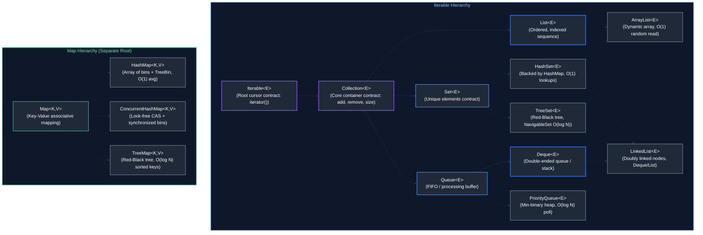
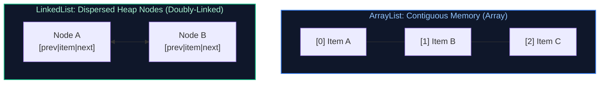
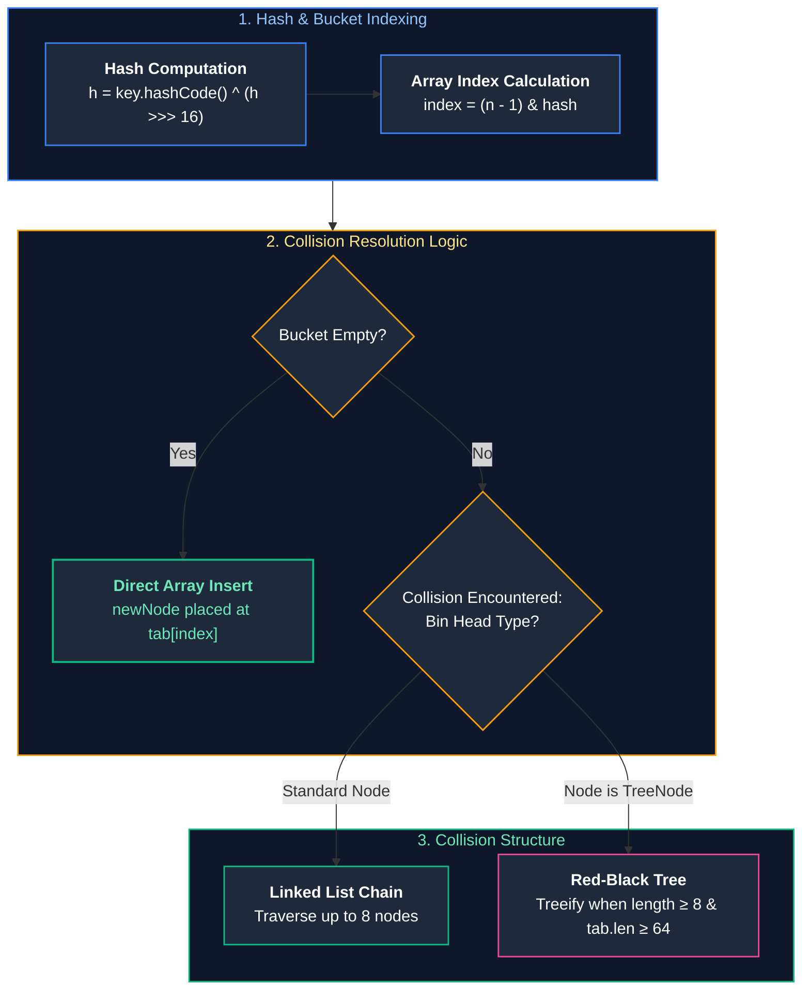
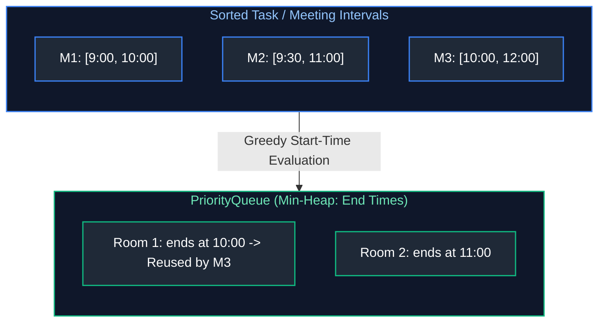
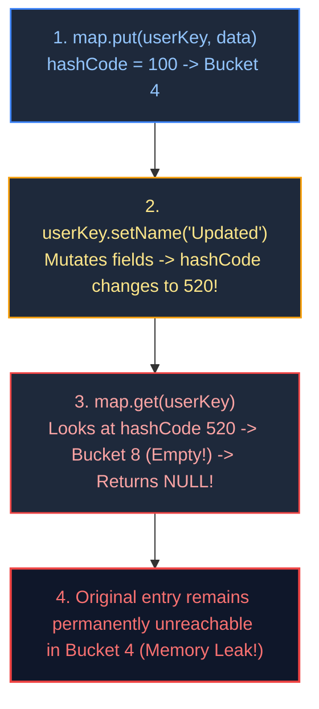
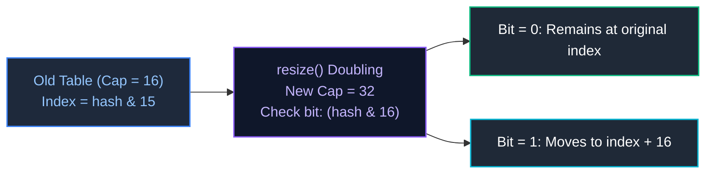
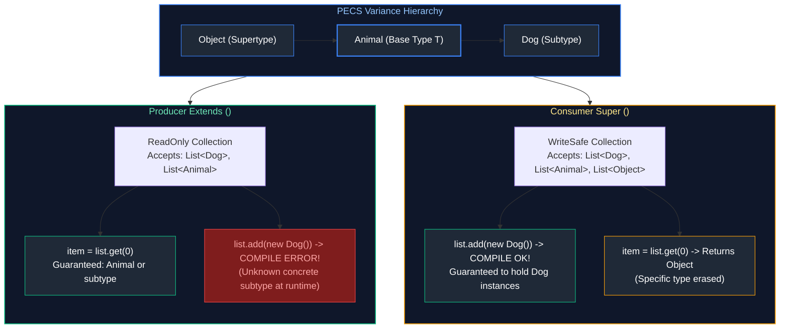
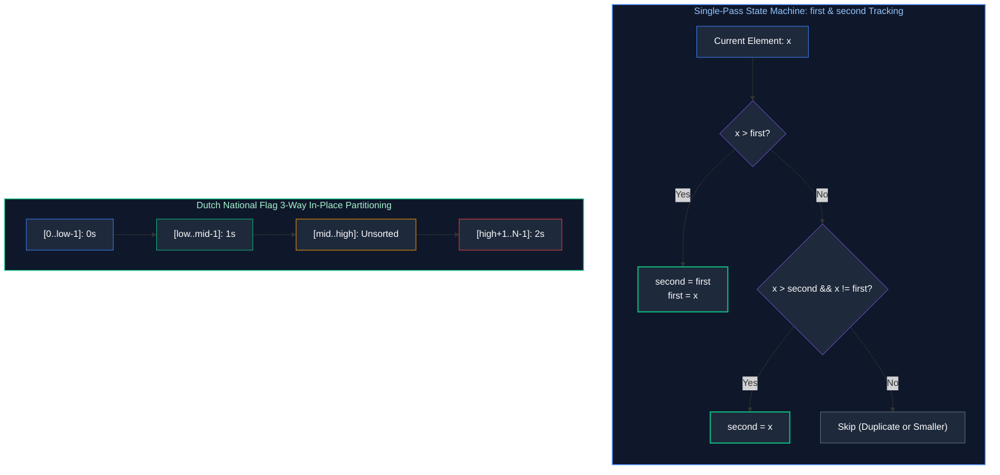
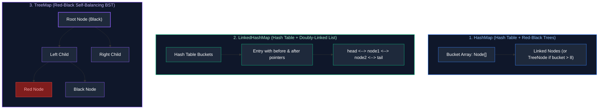

# 02. Java Collections Framework & Data Structures

A comprehensive guide answering all 34 frequently asked interview questions on the Java Collections Framework, internal data structure mechanics, time complexities, thread safety, hash collisions, and practical algorithmic problems.

---

## Architectural Overview: Java Collections Hierarchy & Map Tree



---

## Table of Contents & Question Mapping

1. **Core Collection Contracts & List Implementations**
   - [Q1. `List` vs `Set` Interfaces](#q1-easy-list-vs-set-interfaces)
   - [Q2. `ArrayList` vs `LinkedList`](#q2-easy-arraylist-vs-linkedlist)
   - [Q3. `Arrays.asList()` vs `List.of()` vs `new ArrayList<>()`](#q3-easy-arraysaslist-vs-listof-vs-new-arraylist)
2. **Set Implementations & Uniqueness Mechanics**
   - [Q4. `HashSet` vs `LinkedHashSet` vs `TreeSet`](#q4-easy-hashset-vs-linkedhashset-vs-treeset)
   - [Q5. `HashSet` Internal Working & Uniqueness Guarantee](#q5-medium-hashset-internal-working--uniqueness-guarantee)
3. **Map Internals, Hashing & Concurrency**
   - [Q6. The `hashCode()` and `equals()` Contract & Custom Keys](#q6-medium-the-hashcode-and-equals-contract--custom-keys)
   - [Q7. `HashMap` Internals: Capacity, Load Factor, Resizing, Null Keys & Collisions](#q7-medium-hashmap-internals-capacity-load-factor-resizing-null-keys--collisions)
   - [Q8. `HashMap` vs `ConcurrentHashMap` vs `Hashtable` & Concurrency Mechanics](#q8-hard-hashmap-vs-concurrenthashmap-vs-hashtable--concurrency-mechanics)
   - [Q9. `WeakHashMap` vs `HashMap`](#q9-medium-weakhashmap-vs-hashmap)
   - [Q10. `TreeMap` Red-Black Tree Sorting & Null Keys](#q10-medium-treemap-red-black-tree-sorting--null-keys)
   - [Q11. `EnumSet` and `EnumMap`](#q11-medium-enumset-and-enummap)
4. **Queues, Iterators & Sorting Mechanics**
   - [Q12. `Queue` vs `Deque`](#q12-medium-queue-vs-deque)
   - [Q13. `PriorityQueue` Internal Working](#q13-medium-priorityqueue-internal-working)
   - [Q14. `poll()` vs `peek()` vs `remove()`](#q14-easy-poll-vs-peek-vs-remove)
   - [Q15. `Iterator` vs `ListIterator`](#q15-easy-iterator-vs-listiterator)
   - [Q16. Fail-Fast vs Fail-Safe, `ConcurrentModificationException` & Safe Removal](#q16-medium-fail-fast-vs-fail-safe-concurrentmodificationexception--safe-removal)
   - [Q17. `Comparable` vs `Comparator`](#q17-easy-comparable-vs-comparator)
   - [Q18. Stable vs In-Place Sorting Algorithms](#q18-medium-stable-vs-in-place-sorting-algorithms)
   - [Q19. Creating Truly Immutable Collections](#q19-medium-creating-truly-immutable-collections)
   - [Q20. Handling Large Datasets in Memory Using Collections](#q20-hard-handling-large-datasets-in-memory-using-collections)
5. **Collection Coding Scenarios & Algorithms**
   - [Q21. Filter Employees by Salary > 10,000](#q21-medium-filter-employees-by-salary--10000)
   - [Q22. Rearrange List: Min at First Index, Max at Last Index](#q22-medium-rearrange-list-min-at-first-index-max-at-last-index)
   - [Q23. Finding Frequency of Elements & Most Frequent Element](#q23-medium-finding-frequency-of-elements--most-frequent-element)
   - [Q24. LRU Cache Implementation with $O(1)$ Operations](#q24-hard-lru-cache-implementation-with-o1-operations)
   - [Q25. Sorting a `Map` by Values](#q25-medium-sorting-a-map-by-values)
   - [Q26. Meeting Rooms II: Greedy Interval Scheduling via Min-Heap (`PriorityQueue`)](#q26-medium-meeting-rooms-ii-greedy-interval-scheduling-via-min-heap-priorityqueue)
   - [Q27. Finding the Nth-Largest Element Using a Min-Heap (`PriorityQueue`)](#q27-medium-finding-the-nth-largest-element-using-a-min-heap-priorityqueue)
   - [Q28. Can HashMap Keys Be Mutable? Key Mutation Pitfalls & Memory Leaks](#q28-medium-can-hashmap-keys-be-mutable-key-mutation-pitfalls--memory-leaks)
   - [Q29. HashMap Rehashing Internals, Threshold Triggers & Bitwise Power-of-Two Indexing](#q29-hard-hashmap-rehashing-internals-threshold-triggers--bitwise-power-of-two-indexing)
   - [Q30. Java Generics PECS Rule (`? extends T` vs `? super T`) & Optional Idiomatic Usage](#q30-medium-java-generics-pecs-rule--extends-t-vs--super-t--optional-idiomatic-usage)
   - [Q31. Single-Pass $O(N)$ Second-Highest Element Discovery & Non-Comparison Array Sorting (Dutch National Flag)](#q31-medium-single-pass-on-second-highest-element-discovery--non-comparison-array-sorting-dutch-national-flag)
   - [Q32. HashMap vs LinkedHashMap vs TreeMap: Memory Topology, Access-Order LRU Eviction & Red-Black Tree Invariants](#q32-medium-hashmap-vs-linkedhashmap-vs-treemap-memory-topology-access-order-lru-eviction--red-black-tree-invariants)
---

# 1. Core Collection Contracts & List Implementations

---

### Q1. [Easy] `List` vs `Set` Interfaces
**Difficulty:** [Easy]
**Topic Covered:** Core Collection Abstractions  
- **`List`:** Ordered sequence preserving insertion order. Elements have indices. Allows duplicates and multiple `null` entries.
- **`Set`:** Unordered mathematical set. Prohibits duplicate elements. Allows at most one `null` element in `HashSet`.

---

### Q2. [Easy] `ArrayList` vs `LinkedList`
**Difficulty:** [Easy]
**Topic Covered:** Sequential Data Structures & Memory Locality  



| Operation | `ArrayList` | `LinkedList` |
| :--- | :--- | :--- |
| **Random Access `get(i)`** | $O(1)$ | $O(N)$ |
| **Insertion at Tail** | Amortized $O(1)$ | $O(1)$ |
| **Insertion at Head/Middle** | $O(N)$ | $O(1)$ (once node reached) |
| **Memory & CPU Cache** | Compact, contiguous CPU cache lines. | Heavy memory overhead (24B Node object per item) causing cache misses. |

*Always prefer `ArrayList` in production.*

---

### Q3. [Easy] `Arrays.asList()` vs `List.of()` vs `new ArrayList<>()`
**Difficulty:** [Easy]
*(Grouped together: List Instantiation Factories and Mutability Contracts)*  
**Topic Covered:** List Creation Mechanisms & Mutability Guarantees  

| Feature | `new ArrayList<>(...)` | `Arrays.asList(...)` | `List.of(...)` (Java 9+) |
| :--- | :--- | :--- | :--- |
| **Mutability** | **Fully Mutable** (`add`, `remove`, `set`). | **Fixed-size view** (`set` allowed, `add`/`remove` throw exception). | **Completely Immutable** (modifications throw exception). |
| **Backing Storage** | Independent heap array. | Backed by the exact array passed in (mutates original array). | Compact immutable optimized list. |
| **Null Tolerance** | Permits `null`. | Permits `null`. | **Throws `NullPointerException`**. |

---

# 2. Set Implementations & Uniqueness Mechanics

---

### Q4. [Easy] `HashSet` vs `LinkedHashSet` vs `TreeSet`
**Difficulty:** [Easy]
**Topic Covered:** Set Implementations & Big-O Characteristics  

| Implementation | Underlying Structure | Element Ordering | Time Complexity | Null Support |
| :--- | :--- | :--- | :--- | :--- |
| **`HashSet`** | `HashMap` instance | Unordered | $O(1)$ amortized | Permits 1 `null` |
| **`LinkedHashSet`** | `LinkedHashMap` | Insertion-order | $O(1)$ amortized | Permits 1 `null` |
| **`TreeSet`** | `TreeMap` (Red-Black tree) | Sorted order | $O(\log N)$ | **No nulls** (throws NPE) |

---

### Q5. [Medium] `HashSet` Internal Working & Uniqueness Guarantee
**Difficulty:** [Medium]
**Topic Covered:** `HashSet` Encapsulation & Backing Map  
Every `HashSet` wraps an internal `HashMap<E, Object>` instance. Adding element `set.add(e)` invokes `map.put(e, PRESENT)` where `PRESENT` is a static dummy `new Object()`. Since `HashMap` replaces existing duplicate keys and returns previous value, uniqueness is guaranteed.

---

# 3. Map Internals, Hashing & Concurrency

---

### Q6. [Medium] The `hashCode()` and `equals()` Contract & Custom Keys
**Difficulty:** [Medium]
*(Grouped together: Hashing Contracts and Custom Object Keys)*  
**Topic Covered:** Hashing Mechanics & Map Key Invariants  
1. If two objects are equal according to `equals(Object)`, they **MUST** produce identical `hashCode()` integers.
2. If two objects have equal `hashCode()`, they are not necessarily equal (Hash Collision).
3. If `equals()` is overridden without `hashCode()`, identical entities land in different buckets, returning `null` when fetched from `HashMap`.
- Always override both using the same fields, and ensure key fields are **immutable** (`final`).

---

### Q7. [Medium] `HashMap` Internals: Capacity, Load Factor, Resizing, Null Keys & Collisions
**Difficulty:** [Medium]
*(Grouped together: Complete HashMap Deep Dive)*  
**Topic Covered:** `HashMap` Internal Architecture  



- **Initial Capacity:** 16 (always a power of 2).
- **Load Factor:** 0.75.
- **Threshold:** $16 \times 0.75 = 12$. Doubles capacity to 32 upon crossing.
- **Null Keys:** Stored strictly at **bucket index 0** (hash forced to 0).
- **Treeification:** Buckets with $\ge 8$ colliding elements convert into Red-Black Trees if capacity $\ge 64$ ($O(\log N)$ worst-case). Untreeifies below 6 during shrink.

---

### Q8. [Hard] `HashMap` vs `ConcurrentHashMap` vs `Hashtable` & Concurrency Mechanics
**Difficulty:** [Hard]
*(Grouped together: Concurrent Map Architecture)*  
**Topic Covered:** Multi-Threaded Map Locking Strategies  
- **`HashMap`:** Not thread-safe. Concurrent writes cause data loss or infinite loops.
- **`Hashtable`:** Thread-safe via global `synchronized` lock on entire table (severe bottleneck). Prohibits null keys/values.
- **`ConcurrentHashMap` (Java 8+):** Lock-free volatile reads + CAS for empty buckets + synchronized lock on individual bucket heads. High concurrent throughput. Prohibits null keys/values.

---

### Q9. [Medium] `WeakHashMap` vs `HashMap`
**Difficulty:** [Medium]
**Topic Covered:** Garbage Collection & Reference Types  
In `WeakHashMap`, keys are wrapped in `WeakReference`. When a key is no longer strongly referenced outside the map, the Garbage Collector purges the entry automatically.

---

### Q10. [Medium] `TreeMap` Red-Black Tree Sorting & Null Keys
**Difficulty:** [Medium]
*(Grouped together: Ordered Map Mechanics)*  
**Topic Covered:** Balanced Search Trees & Key Comparison  
- Backed by Red-Black Tree with $O(\log N)$ search/insertion.
- Does **not** allow `null` keys; calling `key.compareTo()` on `null` throws `NullPointerException`.

---

### Q11. [Medium] `EnumSet` and `EnumMap`
**Difficulty:** [Medium]
**Topic Covered:** High-Performance Enum Collections  
- **`EnumSet`:** Backed by bitwise integer/long bit-vectors. Constant time bit operations with zero memory overhead.
- **`EnumMap`:** Backed by a compact Java array indexed by enum `ordinal()`. Ultra-fast $O(1)$ lookups without hashing overhead.

---

# 4. Queues, Iterators & Sorting Mechanics

---

### Q12. [Medium] `Queue` vs `Deque`
**Difficulty:** [Medium]
**Topic Covered:** Queue Abstractions  
- **`Queue`:** FIFO single-ended collection (`offer()`, `poll()`).
- **`Deque`:** Double-ended queue supporting insertion and removal at both ends (`addFirst`, `pollLast`). Replaces legacy `Stack`.

---

### Q13. [Medium] `PriorityQueue` Internal Working
**Difficulty:** [Medium]
**Topic Covered:** Heap Data Structures  
Backed by a **Min-Heap array**. Root is always smallest element ($O(1)$ peek). Insertion (`offer`) and removal (`poll`) run in $O(\log N)$ via heapify operations.

---

### Q14. [Easy] `poll()` vs `peek()` vs `remove()`
**Difficulty:** [Easy]
**Topic Covered:** Queue API Failure Handling  
- `peek()`: Returns `null` if empty; does not remove.
- `poll()`: Returns `null` if empty; retrieves and removes head.
- `remove()`: Throws `NoSuchElementException` if empty; retrieves and removes head.

---

### Q15. [Easy] `Iterator` vs `ListIterator`
**Difficulty:** [Easy]
**Topic Covered:** Collection Traversal  
- `Iterator`: Forward-only traversal for all collections. Supports only `remove()`.
- `ListIterator`: Bi-directional traversal strictly for `List`. Supports `add()`, `set()`, and index queries.

---

### Q16. [Medium] Fail-Fast vs Fail-Safe, `ConcurrentModificationException` & Safe Removal
**Difficulty:** [Medium]
*(Grouped together: Iteration Safety and Structural Modification)*  
**Topic Covered:** Iterator Modification Mechanics  
- **Fail-Fast:** Iterators check internal `modCount`. Modifying the collection outside the iterator throws `ConcurrentModificationException`.
- **Fail-Safe / Weakly Consistent:** Iterates over snapshots or volatile chains (`CopyOnWriteArrayList`, `ConcurrentHashMap`). Never throws exception.
- **Safe Removal:** Use `it.remove()` or modern Java 8+ `list.removeIf(predicate)`.

---

### Q17. [Easy] `Comparable` vs `Comparator`
**Difficulty:** [Easy]
**Topic Covered:** Sorting Contracts  
- `Comparable<T>`: Implemented by domain class (`int compareTo(T o)`). Defines natural ordering.
- `Comparator<T>`: External strategy (`int compare(T o1, T o2)`). Defines custom/multiple orderings.

---

### Q18. [Medium] Stable vs In-Place Sorting Algorithms
**Difficulty:** [Medium]
**Topic Covered:** Sorting Theory  
- **Stable:** Preserves relative order of equal keys (e.g., `TimSort`).
- **In-Place:** Modifies array using $O(1)$ auxiliary memory (e.g., Quicksort).

---

### Q19. [Medium] Creating Truly Immutable Collections
**Difficulty:** [Medium]
**Topic Covered:** Immutability Contracts  
- `List.of()`, `Set.of()`, `Map.of()` (Java 9+): Truly immutable compact collections.
- `Collections.unmodifiableList(list)`: View wrapper; still reflects changes made to the underlying list.

---

### Q20. [Hard] Handling Large Datasets in Memory Using Collections
**Difficulty:** [Hard]
**Topic Covered:** Memory Optimization  
1. Use primitive arrays (`int[]`) or specialized libraries (`fastutil`) instead of boxed wrappers (`List<Integer>`) to eliminate object header overhead.
2. Pre-size collections with expected capacity: `new ArrayList<>(1_000_000)`.
3. Process data via streams or off-heap buffers (`ByteBuffer.allocateDirect`) rather than loading everything into heap memory.

---

# 5. Collection Coding Scenarios & Algorithms

---

### Q21. [Medium] Filter Employees by Salary > 10,000
**Difficulty:** [Medium]
**Topic Covered:** Stream Filtering  

```java
public record Employee(int id, String name, double salary) {}

public List<Employee> filterHighEarners(List<Employee> employees) {
    return employees.stream()
            .filter(e -> e.salary() > 10_000.0)
            .toList();
}
```

---

### Q22. [Medium] Rearrange List: Min at First Index, Max at Last Index
**Difficulty:** [Medium]
**Topic Covered:** Array Manipulation  

```java
public static List<Integer> rearrange(List<Integer> list) {
    if (list == null || list.size() <= 2) return list;
    int minVal = Collections.min(list);
    int maxVal = Collections.max(list);
    int minIdx = list.indexOf(minVal);
    int maxIdx = list.indexOf(maxVal);

    List<Integer> result = new ArrayList<>(list.size());
    result.add(minVal);
    for (int i = 0; i < list.size(); i++) {
        if (i != minIdx && i != maxIdx) result.add(list.get(i));
    }
    result.add(maxVal);
    return result;
}
```

---

### Q23. [Medium] Finding Frequency of Elements & Most Frequent Element
**Difficulty:** [Medium]
*(Grouped together: Frequency Hashing and Mode Calculation)*  
**Topic Covered:** Frequency Analysis  

```java
// Q33: Calculate frequency of each element
public static <T> Map<T, Long> calculateFrequencies(List<T> items) {
    return items.stream().collect(Collectors.groupingBy(Function.identity(), Collectors.counting()));
}

// Q31: Find most frequent element
public static <T> T findMostFrequent(List<T> items) {
    return calculateFrequencies(items).entrySet().stream()
            .max(Map.Entry.comparingByValue())
            .map(Map.Entry::getKey)
            .orElseThrow();
}
```

---

### Q24. [Hard] LRU Cache Implementation with $O(1)$ Operations
**Difficulty:** [Hard]
**Topic Covered:** Custom Data Structure Architecture  

```java
import java.util.LinkedHashMap;
import java.util.Map;

public class LRUCache<K, V> extends LinkedHashMap<K, V> {
    private final int capacity;

    public LRUCache(int capacity) {
        super(capacity, 0.75f, true); // true enables access-order
        this.capacity = capacity;
    }

    @Override
    protected boolean removeEldestEntry(Map.Entry<K, V> eldest) {
        return size() > capacity; // O(1) eviction
    }
}
```

---

### Q25. [Medium] Sorting a `Map` by Values
**Difficulty:** [Medium]
**Topic Covered:** Map Entry Sorting  

```java
public static <K, V extends Comparable<? super V>> Map<K, V> sortByValue(Map<K, V> map) {
    return map.entrySet().stream()
            .sorted(Map.Entry.comparingByValue())
            .collect(Collectors.toMap(
                    Map.Entry::getKey,
                    Map.Entry::getValue,
                    (e1, e2) -> e1,
                    LinkedHashMap::new
            ));
}
```

---

### Q26. [Medium] Meeting Rooms II: Greedy Interval Scheduling via Min-Heap (`PriorityQueue`)
**Topic Covered:** PriorityQueue Mechanics & Greedy Resource Scheduling  
**Difficulty:** `[Medium]`

#### Architectural Overview
When allocating concurrent resources (e.g., meeting rooms, thread workers, database connections) across overlapping intervals, sort the intervals by `start_time` ascending. Use a `PriorityQueue<Integer>` (min-heap) to track the active intervals' `end_time` values. If the meeting starting now begins after the earliest ending meeting (`start >= heap.peek()`), the room can be reused (`heap.poll()`). The peak size of the heap represents the minimum concurrent resources required.



#### Production Code
```java
package com.enterprise.collections;

import java.util.Arrays;
import java.util.Comparator;
import java.util.PriorityQueue;

public final class MeetingRoomAllocator {

    public record Interval(int start, int end) {}

    public static int minMeetingRooms(Interval[] intervals) {
        if (intervals == null || intervals.length == 0) return 0;

        Arrays.sort(intervals, Comparator.comparingInt(Interval::start));
        PriorityQueue<Integer> allocator = new PriorityQueue<>(intervals.length);

        allocator.offer(intervals[0].end());

        for (int i = 1; i < intervals.length; i++) {
            if (intervals[i].start() >= allocator.peek()) {
                allocator.poll(); // Room vacated and reused
            }
            allocator.offer(intervals[i].end()); // Allocate room
        }

        return allocator.size();
    }
}
```

* **Complexity**: Time $O(N \log N)$ sorting and heap operations; Space $O(N)$ priority queue storage.

---

### Q27. [Medium] Finding the Nth-Largest Element Using a Min-Heap (`PriorityQueue`)
**Topic Covered:** PriorityQueue Bounded Buffers  
**Difficulty:** `[Medium]`

#### Architectural Overview
To find the $K$-th (or $N$-th) largest element in an unbounded stream or unsorted collection without sorting the entire array ($O(N \log N)$), maintain a **Min-Heap of fixed capacity $K$**. For every incoming element, push to heap; if size exceeds $K$, poll the smallest element. At the end, the root of the heap (`peek()`) is the $K$-th largest element.

```java
package com.enterprise.collections;

import java.util.PriorityQueue;

public final class TopKSelector {

    /**
     * Finds the K-th largest element using an O(K) space min-heap.
     * Time Complexity: O(N log K) | Space Complexity: O(K)
     */
    public static int findKthLargest(int[] nums, int k) {
        if (nums == null || k <= 0 || k > nums.length) {
            throw new IllegalArgumentException("Invalid input parameters");
        }

        PriorityQueue<Integer> minHeap = new PriorityQueue<>(k);

        for (int num : nums) {
            minHeap.offer(num);
            if (minHeap.size() > k) {
                minHeap.poll(); // Eject smaller numbers
            }
        }

        return minHeap.peek();
    }
}
```

* **Complexity**: Time $O(N \log K)$ significantly faster than $O(N \log N)$ when $K \ll N$; Auxiliary Space $O(K)$.

---

### Q28. [Medium] Can HashMap Keys Be Mutable? Key Mutation Pitfalls & Memory Leaks
**Topic Covered:** Hashing Contract & Map Key Mutability  
**Difficulty:** `[Medium]`

#### Architectural Overview
While Java permits using mutable objects as `HashMap` keys, it is an **enterprise anti-pattern**. When an object's fields mutate after being inserted into a `HashMap`, its `hashCode()` changes. When searching with `map.get(key)`, the map calculates the *new* hash code and looks in the wrong bucket, returning `null` even though the key-value pair exists in memory! Furthermore, the entry can never be removed or evicted, creating a silent **memory leak**.



* **Production Rule**: Always make `Map` keys strictly **immutable** (e.g., `String`, `UUID`, `Long`, or Java 17+ `record` with primitive/immutable components).

---

### Q29. [Hard] HashMap Rehashing Internals, Threshold Triggers & Bitwise Power-of-Two Indexing
**Topic Covered:** `HashMap` Capacity, Load Factor & Resizing Architecture  
**Difficulty:** `[Hard]`

#### Architectural Overview
When `size > capacity * loadFactor` (default threshold $= 16 \times 0.75 = 12$ entries), `HashMap.resize()` doubles the table capacity ($16 \to 32 \to 64$).
Because table size is always a power of 2, the bucket index is computed via bitwise AND: `index = (n - 1) & hash`.
During resizing, elements either stay at the same index or move to `index + oldCapacity`, determined by whether the next bit in the hash is 0 or 1 (`(e.hash & oldCap) == 0`). This eliminates recalculating expensive modulo operations during rehashing.



* **Complexity**: Resizing takes $O(N)$ amortized over insertions; single `put()` operation remains $O(1)$.
* **Production Rule**: When expected element count $E$ is known upfront, initialize map with `new HashMap<>((int) (E / 0.75f) + 1)` to eliminate all resizing pauses.

---

### Q30. [Medium] Java Generics PECS Rule (`? extends T` vs `? super T`) & Optional Idiomatic Usage
**Difficulty:** [Medium]
**Topic Covered:** Generics Variance, Wildcards (PECS) & Optional Design Patterns  
**Question:** Optional and Generics: extends vs. super. Explain when to use `? extends` versus `? super` (PECS rule) and how Optional should be used idiomatically in production API design.

#### Definition & Core Concepts
Generics in Java are **invariant**: `List<String>` is not a subtype of `List<Object>`, even though `String` is a subtype of `Object`. This invariance guarantees type safety at compile-time, preventing heap pollution (such as adding an `Integer` to what was originally a list of strings). However, strict invariance restricts API flexibility.

To re-introduce flexible polymorphism, Java provides wildcard variance using Joshua Bloch's mnemonic: **PECS (Producer Extends, Consumer Super)**:
1. **Producer Extends (`? extends T` — Covariance):**
   - If your method reads/produces items of type $T$ from a generic collection parameter, declare it as `<? extends T>`.
   - The collection can hold $T$ or any subtype of $T$.
   - **Restriction:** You can read from the collection safely (elements are guaranteed to be at least of type $T$), but you **cannot write/add** any item (except literal `null`) because the compiler cannot verify the concrete subtype at runtime.
2. **Consumer Super (`? super T` — Contravariance):**
   - If your method writes/consumes items of type $T$ into a generic collection parameter, declare it as `<? super T>`.
   - The collection can hold $T$ or any supertype of $T$ (up to `Object`).
   - **Restriction:** You can safely write elements of type $T$ (or its subtypes) into the collection, but reads yield only generic `Object` references.

**Idiomatic `Optional<T>` Design Rules:**
- `Optional<T>` was introduced in Java 8 strictly as a **method return type** to signify that a result may be absent (eliminating silent `NullPointerException`).
- **Anti-Patterns:**
  - Never use `Optional<T>` as method parameters (forces callers to wrap arguments with `Optional.ofNullable()`).
  - Never use `Optional<T>` as class fields or JPA entity attributes (`Optional` does not implement `Serializable`).
  - Never use `Optional<T>` as `Map` keys or collection elements.
  - Never call `optional.get()` without checking `optional.isPresent()`; use `.orElseThrow()`, `.map()`, `.flatMap()`, or `.orElseGet()`.

#### Visual Flow


#### Production Implementation / Code Solution
```java
package com.enterprise.generics;

import java.util.*;

public final class PecsAndOptionalDemo {

    public static class Animal { public String name() { return "Animal"; } }
    public static class Dog extends Animal { @Override public String name() { return "Dog"; } }
    public static class Cat extends Animal { @Override public String name() { return "Cat"; } }

    /**
     * Canonical PECS Example: Copying elements from a Producer (src) to a Consumer (dest).
     * src PRODUCES elements of type T (so ? extends T).
     * dest CONSUMES elements of type T (so ? super T).
     */
    public static <T> void copy(List<? super T> dest, List<? extends T> src) {
        for (T item : src) {
            dest.add(item); // Allowed because dest is a consumer of T
        }
    }

    /**
     * Idiomatic Optional API: Service method returning an Optional instead of null.
     */
    public record User(String id, String email, Optional<String> middleName) {} // Anti-pattern in fields!

    public record EnterpriseUser(String id, String email, String middleName) {
        // Correct Pattern: Return Optional from accessor if field can be absent
        public Optional<String> getMiddleName() {
            return Optional.ofNullable(middleName);
        }
    }

    public static Optional<EnterpriseUser> findUserById(Map<String, EnterpriseUser> repo, String id) {
        return Optional.ofNullable(repo.get(id));
    }

    public static String resolveUserDisplayName(Map<String, EnterpriseUser> repo, String userId) {
        // Idiomatic functional chain: map -> orElseGet (never call .get() directly)
        return findUserById(repo, userId)
            .flatMap(EnterpriseUser::getMiddleName)
            .map(mid -> "User Middle: " + mid)
            .orElseGet(() -> "Default Anonymous User");
    }
}
```
- **Time Complexity:** $O(N)$ for copying $N$ elements; $O(1)$ for `Optional` functional transformations.
- **Space Complexity:** $O(1)$ auxiliary overhead.

#### Engineering Implications & Production Pitfalls
1. **The `Optional.get()` NoSuchElementException Anti-Pattern:** Calling `.get()` directly on an `Optional` without checking `.isPresent()` reintroduces the exact same crash risk as a `NullPointerException`. Always use `.orElseThrow(() -> new EntityNotFoundException(...))` or functional operators (`.map()`, `.filter()`).
2. **Collection Invariance Trap:** Trying to pass `List<Dog>` to a method expecting `List<Animal>` causes a compile error. Changing the signature to `List<? extends Animal>` enables callers to pass `List<Dog>`, `List<Cat>`, or `List<Animal>` seamlessly.

#### Core Curriculum Cross-Reference
*Deep-dive theoretical reference: See [02. Java Collections Framework & Generics](../02_java_collections_and_generics.md#02-java-collections-framework--generics)*

---

### Q31. [Medium] Single-Pass $O(N)$ Second-Highest Element Discovery & Non-Comparison Array Sorting (Dutch National Flag)
**Difficulty:** [Medium]
**Topic Covered:** In-Place Linear Array Manipulation, Constant Space State Tracking, and 3-Way Partitioning  
**Definition:** Finding the second-highest distinct integer in an unsorted array without using built-in sorting or nested loops requires maintaining two state variables (`first` and `second`) updated in a single $O(N)$ pass. Similarly, sorting bounded integer arrays without standard sorting utilizes non-comparison counting or the $O(N)$ Dutch National Flag 3-way pointer algorithm.

#### Architectural Mechanics & Core Concepts



#### Production-Grade Implementation

```java
package com.enterprise.collections.algorithms;

import java.util.NoSuchElementException;

public final class ArrayManipulationAlgorithms {

    /**
     * Finds the second highest DISTINCT element in an array in a single O(N) pass.
     * Handles negative numbers, duplicates, and arrays with fewer than 2 distinct values.
     */
    public static int findSecondHighest(int[] nums) {
        if (nums == null || nums.length < 2) {
            throw new IllegalArgumentException("Array must contain at least two elements");
        }

        Integer first = null;
        Integer second = null;

        for (int x : nums) {
            if (first == null || x > first) {
                second = first;
                first = x;
            } else if (x < first && (second == null || x > second)) {
                second = x;
            }
        }

        if (second == null) {
            throw new NoSuchElementException("Array does not contain a distinct second highest element");
        }
        return second;
    }

    /**
     * Sorts an array containing 0s, 1s, and 2s in-place without using sort()
     * via the Dutch National Flag 3-pointer algorithm.
     */
    public static void sortZeroOneTwo(int[] arr) {
        if (arr == null || arr.length <= 1) return;

        int low = 0;
        int mid = 0;
        int high = arr.length - 1;

        while (mid <= high) {
            if (arr[mid] == 0) {
                swap(arr, low++, mid++);
            } else if (arr[mid] == 1) {
                mid++;
            } else { // arr[mid] == 2
                swap(arr, mid, high--);
            }
        }
    }

    private static void swap(int[] arr, int i, int j) {
        int temp = arr[i];
        arr[i] = arr[j];
        arr[j] = temp;
    }
}
```

#### Complexity & Performance Analysis
- **Time Complexity:** $O(N)$ strict single-pass linear time. Exactly $N$ comparisons for `findSecondHighest`; at most $N$ swaps for `sortZeroOneTwo`.
- **Space Complexity:** $O(1)$ auxiliary memory (zero heap allocations, purely primitive register variables).

#### Engineering Implications & Production Pitfalls
1. **The `Integer.MIN_VALUE` Initialization Trap:** Initializing `first = Integer.MIN_VALUE` and `second = Integer.MIN_VALUE` fails when the array contains `Integer.MIN_VALUE` as a valid element (e.g., `[-2147483648, -2147483648]`). Using nullable `Integer` wrappers or boolean flag sentinels guarantees correctness across the full 32-bit two's complement integer space.
2. **Duplicate Value Pitfall:** If `nums = [10, 10, 8]`, sorting with a simple max index would return `10` as second max. Checking `x < first` explicitly ensures strict distinct ordering (`8`).

#### Core Curriculum Cross-Reference
*Deep-dive theoretical reference: See [02. Java Collections Framework & Generics: Array Mechanics](../02_java_collections_and_generics.md#02-java-collections-framework--generics)*

---

### Q32. [Medium] HashMap vs LinkedHashMap vs TreeMap: Memory Topology, Access-Order LRU Eviction & Red-Black Tree Invariants
**Difficulty:** [Medium]
**Topic Covered:** Map Topologies, Cache Eviction Architecture, and Logarithmic vs Constant Lookups  
**Definition:** `HashMap`, `LinkedHashMap`, and `TreeMap` are Java's primary `Map` implementations, differing fundamentally in underlying data structures (Hash Table vs Hash Table + Doubly-Linked List vs Self-Balancing Red-Black Tree), ordering semantics, iteration complexity, and thread safety.

#### Architectural Mechanics & Core Concepts



Detailed Comparison Matrix:

| Feature | `HashMap` | `LinkedHashMap` | `TreeMap` |
| :--- | :--- | :--- | :--- |
| **Underlying Data Structure** | Array of Buckets + Singly-Linked Lists / Red-Black Trees | Hash Table + Global Doubly-Linked List across entries | Red-Black Tree (Self-Balancing Binary Search Tree) |
| **Lookup / Insert Complexity** | $O(1)$ amortized, $O(\log N)$ worst-case collision | $O(1)$ amortized | $O(\log N)$ guaranteed worst-case |
| **Iteration Order** | Non-deterministic (arbitrary bucket order) | **Insertion-Order** or **Access-Order** (LRU) | **Natural Order** (`Comparable`) or custom `Comparator` |
| **Iteration Complexity** | $O(\text{Capacity} + N)$ | $O(N)$ (directly traverses doubly-linked list) | $O(N)$ in-order tree traversal |
| **Null Key Support** | Yes (stored in bucket 0) | Yes (stored in bucket 0) | **No** (throws `NullPointerException` with natural comparator) |
| **Memory Overhead** | 32 bytes per node | 48 bytes per entry (`before` + `after` pointers) | 40 bytes per entry (`left`, `right`, `parent`, `color`) |

#### Production-Grade Implementation: LRU Cache via LinkedHashMap

```java
package com.enterprise.collections.maps;

import java.util.LinkedHashMap;
import java.util.Map;

/**
 * Production thread-safe Least Recently Used (LRU) Cache backed by LinkedHashMap in access-order mode.
 */
public class ProductionLruCache<K, V> extends LinkedHashMap<K, V> {

    private final int maxCapacity;

    public ProductionLruCache(int maxCapacity) {
        // initialCapacity, loadFactor = 0.75f, accessOrder = true
        super(maxCapacity, 0.75f, true);
        this.maxCapacity = maxCapacity;
    }

    /**
     * Invoked by put() and putAll() after inserting a new entry.
     * Automatically evicts the oldest (eldest) entry when capacity is breached.
     */
    @Override
    protected boolean removeEldestEntry(Map.Entry<K, V> eldest) {
        return size() > maxCapacity;
    }

    public synchronized V getSynchronized(K key) {
        return super.get(key);
    }

    public synchronized V putSynchronized(K key, V value) {
        return super.put(key, value);
    }
}
```

#### Complexity & Performance Analysis
- **Time Complexity:** $O(1)$ constant time reads and writes in `ProductionLruCache`. When an entry is accessed via `get()`, `LinkedHashMap` splices it out of its current position and appends it to the tail of the doubly-linked list in $O(1)$ pointer operations.
- **Space Complexity:** $O(N)$ where $N \le \text{maxCapacity}$.

#### Engineering Implications & Production Pitfalls
1. **Concurrency Hazard in Access-Order LinkedHashMap:** Unlike `HashMap` where `get()` is a read-only operation, calling `get()` on a `LinkedHashMap(..., true)` **mutates the underlying doubly-linked list** by moving the accessed node to the tail. Therefore, concurrent `get()` calls without synchronization will corrupt pointers and throw `ConcurrentModificationException` or enter infinite loops.
2. **`TreeMap` and `Comparable` Inconsistency Trap:** `TreeMap` determines equality solely using `compareTo()` or `compare()`, completely ignoring `equals()`. If `compare(a, b) == 0`, `TreeMap` treats them as the identical key even if `a.equals(b) == false`. This violates the general `Map` contract if the comparator is not consistent with `equals`.

#### Core Curriculum Cross-Reference
*Deep-dive theoretical reference: See [02. Java Collections Framework & Generics: Map Architectures](../02_java_collections_and_generics.md#02-java-collections-framework--generics)*

---

## Summary Comparison & Production Reference Matrix

| Scenario Domain | Critical Runtime Pathology | Diagnostic & Triage Method | Canonical Production Resolution |
| :--- | :--- | :--- | :--- |
| **Core Collection Contracts & List Implementations** | High-throughput invariants & concurrency boundaries | Metric instrumentation & trace profiling | Defensive validation & graceful degradation |
| **Set Implementations & Uniqueness Mechanics** | High-throughput invariants & concurrency boundaries | Metric instrumentation & trace profiling | Defensive validation & graceful degradation |
| **Map Internals, Hashing & Concurrency** | High-throughput invariants & concurrency boundaries | Metric instrumentation & trace profiling | Defensive validation & graceful degradation |
| **Queues, Iterators & Sorting Mechanics** | High-throughput invariants & concurrency boundaries | Metric instrumentation & trace profiling | Defensive validation & graceful degradation |
| **Collection Coding Scenarios & Algorithms** | High-throughput invariants & concurrency boundaries | Metric instrumentation & trace profiling | Defensive validation & graceful degradation |
| **Single-Pass Extremum & Non-Comparison Sort** | Quadratic sorting overhead, array out-of-bounds | Two-pointer state tracking, Dutch National Flag partition | Single-pass O(N) traversal, in-place 3-way swap |
| **Map Topologies & LRU Cache Eviction** | Concurrency race on LinkedHashMap get(), TreeMap null crash | jstack contention dump, Comparator consistency audit | Synchronized LRU wrapper, Red-Black self-balancing trees |

---

## References & Further Reading

- [Oracle Java SE 21 Documentation - Collections Framework Overview](https://docs.oracle.com/en/java/javase/21/docs/api/java.base/java/util/doc-files/coll-overview.html)
- [JEP 431: Sequenced Collections](https://openjdk.org/jeps/431) — OpenJDK specification unifying ordered collections in Java 21.
- [Baeldung - The Java Collections Framework Guide](https://www.baeldung.com/category/java/java-collections/)
- [Baeldung - Java Generics and PECS Principle](https://www.baeldung.com/java-generics-pecs)
- [GeeksforGeeks - Java Collections Tutorial](https://www.geeksforgeeks.org/collections-in-java-2/)
- [Joshua Bloch: Effective Java (3rd Edition)](https://www.oreilly.com/library/view/effective-java-3rd/9780134686097/) — Items 26–33 (Generics) and Items 49–56 (Defensive Programming & Collections).
