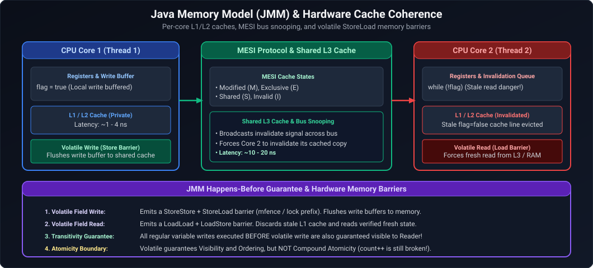
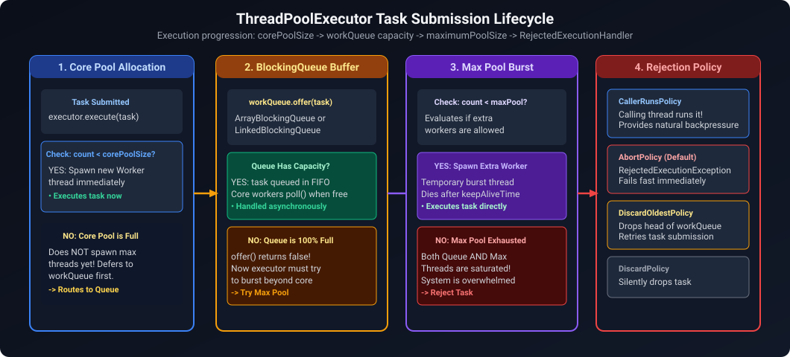
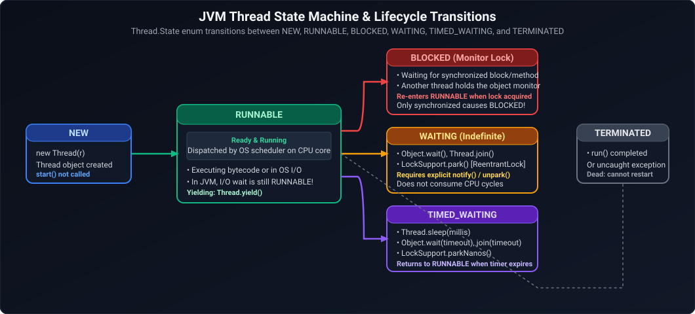
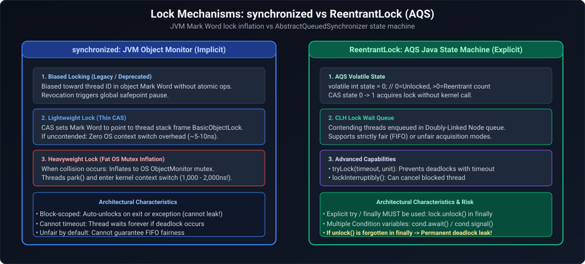
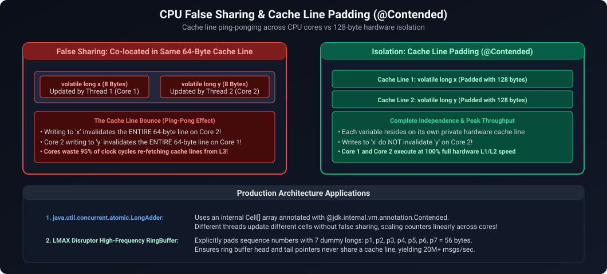
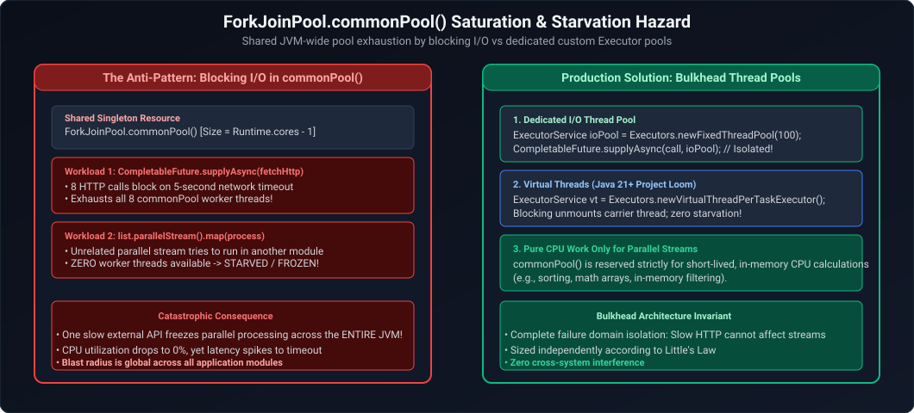
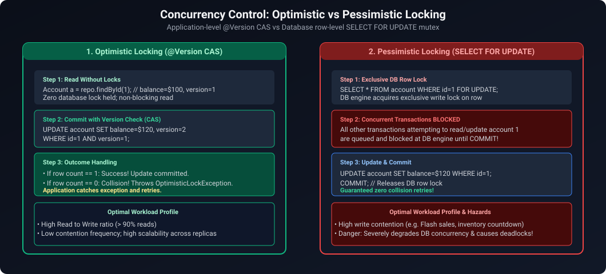

# 04. Java Concurrency, Multithreading & Asynchronous Programming

A comprehensive guide answering all 17 questions on the Java Memory Model (JMM), thread lifecycles, synchronization mechanisms, `volatile`, atomic variables, thread pool engineering, `CompletableFuture`, and production concurrency pitfalls.

---

## Architectural Overview: Java Memory Model (JMM) & Thread Caches



*D2 Source:* [assets/04_java_concurrency_and_multithreading_faq/01_java_memory_model_hardware_cache_coherence.d2](assets/04_java_concurrency_and_multithreading_faq/01_java_memory_model_hardware_cache_coherence.d2)

---

## Table of Contents & Question Mapping

1. **Thread Foundations & Execution Mechanics**
   - [Q1. `Runnable` vs `Callable` & Calling `run()` vs `start()`](#q1-easy-runnable-vs-callable--calling-run-vs-start)
   - [Q2. Why the JVM Fails to Terminate After `main()` Completes](#q2-medium-why-the-jvm-fails-to-terminate-after-main-completes)
2. **Synchronization, Locks & Memory Visibility**
   - [Q3. The `synchronized` Monitor & `sleep()` vs `wait()`](#q3-medium-the-synchronized-monitor--sleep-vs-wait)
   - [Q4. `volatile` vs `AtomicInteger` vs `synchronized`](#q4-medium-volatile-vs-atomicinteger-vs-synchronized)
   - [Q5. Deadlock Conditions, Thread Dumps & Prevention](#q5-hard-deadlock-conditions-thread-dumps--prevention)
3. **Data Races & Thread-Unsafe Scenarios**
   - [Q6. Fixing Inconsistent Shared State (Bank Balance Race Condition)](#q6-hard-fixing-inconsistent-shared-state-bank-balance-race-condition)
   - [Q7. Concurrent Access Hazards on `HashMap` & Fixes](#q7-medium-concurrent-access-hazards-on-hashmap--fixes)
4. **Thread Pools & `ExecutorService` Engineering**
   - [Q8. `ExecutorService` Architecture, Saturated Queues & Silent Failures](#q8-expert-executorservice-architecture-saturated-queues--silent-failures)
5. **Asynchronous Pipelines & Parallel Streams**
   - [Q9. `Future` vs `CompletableFuture`, `thenApply` vs `thenCompose` & Concurrency Optimization](#q9-hard-future-vs-completablefuture-thenapply-vs-thencompose--concurrency-optimization)
   - [Q10. Why Parallel Streams Degrade Production Latency](#q10-hard-why-parallel-streams-degrade-production-latency)
   - [Q11. Orchestrating Asynchronous and Synchronous Remote Calls with `CompletableFuture`](#q11-hard-orchestrating-asynchronous-and-synchronous-remote-calls-with-completablefuture)
   - [Q12. Shared Mutable Object Hazards: Race Conditions, Memory Visibility & JMM](#q12-medium-shared-mutable-object-hazards-race-conditions-memory-visibility--jmm)
   - [Q13. Modern Thread Creation Strategies: Platform Threads, `ExecutorService` & Java 21 Virtual Threads](#q13-easy-modern-thread-creation-strategies-platform-threads-executorservice--java-21-virtual-threads)
   - [Q14. `synchronized` vs `ReentrantLock`: Feature Matrix & Trade-Offs](#q14-medium-synchronized-vs-reentrantlock-feature-matrix--trade-offs)
   - [Q15. ReentrantLock vs ReentrantReadWriteLock: Read/Write Contention & Lock Downgrading](#q15-medium-reentrantlock-vs-reentrantreadwritelock-readwrite-contention--lock-downgrading)
   - [Q16. ThreadLocal Memory Leak Mechanics in Thread Pools & Lifecycle Governance](#q16-medium-threadlocal-memory-leak-mechanics-in-thread-pools--lifecycle-governance)
   - [Q17. The Triad of Thread Coordination: wait(), sleep(), and join() Compared](#q17-medium-the-triad-of-thread-coordination-wait-sleep-and-join-compared)
   - [Q18. Triaging Sudden Thread Explosions in Production (Thousands of Blocked Threads)](#q18-medium-triaging-sudden-thread-explosions-in-production-thousands-of-blocked-threads)
   - [Q19. Why `volatile` Cannot Prevent Lost Updates: Memory Barriers vs Atomic Compound Operations](#q19-medium-why-volatile-cannot-prevent-lost-updates-memory-barriers-vs-atomic-compound-operations)
   - [Q20. CompletableFuture Default Thread Pool Dynamics: `ForkJoinPool.commonPool()` Starvation vs Custom Thread Pool Isolation](#q20-hard-completablefuture-default-thread-pool-dynamics-forkjoinpoolcommonpool-starvation-vs-custom-thread-pool-isolation)
   - [Q21. Thread-Safe High-Volume Payment Account Balance Updates: Optimistic Locking vs Pessimistic Locking vs LMAX Disruptor In-Memory Isolation](#q21-hard-thread-safe-high-volume-payment-account-balance-updates-optimistic-locking-vs-pessimistic-locking-vs-lmax-disruptor-in-memory-isolation)
---

# 1. Thread Foundations & Execution Mechanics

---

### Q1. [Easy] `Runnable` vs `Callable` & Calling `run()` vs `start()`
**Difficulty:** [Easy]
*(Grouped together: Thread invocation and execution contracts)*  
**Topic Covered:** Thread Lifecycle & Task Execution  
- `Runnable`: `void run()`, cannot return value, cannot throw checked exceptions.
- `Callable<V>`: `V call() throws Exception`, returns parameterized value `V`.

#### What happens if you call `run()` directly instead of `start()`?
- `start()` invokes native OS thread creation (`JVM_StartThread`), creates a new call stack, and runs asynchronously.
- `run()` simply executes the method synchronously within the **calling thread's existing stack frame** without creating any new thread.

---

### Q2. [Medium] Why the JVM Fails to Terminate After `main()` Completes
**Difficulty:** [Medium]
**Topic Covered:** JVM Lifecycle & Daemon Threads  
The JVM halts only when all **non-daemon (user) threads** finish or `System.exit()` is called. If `main()` finishes but the application stays alive, active user threads exist (such as an unclosed `ExecutorService` created via `newFixedThreadPool`). Always shut down thread pools gracefully via `executor.shutdown()`.

---

# 2. Synchronization, Locks & Memory Visibility

---

### Q3. [Medium] The `synchronized` Monitor & `sleep()` vs `wait()`
**Difficulty:** [Medium]
*(Grouped together: Monitor locks and thread suspension)*  
**Topic Covered:** Java Intrinsic Monitors  
- `synchronized`: Mutual exclusion lock guaranteeing **Happens-Before** memory visibility.
- `Thread.sleep()`: Pauses execution **without releasing the monitor lock**.
- `Object.wait()`: Must be called inside a `synchronized` block; **releases the monitor lock** so other threads can proceed, resuming upon `notify()` or timeout.

---

### Q4. [Medium] `volatile` vs `AtomicInteger` vs `synchronized`
**Difficulty:** [Medium]
*(Grouped together: Memory Visibility vs Atomicity)*  
**Topic Covered:** Java Memory Model (JMM)  
- `volatile`: Guarantees memory visibility across CPU caches and prevents reordering. Does **not** guarantee atomicity (e.g. `count++` is not thread-safe).
- `AtomicInteger`: Guarantees visibility and atomicity using hardware lock-free Compare-And-Swap (CAS).
- `synchronized`: Mutual exclusion blocking entire critical sections with OS mutexes under contention.

---

### Q5. [Hard] Deadlock Conditions, Thread Dumps & Prevention
**Difficulty:** [Hard]
**Topic Covered:** Concurrency Failures & Diagnostics  
A state where two or more threads are permanently blocked, each holding a lock the other needs.
- **4 Coffman Conditions:** Mutual Exclusion, Hold & Wait, No Preemption, Circular Wait.
- **Prevention:** Always acquire locks in a globally consistent order (e.g., sort account IDs before locking both accounts). Use `ReentrantLock.tryLock(timeout)`.
- **Diagnosis:** Run `jstack <PID>` or `jcmd <PID> Thread.print` to view cyclic dependencies.

---

# 3. Data Races & Thread-Unsafe Scenarios

---

### Q6. [Hard] Fixing Inconsistent Shared State (Bank Balance Race Condition)
**Difficulty:** [Hard]
**Topic Covered:** Race Conditions & Thread Synchronization  

```java
public class SafeBankAccount {
    private final AtomicLong balanceCents = new AtomicLong(0);

    public void deposit(long amount) {
        if (amount <= 0) throw new IllegalArgumentException("Amount must be positive");
        balanceCents.addAndGet(amount);
    }

    public boolean withdraw(long amount) {
        if (amount <= 0) throw new IllegalArgumentException("Amount must be positive");
        while (true) {
            long current = balanceCents.get();
            if (current < amount) return false;
            if (balanceCents.compareAndSet(current, current - amount)) {
                return true;
            }
        }
    }
}
```

---

### Q7. [Medium] Concurrent Access Hazards on `HashMap` & Fixes
**Difficulty:** [Medium]
**Topic Covered:** Thread Safety & Memory Corruption  
Concurrent modification on `HashMap` causes lost updates, data corruption, and (in older JDKs) circular linked-list references resulting in 100% CPU infinite loops.
- **Fix:** Replace with `ConcurrentHashMap` for high concurrency or `Collections.synchronizedMap()` for legacy code.

---

# 4. Thread Pools & `ExecutorService` Engineering

---

### Q8. [Expert] `ExecutorService` Architecture, Saturated Queues & Silent Failures
**Difficulty:** [Expert]
*(Grouped together: Thread Pool Architecture and Diagnostics)*  
**Topic Covered:** `ThreadPoolExecutor` Mechanics & Failure Modes  



*D2 Source:* [assets/04_java_concurrency_and_multithreading_faq/02_threadpoolexecutor_task_submission_lifecycle.d2](assets/04_java_concurrency_and_multithreading_faq/02_threadpoolexecutor_task_submission_lifecycle.d2)

- **Requests waiting unexpectedly:** `Executors.newFixedThreadPool()` uses an unbounded `LinkedBlockingQueue`. The pool never scales beyond `corePoolSize`; tasks accumulate in memory while threads block on external I/O. Use a bounded queue with `CallerRunsPolicy`.
- **Silent task failures:** Exceptions inside `executor.submit()` are captured inside the `Future` and only thrown if `future.get()` is invoked. Wrap tasks in `try-catch` blocks logging errors.

---

# 5. Asynchronous Pipelines & Parallel Streams

---

### Q9. [Hard] `Future` vs `CompletableFuture`, `thenApply` vs `thenCompose` & Concurrency Optimization
**Difficulty:** [Hard]
*(Grouped together: Asynchronous Reactive Orchestration)*  
**Topic Covered:** Non-Blocking Asynchronous Composition  
- `Future`: Only provides blocking `get()`.
- `CompletableFuture`: Non-blocking composable reactive pipeline.
- `thenApply(Function<T, U>)`: Synchronous transformation $T \to U$ (like `map`).
- `thenCompose(Function<T, CompletableFuture<U>>)`: Asynchronous flattening $T \to \text{CompletableFuture}<U>$ (like `flatMap`).

```java
CompletableFuture<User> userF = CompletableFuture.supplyAsync(() -> userService.getUser(id));
CompletableFuture<Score> scoreF = CompletableFuture.supplyAsync(() -> scoreService.getScore(id));

CompletableFuture<Approval> approvalF = userF.thenCombine(scoreF, (u, s) -> new Approval(u, s.isValid()));
```

---

### Q10. [Hard] Why Parallel Streams Degrade Production Latency
**Difficulty:** [Hard]
**Topic Covered:** ForkJoinPool Contention & Thread Starvation  
All parallel streams share the single global `ForkJoinPool.commonPool()`. If tasks perform blocking database or HTTP operations, pool threads stall, degrading all parallel stream workflows across the entire JVM. Use parallel streams solely for non-blocking CPU operations.

---

### Q11. [Hard] Orchestrating Asynchronous and Synchronous Remote Calls with `CompletableFuture`
**Topic Covered:** Multi-Service Async Orchestration Pattern  
**Difficulty:** `[Hard]`

#### Architectural Overview
A standard enterprise orchestration pattern requires querying two independent microservices concurrently (API 1 and API 2) to eliminate cumulative network latency, performing local processing or invoking a third dependent service synchronously (API 3), and finally joining the async results to build the composite response:



*D2 Source:* [assets/04_java_concurrency_and_multithreading_faq/03_thread_state_machine_transitions.d2](assets/04_java_concurrency_and_multithreading_faq/03_thread_state_machine_transitions.d2)

#### Production Code
```java
package com.enterprise.concurrency;

import java.time.Duration;
import java.util.concurrent.*;

public final class ServiceOrchestrator {

    private final ExecutorService customExecutor = Executors.newFixedThreadPool(
            32,
            r -> {
                Thread t = new Thread(r, "api-worker");
                t.setDaemon(true);
                return t;
            }
    );

    public record AggregateResponse(String res1, String res2, String res3) {}

    public AggregateResponse orchestrateCalls() {
        // Step 1: Fire API 1 and API 2 asynchronously on dedicated thread pool
        CompletableFuture<String> future1 = CompletableFuture.supplyAsync(
                () -> callRemoteService("http://api1.internal/data", 200), customExecutor
        );

        CompletableFuture<String> future2 = CompletableFuture.supplyAsync(
                () -> callRemoteService("http://api2.internal/data", 250), customExecutor
        );

        // Step 2: Execute API 3 synchronously on caller thread
        String result3 = callRemoteService("http://api3.internal/data", 100);

        // Step 3: Await completion of future1 and future2 with strict timeout
        try {
            CompletableFuture.allOf(future1, future2).get(2, TimeUnit.SECONDS);
            return new AggregateResponse(future1.join(), future2.join(), result3);
        } catch (InterruptedException e) {
            Thread.currentThread().interrupt();
            throw new CompletionException("Call interrupted", e);
        } catch (ExecutionException | TimeoutException e) {
            throw new CompletionException("Asynchronous API failure or SLA timeout", e);
        }
    }

    private String callRemoteService(String endpoint, long delayMs) {
        try {
            Thread.sleep(delayMs);
            return "Payload from " + endpoint;
        } catch (InterruptedException e) {
            Thread.currentThread().interrupt();
            throw new RuntimeException("Service call failed", e);
        }
    }
}
```

* **Complexity**: Total latency $= \max(\text{Latency}(\text{API 1}), \text{Latency}(\text{API 2}), \text{Latency}(\text{API 3}))$, reducing sequential latency from $T_1 + T_2 + T_3$ down to the slowest concurrent call.
* **Production Trap**: Never omit passing a bounded custom `ExecutorService` to `supplyAsync()`; defaulting to `ForkJoinPool.commonPool()` causes worker starvation across the entire JVM.

---

### Q12. [Medium] Shared Mutable Object Hazards: Race Conditions, Memory Visibility & JMM
**Topic Covered:** Java Memory Model (JMM) & Thread Safety  
**Difficulty:** `[Medium]`

#### Architectural Overview
When multiple threads modify a shared mutable object without synchronization:
1. **Atomicity Violations (Race Conditions)**: Compound actions like `count++` decompose into 3 distinct CPU bytecode steps (`getfield`, `iadd`, `putfield`). Interleaved execution causes lost updates.
2. **Memory Visibility Violations**: Modern CPUs maintain local L1/L2 hardware caches. Writes made by Core 1 are buffered in store buffers and may never become visible to Core 2 without a **memory barrier** (cache flush).
3. **Instruction Reordering**: JIT compilers and CPU out-of-order execution pipelines reorder independent instructions, exposing partially constructed objects.

* **Resolution Hierarchy**: Immutability > `AtomicInteger` / CAS > `volatile` (visibility only) > `ReentrantLock` / `synchronized` (mutual exclusion + visibility).

---

### Q13. [Easy] Modern Thread Creation Strategies: Platform Threads, `ExecutorService` & Java 21 Virtual Threads
**Topic Covered:** Threading Lifecycle & Scalability  
**Difficulty:** `[Easy]`

#### Architectural Overview
| Mechanism | Backing Implementation | Memory Footprint | Best Production Use Case |
| :--- | :--- | :--- | :--- |
| **`new Thread(r).start()`** | 1:1 OS Kernel Thread | ~1 MB heap/stack | **Anti-pattern in production** (unbounded thread creation exhausts OS PIDs). |
| **`ExecutorService` (Fixed)** | Bounded Pool of Platform Threads | Controlled ($N \times 1\text{ MB}$) | High-throughput CPU-bound processing (cryptography, hashing, parsing). |
| **Java 21 Virtual Threads** | JVM-scheduled user-mode threads | ~$1\text{ KB}$ | High-concurrency I/O-bound web and database requests (`Executors.newVirtualThreadPerTaskExecutor()`). |

```java
// Java 21+ Virtual Thread Executor
try (var executor = Executors.newVirtualThreadPerTaskExecutor()) {
    IntStream.range(0, 100_000).forEach(i -> executor.submit(() -> {
        Thread.sleep(Duration.ofMillis(100)); // Unmounts carrier thread; zero CPU waste!
        return i;
    }));
} // Automatically awaits termination
```

---

### Q14. [Medium] `synchronized` vs `ReentrantLock`: Feature Matrix & Trade-Offs
**Topic Covered:** Mutual Exclusion Mechanics  
**Difficulty:** `[Medium]`

#### Architectural Overview
- **`synchronized`**: Language keyword managed by JVM object monitor. Automatically releases lock on exception exit. Highly optimized by JIT via lock elision and biased/lightweight locking.
- **`ReentrantLock`**: API-based lock (`java.util.concurrent.locks`). Requires explicit `lock()` and `finally { unlock(); }`.

#### Feature Matrix:
| Feature | `synchronized` | `ReentrantLock` |
| :--- | :--- | :--- |
| **Fairness Policy** | Unfair (thread barging) | Configurable (`new ReentrantLock(true)`) |
| **Non-blocking Acquisition** | No | `tryLock()` |
| **Timed Acquisition** | No | `tryLock(1, TimeUnit.SECONDS)` |
| **Interruptible Lock** | No | `lockInterruptibly()` |
| **Multiple Wait Conditions**| Single monitor (`wait`/`notify`) | Multiple `Condition` instances (`newCondition()`) |

---

### Q15. [Medium] ReentrantLock vs ReentrantReadWriteLock: Read/Write Contention & Lock Downgrading
**Difficulty:** [Medium]
**Topic Covered:** Explicit Locks, Read-Write Separation & Lock Downgrading  
**Question:** ReentrantLock vs. ReentrantReadWriteLock. When would you use a ReadWriteLock over a standard ReentrantLock, how does lock downgrading work, and what are the writer starvation pitfalls?

#### Definition & Core Concepts
Mutual exclusion locks like `ReentrantLock` enforce exclusive access regardless of operation type. Even if 1,000 threads only read data without modifying state, `ReentrantLock` forces them to execute sequentially, introducing artificial queueing delays.

`ReentrantReadWriteLock` resolves this by decoupling synchronization into two complementary locks:
1. **Shared Read Lock (`readLock()`):** Can be held simultaneously by an arbitrary number of reader threads, provided no thread holds the write lock.
2. **Exclusive Write Lock (`writeLock()`):** Can only be held by exactly one thread at a time, completely locking out all readers and other writers.

**Lock Downgrading vs. Upgrading Semantics:**
- **Lock Downgrading is Supported:** A thread holding the write lock can acquire the read lock, and subsequently release the write lock:
  $$\text{writeLock.lock()} \to \text{readLock.lock()} \to \text{writeLock.unlock()} \to \text{readLock.unlock()}$$
  This pattern allows a thread to modify shared data, atomically downgrade to a shared read lock, and read the modified state without giving another writer the opportunity to intervene.
- **Lock Upgrading is Strictly Prohibited:** A thread holding a read lock **cannot** acquire a write lock without first releasing its read lock. If two reader threads attempt to acquire the write lock simultaneously while holding their read locks, a fatal deadlock ensues.

**Writer Starvation Pitfall:**
Under continuous high-throughput read workloads, the read lock is constantly held by overlapping readers, preventing waiting writers from acquiring the write lock indefinitely (Writer Starvation). Configuring fairness (`new ReentrantReadWriteLock(true)`) mitigates starvation at the cost of throughput. In ultra-high-throughput systems, Java 8 `StampedLock` is preferred due to its lock-free optimistic read capability (`tryOptimisticRead()`).

#### Visual Flow


*D2 Source:* [assets/04_java_concurrency_and_multithreading_faq/04_synchronized_vs_reentrantlock_mechanics.d2](assets/04_java_concurrency_and_multithreading_faq/04_synchronized_vs_reentrantlock_mechanics.d2)

#### Production Implementation / Code Solution
```java
package com.enterprise.concurrency;

import java.util.HashMap;
import java.util.Map;
import java.util.concurrent.locks.Lock;
import java.util.concurrent.locks.ReentrantReadWriteLock;

public final class ThreadSafeCache<K, V> {

    private final Map<K, V> internalMap = new HashMap<>();
    private final ReentrantReadWriteLock rwLock = new ReentrantReadWriteLock();
    private final Lock readLock = rwLock.readLock();
    private final Lock writeLock = rwLock.writeLock();

    public V get(K key) {
        readLock.lock();
        try {
            return internalMap.get(key);
        } finally {
            readLock.unlock();
        }
    }

    public void put(K key, V value) {
        writeLock.lock();
        try {
            internalMap.put(key, value);
        } finally {
            writeLock.unlock();
        }
    }

    /**
     * Demonstrates safe Lock Downgrading:
     * Write Lock -> Acquire Read Lock -> Release Write Lock -> Release Read Lock.
     */
    public V updateAndGet(K key, V newValue) {
        writeLock.lock();
        try {
            internalMap.put(key, newValue);

            // Step 1: Acquire read lock before releasing write lock (Lock Downgrading)
            readLock.lock();
        } finally {
            // Step 2: Release write lock; other readers can now read concurrently
            writeLock.unlock();
        }

        try {
            // Step 3: Safely use the value under shared read lock
            return internalMap.get(key);
        } finally {
            // Step 4: Release read lock
            readLock.unlock();
        }
    }
}
```
- **Time Complexity:** $O(1)$ read and write lock acquisition without contention; $O(1)$ map lookups.
- **Space Complexity:** $O(N)$ for $N$ stored cache elements.

#### Engineering Implications & Production Pitfalls
1. **The Lock Upgrade Deadlock Trap:** Never attempt to call `writeLock.lock()` while holding the `readLock()`. The current thread will wait forever for all read locks to be released (including its own!), causing a self-deadlock that halts the service thread.
2. **Interview Talking Point:** In high-concurrency microservices with 99% read workloads (e.g., config lookups, routing tables), `ReentrantReadWriteLock` dramatically outperforms `ReentrantLock`. However, if writers are frequent or readers hold locks during I/O operations, context-switching overhead can make `ConcurrentHashMap` or `StampedLock` far superior.

#### Core Curriculum Cross-Reference
*Deep-dive theoretical reference: See [04. Java Concurrency & Multithreading](../04_java_concurrency_and_multithreading.md#5-locks--explicit-synchronizers)*

---

### Q16. [Medium] ThreadLocal Memory Leak Mechanics in Thread Pools & Lifecycle Governance
**Difficulty:** [Medium]
**Topic Covered:** WeakReference GC Mechanics, Thread Pool Worker Lifecycles, and Defensive Cleanup  
**Question:** *How can ThreadLocal create a memory leak in a Java application? How do you prevent it in a production microservice running a thread pool?*

#### Architectural Mechanism & Root Cause
Each Java `Thread` object maintains a private field `threadLocals` of type `ThreadLocal.ThreadLocalMap`. The map's table is an array of entries:
```java
static class Entry extends WeakReference<ThreadLocal<?>> {
    Object value; // STRONG REFERENCE TO VALUE!
    Entry(ThreadLocal<?> k, Object v) {
        super(k);
        value = v;
    }
}
```
1. **The Weak Key vs. Strong Value Mismatch:** The key (the `ThreadLocal` object) is wrapped in a `WeakReference`. When the `ThreadLocal` variable loses its strong reference (e.g., when a request completes or a class is undeployed), the GC reclaims the key on the next collection cycle, leaving the entry key as `null`.
2. **The Strong Reference Chain:** However, the **`value` field is a normal strong reference**. The reference chain is:
   $$\text{Thread (Stack)} \longrightarrow \text{Thread.threadLocals (Heap)} \longrightarrow \text{Entry[i]} \longrightarrow \text{Value (Heap)}$$
3. **Thread Pool Worker Permanence:** In standalone non-pooled threads, when the thread terminates, its entire `Thread` object and its `ThreadLocalMap` are garbage collected. But in an application server or microservice (`Tomcat`, `HikariCP`, `ThreadPoolExecutor`), worker threads **never terminate**; they live for days or months, servicing thousands of subsequent requests.
4. **The Silent Leak:** The uncollected `value` (which often references large user session contexts, security tokens, or classloaders) remains strongly reachable forever, eventually triggering `java.lang.OutOfMemoryError: Java heap space` or `Metaspace`.

#### Production Mitigation (Mandatory finally Block Pattern)
```java
public class SecurityContextFilter implements Filter {

    private static final ThreadLocal<UserContext> CURRENT_USER = new ThreadLocal<>();

    @Override
    public void doFilter(ServletRequest request, ServletResponse response, FilterChain chain)
            throws IOException, ServletException {
        try {
            UserContext context = extractUserContext(request);
            CURRENT_USER.set(context); // Bind to pooled worker thread
            chain.doFilter(request, response);
        } finally {
            // CRITICAL DEFENSE: Must always remove in finally block to prevent leaks into next task
            CURRENT_USER.remove();
        }
    }
}
```

---

### Q17. [Medium] The Triad of Thread Coordination: wait(), sleep(), and join() Compared
**Difficulty:** [Medium]
**Topic Covered:** Object Monitor Locks, Thread States, and Asynchronous Synchronization  
**Question:** *What is the difference between wait(), sleep(), and join()?*

#### Definitive Technical Comparison

| Feature | `Object.wait()` | `Thread.sleep(ms)` | `Thread.join()` |
| :--- | :--- | :--- | :--- |
| **Origin Class** | `java.lang.Object` (instance method) | `java.lang.Thread` (static method) | `java.lang.Thread` (instance method) |
| **Lock Behavior** | **Releases** the object monitor lock, allowing other threads to enter `synchronized` blocks on that object. | **Holds / Retains** all held monitor locks throughout the sleep interval. | Internally invokes `wait()` on the target thread object while target `isAlive()`; **releases lock** on target thread instance. |
| **Context Required** | **Must** be called from within a `synchronized` block/method holding the object's monitor (throws `IllegalMonitorStateException` otherwise). | Can be invoked anywhere; does not require any synchronization context. | Can be invoked without explicit synchronization, though calling thread must have reference to target thread. |
| **Wake-Up Mechanism** | Wakes upon `notify()`, `notifyAll()`, timeout expiry, or thread interrupt (`InterruptedException`). | Wakes automatically when the sleep timer expires, or upon thread interrupt. | Wakes when target thread terminates (`thread.join()` returns), timeout expires, or interrupt occurs. |
| **Thread State** | Transitions to `WAITING` or `TIMED_WAITING`. | Transitions to `TIMED_WAITING`. | Transitions calling thread to `WAITING` or `TIMED_WAITING`. |
| **Primary Use Case** | Inter-thread signaling and producer-consumer condition coordination. | Introducing pacing delays, exponential backoff retries, polling intervals. | Coordinating execution order (e.g., waiting for worker threads $T_1, T_2$ to complete before aggregating results). |

---

### Q18. [Medium] Triaging Sudden Thread Explosions in Production (Thousands of Blocked Threads)
**Difficulty:** [Medium]
**Topic Covered:** Thread Starvation, Unbounded Pools, OS PID Exhaustion, and SRE Incident Triage  
**Question:** *Your Java application suddenly has thousands of active threads, triggering JVM sluggishness or "java.lang.OutOfMemoryError: unable to create new native thread". What could be causing it and how do you troubleshoot it?*

#### 4 Canonical Production Root Causes
1. **Unbounded Thread Creation (`Executors.newCachedThreadPool()`):** A burst of 5,000 concurrent HTTP requests arrives. Because `newCachedThreadPool()` uses a `SynchronousQueue` with `maximumPoolSize = Integer.MAX_VALUE`, it attempts to spawn 5,000 OS-level threads. Each platform thread consumes 1 MB stack (`-Xss1m`), exhausting OS virtual memory and PID limits (`/proc/sys/kernel/pid_max`).
2. **Missing Downstream Timeouts (Connection Pile-Up):** A downstream database, payment gateway, or microservice begins hanging (p99 latency jumps from $20\text{ms}$ to $60\text{s}$). If client calls lack explicit connect/read timeouts, incoming request threads block indefinitely in `WAITING` on socket reads, causing Tomcat / Netty worker pools to spawn up to maximum capacity and freeze.
3. **Thread Leaks in Ad-Hoc Asynchronous Tasks:** Code invokes `new Thread(() -> { ... }).start()` inside an API request controller rather than dispatching to a managed, bounded `ThreadPoolExecutor`.
4. **Distributed Deadlocks or Heavy Lock Contention:** Multiple threads enter `BLOCKED` states attempting to acquire mutual exclusion locks in cyclic dependency, preventing threads from exiting.

#### Diagnostic Playbook & Commands
```bash
# 1. Inspect live thread count for JVM PID
jcmd <pid> Thread.print | grep -c "tid="

# 2. Capture full thread dump to file
jcmd <pid> Thread.print > thread_dump_$(date +%s).txt

# 3. Analyze thread state distribution
grep "java.lang.Thread.State:" thread_dump_*.txt | sort | uniq -c

# 4. Check for automated deadlocks
grep -A 10 "Found one Java-level deadlock:" thread_dump_*.txt

# 5. Identify high-CPU threads mapped to OS PIDs
top -H -p <pid>  # Find top thread OS PID, convert to Hex: printf "0x%x\n" <thread_pid>
# Search thread dump for nid=<hex_pid>
```

#### Production Resolution & Architectural Hardening
- Replace all unbounded pools with bounded `ThreadPoolExecutor` configurations (`corePoolSize=32`, `maxPoolSize=64`, bounded `ArrayBlockingQueue(1000)` with `AbortPolicy` or `CallerRunsPolicy`).
- Configure explicit HTTP/JDBC socket read timeouts ($< 3\text{ seconds}$).
- In Java 21+, adopt **Virtual Threads** (`Executors.newVirtualThreadPerTaskExecutor()`) for I/O-bound workloads, which store lightweight call stacks in the JVM heap ($< 2\text{ KB}$) rather than allocating 1 MB OS platform thread stacks.

---

### Q19. [Medium] Why `volatile` Cannot Prevent Lost Updates: Memory Barriers vs Atomic Compound Operations
**Difficulty:** [Medium]
**Topic Covered:** Java Memory Model (JMM), Cache Coherence, Hardware Memory Barriers, and Atomicity  
**Definition:** The `volatile` modifier guarantees **memory visibility** (ensuring all threads read the latest write from CPU L1/L2 cache and main memory via Store-Load memory barriers) and **instruction ordering** (preventing compiler and hardware instruction reordering). However, `volatile` **DOES NOT guarantee atomicity**. Compound operations (such as `count++` or `balance = balance - debit`) suffer from lost updates under concurrent access.

#### Architectural Mechanics & Core Concepts



*D2 Source:* [assets/04_java_concurrency_and_multithreading_faq/05_false_sharing_cache_line_padding.d2](assets/04_java_concurrency_and_multithreading_faq/05_false_sharing_cache_line_padding.d2)

Why `volatile` Fails for `count++`:
1. `count++` is decomposed into **3 discrete bytecode instructions**:
   - `getfield` (Read value from memory into thread operand stack)
   - `iadd` (Add constant 1 to operand in CPU ALU)
   - `putfield` (Write result back to field memory)
2. Even though `volatile` forces `putfield` to immediately flush to memory via a `StoreStore` and `StoreLoad` fence, Thread B may have already executed `getfield` with the old value before Thread A flushed its write.
3. Therefore, both threads write the exact same value, and Thread A's increment is lost.

#### Production-Grade Implementation & Fixes

```java
package com.enterprise.concurrency.memory;

import java.util.concurrent.atomic.AtomicInteger;
import java.util.concurrent.atomic.LongAdder;

public final class VolatileLostUpdateBenchmark {

    // BROKEN: Thread-unsafe despite volatile
    public static class BrokenVolatileCounter {
        private volatile int count = 0;

        public void increment() {
            count++; // Non-atomic compound operation!
        }

        public int get() { return count; }
    }

    // CANONICAL PRODUCTION FIX 1: Lock-Free Compare-And-Swap (CAS)
    public static class SafeAtomicCounter {
        private final AtomicInteger count = new AtomicInteger(0);

        public void increment() {
            count.incrementAndGet(); // Atomic CPU CMPXCHG hardware instruction
        }

        public int get() { return count.get(); }
    }

    // HIGH-THROUGHPUT BEST PRACTICE: Striped Cell Counter (Java 8+)
    public static class HighThroughputLongAdderCounter {
        private final LongAdder counter = new LongAdder();

        public void increment() {
            counter.increment(); // Distributes writes across CPU cache lines (Cell[])
        }

        public long get() { return counter.sum(); }
    }
}
```

#### Complexity & Performance Analysis
- **`AtomicInteger.incrementAndGet()`:** $O(1)$ lock-free CAS loop. Under extreme multi-threaded write contention (64+ threads), threads spin in retry loops, causing cache coherence bus traffic.
- **`LongAdder`:** $O(1)$ striped throughput. Eliminates false sharing and bus contention by allocating thread-local cell counters padded to 64-byte L1 cache line boundaries.

#### Engineering Implications & Production Pitfalls
1. **When IS `volatile` Sufficient?** `volatile` is completely sufficient for **single-writer flag patterns** or state transitions where updates depend purely on external inputs rather than the current value (e.g., `private volatile boolean shutdownRequested;`).
2. **Double-Checked Locking:** In lazy singleton initialization, `volatile` is strictly mandatory not for atomicity, but to prevent CPU instruction reordering of object memory allocation before constructor execution (`new` allocates memory $\to$ publishes reference $\to$ initializes fields).

#### Core Curriculum Cross-Reference
*Deep-dive theoretical reference: See [04. Java Concurrency & Multithreading: Memory Model & Volatile](../04_java_concurrency_and_multithreading.md#3-java-memory-model-jmm)*

---

### Q20. [Hard] CompletableFuture Default Thread Pool Dynamics: `ForkJoinPool.commonPool()` Starvation vs Custom Thread Pool Isolation
**Difficulty:** [Hard]
**Topic Covered:** Asynchronous Pipelines, Common Thread Pool Contention, and Thread Pool Sizing  
**Definition:** When `CompletableFuture` asynchronous methods (`supplyAsync()`, `runAsync()`) are invoked without passing an explicit `Executor`, the JVM defaults to `ForkJoinPool.commonPool()`. In enterprise backends, running blocking I/O calls on this shared pool starvates the entire JVM, degrading parallel streams, UI processing, and unrelated async tasks.

#### Architectural Mechanics & Core Concepts



*D2 Source:* [assets/04_java_concurrency_and_multithreading_faq/06_forkjoinpool_commonpool_saturation_hazard.d2](assets/04_java_concurrency_and_multithreading_faq/06_forkjoinpool_commonpool_saturation_hazard.d2)

CommonPool Specifications & Failure Mode:
1. **Default Thread Count:** `Runtime.getRuntime().availableProcessors() - 1`. On an 8-core cloud VM/container, the pool contains only **7 worker threads**.
2. **Blocking I/O Pathology:** If 7 concurrent HTTP requests call `CompletableFuture.supplyAsync(() -> httpClient.get(...))` without a custom executor, all 7 worker threads block waiting on remote network sockets.
3. **Blast Radius:** All Java 8 parallel streams (`list.parallelStream()`), asynchronous logging handlers, and other microservices within the same JVM instance freeze completely because `commonPool` is 100% saturated.

#### Production-Grade Implementation: Bulkhead Isolation Pattern

```java
package com.enterprise.concurrency.async;

import java.time.Duration;
import java.util.concurrent.*;

public final class ProductionAsyncOrchestrator {

    // Dedicated bounded thread pool for outbound I/O calls
    private static final ExecutorService OUTBOUND_HTTP_EXECUTOR = new ThreadPoolExecutor(
        16,                                         // corePoolSize
        64,                                         // maximumPoolSize
        60L, TimeUnit.SECONDS,                      // keepAliveTime
        new LinkedBlockingQueue<>(500),             // bounded queue
        new ThreadFactory() {
            private int counter = 0;
            @Override
            public Thread newThread(Runnable r) {
                Thread t = new Thread(r, "outbound-http-worker-" + (++counter));
                t.setDaemon(true);
                return t;
            }
        },
        new ThreadPoolExecutor.CallerRunsPolicy()   // Backpressure: Client thread executes task if queue full
    );

    public record PaymentVerification(String orderId, boolean approved, String authCode) {}

    /**
     * Executes async task safely with explicit custom executor and timeout protection.
     */
    public static CompletableFuture<PaymentVerification> verifyPaymentAsync(String orderId) {
        return CompletableFuture.supplyAsync(() -> {
            // Simulated I/O Remote Payment Gateway Call
            return executeRemotePaymentRpc(orderId);
        }, OUTBOUND_HTTP_EXECUTOR)
        .orTimeout(2500, TimeUnit.MILLISECONDS) // Java 9+ timeout guard
        .exceptionally(ex -> {
            // Graceful fallback on timeout or connection rejection
            return new PaymentVerification(orderId, false, "REJECTED_TIMEOUT");
        });
    }

    private static PaymentVerification executeRemotePaymentRpc(String orderId) {
        return new PaymentVerification(orderId, true, "AUTH-" + System.currentTimeMillis());
    }
}
```

#### Complexity & Performance Analysis
- **Execution Overhead:** $O(1)$ task dispatch. Using a dedicated bounded pool prevents catastrophic cascading failure, bounding the blast radius to outbound calls.
- **Backpressure:** `CallerRunsPolicy` naturally slows down upstream request ingestion when downstream RPC latency spikes, maintaining system stability without OutOfMemoryError crashes.

#### Engineering Implications & Production Pitfalls
1. **Virtual Threads Alternative in Java 21:** In Java 21+, rather than sizing complex thread pools for I/O tasks, pass `Executors.newVirtualThreadPerTaskExecutor()` into `CompletableFuture.supplyAsync(task, virtualExecutor)`. Virtual threads unmount from carrier threads during socket wait, making thread pool exhaustion physically impossible.
2. **Missing `orTimeout()`:** Never leave a `CompletableFuture` unbounded. Always attach `.orTimeout(timeout, unit)` to prevent hung promises from holding resources forever.

#### Core Curriculum Cross-Reference
*Deep-dive theoretical reference: See [04. Java Concurrency & Multithreading: Asynchronous Pipelines](../04_java_concurrency_and_multithreading.md#7-executor-framework--asynchronous-pipelines)*

---

### Q21. [Hard] Thread-Safe High-Volume Payment Account Balance Updates: Optimistic Locking vs Pessimistic Locking vs LMAX Disruptor In-Memory Isolation
**Difficulty:** [Hard]
**Topic Covered:** Concurrency Control, Database Locking, Atomic Balance Mutexes, and Distributed Ledger Isolation  
**Definition:** In high-volume financial ledger systems, updating account balances concurrently (e.g., thousands of simultaneous debits and credits on hot merchant accounts) presents severe double-spending risks. Production systems solve this using **Optimistic Locking with Retry**, **Pessimistic Locking (`SELECT FOR UPDATE`)**, or **In-Memory Single-Threaded Actor/Ring Buffer Partitioning**.

#### Architectural Mechanics & Core Concepts



*D2 Source:* [assets/04_java_concurrency_and_multithreading_faq/07_optimistic_vs_pessimistic_locking_concurrency.d2](assets/04_java_concurrency_and_multithreading_faq/07_optimistic_vs_pessimistic_locking_concurrency.d2)

Architectural Trade-Off Analysis:

| Architectural Metric | Optimistic Locking (`@Version`) | Pessimistic Locking (`FOR UPDATE`) | In-Memory Single-Threaded Actor (LMAX) |
| :--- | :--- | :--- | :--- |
| **Lock Mechanism** | Application-level Compare-And-Swap | RDBMS row-level exclusive lock | Lock-free sequential event loop |
| **Throughput under Contention** | Collapses under high contention (CPU burns on retries) | Low to Medium (transactions queue behind row lock) | **Ultra High** ($> 500,000\text{ tx/sec}$ per core) |
| **Deadlock Vulnerability** | **Zero** deadlocks | High risk if locking multiple accounts (e.g. transfer A $\to$ B vs B $\to$ A) | **Zero** deadlocks |
| **Best Production Fit** | Low contention (personal user bank accounts) | Moderate contention with guaranteed strict ordering | Flash sales, uber driver wallets, high-volume payment aggregators |

#### Production-Grade Implementation: Pessimistic with Deadlock-Free Ordering

```java
package com.enterprise.concurrency.finance;

import java.math.BigDecimal;
import java.util.Objects;

public final class SafeFundTransferService {

    public record TransferCommand(String fromAccountId, String toAccountId, BigDecimal amount) {}

    /**
     * Executes transfer with guaranteed deadlock avoidance via Global Key Sorting.
     * Always acquires locks in deterministic lexicographical order: min(from, to) then max(from, to).
     */
    public static void executeDeadlockFreeTransfer(
            AccountLockRepository repo,
            TransferCommand cmd) {

        Objects.requireNonNull(cmd.amount(), "Amount must not be null");
        if (cmd.amount().compareTo(BigDecimal.ZERO) <= 0) {
            throw new IllegalArgumentException("Transfer amount must be positive");
        }

        String firstLockId = cmd.fromAccountId().compareTo(cmd.toAccountId()) < 0 ? cmd.fromAccountId() : cmd.toAccountId();
        String secondLockId = cmd.fromAccountId().compareTo(cmd.toAccountId()) < 0 ? cmd.toAccountId() : cmd.fromAccountId();

        // Transaction boundary
        repo.inTransaction(() -> {
            // Lock in strict ascending order
            Account fromAccount = repo.lockAccountForUpdate(firstLockId.equals(cmd.fromAccountId()) ? firstLockId : secondLockId);
            Account toAccount = repo.lockAccountForUpdate(secondLockId.equals(cmd.toAccountId()) ? secondLockId : firstLockId);

            if (fromAccount.balance().compareTo(cmd.amount()) < 0) {
                throw new InsufficientFundsException("Account " + fromAccount.id() + " has insufficient balance");
            }

            fromAccount.debit(cmd.amount());
            toAccount.credit(cmd.amount());

            repo.save(fromAccount);
            repo.save(toAccount);
        });
    }

    public interface AccountLockRepository {
        void inTransaction(Runnable action);
        Account lockAccountForUpdate(String accountId);
        void save(Account account);
    }

    public record Account(String id, BigDecimal balance) {
        public void debit(BigDecimal amt) { /* balance = balance.subtract(amt) */ }
        public void credit(BigDecimal amt) { /* balance = balance.add(amt) */ }
    }

    public static class InsufficientFundsException extends RuntimeException {
        public InsufficientFundsException(String msg) { super(msg); }
    }
}
```

#### Complexity & Performance Analysis
- **Time Complexity:** $O(1)$ lock acquisition and arithmetic updates.
- **Deadlock Proof:** Establishing a global lock ordering ($A < B$) breaks Coffman's Circular Wait condition, making database lock deadlocks mathematically impossible regardless of concurrent thread ordering.

#### Engineering Implications & Production Pitfalls
1. **The Distributed Deadlock Trap:** In fund transfers ($A \to B$ and $B \to A$ simultaneously), if Thread 1 locks $A$ and waits for $B$, while Thread 2 locks $B$ and waits for $A$, the database throws `DeadlockLoserDataAccessException`. Deterministic resource ordering (locking the lower ID first) completely neutralizes this pathology.
2. **Short Transaction Hold Times:** Never perform external network calls (e.g., Stripe API, Kafka publish) while holding a database row lock. External latency stretches lock hold times from milliseconds to seconds, causing connection pool exhaustion across all concurrent operations.

#### Core Curriculum Cross-Reference
*Deep-dive theoretical reference: See [04. Java Concurrency & Multithreading: Synchronization & Locks](../04_java_concurrency_and_multithreading.md#2-synchronization--thread-safety)*

---

## Summary Comparison & Production Reference Matrix

| Scenario Domain | Critical Runtime Pathology | Diagnostic & Triage Method | Canonical Production Resolution |
| :--- | :--- | :--- | :--- |
| **Thread Foundations & Execution Mechanics** | High-throughput invariants & concurrency boundaries | Metric instrumentation & trace profiling | Defensive validation & graceful degradation |
| **Synchronization, Locks & Memory Visibility** | High-throughput invariants & concurrency boundaries | Metric instrumentation & trace profiling | Defensive validation & graceful degradation |
| **Data Races & Thread-Unsafe Scenarios** | High-throughput invariants & concurrency boundaries | Metric instrumentation & trace profiling | Defensive validation & graceful degradation |
| **Thread Pools & `ExecutorService` Engineering** | High-throughput invariants & concurrency boundaries | Metric instrumentation & trace profiling | Defensive validation & graceful degradation |
| **Asynchronous Pipelines & Parallel Streams** | High-throughput invariants & concurrency boundaries | Metric instrumentation & trace profiling | Defensive validation & graceful degradation |
| **Volatile Visibility vs Atomicity** | Lost updates on count++ read-modify-write compounds | Thread race stress testing, JMM memory barrier analysis | AtomicInteger CAS, LongAdder cache-line striping |
| **CompletableFuture Default Pool Starvation** | CommonPool worker thread starvation via blocking I/O | jstack thread state inspection, active thread metrics | Bulkhead custom bounded ThreadPoolExecutor / Virtual Threads |
| **High-Volume Account Balance Updates** | Double debits, distributed deadlocks under cyclic transfers | DB row lock wait time monitoring, transaction hold audit | Global key ordering, Optimistic CAS / LMAX Disruptor |

---

## References & Further Reading

---
- [Oracle OpenJDK - JEP 444: Virtual Threads](https://openjdk.org/jeps/444) — Specification for user-mode virtual threads in Java 21.
- [JEP 453: Structured Concurrency (Preview)](https://openjdk.org/jeps/453) — OpenJDK API simplifying multi-threaded error propagation and cancellation.
- [Brian Goetz: Java Concurrency in Practice](https://jcip.net/) — The definitive guide to thread safety, synchronization, and the Java Memory Model.
- [Doug Lea: Concurrent Programming in Java](https://gee.cs.oswego.edu/dl/cpj/) — Design principles from the lead author of `java.util.concurrent`.
- [Baeldung - Java Concurrency and Multithreading Guide](https://www.baeldung.com/java-concurrency)
