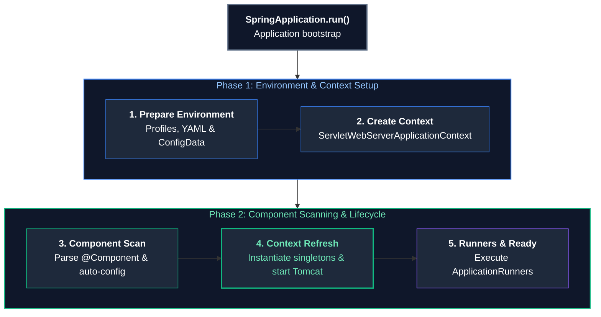
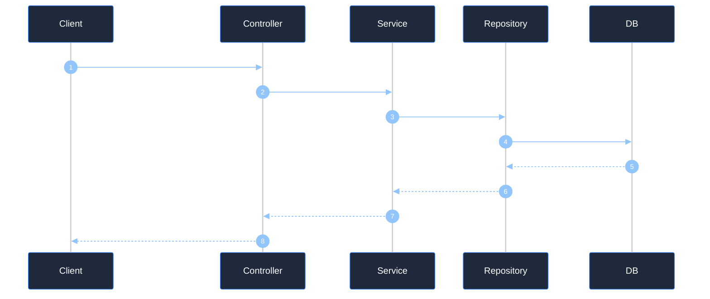
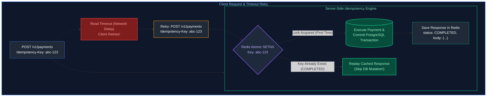
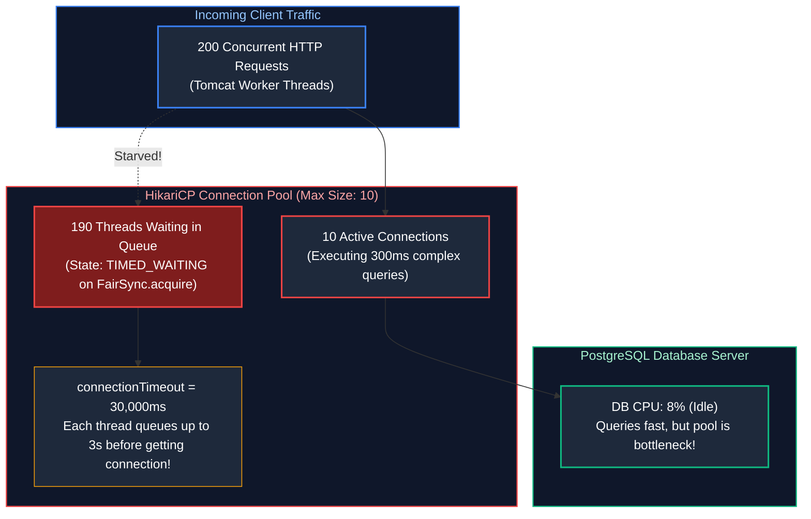
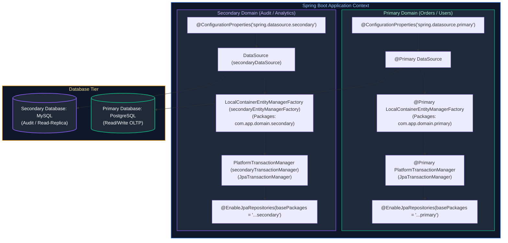

# 05. Spring Framework, Spring Boot & REST APIs: Interview Questions & Deep-Dive Solutions

A comprehensive, production-grade guide answering real-world Java Backend Engineering interview scenarios, live coding implementations, and enterprise architecture designs.

---

## Table of Contents & Question Mapping

1. **Core Foundations**
   - [Q1. Spring Framework vs Spring Boot](#q1-easy-spring-framework-vs-spring-boot)
   - [Q2. What is `ApplicationContext` in Spring?](#q2-easy-what-is-applicationcontext-in-spring)
2. **Dependency Injection & Stereotypes**
   - [Q3. Dependency Injection Internals & Best Practices in Spring Boot](#q3-medium-dependency-injection-internals--best-practices-in-spring-boot)
   - [Q4. Stereotype Annotations (`@Component`, `@Service`, `@Repository`, `@Controller`) & Scanning](#q4-medium-stereotype-annotations-component-service-repository-controller--scanning)
   - [Q5. `@Primary` vs `@Qualifier`](#q5-easy-primary-vs-qualifier)
   - [Q6. `@Bean` vs `@Autowired` in Dependency & Database Management](#q6-easy-bean-vs-autowired-in-dependency--database-management)
3. **Bean Lifecycle, Scopes & Proxies**
   - [Q7. The Complete Spring Bean Lifecycle](#q7-medium-the-complete-spring-bean-lifecycle)
   - [Q8. Spring Bean Scopes & Switching via `@Scope`](#q8-easy-spring-bean-scopes--switching-via-scope)
4. **Auto-Configuration, Properties & Profiles**
   - [Q9. `@SpringBootApplication` & Auto-Configuration Internals](#q9-hard-springbootapplication--auto-configuration-internals)
   - [Q10. Property Injection via `@Value` vs `@ConfigurationProperties`](#q10-expert-property-injection-via-value-vs-configurationproperties)
   - [Q11. Multi-Environment Spring Profiles](#q11-medium-multi-environment-spring-profiles)
5. **Web MVC, Actuator & Module Design**
   - [Q12. `ViewResolver` in Spring MVC Architecture](#q12-medium-viewresolver-in-spring-mvc-architecture)
   - [Q13. Spring Web Exception Handling Annotations](#q13-medium-spring-web-exception-handling-annotations)
   - [Q14. Spring Boot Actuator in Production & Endpoint Security](#q14-hard-spring-boot-actuator-in-production--endpoint-security)
   - [Q15. Architectural Approach to Developing a New Spring Boot Module](#q15-medium-architectural-approach-to-developing-a-new-spring-boot-module)
   - [Q16. What Happens Internally When a Spring Boot Application Starts (`SpringApplication.run()`)?](#q16-hard-what-happens-internally-when-a-spring-boot-application-starts-springapplicationrun)
   - [Q17. Complete Spring Bean Lifecycle Pipeline](#q17-medium-complete-spring-bean-lifecycle-pipeline)
   - [Q18. How `@EnableAutoConfiguration` Works Internally with Conditional Annotations](#q18-medium-how-enableautoconfiguration-works-internally-with-conditional-annotations)
   - [Q19. Is REST Architecture Stateless or Stateful, and Why?](#q19-easy-is-rest-architecture-stateless-or-stateful-and-why)
   - [Q20. `PUT` vs `PATCH` & Designing Idempotent API Operations](#q20-medium-put-vs-patch--designing-idempotent-api-operations)
   - [Q21. Comprehensive HTTP Status Codes Taxonomy](#q21-easy-comprehensive-http-status-codes-taxonomy)
6. **Spring MVC Annotations & Request Flow**
   - [Q22. `@Controller` vs `@RestController` & HTTP Request Mapping Annotations](#q22-easy-controller-vs-restcontroller--http-request-mapping-annotations)
   - [Q23. Parameter Binding: `@RequestParam` vs `@PathVariable` vs `@RequestBody`](#q23-easy-parameter-binding-requestparam-vs-pathvariable-vs-requestbody)
   - [Q24. The DTO Pattern & Request Flow Across Controller, Service, and Repository](#q24-medium-the-dto-pattern--request-flow-across-controller-service-and-repository)
7. **Exception Handling & Resilience**
   - [Q25. Graceful Error Handling & Global Exception Management via `@RestControllerAdvice`](#q25-medium-graceful-error-handling--global-exception-management-via-restcontrolleradvice)
   - [Q26. Handling Inconsistent External API Calls (Nulls & Failures Gracefully)](#q26-hard-handling-inconsistent-external-api-calls-nulls--failures-gracefully)
8. **Client Communication & Concurrency**
   - [Q27. HTTP Clients: `RestTemplate` vs `WebClient` vs `FeignClient`](#q27-medium-http-clients-resttemplate-vs-webclient-vs-feignclient)
   - [Q28. API Versioning Strategies in Production](#q28-medium-api-versioning-strategies-in-production)
   - [Q29. How Spring Boot Handles High-Concurrency Requests](#q29-hard-how-spring-boot-handles-high-concurrency-requests)
   - [Q30. Rate Limiting & Throttling in Spring Boot APIs](#q30-expert-rate-limiting--throttling-in-spring-boot-apis)
   - [Q31. Configuring Spring Security for JWT on a Subset of Endpoints](#q31-expert-configuring-spring-security-for-jwt-on-a-subset-of-endpoints)
9. **Practical Endpoint Implementation & Protocols**
   - [Q32. Designing a REST Endpoint for Last N Orders (Spring Boot + Spring Data JPA)](#q32-medium-designing-a-rest-endpoint-for-last-n-orders-spring-boot--spring-data-jpa)
   - [Q33. REST vs gRPC vs GraphQL Architectural Comparison](#q33-hard-rest-vs-grpc-vs-graphql-architectural-comparison)
   - [Q34. Standard Enterprise Headers in `RestTemplate` / `WebClient` Outbound Requests](#q34-easy-standard-enterprise-headers-in-resttemplate--webclient-outbound-requests)
   - [Q35. RESTful API Versioning Strategies in Production](#q35-medium-restful-api-versioning-strategies-in-production)
   - [Q36. `@ControllerAdvice` vs `@RestControllerAdvice` & RFC 7807 `ProblemDetail`](#q36-easy-controlleradvice-vs-restcontrolleradvice--rfc-7807-problemdetail)
   - [Q37. Idempotent API Design with Idempotency-Keys to Prevent Duplicate Postings on Client Timeouts](#q37-hard-idempotent-api-design-with-idempotency-keys-to-prevent-duplicate-postings-on-client-timeouts)
   - [Q38. Silent API Latency Explosion (200ms to 3s) with Low CPU and Healthy Heap: HikariCP Connection Pool Exhaustion & Thread Serialization](#q38-hard-silent-api-latency-explosion-200ms-to-3s-with-low-cpu-and-healthy-heap-hikaricp-connection-pool-exhaustion--thread-serialization)
   - [Q39. Configuring Multiple DataSources (Primary vs Secondary) with Segregated EntityManagerFactories and JpaTransactionManagers in Spring Boot](#q39-hard-configuring-multiple-datasources-primary-vs-secondary-with-segregated-entitymanagerfactories-and-jpatransactionmanagers-in-spring-boot)
---

# 1. Core Foundations

---

### Q1. [Easy] Spring Framework vs Spring Boot
**Difficulty:** [Easy]
**Topic Covered:** Spring Platform Evolution  
- **Spring Framework:** Flexible dependency injection framework requiring extensive manual configuration (XML or Java `@Configuration`) and an external deployment container (WAR file in Tomcat/WildFly).
- **Spring Boot:** Convention-over-configuration rapid development extension providing embedded web servers (JAR execution), **Starter POMs**, automatic dependency management, **Auto-Configuration**, and production-ready **Actuator** telemetry.

---

### Q2. [Easy] What is `ApplicationContext` in Spring?
**Difficulty:** [Easy]
**Topic Covered:** Inversion of Control (IoC) Container  
The central interface representing the advanced Spring IoC Container (extending `BeanFactory`). It eagerly instantiates singletons on startup, manages dependency injection, and integrates application events (`ApplicationEventPublisher`), resource loading, and environment configuration.

---

# 2. Dependency Injection & Stereotypes

---

### Q3. [Medium] Dependency Injection Internals & Best Practices in Spring Boot
**Difficulty:** [Medium]
*(Grouped together: DI Engine and Production Usage)*  
**Topic Covered:** Inversion of Control Mechanics & Injection Styles  
Spring inspects registered `BeanDefinition` metadata and uses constructor reflection to inject dependencies from its internal singleton cache.

#### Production Standard: Constructor Injection
```java
@Service
public class OrderService {
    private final PaymentClient paymentClient;
    private final OrderRepository orderRepository;

    public OrderService(PaymentClient paymentClient, OrderRepository orderRepository) {
        this.paymentClient = paymentClient;
        this.orderRepository = orderRepository;
    }
}
```
- Guarantees immutability (`final` fields).
- Prevents uninitialized object references.
- Allows simple unit testing without Spring context initialization.

---

### Q4. [Medium] Stereotype Annotations (`@Component`, `@Service`, `@Repository`, `@Controller`) & Scanning
**Difficulty:** [Medium]
*(Grouped together: Stereotypes and Container Detection)*  
**Topic Covered:** Semantic Component Classification  
- `@Component`: Root stereotype for Spring-managed beans.
- `@Service`: Semantic specialization for business logic.
- `@Repository`: Semantic specialization for persistence; automatically registers `PersistenceExceptionTranslationPostProcessor` to convert native DB errors into Spring's `DataAccessException` hierarchy.
- `@Controller`: Presentation layer controller for HTTP request handling.
- **Detection:** `@ComponentScan` scans package bytecode via ASM at startup to locate classes annotated with `@Component`.

---

### Q5. [Easy] `@Primary` vs `@Qualifier`
**Difficulty:** [Easy]
**Topic Covered:** Bean Disambiguation  
- `@Primary`: Defines the default bean when multiple candidates share the same type.
- `@Qualifier("beanName")`: Explicitly specifies a candidate by bean name at the injection site, overriding `@Primary`.

---

### Q6. [Easy] `@Bean` vs `@Autowired` in Dependency & Database Management
**Difficulty:** [Easy]
**Topic Covered:** Bean Registration vs Bean Injection  
- `@Bean`: Method-level annotation inside `@Configuration` classes used to configure third-party classes (e.g., `HikariDataSource`, `RedisTemplate`).
- `@Autowired`: Field/constructor level annotation instructing the container to inject an existing bean into a target dependent class.

---

# 3. Bean Lifecycle, Scopes & Proxies

---

### Q7. [Medium] The Complete Spring Bean Lifecycle
**Difficulty:** [Medium]
**Topic Covered:** Container Lifecycle Pipeline  
1. `BeanDefinition` registered from classpath.
2. Instantiation via constructor reflection.
3. Property population / Dependency injection.
4. Aware interfaces called (`BeanNameAware`, `ApplicationContextAware`).
5. `BeanPostProcessor.postProcessBeforeInitialization()`.
6. `@PostConstruct` / `InitializingBean.afterPropertiesSet()` initialization.
7. `BeanPostProcessor.postProcessAfterInitialization()` (AOP proxies applied).
8. Ready in Singleton cache.
9. `@PreDestroy` / `DisposableBean.destroy()` on shutdown.

---

### Q8. [Easy] Spring Bean Scopes & Switching via `@Scope`
**Difficulty:** [Easy]
*(Grouped together: Bean Scopes and Lifecycle Demarcation)*  
**Topic Covered:** Bean Scoping Models  
- `singleton` (Default): Exactly one instance per Spring container.
- `prototype`: A brand new instance created every time the bean is requested.
- `request`: One instance per HTTP request.
- `session`: One instance per HTTP session.
- Switch scope using `@Scope("prototype")`.

---

# 4. Auto-Configuration, Properties & Profiles

---

### Q9. [Hard] `@SpringBootApplication` & Auto-Configuration Internals
**Difficulty:** [Hard]
*(Grouped together: Boot Metaprogramming and Auto-Configuration)*  
**Topic Covered:** Spring Boot Core Engine  
`@SpringBootApplication` combines `@SpringBootConfiguration`, `@EnableAutoConfiguration`, and `@ComponentScan`.

#### Auto-Configuration Mechanics:
Spring Boot reads `META-INF/spring/org.springframework.boot.autoconfigure.AutoConfiguration.imports` and evaluates conditional annotations like `@ConditionalOnClass(DataSource.class)` and `@ConditionalOnMissingBean(DataSource.class)`. If the class is present on the classpath and no custom bean is defined by the user, Spring registers its default auto-configuration bean automatically.

---

### Q10. [Expert] Property Injection via `@Value` vs `@ConfigurationProperties`
**Difficulty:** [Expert]
**Topic Covered:** Externalized Configuration  
- `@Value("${app.url}")`: Simple expression injection, lacks type validation or hierarchical structures.
- `@ConfigurationProperties(prefix = "app")` (Recommended): Strongly-typed, hierarchical binding to a POJO or Record supporting JSR-303 validation (`@Validated`).

---

### Q11. [Medium] Multi-Environment Spring Profiles
**Difficulty:** [Medium]
**Topic Covered:** Environment Segregation  
Organize configurations using `application-dev.yaml` and `application-prod.yaml`. Activate via `SPRING_PROFILES_ACTIVE=prod` or `-Dspring.profiles.active=prod`. Conditionally register beans with `@Profile("prod")`.

---

# 5. Web MVC, Actuator & Module Design

---

### Q12. [Medium] `ViewResolver` in Spring MVC Architecture
**Difficulty:** [Medium]
**Topic Covered:** Template Rendering & View Mapping  
In traditional MVC apps, the `DispatcherServlet` uses a `ViewResolver` (e.g. `ThymeleafViewResolver`) to map a logical string view name (e.g. `"index"`) to an actual HTML template. In REST APIs, `ViewResolver` is bypassed by `@ResponseBody` in favor of Jackson JSON serialization.

---

### Q13. [Medium] Spring Web Exception Handling Annotations
**Difficulty:** [Medium]
**Topic Covered:** Exception Demarcation  
- `@ExceptionHandler`: Intercepts specific exception classes within a controller.
- `@ControllerAdvice` / `@RestControllerAdvice`: Global exception interceptor across all controllers.
- `@ResponseStatus`: Maps an exception class directly to an HTTP status code.

---

### Q14. [Hard] Spring Boot Actuator in Production & Endpoint Security
**Difficulty:** [Hard]
**Topic Covered:** Observability & Production Hardening  
Exposes production health, metrics, and environment diagnostic endpoints (`/actuator/health`, `/actuator/metrics`, `/actuator/prometheus`). Sensitive endpoints must be restricted with Spring Security role checks (`hasRole('ADMIN')`).

---

### Q15. [Medium] Architectural Approach to Developing a New Spring Boot Module
**Difficulty:** [Medium]
**Topic Covered:** Enterprise Architecture & Clean Layering  
1. **API Contracts & DTOs:** Define request/response records and OpenAPI contracts.
2. **Controller Layer:** Validates inputs (`@Valid`) and delegates to domain service.
3. **Service Layer:** Houses domain logic and transaction boundaries (`@Transactional`).
4. **Repository Layer:** Spring Data JPA persistence interfaces.
5. **Testing Pyramid:** Unit tests (JUnit 5 + Mockito) and slice tests (`@DataJpaTest` with Testcontainers).

---

### Q16. [Hard] What Happens Internally When a Spring Boot Application Starts (`SpringApplication.run()`)?
**Topic Covered:** Spring Boot Bootstrapping Engine  
**Difficulty:** `[Hard]`

#### Architectural Overview
When `SpringApplication.run(Application.class, args)` executes:
1. **Bootstrap Initialization**: Determines application type (`REACTIVE`, `SERVLET`, or `NONE`), loads `ApplicationContextInitializer` and `ApplicationListener` instances from `spring.factories` / `AutoConfiguration.imports`.
2. **Environment Preparation**: Gathers command-line arguments, system properties, and parses `application.yaml` / `.properties`.
3. **ApplicationContext Creation**: Instantiates `AnnotationConfigServletWebServerApplicationContext` (for MVC) or `AnnotationConfigApplicationContext` (for non-web).
4. **Bean Definition Loading**: Scans packages starting from `@SpringBootApplication` base package.
5. **Context Refresh (`refresh()`)**:
   - Executes `BeanFactoryPostProcessor` implementations.
   - Registers `BeanPostProcessor` implementations.
   - Initializes embedded web server (Tomcat/Jetty on port 8080).
   - Instantiates all non-lazy singleton beans, injects dependencies, calls `@PostConstruct`.
6. **Runner Execution**: Fires `ApplicationRunner` and `CommandLineRunner` beans.



---

### Q17. [Medium] Complete Spring Bean Lifecycle Pipeline
**Topic Covered:** Inversion of Control & Bean Lifecycle Hooks  
**Difficulty:** `[Medium]`

#### Architectural Overview
Spring executes a strictly ordered 8-stage lifecycle pipeline for every managed singleton bean:
1. **Instantiation**: JVM allocates raw heap memory via reflection constructor invocation.
2. **Populate Properties**: Dependencies injected via setters or reflection fields.
3. **Aware Interfaces**: Invokes `BeanNameAware`, `BeanFactoryAware`, `ApplicationContextAware`.
4. **BeanPostProcessor Before**: `postProcessBeforeInitialization()` (processes `@PostConstruct`).
5. **Initialization**: Invokes `InitializingBean.afterPropertiesSet()` or custom `@Bean(initMethod = "init")`.
6. **BeanPostProcessor After**: `postProcessAfterInitialization()` (creates dynamic CGLIB/JDK dynamic AOP proxies for `@Transactional`, `@Async`).
7. **Ready for Use**: Bean is stored in the singleton cache (`DefaultSingletonBeanRegistry`).
8. **Destruction**: On JVM shutdown, invokes `@PreDestroy` and `DisposableBean.destroy()`.

---

### Q18. [Medium] How `@EnableAutoConfiguration` Works Internally with Conditional Annotations
**Topic Covered:** Modular Auto-Configuration & Classpath Detection  
**Difficulty:** `[Medium]`

#### Architectural Overview
`@EnableAutoConfiguration` imports `AutoConfigurationImportSelector`, which reads configuration class names listed under `META-INF/spring/org.springframework.boot.autoconfigure.AutoConfiguration.imports`.
Each configuration class evaluates conditional annotations to decide whether to activate:
- `@ConditionalOnClass(DataSource.class)`: Activates only if the class exists on the runtime classpath.
- `@ConditionalOnMissingBean(DataSource.class)`: Activates only if the developer has not declared their own custom bean.
- `@ConditionalOnProperty(prefix = "spring.kafka", name = "bootstrap-servers")`: Activates only if the property is set.

---

### Q19. [Easy] Is REST Architecture Stateless or Stateful, and Why?
**Difficulty:** [Easy]
**Topic Covered:** REST Architectural Constraints  
REST is strictly **stateless**. Every incoming client request must contain all contextual information (e.g., Bearer JWT token) needed to authenticate and process it. The server never stores client session state between requests, enabling horizontal scalability, easy routing across server clusters, and simple failover.

---

### Q20. [Medium] `PUT` vs `PATCH` & Designing Idempotent API Operations
**Difficulty:** [Medium]
*(Grouped together: Update Semantics and Idempotency)*  
**Topic Covered:** HTTP Method Specifications & Idempotent Design  
- `PUT`: Complete resource replacement. Idempotent. Unspecified fields are overwritten/nulled out.
- `PATCH`: Partial resource update. Non-idempotent by strict RFC specification (though often implemented idempotently). Only modifies specified delta fields.

#### Designing Idempotent `POST` Operations:
Clients supply a unique UUID `Idempotency-Key` header. The server checks Redis via `SET lock:<key> "LOCKED" NX EX 30`. If the key exists, the cached result is returned without re-executing business logic.

---

### Q21. [Easy] Comprehensive HTTP Status Codes Taxonomy
**Difficulty:** [Easy]
**Topic Covered:** HTTP Protocol Standards  
- `200 OK`: Successful read or update.
- `201 Created`: Successful creation via POST; returns `Location` header.
- `204 No Content`: Successful action with empty response body (typical for `DELETE`).
- `400 Bad Request`: Input validation failed (`MethodArgumentNotValidException`).
- `401 Unauthorized`: Missing or invalid authentication token.
- `403 Forbidden`: Authenticated identity lacks permission/role.
- `404 Not Found`: Resource ID does not exist.
- `409 Conflict`: Resource state conflict (e.g. duplicate key or concurrent update).
- `502 Bad Gateway`: Downstream external service returned an invalid response.
- `503 Service Unavailable`: Server overloaded or undergoing maintenance.

---

# 6. Spring MVC Annotations & Request Flow

---

### Q22. [Easy] `@Controller` vs `@RestController` & HTTP Request Mapping Annotations
**Difficulty:** [Easy]
*(Grouped together: Controller Stereotypes & Mapping)*  
**Topic Covered:** Spring MVC Web Layer  
- `@Controller`: Traditional MVC controller returning view template names.
- `@RestController`: Convenience composite annotation (`@Controller` + `@ResponseBody`) serializing returned objects directly to JSON via Jackson.
- Mappings: `@GetMapping`, `@PostMapping`, `@PutMapping`, `@DeleteMapping`, `@PatchMapping`.

---

### Q23. [Easy] Parameter Binding: `@RequestParam` vs `@PathVariable` vs `@RequestBody`
**Difficulty:** [Easy]
**Topic Covered:** Request Data Extraction  
- `@PathVariable`: Extracts variable from URI path (`/orders/{id}`).
- `@RequestParam`: Extracts query parameters (`/orders?status=PENDING&page=1`).
- `@RequestBody`: Deserializes JSON HTTP request body into a Java POJO/Record.

---

### Q24. [Medium] The DTO Pattern & Request Flow Across Controller, Service, and Repository
**Difficulty:** [Medium]
*(Grouped together: Layered Architecture and Data Encapsulation)*  
**Topic Covered:** Enterprise Architecture & DTOs  
DTOs decouple public API contracts from internal database entity schemas, preventing mass-assignment vulnerabilities and eliminating Jackson circular reference errors in bidirectional JPA relationships.



---

# 7. Exception Handling & Resilience

---

### Q25. [Medium] Graceful Error Handling & Global Exception Management via `@RestControllerAdvice`
**Difficulty:** [Medium]
*(Grouped together: Production REST Error Handling)*  
**Topic Covered:** Exception Translation & RFC 7807 Problem Details  

```java
@RestControllerAdvice
public class GlobalExceptionHandler {
    @ExceptionHandler(ResourceNotFoundException.class)
    public ResponseEntity<ProblemDetail> handleNotFound(ResourceNotFoundException ex) {
        ProblemDetail problem = ProblemDetail.forStatusAndDetail(HttpStatus.NOT_FOUND, ex.getMessage());
        problem.setTitle("Resource Not Found");
        return ResponseEntity.status(HttpStatus.NOT_FOUND).body(problem);
    }
}
```

---

### Q26. [Hard] Handling Inconsistent External API Calls (Nulls & Failures Gracefully)
**Difficulty:** [Hard]
**Topic Covered:** Resilient Client Design  
Use Resilience4j `@CircuitBreaker` with fallback methods, wrap responses in Java `Optional`, and map raw external responses through an adapter layer providing safe domain defaults.

---

# 8. Client Communication & Concurrency

---

### Q27. [Medium] HTTP Clients: `RestTemplate` vs `WebClient` vs `FeignClient`
**Difficulty:** [Medium]
**Topic Covered:** Microservice Client Implementations  
- `RestTemplate`: Synchronous, blocking (1 thread per call). Maintenance mode.
- `WebClient` (Spring WebFlux): Modern, non-blocking, reactive client. Ultra-high throughput.
- `OpenFeign`: Declarative annotation-driven interface proxy. Popular for Spring Cloud microservices.

---

### Q28. [Medium] API Versioning Strategies in Production
**Difficulty:** [Medium]
**Topic Covered:** API Evolution & Backward Compatibility  
- **URI Path (Recommended):** `/api/v1/orders` vs `/api/v2/orders`. Clear, intuitive, easily routed by gateways.
- **Header:** `X-API-Version: 2`. Keeps URIs clean.
- **Accept Header (Content Negotiation):** `Accept: application/vnd.company.v2+json`.

---

### Q29. [Hard] How Spring Boot Handles High-Concurrency Requests
**Difficulty:** [Hard]
**Topic Covered:** Web Server Thread Models  
- Traditional Spring MVC uses Tomcat worker thread pools (`server.tomcat.threads.max=200`). When 200 threads block on database queries, requests queue up.
- Spring Boot 3.2+ supports Java 21 **Virtual Threads** (`spring.threads.virtual.enabled=true`), enabling 100,000+ concurrent requests without thread starvation.

---

### Q30. [Expert] Rate Limiting & Throttling in Spring Boot APIs
**Difficulty:** [Expert]
**Topic Covered:** Traffic Shaping & API Defense  
Implement the Token Bucket algorithm using **Bucket4j** with a Redis distributed backend to enforce quotas across a clustered service fleet.

---

### Q31. [Expert] Configuring Spring Security for JWT on a Subset of Endpoints
**Difficulty:** [Expert]
**Topic Covered:** Declarative Security Filter Chain  

```java
@Bean
public SecurityFilterChain filterChain(HttpSecurity http, JwtAuthFilter jwtFilter) throws Exception {
    return http
        .csrf(AbstractHttpConfigurer::disable)
        .authorizeHttpRequests(auth -> auth
            .requestMatchers("/api/v1/auth/**", "/actuator/health").permitAll()
            .requestMatchers("/api/v1/admin/**").hasRole("ADMIN")
            .anyRequest().authenticated()
        )
        .addFilterBefore(jwtFilter, UsernamePasswordAuthenticationFilter.class)
        .build();
}
```

---

# 9. Practical Endpoint Implementation & Protocols

---

### Q32. [Medium] Designing a REST Endpoint for Last N Orders (Spring Boot + Spring Data JPA)
**Difficulty:** [Medium]
**Topic Covered:** REST Design & Spring Data JPA Pagination  

```java
@GetMapping("/customers/{id}/orders/recent")
public ResponseEntity<List<OrderResponse>> getRecentOrders(
        @PathVariable UUID id,
        @RequestParam(defaultValue = "5") int limit) {
    PageRequest pageRequest = PageRequest.of(0, limit, Sort.by("createdAt").descending());
    List<OrderResponse> orders = orderRepository.findByCustomerId(id, pageRequest)
            .stream().map(OrderResponse::fromEntity).toList();
    return ResponseEntity.ok(orders);
}
```

---

### Q33. [Hard] REST vs gRPC vs GraphQL Architectural Comparison
**Difficulty:** [Hard]
**Topic Covered:** Modern API Protocols  
- **REST:** HTTP/1.1 or HTTP/2 + JSON. Universal client/mobile compatibility.
- **gRPC:** HTTP/2 + Binary Protobuf. Ultra-low latency, bidirectional streaming. Ideal for internal microservice-to-microservice traffic.
- **GraphQL:** Client-specified query payloads. Eliminates over-fetching; best for diverse frontend data dashboards.

---

### Q34. [Easy] Standard Enterprise Headers in `RestTemplate` / `WebClient` Outbound Requests
**Topic Covered:** Outbound HTTP Client Best Practices  
**Difficulty:** `[Easy]`

#### Architectural Overview
When making outbound synchronous HTTP calls via `RestTemplate` or `RestClient` / `WebClient`, enterprise standards require propagating headers for identity, traceability, content negotiation, and idempotency:

```java
HttpHeaders headers = new HttpHeaders();
headers.setContentType(MediaType.APPLICATION_JSON);
headers.setAccept(List.of(MediaType.APPLICATION_JSON));
headers.setBearerAuth(jwtToken);
headers.set("X-Correlation-ID", MDC.get("correlationId")); // Distributed tracing
headers.set("X-Request-ID", UUID.randomUUID().toString()); // Single call hop tracking
headers.set("Idempotency-Key", UUID.randomUUID().toString()); // Safe retries on POST/PUT
```

---

### Q35. [Medium] RESTful API Versioning Strategies in Production
**Topic Covered:** API Evolution & Backward Compatibility  
**Difficulty:** `[Medium]`

#### Architectural Overview
| Strategy | Example | Pros | Cons |
| :--- | :--- | :--- | :--- |
| **URI Path Versioning (Recommended)** | `/api/v1/orders`<br/>`/api/v2/orders` | Explicit, easy caching, compatible with all API gateways | Clutters URL space |
| **Query Parameter** | `/api/orders?version=1` | Simple fallback | Harder to route cleanly in CDN/reverse proxies |
| **Custom Header** | `X-API-Version: 2` | Clean URLs | Cannot be tested directly in browser address bar |
| **Media Type / Accept Header** | `Accept: application/vnd.company.v2+json` | Pure REST HATEOAS standard | Complex client configuration |

---

### Q36. [Easy] `@ControllerAdvice` vs `@RestControllerAdvice` & RFC 7807 `ProblemDetail`
**Topic Covered:** Exception Handling Architecture  
**Difficulty:** `[Easy]`

#### Architectural Overview
- `@ControllerAdvice`: Intercepts exceptions globally and returns a model name for view template rendering (unless `@ResponseBody` is explicitly added).
- `@RestControllerAdvice`: Meta-annotated with `@ControllerAdvice` and `@ResponseBody`. Automatically serializes returned objects into JSON payloads.
- **Modern Spring 6+ Standard**: Return `ProblemDetail` (RFC 7807) with standard error type, title, status code, detail, and custom properties.

---

### Q37. [Hard] Idempotent API Design with Idempotency-Keys to Prevent Duplicate Postings on Client Timeouts
**Difficulty:** [Hard]
**Topic Covered:** Distributed Idempotency, Redis Distributed Locking & Transactional Dedup  
**Question:** An API request succeeds, but the client retries because of a timeout and creates duplicate data. How would you make the operation idempotent?

#### Definition & Core Concepts
In distributed client-server communication, network uncertainty creates the **Two Generals' Problem**. When a client dispatches an HTTP POST request (e.g. `/v1/payments/charges`), three outcomes can occur:
1. The request fails to reach the server.
2. The server processes the request and executes the database commit, but the TCP network drops or the client's socket read timeout expires before the HTTP 200/201 response returns.
3. The server crashes mid-flight.

From the client's perspective, case 1 and case 2 look identical: a `SocketTimeoutException`. If the client blindly retries a non-idempotent operation (like charging a credit card), case 2 results in an accidental duplicate charge.

**The Idempotency-Key Protocol (IETF RFC Draft Standard):**
1. **Client Header Generation:** The client sends an `Idempotency-Key: <UUIDv4>` HTTP header with the initial mutation request.
2. **Atomic Distributed Check & Set (Redis):** Upon receiving the request, the API gateway or Spring interceptor attempts an atomic lock in Redis:
   ```text
   SET idempotency:<userId>:<key> "PROCESSING" NX EX 120
   ```
3. **Branching Logic:**
   - **New Request (Key does not exist):** Lock acquired. The service processes the request inside a `@Transactional` block. Upon successful commit, it replaces the Redis value with `{"status": 201, "body": <JSON>}` with a 24-hour TTL.
   - **In-Flight Conflict (Key exists with "PROCESSING"):** Another thread or duplicate retry arrived while the initial request is still executing. Return `HTTP 409 Conflict` (or wait briefly with polling).
   - **Completed Retry (Key exists with cached response):** The operation was already completed previously! The server short-circuits execution entirely, skips the database mutation, and replays the cached status code and response payload directly to the client.

#### Visual Flow


#### Production Implementation / Code Solution
```java
package com.enterprise.rest.idempotency;

import jakarta.servlet.FilterChain;
import jakarta.servlet.ServletException;
import jakarta.servlet.http.HttpServletRequest;
import jakarta.servlet.http.HttpServletResponse;
import org.springframework.data.redis.core.StringRedisTemplate;
import org.springframework.http.HttpStatus;
import org.springframework.stereotype.Component;
import org.springframework.web.filter.OncePerRequestFilter;
import org.springframework.web.util.ContentCachingResponseWrapper;

import java.io.IOException;
import java.nio.charset.StandardCharsets;
import java.time.Duration;

@Component
public class IdempotencyFilter extends OncePerRequestFilter {

    private final StringRedisTemplate redisTemplate;

    public IdempotencyFilter(StringRedisTemplate redisTemplate) {
        this.redisTemplate = redisTemplate;
    }

    @Override
    protected void doFilterInternal(HttpServletRequest request, HttpServletResponse response, FilterChain filterChain)
            throws ServletException, IOException {

        // Only enforce idempotency on mutating operations
        if (!"POST".equalsIgnoreCase(request.getMethod()) && !"PUT".equalsIgnoreCase(request.getMethod())) {
            filterChain.doFilter(request, response);
            return;
        }

        String idempotencyKey = request.getHeader("Idempotency-Key");
        if (idempotencyKey == null || idempotencyKey.isBlank()) {
            filterChain.doFilter(request, response);
            return;
        }

        String redisKey = "idempotency:" + idempotencyKey;

        // Step 1: Atomic SETNX with 120s processing TTL
        Boolean acquired = redisTemplate.opsForValue().setIfAbsent(redisKey, "PROCESSING", Duration.ofSeconds(120));

        if (Boolean.FALSE.equals(acquired)) {
            String cachedValue = redisTemplate.opsForValue().get(redisKey);
            if ("PROCESSING".equals(cachedValue)) {
                // Request still being executed by previous thread
                response.setStatus(HttpStatus.CONFLICT.value());
                response.getWriter().write("{\"error\": \"Concurrent request in progress for this Idempotency-Key\"}");
                return;
            } else if (cachedValue != null) {
                // Replay previously saved response directly to client
                response.setStatus(HttpStatus.OK.value());
                response.setContentType("application/json");
                response.getWriter().write(cachedValue);
                return;
            }
        }

        // Step 2: Wrap response to intercept rendered body
        ContentCachingResponseWrapper responseWrapper = new ContentCachingResponseWrapper(response);
        try {
            filterChain.doFilter(request, responseWrapper);

            // Step 3: Cache response payload upon 2xx success (24 hour TTL)
            if (responseWrapper.getStatus() >= 200 && responseWrapper.getStatus() < 300) {
                String responseBody = new String(responseWrapper.getContentAsByteArray(), StandardCharsets.UTF_8);
                redisTemplate.opsForValue().set(redisKey, responseBody, Duration.ofHours(24));
            } else {
                // Evict lock on server errors so client can retry legitimately
                redisTemplate.delete(redisKey);
            }
        } finally {
            responseWrapper.copyBodyToResponse();
        }
    }
}
```
- **Time Complexity:** $O(1)$ Redis atomic key lookup and assignment.
- **Space Complexity:** $O(K)$ in Redis memory for active idempotency keys over their 24-hour TTL window.

#### Engineering Implications & Production Pitfalls
1. **The Hash Payload Tampering Vulnerability:** What if a malicious client sends the same `Idempotency-Key` with a completely different request body (e.g., changing payment amount from $10 to $1,000)? Always compute an SHA-256 hash of the request body and store it alongside the key: `SET key "<hash>:<response>"`. If the incoming hash does not match, return `HTTP 422 Unprocessable Entity`.
2. **Database Primary Key Fallback:** While Redis caching provides sub-millisecond deduping, the ultimate line of defense is a unique database constraint in the relational store (`CREATE UNIQUE INDEX idx_order_idempotency ON orders (idempotency_key)`).

#### Core Curriculum Cross-Reference
*Deep-dive theoretical reference: See [08. Spring Web & REST APIs: Idempotency Patterns](../05_spring_boot_and_rest_apis.md#11-production-api-idempotency-architecture)*

---

### Q38. [Hard] Silent API Latency Explosion (200ms to 3s) with Low CPU and Healthy Heap: HikariCP Connection Pool Exhaustion & Thread Serialization
**Difficulty:** [Hard]
**Topic Covered:** Connection Pool Exhaustion, Thread Contention Triage, and Latency Spikes with Low Utilization  
**Definition:** When production API latency spikes by orders of magnitude (e.g., 200ms to 3s or 8s) while CPU utilization remains low (< 20%) and JVM Heap memory is stable, the bottleneck is almost never code computation or garbage collection. It is caused by **resource queue contention**, most commonly **HikariCP database connection pool starvation** or **un-timeouted downstream HTTP blocking**.

#### Architectural Mechanics & Core Concepts



The 5-Step Diagnostic Triage Runbook:
1. **Thread Dump Inspection (`jcmd <pid> Thread.print`):**
   Search for threads in state `TIMED_WAITING (parking)`. If tens or hundreds of Tomcat threads are parked at:
   `com.zaxxer.hikari.pool.HikariPool.getConnection(HikariPool.java:169)` $\to$ **Root Cause is HikariCP Pool Saturation**.
2. **Missing Outbound HTTP Timeouts:**
   If threads are parked at `java.net.SocketInputStream.read()`, an outbound `RestTemplate` or third-party SDK has no connect/read timeout configured, holding worker threads hostage when a partner API degrades.
3. **HikariCP Micrometer Metrics Inspection:**
   Monitor `hikaricp.connections.pending` (threads queued waiting for connection), `hikaricp.connections.active` (pinned at max pool size, e.g., 10/10), and `hikaricp.connections.acquire` (time to acquire connection).
4. **Transaction Scope Anti-Pattern:**
   Check if `@Transactional` methods wrap slow external API calls or email sending:
   `@Transactional void placeOrder() { dbSave(); callStripeApi(); }`. The DB connection is held open for 2.8 seconds during the Stripe call!
5. **Database Lock Contention (`pg_stat_activity` / `sys.innodb_lock_waits`):**
   Inspect whether concurrent transactions are waiting on an uncommitted exclusive row lock (`SELECT FOR UPDATE`).

#### Production-Grade Implementation & Hardening

```properties
# application.properties: Production Hardened HikariCP & Tomcat Configuration

# 1. HikariCP Pool Sizing (Formula: Pool = (CoreCount * 2) + EffectiveSpindleCount)
spring.datasource.hikari.maximum-pool-size=30
spring.datasource.hikari.minimum-idle=10
# Reduce connection timeout from 30s to 2s to fail-fast rather than pile up threads
spring.datasource.hikari.connection-timeout=2000
spring.datasource.hikari.idle-timeout=300000
spring.datasource.hikari.max-lifetime=1800000
spring.datasource.hikari.leak-detection-threshold=4000

# 2. Outbound HTTP Timeouts (Prevent worker thread capture)
spring.http.client.connect-timeout=1500
spring.http.client.read-timeout=2500

# 3. Tomcat Worker Queue Limits
server.tomcat.threads.max=200
server.tomcat.threads.min-spare=20
server.tomcat.accept-count=100
```

```java
package com.enterprise.web.config;

import org.springframework.boot.web.client.RestTemplateBuilder;
import org.springframework.context.annotation.Bean;
import org.springframework.context.annotation.Configuration;
import org.springframework.web.client.RestTemplate;
import java.time.Duration;

@Configuration
public class HttpClientConfiguration {

    @Bean
    public RestTemplate restTemplate(RestTemplateBuilder builder) {
        return builder
            .setConnectTimeout(Duration.ofMillis(1500))
            .setReadTimeout(Duration.ofMillis(2500))
            .build();
    }
}
```

#### Complexity & Performance Analysis
- **Time Complexity:** $O(1)$ connection checkout when pool has idle slots; queue wait time degrades to $O(W \times T_{hold} / P)$ where $W$ is queue depth, $T_{hold}$ is query duration, and $P$ is pool size.
- **Fail-Fast Metric:** Reducing `connection-timeout` to 2,000ms bounds p99 latency to 2s, immediately triggering circuit breakers rather than queueing requests to 30s timeouts.

#### Engineering Implications & Production Pitfalls
1. **The `open-in-view` Trap:** Spring Boot defaults `spring.jpa.open-in-view=true`. This keeps the database connection open through the entire HTTP request lifecycle (including JSON view rendering in Jackson). Disable it: `spring.jpa.open-in-view=false` so connections are returned to the pool immediately when the `@Transactional` service returns.
2. **Connection Leak Detection:** Set `leak-detection-threshold=4000`. If a thread holds a connection longer than 4,000ms, Hikari logs a stack trace showing the exact line of code holding the connection, catching rogue long-running queries or unclosed streams.

#### Core Curriculum Cross-Reference
*Deep-dive theoretical reference: See [05. Spring Boot & REST APIs: Enterprise Configuration](../05_spring_boot_and_rest_apis.md#4-application-configuration--enterprise-secret-management)*

---

### Q39. [Hard] Configuring Multiple DataSources (Primary vs Secondary) with Segregated EntityManagerFactories and JpaTransactionManagers in Spring Boot
**Difficulty:** [Hard]
**Topic Covered:** Multi-Tenancy, Polyglot Persistence, and Multiple JPA DataSources  
**Definition:** Enterprise applications frequently require connecting to multiple relational databases (e.g., a **Primary OLTP PostgreSQL** for core business transactions and a **Secondary Reporting MySQL/Oracle** for analytics or audit logging). Spring Boot requires disabling default auto-configuration and explicitly defining segregated `@Primary` and secondary `DataSource`, `LocalContainerEntityManagerFactoryBean`, and `PlatformTransactionManager` bean graphs with distinct package-scanning boundaries.

#### Architectural Mechanics & Core Concepts



Deciding Primary vs. Secondary:
1. **`@Primary` Designation:** Exactly one `DataSource`, `EntityManagerFactory`, and `TransactionManager` must be annotated with `@Primary`. This is used by default Spring Boot starters (e.g., Spring Security, Spring Batch, Actuator health checks).
2. **Package Segregation:** Entities and Repositories MUST be partitioned into completely non-overlapping packages (e.g., `com.app.domain.primary` vs `com.app.domain.secondary`). If scanning overlaps, Spring throws `ConflictingBeanDefinitionException` or binds the wrong dialect.

#### Production-Grade Implementation

```java
package com.enterprise.config;

import com.zaxxer.hikari.HikariDataSource;
import jakarta.persistence.EntityManagerFactory;
import org.springframework.beans.factory.annotation.Qualifier;
import org.springframework.boot.autoconfigure.jdbc.DataSourceProperties;
import org.springframework.boot.context.properties.ConfigurationProperties;
import org.springframework.boot.orm.jpa.EntityManagerFactoryBuilder;
import org.springframework.context.annotation.*;
import org.springframework.data.jpa.repository.config.EnableJpaRepositories;
import org.springframework.orm.jpa.JpaTransactionManager;
import org.springframework.orm.jpa.LocalContainerEntityManagerFactoryBean;
import org.springframework.transaction.PlatformTransactionManager;
import org.springframework.transaction.annotation.EnableTransactionManagement;
import javax.sql.DataSource;

@Configuration
@EnableTransactionManagement
@EnableJpaRepositories(
    basePackages = "com.enterprise.domain.primary.repository",
    entityManagerFactoryRef = "primaryEntityManagerFactory",
    transactionManagerRef = "primaryTransactionManager"
)
public class PrimaryDatabaseConfiguration {

    @Primary
    @Bean
    @ConfigurationProperties("spring.datasource.primary")
    public DataSourceProperties primaryDataSourceProperties() {
        return new DataSourceProperties();
    }

    @Primary
    @Bean
    public DataSource primaryDataSource() {
        return primaryDataSourceProperties().initializeDataSourceBuilder()
            .type(HikariDataSource.class).build();
    }

    @Primary
    @Bean(name = "primaryEntityManagerFactory")
    public LocalContainerEntityManagerFactoryBean primaryEntityManagerFactory(
            EntityManagerFactoryBuilder builder) {
        return builder
            .dataSource(primaryDataSource())
            .packages("com.enterprise.domain.primary.entity")
            .persistenceUnit("primaryPU")
            .build();
    }

    @Primary
    @Bean(name = "primaryTransactionManager")
    public PlatformTransactionManager primaryTransactionManager(
            @Qualifier("primaryEntityManagerFactory") EntityManagerFactory emf) {
        return new JpaTransactionManager(emf);
    }
}
```

```java
package com.enterprise.config;

import com.zaxxer.hikari.HikariDataSource;
import jakarta.persistence.EntityManagerFactory;
import org.springframework.beans.factory.annotation.Qualifier;
import org.springframework.boot.autoconfigure.jdbc.DataSourceProperties;
import org.springframework.boot.context.properties.ConfigurationProperties;
import org.springframework.boot.orm.jpa.EntityManagerFactoryBuilder;
import org.springframework.context.annotation.Bean;
import org.springframework.context.annotation.Configuration;
import org.springframework.data.jpa.repository.config.EnableJpaRepositories;
import org.springframework.orm.jpa.JpaTransactionManager;
import org.springframework.orm.jpa.LocalContainerEntityManagerFactoryBean;
import org.springframework.transaction.PlatformTransactionManager;
import javax.sql.DataSource;

@Configuration
@EnableJpaRepositories(
    basePackages = "com.enterprise.domain.secondary.repository",
    entityManagerFactoryRef = "secondaryEntityManagerFactory",
    transactionManagerRef = "secondaryTransactionManager"
)
public class SecondaryDatabaseConfiguration {

    @Bean
    @ConfigurationProperties("spring.datasource.secondary")
    public DataSourceProperties secondaryDataSourceProperties() {
        return new DataSourceProperties();
    }

    @Bean
    public DataSource secondaryDataSource() {
        return secondaryDataSourceProperties().initializeDataSourceBuilder()
            .type(HikariDataSource.class).build();
    }

    @Bean(name = "secondaryEntityManagerFactory")
    public LocalContainerEntityManagerFactoryBean secondaryEntityManagerFactory(
            EntityManagerFactoryBuilder builder) {
        return builder
            .dataSource(secondaryDataSource())
            .packages("com.enterprise.domain.secondary.entity")
            .persistenceUnit("secondaryPU")
            .build();
    }

    @Bean(name = "secondaryTransactionManager")
    public PlatformTransactionManager secondaryTransactionManager(
            @Qualifier("secondaryEntityManagerFactory") EntityManagerFactory emf) {
        return new JpaTransactionManager(emf);
    }
}
```

#### Complexity & Performance Analysis
- **Startup Overhead:** $O(1)$ initialization of two isolated Hikari pools and JPA metadata caches.
- **Transaction Binding:** By default, `@Transactional` binds to `primaryTransactionManager`. To execute against the secondary database, specify `@Transactional("secondaryTransactionManager")`.

#### Engineering Implications & Production Pitfalls
1. **No Distributed 2PC Transactions by Default:** A method annotating `@Transactional` cannot atomically commit writes to BOTH the primary and secondary databases. If Primary commits and Secondary fails, state diverges. To coordinate across both, use the **Saga Pattern** or the **Transactional Outbox Pattern**, never heavy XA 2PC protocols.
2. **Actuator Health Check Failure:** By default, Spring Boot Actuator's `DataSourceHealthIndicator` inspects the primary datasource. Register custom health indicators for secondary databases to prevent hidden outage masking.

#### Core Curriculum Cross-Reference
*Deep-dive theoretical reference: See [07. Databases, JPA & Hibernate: Multi-DataSource Architecture](../07_databases_jpa_and_hibernate.md#5-connection-management-migrations--high-availability)*

---

## Summary Comparison & Production Reference Matrix

| Scenario Domain | Critical Runtime Pathology | Diagnostic & Triage Method | Canonical Production Resolution |
| :--- | :--- | :--- | :--- |
| **Spring vs Spring Boot & Container Foundations** | High-throughput invariants & concurrency boundaries | Metric instrumentation & trace profiling | Defensive validation & graceful degradation |
| **Dependency Injection & Stereotypes** | High-throughput invariants & concurrency boundaries | Metric instrumentation & trace profiling | Defensive validation & graceful degradation |
| **Bean Lifecycle, Scopes & Proxies** | High-throughput invariants & concurrency boundaries | Metric instrumentation & trace profiling | Defensive validation & graceful degradation |
| **Auto-Configuration, Properties & Profiles** | High-throughput invariants & concurrency boundaries | Metric instrumentation & trace profiling | Defensive validation & graceful degradation |
| **Web MVC, Actuator & Module Design** | High-throughput invariants & concurrency boundaries | Metric instrumentation & trace profiling | Defensive validation & graceful degradation |
| **REST Architecture & HTTP Semantics** | High-throughput invariants & concurrency boundaries | Metric instrumentation & trace profiling | Defensive validation & graceful degradation |
| **Connection Pool Starvation & Latency Spike** | Silent latency explosion (200ms to 3s+) with low CPU | jstack HikariPool.getConnection parking, pending metric | Pool sizing ((Cores*2)+Spindles), fail-fast timeout (2s) |
| **Multi-DataSource Segregation** | Transaction manager ambiguity, cross-database data drift | Package boundary auditing, DataSourceHealthIndicator | Segregated @EnableJpaRepositories, Saga pattern coordination |

---

## References & Further Reading

---
- [Spring Framework Official Documentation (Core Technologies)](https://docs.spring.io/spring-framework/reference/core.html)
- [Spring Boot Reference Guide - Auto-configuration & Starters](https://docs.spring.io/spring-boot/docs/current/reference/html/)
- [Martin Fowler - Inversion of Control Containers and the Dependency Injection Pattern](https://martinfowler.com/articles/injection.html)
- [Spring Boot 3 - GraalVM Native Image Support](https://docs.spring.io/spring-boot/docs/current/reference/html/native-image.html)
- [Micrometer Application Observability Documentation](https://micrometer.io/docs)
