# 06. Spring Security, OAuth2 & JWT Architecture

A comprehensive guide answering all 20 questions on authentication vs authorization, Spring Security internal architecture, the Security Filter Chain, `AuthenticationManager`, password hashing, CSRF protection, JSON Web Tokens (JWT), token revocation, and OAuth2 authorization flows.

---

## Architectural Overview: Spring Security Internal Request Flow

```mermaid
flowchart LR
    subgraph ServletBridge ["1. Servlet Ingress & Bridge"]
        direction TB
        Req["Incoming HTTP Request"] --> DelegatingProxy["DelegatingFilterProxy"]
        DelegatingProxy --> FilterChainProxy["FilterChainProxy"]
    end

    subgraph FilterChain ["2. SecurityFilterChain Sequence"]
        direction TB
        CorsFilter["CorsFilter"] --> CsrfFilter["CsrfFilter"]
        CsrfFilter --> JwtFilter["Custom JwtAuthFilter"]
        JwtFilter --> UserPassFilter["UsernamePasswordAuthFilter"]
        UserPassFilter --> FilterSecurity["AuthorizationFilter<br/>(Access Decision)"]
    end

    subgraph AuthSubsystem ["3. Auth Subsystem & Endpoint"]
        direction TB
        AuthManager["AuthenticationManager"] --> AuthProvider["AuthenticationProvider"]
        AuthProvider --> UserDetails["UserDetailsService"]
        AuthProvider --> SecContext["SecurityContextHolder<br/>(Set Authentication)"]
        FilterSecurity -->|"Authorized"| Controller["Target @RestController"]
    end

    FilterChainProxy -->|"Dispatches request"| CorsFilter
    JwtFilter -->|"Extracts Bearer Token"| AuthManager

    style ServletBridge fill:#0f172a,stroke:#3b82f6,stroke-width:1.5px,color:#93c5fd
    style FilterChain fill:#0f172a,stroke:#8b5cf6,stroke-width:1.5px,color:#c4b5fd
    style AuthSubsystem fill:#0f172a,stroke:#10b981,stroke-width:1.5px,color:#6ee7b7

    style Req fill:#1f2937,stroke:#3b82f6,stroke-width:2px,color:#fff
    style DelegatingProxy fill:#1f2937,stroke:#06b6d4,stroke-width:2px,color:#67e8f9
    style FilterChainProxy fill:#1f2937,stroke:#8b5cf6,stroke-width:2px,color:#c4b5fd

    style CorsFilter fill:#1f2937,stroke:#8b5cf6,stroke-width:2px,color:#fff
    style CsrfFilter fill:#1f2937,stroke:#8b5cf6,stroke-width:2px,color:#fff
    style JwtFilter fill:#1f2937,stroke:#f59e0b,stroke-width:2px,color:#fff
    style UserPassFilter fill:#1f2937,stroke:#8b5cf6,stroke-width:2px,color:#fff
    style FilterSecurity fill:#1f2937,stroke:#10b981,stroke-width:2px,color:#fff

    style AuthManager fill:#1f2937,stroke:#10b981,stroke-width:2px,color:#fff
    style AuthProvider fill:#1f2937,stroke:#10b981,stroke-width:2px,color:#fff
    style UserDetails fill:#1f2937,stroke:#10b981,stroke-width:2px,color:#fff
    style SecContext fill:#1f2937,stroke:#10b981,stroke-width:2px,color:#fff
    style Controller fill:#064e3b,stroke:#10b981,stroke-width:2px,color:#a7f3d0
```



---

## Table of Contents & Question Mapping

1. **Authentication vs Authorization & Core Architecture**
   - [Q1. Authentication vs Authorization](#q1-easy-authentication-vs-authorization)
   - [Q2. Spring Security Internal Architecture, Filter Chain & `AuthenticationManager`](#q2-expert-spring-security-internal-architecture-filter-chain--authenticationmanager)
2. **User Details, Providers & Password Security**
   - [Q3. `UserDetailsService` & Custom `AuthenticationProvider`](#q3-medium-userdetailsservice--custom-authenticationprovider)
   - [Q4. `BCryptPasswordEncoder` vs Plain Text Passwords](#q4-easy-bcryptpasswordencoder-vs-plain-text-passwords)
3. **Method Security & Web Protections**
   - [Q5. Method-Level Security: `@PreAuthorize` vs `@Secured` vs `@RolesAllowed`](#q5-medium-method-level-security-preauthorize-vs-secured-vs-rolesallowed)
   - [Q6. Spring Security CSRF Protection Mechanics](#q6-easy-spring-security-csrf-protection-mechanics)
   - [Q7. Remember-Me Authentication Architecture](#q7-medium-remember-me-authentication-architecture)
4. **JSON Web Tokens (JWT) Deep Dive**
   - [Q8. Why Use JWT Tokens Instead of Stateful Sessions?](#q8-medium-why-use-jwt-tokens-instead-of-stateful-sessions)
   - [Q9. Structure of a JWT Token & Cryptographic Validation](#q9-medium-structure-of-a-jwt-token--cryptographic-validation)
   - [Q10. Client-Side JWT Storage & Early Token Revocation](#q10-expert-client-side-jwt-storage--early-token-revocation)
   - [Q11. Expired Tokens, Refresh Token Rotation & Concurrency](#q11-medium-expired-tokens-refresh-token-rotation--concurrency)
   - [Q12. JWT Security Risks & Mitigations](#q12-medium-jwt-security-risks--mitigations)
5. **OAuth2 & Modern Federated Identity**
   - [Q13. OAuth2 vs Basic Authentication](#q13-easy-oauth2-vs-basic-authentication)
   - [Q14. OAuth2 Authorization Code Flow with PKCE](#q14-hard-oauth2-authorization-code-flow-with-pkce)
   - [Q15. OAuth2 Client Credentials Grant for Microservices](#q15-expert-oauth2-client-credentials-grant-for-microservices)
   - [Q16. Cross-Service JWT Propagation & Verification in Distributed Microservices](#q16-hard-cross-service-jwt-propagation--verification-in-distributed-microservices)
   - [Q17. Refresh Token Reuse Detection & Blast-Radius Revocation Workflows](#q17-hard-refresh-token-reuse-detection--blast-radius-revocation-workflows)
---

# 1. Authentication vs Authorization & Core Architecture

---

### Q1. [Easy] Authentication vs Authorization
**Difficulty:** [Easy]
**Topic Covered:** Identity & Access Fundamentals  
- **Authentication (AuthN):** *"Who are you?"* Validates identity using credentials. Returns `401 Unauthorized` if invalid.
- **Authorization (AuthZ):** *"What are you permitted to do?"* Validates roles/permissions after identity is established. Returns `403 Forbidden` if denied.

---

### Q2. [Expert] Spring Security Internal Architecture, Filter Chain & `AuthenticationManager`
**Difficulty:** [Expert]
*(Grouped together: Core Security Architecture)*  
**Topic Covered:** Spring Security Engine & Filter Pipeline  
1. `DelegatingFilterProxy`: Bridges servlet container to Spring-managed `FilterChainProxy`.
2. `FilterChainProxy`: Passes requests through the configured `SecurityFilterChain`.
3. Filter Sequence: `CorsFilter` $\to$ `CsrfFilter` $\to$ Custom `JwtAuthFilter` $\to$ `UsernamePasswordAuthenticationFilter` $\to$ `AuthorizationFilter`.
4. `AuthenticationManager` (`ProviderManager`): Delegates unauthenticated tokens across registered `AuthenticationProvider`s until one returns an authenticated token stored in `SecurityContextHolder`.

---

# 2. User Details, Providers & Password Security

---

### Q3. [Medium] `UserDetailsService` & Custom `AuthenticationProvider`
**Difficulty:** [Medium]
*(Grouped together: Credential Providers)*  
**Topic Covered:** Custom Identity Resolution  
- `UserDetailsService`: Database lookup contract (`UserDetails loadUserByUsername(String username)`).
- Custom `AuthenticationProvider`: Used when authentication involves external enterprise systems (LDAP, Active Directory, hardware MFA tokens).

---

### Q4. [Easy] `BCryptPasswordEncoder` vs Plain Text Passwords
**Difficulty:** [Easy]
**Topic Covered:** Cryptographic Password Storage  
1. **Configurable Work Factor (Cost Parameter):** Slows computation deliberately to thwart GPU brute-force attacks.
2. **Built-in Salt:** Automatically includes a random 128-bit salt in the generated hash to defeat rainbow tables.
3. **Constant-time comparison:** Protects against side-channel timing attacks.

---

# 3. Method Security & Web Protections

---

### Q5. [Medium] Method-Level Security: `@PreAuthorize` vs `@Secured` vs `@RolesAllowed`
**Difficulty:** [Medium]
*(Grouped together: Method Authorization & Parameter Security)*  
**Topic Covered:** Method Interception & Spring Expression Language (SpEL)  
- `@PreAuthorize` (Recommended): Supports rich SpEL expressions (`@PreAuthorize("hasRole('ADMIN') or #id == authentication.principal.id")`).
- `@Secured` & `@RolesAllowed`: Legacy role string arrays without SpEL support.
- `@PostAuthorize`: Evaluates return value permissions before returning.

---

### Q6. [Easy] Spring Security CSRF Protection Mechanics
**Difficulty:** [Easy]
**Topic Covered:** Cross-Site Request Forgery Defense  
Requires state-changing HTTP requests (`POST`, `PUT`, `DELETE`) to submit a unique server-generated CSRF token in an `X-XSRF-TOKEN` header. Disabled in stateless REST APIs authenticated exclusively via Bearer tokens in headers.

---

### Q7. [Medium] Remember-Me Authentication Architecture
**Difficulty:** [Medium]
**Topic Covered:** Persistent Login Mechanics  
Uses a persistent token repository database table storing series and token hashes. Each automatic login regenerates the token to thwart cookie theft replay attacks.

---

# 4. JSON Web Tokens (JWT) Deep Dive

---

### Q8. [Medium] Why Use JWT Tokens Instead of Stateful Sessions?
**Difficulty:** [Medium]
**Topic Covered:** Stateless Authentication Architecture  
Stateful sessions require server RAM or centralized Redis lookups. JWT tokens are self-contained, stateless, and cryptographically signed, allowing any microservice to validate tokens independently without database roundtrips.

---

### Q9. [Medium] Structure of a JWT Token & Cryptographic Validation
**Difficulty:** [Medium]
**Topic Covered:** RFC 7519 Standards & Cryptography  
A JWT consists of three Base64URL-encoded parts separated by dots:
1. **Header:** Algorithm & token type (`{"alg": "RS256", "typ": "JWT"}`).
2. **Payload:** Claims (`sub`, `roles`, `exp`, `iss`).
3. **Signature:** Cryptographic signature computed over Header and Payload using an asymmetric private key or secret key.

---

### Q10. [Expert] Client-Side JWT Storage & Early Token Revocation
**Difficulty:** [Expert]
**Topic Covered:** Token Security & State Management  
- **Storage:** Access token in memory; Refresh token in an **`HttpOnly`, `Secure`, `SameSite=Strict` Cookie** to prevent XSS.
- **Early Revocation:** Store revoked token IDs (`jti`) in Redis with a TTL equal to the token's remaining validity. The auth filter rejects blacklisted tokens.

---

### Q11. [Medium] Expired Tokens, Refresh Token Rotation & Concurrency
**Difficulty:** [Medium]
**Topic Covered:** Token Refresh Workflows  
When the short-lived access token expires (e.g. 15 mins), the client calls `/auth/refresh` presenting the refresh token. The auth server invalidates the old refresh token and issues a new access token and rotated refresh token simultaneously.

---

### Q12. [Medium] JWT Security Risks & Mitigations
**Difficulty:** [Medium]
**Topic Covered:** Vulnerability Defense  
1. **`alg: none` attack:** Whitelist allowed algorithms (e.g. `RS256`) explicitly in parser.
2. **Sensitive payload data:** Base64 is not encryption; never store secrets or PII in payload claims.
3. **Weak secret keys:** Use 2048-bit RSA keys or 256-bit+ random HMAC keys.

---

# 5. OAuth2 & Modern Federated Identity

---

### Q13. [Easy] OAuth2 vs Basic Authentication
**Difficulty:** [Easy]
**Topic Covered:** Modern Authorization Frameworks  
Basic Auth sends static credentials on every request. OAuth2 is a delegated authorization framework where users authenticate via identity providers (Keycloak, Okta) and issue short-lived scoped access tokens to client applications.

---

### Q14. [Hard] OAuth2 Authorization Code Flow with PKCE
**Difficulty:** [Hard]
**Topic Covered:** RFC 7636 Authorization Protocol  
Proof Key for Code Exchange (PKCE) protects single-page and mobile apps by creating a dynamic `code_verifier` and hashed `code_challenge`, preventing authorization code interception attacks.

---

### Q15. [Expert] OAuth2 Client Credentials Grant for Microservices
**Difficulty:** [Expert]
**Topic Covered:** Machine-to-Machine (M2M) Security  
Used for backend service-to-service communication without an end-user. The calling microservice passes its own `client_id` and `client_secret` to obtain a scoped access token.

---

### Q16. [Hard] Cross-Service JWT Propagation & Verification in Distributed Microservices
**Topic Covered:** Distributed Identity & Token Relay  
**Difficulty:** `[Hard]`

#### Architectural Overview
When an authenticated request enters an API Gateway, the gateway validates the edge JWT and forwards it downstream. To propagate identity across internal synchronous REST hops (e.g. Service A $\to$ Service B via OpenFeign):
1. **Token Relay Interceptor**: Configure a `RequestInterceptor` that extracts the `Bearer <token>` from the incoming `SecurityContextHolder` / `ServletRequestAttributes` and sets it on the outgoing request `Authorization` header.
2. **Decentralized Verification via JWKS**: Downstream services verify the JWT signature locally using the Identity Provider's public key JSON Web Key Set (`/.well-known/jwks.json`), caching public keys in memory to avoid remote network latency per request.

```mermaid
flowchart LR
    Client["Client Request (Bearer JWT)"] --> Gateway["API Gateway (Edge AuthN)"]
    Gateway --> SvcA["Microservice A"]
    SvcA -->|"Feign RequestInterceptor (Relay Token)"| SvcB["Microservice B"]
    SvcB <-->|"Local Signature Check (Cached JWKS)"| Keycloak[("IdP / Keycloak / Entra ID")]

    style Client fill:#1e293b,stroke:#3b82f6,stroke-width:1.5px,color:#93c5fd
    style Gateway fill:#0f172a,stroke:#3b82f6,stroke-width:2px,color:#93c5fd
    style SvcA fill:#1e293b,stroke:#10b981,stroke-width:1.5px,color:#6ee7b7
    style SvcB fill:#1e293b,stroke:#10b981,stroke-width:1.5px,color:#6ee7b7
    style Keycloak fill:#1e293b,stroke:#8b5cf6,stroke-width:1.5px,color:#c4b5fd
```



```java
@Configuration
public class FeignClientSecurityConfig {
    @Bean
    public RequestInterceptor oauth2FeignRequestInterceptor() {
        return requestTemplate -> {
            ServletRequestAttributes attributes = (ServletRequestAttributes) RequestContextHolder.getRequestAttributes();
            if (attributes != null) {
                String authHeader = attributes.getRequest().getHeader(HttpHeaders.AUTHORIZATION);
                if (authHeader != null && authHeader.startsWith("Bearer ")) {
                    requestTemplate.header(HttpHeaders.AUTHORIZATION, authHeader);
                }
            }
        };
    }
}
```

---

### Q17. [Hard] Refresh Token Reuse Detection & Blast-Radius Revocation Workflows
**Topic Covered:** Compromised Token Invalidation Architecture  
**Difficulty:** `[Hard]`

#### Architectural Overview
If a refresh token is stolen, an attacker and legitimate user will both attempt to exchange it. **Refresh Token Rotation with Reuse Detection** requires storing token family trees in Redis. When a previously invalidated refresh token is presented:
1. Detect immediately that token replay occurred.
2. Invalidate the entire token family (access token + all issued refresh tokens for that user).
3. Force immediate credential re-authentication, nullifying the attacker's access window.

---

## Summary Comparison & Production Reference Matrix

| Scenario Domain | Critical Runtime Pathology | Diagnostic & Triage Method | Canonical Production Resolution |
| :--- | :--- | :--- | :--- |
| **Authentication vs Authorization & Core Architecture** | High-throughput invariants & concurrency boundaries | Metric instrumentation & trace profiling | Defensive validation & graceful degradation |
| **User Details, Providers & Password Security** | High-throughput invariants & concurrency boundaries | Metric instrumentation & trace profiling | Defensive validation & graceful degradation |
| **Method Security & Web Protections** | High-throughput invariants & concurrency boundaries | Metric instrumentation & trace profiling | Defensive validation & graceful degradation |
| **JSON Web Tokens (JWT) Deep Dive** | High-throughput invariants & concurrency boundaries | Metric instrumentation & trace profiling | Defensive validation & graceful degradation |
| **OAuth2 & Modern Federated Identity** | High-throughput invariants & concurrency boundaries | Metric instrumentation & trace profiling | Defensive validation & graceful degradation |

---

## References & Further Reading

---
- [Spring Security Reference Documentation (Version 6.x)](https://docs.spring.io/spring-security/reference/)
- [RFC 7519 - JSON Web Token (JWT) Specification](https://datatracker.ietf.org/doc/html/rfc7519)
- [RFC 7636 - Proof Key for Code Exchange (PKCE) by OAuth Public Clients](https://datatracker.ietf.org/doc/html/rfc7636)
- [OWASP Top Ten Web Application Security Risks](https://owasp.org/www-project-top-ten/)
- [NIST Special Publication 800-63B - Digital Identity Guidelines](https://pages.nist.gov/800-63-3/sp800-63b.html)
