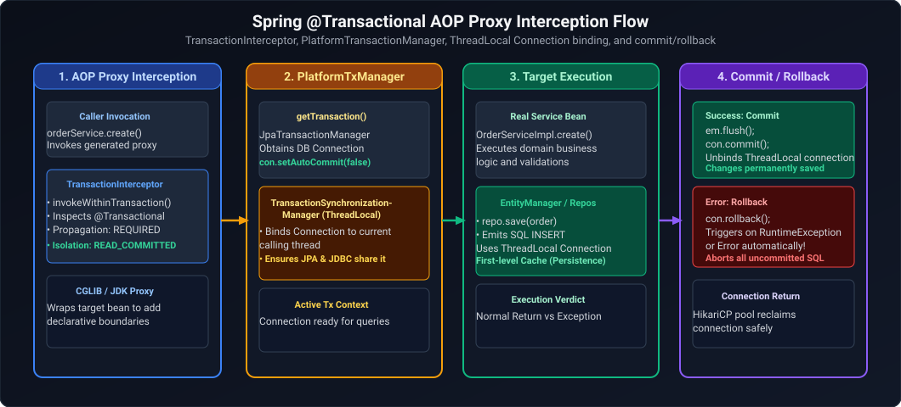
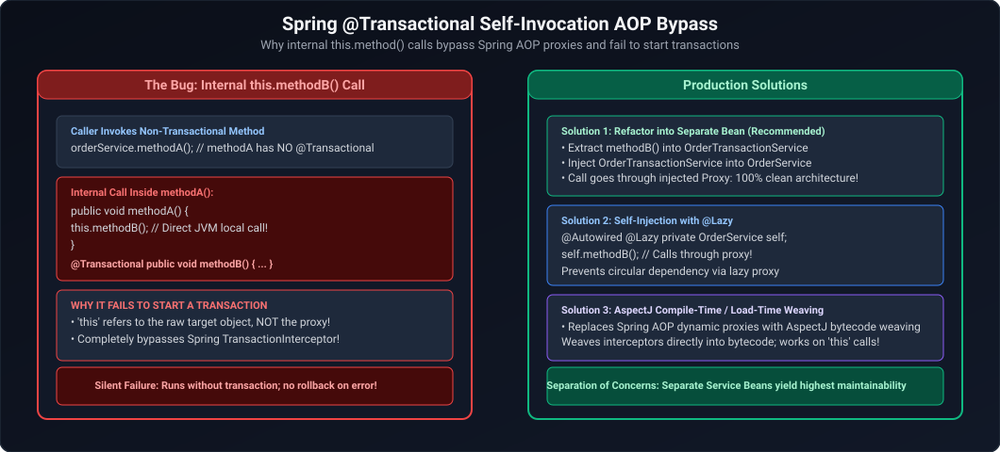
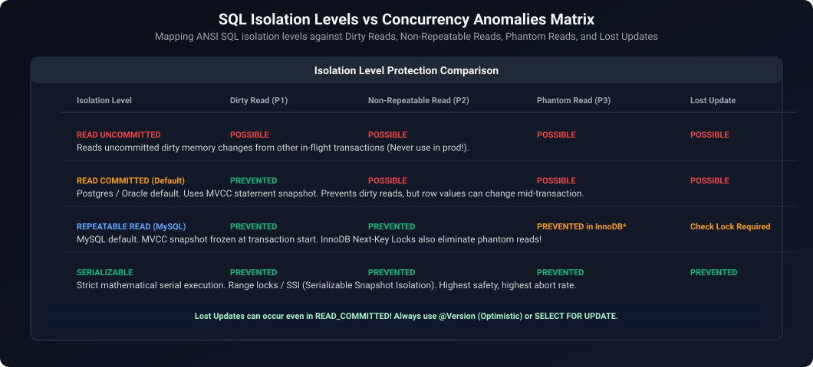
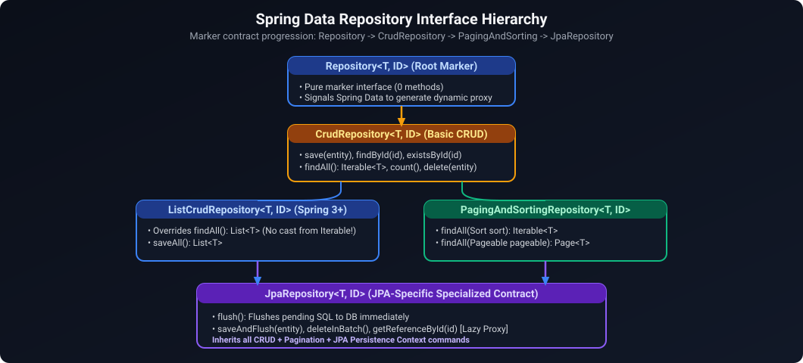
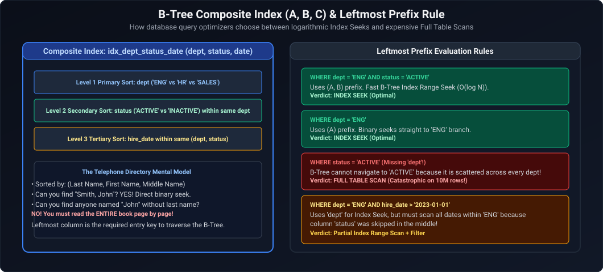
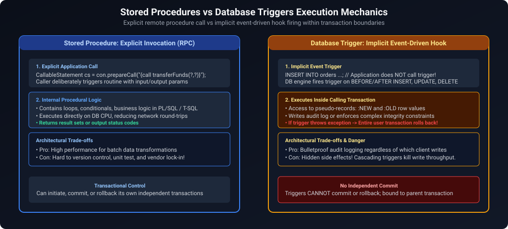
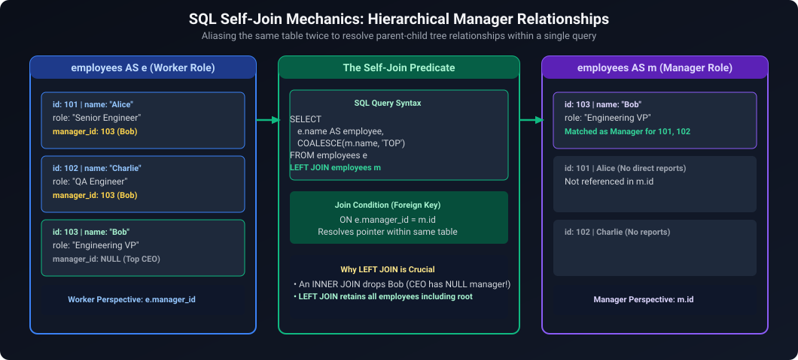
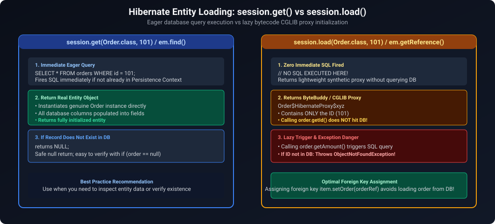
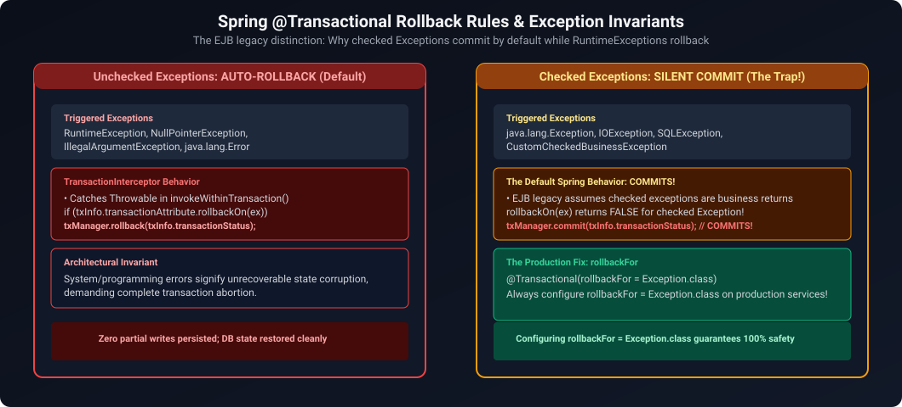

# 07. Databases, SQL, JPA & Hibernate Architecture

A comprehensive guide answering all 22 questions on ACID properties, database isolation levels, SQL joins and optimization, Spring Boot multi-datasource configuration, Hibernate entity lifecycles, lazy loading, N+1 query problem, transaction propagation, and concurrency locking strategies.

---

## Architectural Overview: Hibernate Persistence Context & Transaction Boundary



*D2 Source:* [assets/07_databases_jpa_and_hibernate_faq/01_spring_transactional_aop_proxy_flow.d2](assets/07_databases_jpa_and_hibernate_faq/01_spring_transactional_aop_proxy_flow.d2)

---

## Table of Contents & Question Mapping

1. **RDBMS Foundations, ACID & SQL Query Engineering**
   - [Q1. ACID Properties & Database Transaction Isolation Levels](#q1-medium-acid-properties--database-transaction-isolation-levels)
   - [Q2. SQL Joins: `INNER`, `LEFT`, `RIGHT`, and `FULL OUTER`](#q2-easy-sql-joins-inner-left-right-and-full-outer)
   - [Q3. Practical SQL Queries: Second-Highest Salary & Department-Wise Averages](#q3-easy-practical-sql-queries-second-highest-salary--department-wise-averages)
   - [Q4. Clustered vs Non-Clustered Indexes & Slow Query Optimization](#q4-medium-clustered-vs-non-clustered-indexes--slow-query-optimization)
   - [Q5. Invoking Stored Procedures via JDBC](#q5-medium-invoking-stored-procedures-via-jdbc)
2. **Spring Boot Datasources & JPA Entity Mapping**
   - [Q6. Connecting Multiple DataSources in Spring Boot](#q6-medium-connecting-multiple-datasources-in-spring-boot)
   - [Q7. JPA Primary Key Annotations: `@Id` & `@GeneratedValue`](#q7-medium-jpa-primary-key-annotations-id--generatedvalue)
   - [Q8. Hibernate Entity Lifecycle States](#q8-medium-hibernate-entity-lifecycle-states)
   - [Q9. Criteria API vs JPQL](#q9-hard-criteria-api-vs-jpql)
3. **ORM Performance: Fetching, N+1 Problem & Caching**
   - [Q10. `LAZY` vs `EAGER`, `LazyInitializationException` & The N+1 Select Problem](#q10-hard-lazy-vs-eager-lazyinitializationexception--the-n1-select-problem)
   - [Q11. Hibernate Caching: 1st Level vs 2nd Level Cache](#q11-medium-hibernate-caching-1st-level-vs-2nd-level-cache)
   - [Q12. Dirty Checking & Flush Modes](#q12-medium-dirty-checking--flush-modes)
   - [Q13. `CascadeType.ALL` vs `orphanRemoval`](#q13-medium-cascadetypeall-vs-orphanremoval)
4. **Transactions, Concurrency & Enterprise Architectures**
   - [Q14. Spring `@Transactional` Architecture, Propagation Levels & The 10 Core Production Puzzle Scenarios](#q14-medium-spring-transactional-architecture-propagation-levels--the-10-core-production-puzzle-scenarios)
   - [Q15. Optimistic vs Pessimistic Locking & The Train Seat Booking Race Condition](#q15-hard-optimistic-vs-pessimistic-locking--the-train-seat-booking-race-condition)
   - [Q16. Pagination and Sorting in Spring Data JPA](#q16-medium-pagination-and-sorting-in-spring-data-jpa)
   - [Q17. Multi-Tenancy Architecture in JPA](#q17-expert-multi-tenancy-architecture-in-jpa)
   - [Q18. Multi-Instance Cron Worker Row Concurrency: `ShedLock` vs `SELECT FOR UPDATE SKIP LOCKED`](#q18-hard-multi-instance-cron-worker-row-concurrency-shedlock-vs-select-for-update-skip-locked)
   - [Q19. Lost Update Anomaly: Optimistic vs Pessimistic Locking Strategy Selection](#q19-hard-lost-update-anomaly-optimistic-vs-pessimistic-locking-strategy-selection)
   - [Q20. Managing Transaction Rollbacks Across a Series of SQL Statements](#q20-medium-managing-transaction-rollbacks-across-a-series-of-sql-statements)
   - [Q21. `JpaRepository` vs `CrudRepository` vs `PagingAndSortingRepository`](#q21-easy-jparepository-vs-crudrepository-vs-pagingandsortingrepository)
   - [Q22. Deleting Duplicate Rows While Retaining Exactly One Copy in SQL](#q22-medium-deleting-duplicate-rows-while-retaining-exactly-one-copy-in-sql)
   - [Q23. Database Indexing Mechanics & Composite Index Leftmost Prefix Rule](#q23-medium-database-indexing-mechanics--composite-index-leftmost-prefix-rule)
   - [Q24. Stored Procedures vs Database Triggers: Performance & Architecture Trade-offs](#q24-medium-stored-procedures-vs-database-triggers-performance--architecture-trade-offs)
   - [Q25. SQL Self-Join: Finding Employees Earning More Than Their Managers](#q25-medium-sql-self-join-finding-employees-earning-more-than-their-managers)
   - [Q26. Hibernate `session.get()` vs `session.load()` (and `EntityManager.find()` vs `getReference()`): Proxy Initialization & Lazy Traps](#q26-medium-hibernate-sessionget-vs-sessionload-and-entitymanagerfind-vs-getreference-proxy-initialization--lazy-traps)
   - [Q27. The Silent Rollback Trap: Catching Downstream Exceptions in `@Transactional` Methods & `UnexpectedRollbackException`](#q27-hard-the-silent-rollback-trap-catching-downstream-exceptions-in-transactional-methods--unexpectedrollbackexception)
---

# 1. RDBMS Foundations, ACID & SQL Query Engineering

---

### Q1. [Medium] ACID Properties & Database Transaction Isolation Levels
**Difficulty:** [Medium]
**Topic Covered:** Relational Database Engine Foundations  
- **Atomicity:** All-or-nothing execution.
- **Consistency:** Transactions preserve valid database integrity constraints.
- **Isolation:** Prevents concurrent transaction interference.
- **Durability:** Committed changes persist across crashes.

| Isolation Level | Dirty Read | Non-Repeatable Read | Phantom Read |
| :--- | :---: | :---: | :---: |
| **Read Uncommitted** | Yes | Yes | Yes |
| **Read Committed** | No | Yes | Yes |
| **Repeatable Read** | No | No | Yes |
| **Serializable** | No | No | No |

---

### Q2. [Easy] SQL Joins: `INNER`, `LEFT`, `RIGHT`, and `FULL OUTER`
**Difficulty:** [Easy]
**Topic Covered:** Relational Set Operations  
- `INNER JOIN`: Matching records present in both tables.
- `LEFT JOIN`: All records from left table plus matching records from right.
- `RIGHT JOIN`: All records from right table plus matching records from left.
- `FULL OUTER JOIN`: All rows from both tables, filling nulls where matches do not exist.

---

### Q3. [Easy] Practical SQL Queries: Second-Highest Salary & Department-Wise Averages
**Difficulty:** [Easy]
*(Grouped together: Analytical SQL Queries)*  
**Topic Covered:** SQL Window Functions & Aggregation  

```sql
-- Q3: Second highest salary via DENSE_RANK() (handles ties correctly)
WITH Ranked AS (
    SELECT salary, DENSE_RANK() OVER (ORDER BY salary DESC) as rk FROM employees
)
SELECT salary FROM Ranked WHERE rk = 2 LIMIT 1;

-- Q4: Department-wise average salary
SELECT department_id, COUNT(*) as emp_count, ROUND(AVG(salary), 2) as avg_sal
FROM employees
GROUP BY department_id;
```

---

### Q4. [Medium] Clustered vs Non-Clustered Indexes & Slow Query Optimization
**Difficulty:** [Medium]
*(Grouped together: Database Indexing & Performance Tuning)*  
**Topic Covered:** B-Tree Physical Layout & Query Optimization  
- **Clustered Index:** Dictates physical row storage on disk (Primary Key). One per table. Leaf nodes contain the row data.
- **Non-Clustered Index:** Separate B-tree structure holding indexed columns and pointers to the row.
- **Optimization:** Use `EXPLAIN ANALYZE`, build **Covering Indexes**, and avoid leading wildcards in `LIKE` queries.

---

### Q5. [Medium] Invoking Stored Procedures via JDBC
**Difficulty:** [Medium]
**Topic Covered:** JDBC Callable Statements  
Use `CallableStatement cs = connection.prepareCall("{call proc_name(?, ?)}")` registering OUT parameters with `Types.*`.

---

# 2. Spring Boot Datasources & JPA Entity Mapping

---

### Q6. [Medium] Connecting Multiple DataSources in Spring Boot
**Difficulty:** [Medium]
**Topic Covered:** Spring Boot Multi-Database Configuration  
Create two `@Configuration` classes, mark one `DataSource` `@Primary`, and configure independent `EntityManagerFactory` and `PlatformTransactionManager` beans pointing to distinct package namespaces.

---

### Q7. [Medium] JPA Primary Key Annotations: `@Id` & `@GeneratedValue`
**Difficulty:** [Medium]
**Topic Covered:** Entity Identification Strategies  
- `@Id`: Marks primary key.
- `GenerationType.IDENTITY`: Uses DB auto-increment; disables JDBC batch inserts.
- `GenerationType.SEQUENCE`: Uses DB sequences; supports batching (`allocationSize = 50`).

---

### Q8. [Medium] Hibernate Entity Lifecycle States
**Difficulty:** [Medium]
**Topic Covered:** Persistence Context Management  
- **Transient:** New instance, unattached to Session.
- **Persistent:** Managed by active `EntityManager`; modifications dirty-checked automatically.
- **Detached:** Previously persistent entity whose Session has closed.
- **Removed:** Marked for deletion on transaction commit.

---

### Q9. [Hard] Criteria API vs JPQL
**Difficulty:** [Hard]
**Topic Covered:** JPA Query Paradigms  
- `JPQL`: String-based entity query language. Simple but runtime syntax discovery.
- `Criteria API`: Type-safe programmatic API builder for dynamic queries.

---

# 3. ORM Performance: Fetching, N+1 Problem & Caching

---

### Q10. [Hard] `LAZY` vs `EAGER`, `LazyInitializationException` & The N+1 Select Problem
**Difficulty:** [Hard]
*(Grouped together: Complete ORM Performance Tuning)*  
**Topic Covered:** Association Fetching & Query Optimization  
- `LAZY`: Association loaded on demand via proxy.
- `EAGER`: Association loaded immediately.
- `LazyInitializationException`: Caused by accessing a lazy proxy outside an open Hibernate session. Avoid by mapping to DTOs in `@Transactional` service layer.
- **N+1 Problem:** 1 query to fetch parents + $N$ queries to fetch each child. Prevent using `JOIN FETCH` or `@EntityGraph`.

```java
@Query("SELECT DISTINCT a FROM Author a LEFT JOIN FETCH a.books")
List<Author> findAllWithBooks();
```

---

### Q11. [Medium] Hibernate Caching: 1st Level vs 2nd Level Cache
**Difficulty:** [Medium]
**Topic Covered:** ORM Caching Layers  
- **1st Level Cache (Session):** Mandatory. Scoped to current transaction.
- **2nd Level Cache (Process/Cluster):** Optional (e.g. Ehcache/Redis). Scoped to `EntityManagerFactory` across transactions.

---

### Q12. [Medium] Dirty Checking & Flush Modes
**Difficulty:** [Medium]
**Topic Covered:** Session Synchronization  
Hibernate compares entity snapshots against current state during session flush, auto-emitting SQL `UPDATE` statements. `FlushModeType.AUTO` flushes before queries and at commit.

---

### Q13. [Medium] `CascadeType.ALL` vs `orphanRemoval`
**Difficulty:** [Medium]
**Topic Covered:** Entity Relationship Cascading  
- `CascadeType.ALL`: Cascades entity state operations (`PERSIST`, `REMOVE`).
- `orphanRemoval = true`: Deletes child from DB when severed from parent collection.

---

# 4. Transactions, Concurrency & Enterprise Architectures

---

### Q14. [Medium] Spring `@Transactional` Architecture, Propagation Levels & The 10 Core Production Puzzle Scenarios
**Topic Covered:** Declarative Transaction Demarcation, Spring AOP Proxies, Propagation Semantics & Concurrency Traps  
**Difficulty:** `[Hard]`

#### Architectural Overview
Spring's `@Transactional` relies on Spring AOP proxies (CGLIB subclassing or JDK dynamic interfaces) wrapping target beans. When a client invokes a transactional method from outside the bean, the proxy intercepts the call, obtains a JDBC connection from `DataSource` (via `PlatformTransactionManager`), binds it to the current thread (`ThreadLocal`), sets `connection.setAutoCommit(false)`, and delegates to the target method.



*D2 Source:* [assets/07_databases_jpa_and_hibernate_faq/02_spring_self_invocation_aop_bypass.d2](assets/07_databases_jpa_and_hibernate_faq/02_spring_self_invocation_aop_bypass.d2)

---

#### The 10 Core Production `@Transactional` Interview Puzzle Scenarios

##### 1. Checked Exception (`IOException`) vs Unchecked Exception Rollback
* **Scenario:** A `@Transactional` method inserts an order into the database, then throws an `IOException`. The order unexpectedly remains in the database. Why?
* **Mechanism:** By default, Spring's transaction rollback rules conform to EJB conventions: transactions roll back automatically **only on unchecked exceptions** (`RuntimeException` and `Error`). Checked exceptions (subclasses of `java.lang.Exception` like `IOException` or `SQLException`) represent recoverable business conditions; Spring commits the transaction by default!
* **Production Fix:** Explicitly declare rollback rules:
  ```java
  @Transactional(rollbackFor = Exception.class)
  public void placeOrder(OrderRequest request) throws IOException { ... }
  ```

##### 2. Same-Class Self-Invocation with `REQUIRES_NEW`
* **Scenario:** `placeOrder()` is annotated with `@Transactional(propagation = Propagation.REQUIRED)` and internally calls `this.audit()` in the same class. `audit()` is annotated with `@Transactional(propagation = Propagation.REQUIRES_NEW)`. How many physical transactions execute?
* **Mechanism:** **Exactly 1 physical transaction executes!**
* **Root Cause:** Spring AOP cannot intercept `this` self-invocations. Calling `audit()` directly invokes the raw memory instance, bypassing the Spring AOP proxy. The `@Transactional(REQUIRES_NEW)` annotation on `audit()` is completely ignored, executing inside the existing caller transaction.
* **Production Fix:** Move `audit()` to a dedicated collaborator service bean (`AuditService`) and inject it into `OrderService`.

##### 3. `@Transactional` Applied to a `private` Method
* **Scenario:** What happens when `@Transactional` is applied to a `private` method?
* **Mechanism:** The annotation is **silently ignored**. No transaction is created.
* **Root Cause:** Spring AOP proxies rely on dynamic subclassing (CGLIB) or interfaces (JDK proxies). Neither mechanism can intercept or override `private` methods. Spring's `TransactionAttributeSource` ignores non-public methods on proxy targets. (AspectJ byte-code weaving is required if private method transactionality is strictly needed).

##### 4. `@Transactional` Applied to a `public final` Method on Another Bean
* **Scenario:** Bean A invokes a `public final` method annotated with `@Transactional` on Bean B. What happens?
* **Mechanism:** The method executes **non-transactionally**, without proxy interception.
* **Root Cause:** In default CGLIB proxying, Spring generates a subclass of Bean B. In Java bytecode, a subclass cannot override a `final` method. When Bean A calls `beanB.finalMethod()`, JVM dynamic dispatch routes the call directly to the base class implementation, bypassing the CGLIB proxy advice.

##### 5. Service Method Without `@Transactional` Calling Multiple Repositories
* **Scenario:** Your service method has NO `@Transactional`. It calls `orderRepo.save(order)`. Then `paymentRepo.save(payment)` throws a `RuntimeException`. Does the order remain in the database?
* **Mechanism:** **Yes, the order remains permanently in the database!**
* **Root Cause:** Spring Data's `SimpleJpaRepository` is annotated with `@Transactional` at the class level. In the absence of an outer transaction, each repository method runs in its own isolated transaction. `orderRepo.save()` opens a physical connection, inserts the row, and immediately commits. When `paymentRepo.save()` later fails, the order is already committed, resulting in partial data corruption.

##### 6. Nested Transactions: Caller Catching Callee `RuntimeException`
* **Scenario:** Bean A calls Bean B. Both methods use default `@Transactional(REQUIRED)`. Bean B throws a `RuntimeException`. Bean A catches the exception in a `try-catch` block and returns normally. What gets committed?
* **Mechanism:** **Nothing gets committed! Spring throws `UnexpectedRollbackException`!**
* **Root Cause:** Because both beans participate in the same logical transaction, when Bean B's exception passes through its transaction interceptor, Spring marks the underlying physical transaction as **Rollback-Only** (`TransactionStatus.setRollbackOnly()`). When Bean A catches the exception and attempts to commit, Spring inspects the rollback-only flag, aborts the commit, rolls back all changes, and throws `org.springframework.transaction.UnexpectedRollbackException`.
* **Production Fix:** If Bean B's failure should not abort Bean A, annotate Bean B with `@Transactional(propagation = Propagation.REQUIRES_NEW)` or use JDBC savepoints (`Propagation.NESTED`).

##### 7. Mutating Managed JPA Entity Without Calling `save()`
* **Scenario:** Inside a `@Transactional` method, you load a `User` entity using JPA, update `user.setEmail("new@example.com")`, and never call `userRepository.save(user)`. Is the change persisted?
* **Mechanism:** **Yes, the update is persisted automatically!**
* **Root Cause:** JPA Hibernate uses a **Persistence Context** (1st Level Cache) with **Automatic Dirty Checking**. When an entity is loaded inside an active transaction, it enters the `MANAGED` state. Hibernate takes an initial snapshot. At transaction commit / flush time, Hibernate compares the entity's current state against the snapshot. Detecting the modified email, Hibernate automatically emits `UPDATE users SET email = ? WHERE id = ?`. Calling `save()` is redundant.

##### 8. `@Async` Method Invoked from `@Transactional` Method
* **Scenario:** A `@Transactional` method invokes an `@Async` method on another bean that inserts a row into the database. The caller transaction then throws a `RuntimeException`. Is the async row rolled back?
* **Mechanism:** **No, the async row is NOT rolled back!**
* **Root Cause:** Spring's transaction state is bound to the calling thread via `ThreadLocal`. An `@Async` method executes on a separate worker thread borrowed from a `TaskExecutor`. Because `ThreadLocal` context does not cross thread boundaries, the `@Async` method executes in a completely independent database transaction and connection. The caller's rollback has zero effect on the async thread.

##### 9. Application Event Listener During Transaction Rollback
* **Scenario:** Inside a `@Transactional` method, you publish an `OrderPlacedEvent`, and an `@EventListener` sends a confirmation email to the customer. The database transaction then rolls back. Does the customer still receive the email?
* **Mechanism:** **Yes, the customer receives the email!**
* **Root Cause:** Standard `@EventListener` methods execute **synchronously on the same thread immediately when `publishEvent()` is called**, well before the transaction attempts to commit. If a rollback occurs later, the external email has already been transmitted over SMTP/HTTP.
* **Production Fix:** Use `@TransactionalEventListener(phase = TransactionPhase.AFTER_COMMIT)` to ensure listener execution occurs strictly after the physical database transaction has committed.

##### 10. Isolation Level Override in Participating Transaction
* **Scenario:** Method A (`@Transactional(isolation = READ_COMMITTED)`) calls Method B (`@Transactional(propagation = REQUIRED, isolation = SERIALIZABLE)`). Which isolation level applies to Method B?
* **Mechanism:** **The outer transaction's isolation level (`READ_COMMITTED`) applies!**
* **Root Cause:** With `Propagation.REQUIRED`, Method B joins the existing physical JDBC transaction. In JDBC, connection isolation is negotiated when the connection is borrowed; it cannot be altered mid-transaction. Spring either ignores the inner isolation setting or, if `validateExistingTransaction = true` is configured on `PlatformTransactionManager`, throws `IllegalTransactionStateException`.
* **Production Fix:** If `SERIALIZABLE` is mandatory for Method B, declare `propagation = Propagation.REQUIRES_NEW` so it opens its own independent physical connection with the elevated isolation level.

---

### Q15. [Hard] Optimistic vs Pessimistic Locking & The Train Seat Booking Race Condition
**Difficulty:** [Hard]
*(Grouped together: Concurrency Locking and Real-World Scenarios)*  
**Topic Covered:** High-Concurrency Conflict Resolution  
- **Optimistic Locking (`@Version`):** Verifies version column on update. Throws `OptimisticLockException` on concurrent write. Best for low collision workloads.
- **Pessimistic Locking (`PESSIMISTIC_WRITE`):** Issues `SELECT ... FOR UPDATE` row lock.

#### Train Seat Booking Race Condition Solution:
```java
@Lock(LockModeType.PESSIMISTIC_WRITE)
@Query("SELECT s FROM Seat s WHERE s.id = :id")
Optional<Seat> findByIdForUpdate(@Param("id") Long id);
```
Acquires exclusive row lock in DB; competing booking requests wait until the first commits.

---

### Q16. [Medium] Pagination and Sorting in Spring Data JPA
**Difficulty:** [Medium]
**Topic Covered:** Large Result Set Management  
Pass `Pageable` (`PageRequest.of(0, 20)`). Prefer `Slice<T>` over `Page<T>` when total count queries are expensive.

---

### Q17. [Expert] Multi-Tenancy Architecture in JPA
**Difficulty:** [Expert]
**Topic Covered:** Multi-Tenant Persistence Strategies  
1. Database-Per-Tenant (via `AbstractRoutingDataSource`).
2. Schema-Per-Tenant (via `MultiTenantConnectionProvider`).
3. Shared Schema Discriminator Column (via Hibernate `@TenantId`).

---

### Q18. [Hard] Multi-Instance Cron Worker Row Concurrency: `ShedLock` vs `SELECT FOR UPDATE SKIP LOCKED`
**Topic Covered:** Distributed Scheduling & Queue Processing  
**Difficulty:** `[Hard]`

#### Architectural Overview
When scaling scheduled jobs across multi-replica Kubernetes clusters, instances collide if both read and update the same pending records:
1. **Singleton Scheduled Jobs**: Use **ShedLock** to acquire a distributed lock in a shared database table (`shedlock`). Exactly one pod executes the cron job while others skip.
2. **High-Throughput Queue Processing**: Use PostgreSQL / MySQL 8+ `SELECT ... FOR UPDATE SKIP LOCKED` inside worker transactions. Each worker thread immediately locks and processes distinct rows without blocking or duplicate execution.

```sql
-- Claims 50 unclaimed jobs without waiting on rows locked by concurrent pods
SELECT id, task_payload 
FROM scheduled_tasks 
WHERE status = 'PENDING' 
ORDER BY priority DESC, created_at ASC 
LIMIT 50 
FOR UPDATE SKIP LOCKED;
```

---

### Q19. [Hard] Lost Update Anomaly: Optimistic vs Pessimistic Locking Strategy Selection
**Topic Covered:** Concurrency Control & Race Condition Diagnostics  
**Difficulty:** `[Medium]`

#### Architectural Overview
The **Lost Update Anomaly** occurs when Transaction 1 and Transaction 2 read the same row concurrently, and Transaction 2 commits after Transaction 1, completely overwriting Transaction 1's write without knowing about it.



*D2 Source:* [assets/07_databases_jpa_and_hibernate_faq/03_acid_isolation_levels_anomalies.d2](assets/07_databases_jpa_and_hibernate_faq/03_acid_isolation_levels_anomalies.d2)

* **Optimistic Locking**: Place `@Version private Long version;` on the JPA entity. Generates `UPDATE ... WHERE id = :id AND version = :version`. Throws `OptimisticLockException` on collision; retry with exponential backoff.
* **Pessimistic Locking**: Use `@Lock(LockModeType.PESSIMISTIC_WRITE)` to place an exclusive database lock (`SELECT FOR UPDATE`).

#### Concrete Production Scenario: The Rs. 500 Wallet Double-Deduction Race Condition
* **Question:** A wallet balance has Rs. 500. Two concurrent requests each load the balance, verify it is at least Rs. 400, and deduct Rs. 400 inside `@Transactional`. Can both requests succeed?
* **Answer:** **Yes! Under default `READ COMMITTED` isolation, BOTH requests succeed unless explicit concurrency controls are added!**
* **Execution Trace:**
  1. Request A begins transaction $T_1$, queries `SELECT balance FROM wallet WHERE id = 1`, and reads `balance = 500`.
  2. Concurrently, Request B begins transaction $T_2$, queries the same row under `READ COMMITTED`, and also reads `balance = 500`.
  3. Both threads evaluate the business condition: `500 >= 400` evaluates to `true` for both threads!
  4. Request A updates balance: `500 - 400 = 100`, issues `UPDATE wallet SET balance = 100 WHERE id = 1`, and commits $T_1$.
  5. Request B, having read the snapshot value 500, updates balance: `500 - 400 = 100` (or `100 - 400 = -300` overdraft if applying a relative debit), and commits $T_2$.
  6. **Result:** The user withdrew Rs. 800 while having only Rs. 500! A catastrophic lost update anomaly.

#### 3 Production Defenses:
1. **Pessimistic Locking (`SELECT FOR UPDATE`):**
   ```java
   @Lock(LockModeType.PESSIMISTIC_WRITE)
   @Query("SELECT w FROM Wallet w WHERE w.id = :id")
   Optional<Wallet> findByIdForUpdate(@Param("id") Long id);
   ```
   Request B blocks at the database level until Request A commits. Request B then re-reads the updated balance (`100`), checks `100 >= 400`, and rejects the deduction with `InsufficientFundsException`.
2. **Optimistic Locking (`@Version`):**
   Add `@Version private Long version;` to `Wallet`. Request B's update generates `UPDATE wallet SET balance = 100, version = 2 WHERE id = 1 AND version = 1`. Because Request A incremented version to 2, Request B matches 0 rows and throws `OptimisticLockException`.
3. **Atomic SQL Update with DB Constraint Guardrail:**
   ```sql
   UPDATE wallet 
   SET balance = balance - 400 
   WHERE id = :id AND balance >= 400;
   ```
   Combined with a database check constraint (`CHECK (balance >= 0)`), this executes at row-lock speed in the database engine without holding long application-level locks. If updated rows count is 0, the application aborts and returns an error.

---

### Q20. [Medium] Managing Transaction Rollbacks Across a Series of SQL Statements
**Topic Covered:** Transaction Demarcation, Nested Transactions & Savepoints  
**Difficulty:** `[Medium]`

#### Architectural Overview
When executing a sequence of SQL statements, if Step 4 fails out of 5:
- In pure JDBC: Set `connection.setAutoCommit(false)`. On exception in `catch`, invoke `connection.rollback()`. To roll back partially, use **JDBC Savepoints**: `Savepoint sp = connection.setSavepoint(); connection.rollback(sp);`.
- In Spring: By default, Spring rolls back on `RuntimeException` and `Error`, but NOT checked exceptions (`SQLException`, `IOException`). Always configure `@Transactional(rollbackFor = Exception.class)`. To isolate a sub-step without failing the outer transaction, use `@Transactional(propagation = Propagation.REQUIRES_NEW)` or `NESTED` (which uses JDBC savepoints).

---

### Q21. [Easy] `JpaRepository` vs `CrudRepository` vs `PagingAndSortingRepository`
**Topic Covered:** Spring Data JPA Repository Hierarchy  
**Difficulty:** `[Easy]`

#### Architectural Overview


*D2 Source:* [assets/07_databases_jpa_and_hibernate_faq/04_spring_data_repository_hierarchy.d2](assets/07_databases_jpa_and_hibernate_faq/04_spring_data_repository_hierarchy.d2)
- **`CrudRepository`**: Basic CRUD operations (`save`, `findById`, `delete`).
- **`PagingAndSortingRepository`**: Adds pagination and sorting methods.
- **`JpaRepository`**: Extends both; adds JPA-specific flush methods (`flush()`, `saveAndFlush()`), batch deletion (`deleteAllInBatch()`), and returns `List` instead of `Iterable`.

---

### Q22. [Medium] Deleting Duplicate Rows While Retaining Exactly One Copy in SQL
**Topic Covered:** SQL Deduplication Algorithms  
**Difficulty:** `[Medium]`

#### Architectural Overview
Given a table `employees` containing duplicate records for `email`:
```sql
-- Solution using CTE with ROW_NUMBER()
WITH RankedDuplicates AS (
    SELECT id,
           ROW_NUMBER() OVER (
               PARTITION BY email 
               ORDER BY created_at ASC, id ASC
           ) AS row_num
    FROM employees
)
DELETE FROM employees
WHERE id IN (
    SELECT id 
    FROM RankedDuplicates 
    WHERE row_num > 1
);
```
Retains the oldest original entry (`row_num = 1`) and purges all redundant duplicates in a single atomic statement.

---

### Q23. [Medium] Database Indexing Mechanics & Composite Index Leftmost Prefix Rule
**Difficulty:** [Medium]
**Topic Covered:** B-Tree Index Internals, Composite Indexes & Covering Queries  
**Question:** Indexing and composite indexes: How does a composite index work under the hood, why does the leftmost prefix rule apply, and when is an index ignored by the query planner?

#### Definition & Core Concepts
Relational database engines (PostgreSQL, MySQL InnoDB, Oracle) structure indexes as self-balancing **B+ Trees**. Leaf nodes contain sorted key values and physical row pointers (`ctid` in Postgres, clustered PK in InnoDB).

A **Composite Index** indexes multiple columns in a strict declared sequence:
```sql
CREATE INDEX idx_user_status_created ON users (status, tenant_id, created_at);
```

**The Leftmost Prefix Rule:**
A composite index on `(A, B, C)` is physically sorted first by $A$, then by $B$ within identical values of $A$, and finally by $C$ within identical values of $(A, B)$.
- **Can Use Index:**
  - Queries filtering on `A` alone.
  - Queries filtering on `A AND B`.
  - Queries filtering on `A AND B AND C`.
- **Cannot Efficiently Use Index:**
  - Queries filtering on `B` alone, `C` alone, or `B AND C` (the B+ tree cannot skip to $B$ because values of $B$ are scattered across different branches of $A$).
- **The Range Predicate Boundary:** If a range filter (`>`, `<`, `BETWEEN`) is applied on column $B$, the database can use the index for $A$ and $B$, but **cannot** use the index for column $C$. Equality predicates must precede range predicates.

**Covering Indexes (`INDEX ... INCLUDE`):**
If an index contains all columns requested in the query `SELECT` clause, the database satisfies the query entirely from the B+ Tree leaf nodes, eliminating expensive **Table Heap Lookups** (Index-Only Scan).

#### Visual Flow


*D2 Source:* [assets/07_databases_jpa_and_hibernate_faq/05_b_tree_composite_index_leftmost_prefix.d2](assets/07_databases_jpa_and_hibernate_faq/05_b_tree_composite_index_leftmost_prefix.d2)

#### Production Implementation / SQL Solution
```sql
-- Optimal composite index matching: equality on high-cardinality tenant_id, equality on status, range on created_at
CREATE INDEX idx_orders_composite ON orders (tenant_id, status, created_at)
INCLUDE (total_amount, customer_id);

-- Query benefiting from full Index-Only Scan (Zero Table Heap Lookups)
EXPLAIN ANALYZE
SELECT customer_id, total_amount
FROM orders
WHERE tenant_id = 'tenant_east_01'
  AND status = 'SHIPPED'
  AND created_at >= '2026-01-01 00:00:00'
ORDER BY created_at DESC;
```
- **Time Complexity:** $O(\log N + K)$ B+ Tree binary search to leaf + range scan of $K$ matching rows.
- **Space Complexity:** $O(M)$ extra disk storage consumed by the index file.

#### Engineering Implications & Production Pitfalls
1. **Low Cardinality Index Ignored:** If a column has only 2 values (e.g. `gender` or `is_deleted = false` where 95% of rows are `false`), the query planner will ignore the index and perform a sequential table scan because random disk I/O through index leaf pointers is slower than sequential reads.
2. **Implicit Type Casting Pitfall:** If `tenant_id` is `VARCHAR` but the query passes an integer (`WHERE tenant_id = 100`), the database wraps the column with `CAST(tenant_id AS integer)`, completely invalidating the B-Tree index!

---

### Q24. [Medium] Stored Procedures vs Database Triggers: Performance & Architecture Trade-offs
**Difficulty:** [Medium]
**Topic Covered:** Server-Side RDBMS Logic vs Domain Layer Orchestration  
**Question:** Stored procedures vs. triggers: What are the architectural differences, performance characteristics, maintainability challenges, and when should business logic reside in the database versus the application service layer?

#### Definition & Core Concepts
- **Stored Procedures:** Named blocks of procedural SQL code compiled and stored on the database server. Explicitly called by application code (`CALL process_monthly_payroll()`).
- **Database Triggers:** Implicit procedural routines tied to a table that execute automatically in response to DML operations (`BEFORE/AFTER INSERT`, `UPDATE`, `DELETE`).

#### Architectural Comparison Matrix:
| Architectural Dimension | Stored Procedures | Database Triggers | Application Service Layer |
| :--- | :--- | :--- | :--- |
| **Invocation** | Explicitly invoked by code | Implicitly executed by DML events | Orchestrated via Java / Spring |
| **Network Roundtrips** | Minimal (executes multi-step logic inside DB) | Zero application roundtrips | Multiple network hops per query |
| **Maintainability** | Difficult; procedural SQL differs across vendors | Extremely difficult; invisible side-effects | High; clean OOP, Git branching, CI/CD |
| **Compute Scalability** | Low; scaling database CPUs is very expensive | Low; triggers block writer transactions | High; scale stateless Spring Boot Pods horizontally |
| **Observability** | Opaque; hard to trace with OpenTelemetry | Invisible; triggers cause unexpected latency | Full OpenTelemetry APM & distributed tracing |

#### Visual Flow


*D2 Source:* [assets/07_databases_jpa_and_hibernate_faq/06_stored_procedures_vs_triggers_execution.d2](assets/07_databases_jpa_and_hibernate_faq/06_stored_procedures_vs_triggers_execution.d2)

#### Production Implementation / SQL Example
```sql
-- Production Trigger Pattern: Enforcing Immutable Audit History
CREATE TABLE account_audit_log (
    audit_id BIGSERIAL PRIMARY KEY,
    account_id BIGINT NOT NULL,
    old_balance NUMERIC(15, 2),
    new_balance NUMERIC(15, 2),
    changed_by VARCHAR(50),
    changed_at TIMESTAMP DEFAULT CURRENT_TIMESTAMP
);

CREATE OR REPLACE FUNCTION audit_account_balance_change()
RETURNS TRIGGER AS $$
BEGIN
    IF NEW.balance <> OLD.balance THEN
        INSERT INTO account_audit_log (account_id, old_balance, new_balance, changed_by, changed_at)
        VALUES (OLD.id, OLD.balance, NEW.balance, CURRENT_USER, CURRENT_TIMESTAMP);
    END IF;
    RETURN NEW;
END;
$$ LANGUAGE plpgsql;

CREATE TRIGGER trg_account_balance_audit
AFTER UPDATE ON accounts
FOR EACH ROW
EXECUTE FUNCTION audit_account_balance_change();
```

#### Engineering Implications & Production Pitfalls
1. **The Cascading Trigger Deadlock:** Trigger A updates Table 2, which fires Trigger B updating Table 1. Under concurrent transactions, this creates circular locks and immediate deadlocks. Avoid triggers for complex business domain logic.
2. **Production Recommendation:** Use stored procedures solely for bulk database-internal maintenance (e.g. monthly partition pruning). Keep all core business rules in the Java application layer where they can be unit-tested, versioned, and horizontally scaled.

---

### Q25. [Medium] SQL Self-Join: Finding Employees Earning More Than Their Managers
**Difficulty:** [Medium]
**Topic Covered:** Relational Self-Joins, Hierarchical Data & Hash Joins  
**Question:** Write a query to find employees earning more than their managers. Explain the join mechanics, NULL handling for the CEO, and optimization strategies.

#### Definition & Core Concepts
In hierarchical relational schemas (e.g., employee reporting trees, bill-of-materials, category hierarchies), parent-child relationships reside within a single table:
- `id`: Employee's Primary Key.
- `manager_id`: Self-referential Foreign Key pointing to `id` in the same table.
- `salary`: Numerical compensation value.

To compare attributes between an employee and their immediate superior, perform a **Self-Join** by aliasing the table twice: once as the employee (`emp`) and once as the manager (`mgr`).

**CEO / Top-Level Executive Edge Case:**
The CEO or root entity has `manager_id IS NULL`. An `INNER JOIN` automatically excludes the CEO from the left table (since `NULL = id` evaluates to `UNKNOWN`), which is correct because a CEO has no manager to compare against.

#### Visual Flow


*D2 Source:* [assets/07_databases_jpa_and_hibernate_faq/07_sql_self_join_manager_hierarchy.d2](assets/07_databases_jpa_and_hibernate_faq/07_sql_self_join_manager_hierarchy.d2)

#### Production Implementation / SQL Solution
```sql
-- Production SQL Query: Self-Join with Salary Comparison
SELECT emp.id AS employee_id,
       emp.name AS employee_name,
       emp.salary AS employee_salary,
       mgr.name AS manager_name,
       mgr.salary AS manager_salary
FROM employees emp
INNER JOIN employees mgr 
        ON emp.manager_id = mgr.id
WHERE emp.salary > mgr.salary;

-- Indexing Strategy to guarantee O(N) Hash Join or Index Nested Loop:
-- 1. Primary key index on id (already exists by default)
-- 2. Covering composite index on (manager_id, salary) INCLUDE (name):
CREATE INDEX idx_emp_mgr_salary ON employees (manager_id, salary) INCLUDE (name);
```
- **Time Complexity:** $O(N)$ using hash join or index nested loop lookup where $N$ is total employee records.
- **Space Complexity:** $O(M)$ memory hash table built on the manager dataset during query execution.

#### Engineering Implications & Production Pitfalls
1. **Missing Index on Foreign Key:** Relational databases do not automatically index foreign keys. If `manager_id` lacks an index, the database is forced to execute an $O(N^2)$ nested loop scan, causing catastrophic latency on large tables.
2. **Recursive Traversal Nuance:** A self-join only compares an employee with their *immediate* manager (1 level). If the interviewer asks to find employees earning more than *any* manager above them in the chain of command, a **Recursive Common Table Expression (CTE)** is required.

#### Core Curriculum Cross-Reference
*Deep-dive theoretical reference: See [09. Relational Databases & SQL: Query Design](../07_databases_jpa_and_hibernate.md#4-indexing-mechanics--query-execution-plan-tuning)*

---

### Q26. [Medium] Hibernate `session.get()` vs `session.load()` (and `EntityManager.find()` vs `getReference()`): Proxy Initialization & Lazy Traps
**Difficulty:** [Medium]
**Topic Covered:** Bytecode Proxies, Lazy Loading, Database Hits, and Persistence Context Lookups  
**Definition:** In Hibernate and JPA, `session.get()` / `EntityManager.find()` executes an immediate SQL `SELECT` to fetch and initialize the entity (returning `null` if the identifier does not exist), whereas `session.load()` / `EntityManager.getReference()` returns an uninitialized **ByteBuddy / CGLIB Dynamic Proxy** without hitting the database, deferring SQL execution until an entity property is first accessed.

#### Architectural Mechanics & Core Concepts



*D2 Source:* [assets/07_databases_jpa_and_hibernate_faq/08_hibernate_session_get_vs_load_proxy.d2](assets/07_databases_jpa_and_hibernate_faq/08_hibernate_session_get_vs_load_proxy.d2)

Detailed Architectural Differences:

| Feature | `session.get()` / `em.find()` | `session.load()` / `em.getReference()` |
| :--- | :--- | :--- |
| **SQL Execution** | Immediate eager `SELECT` upon method call | Deferred until a non-ID getter is invoked |
| **Return Type** | Real concrete entity instance | Bytecode dynamic proxy (`HibernateProxy`) |
| **Row Missing in DB** | Returns `null` | Throws `EntityNotFoundException` / `ObjectNotFoundException` on access |
| **Session Closed** | Safe to read fetched properties anywhere | Throws `LazyInitializationException` if uninitialized |
| **Primary Production Use** | Verifying record existence, reading fields | **Assigning Foreign Key References** without loading parents! |

#### Production-Grade Implementation & The Foreign Key Optimization

```java
package com.enterprise.persistence.proxy;

import jakarta.persistence.EntityManager;
import jakarta.persistence.PersistenceContext;
import org.springframework.stereotype.Service;
import org.springframework.transaction.annotation.Transactional;

@Service
public class OrderManagementService {

    @PersistenceContext
    private EntityManager entityManager;

    /**
     * PRODUCTION OPTIMIZATION:
     * When creating a child record (OrderItem) that references an existing parent (Order),
     * using getReference() assigns the foreign key without executing a useless SELECT on the Order table!
     */
    @Transactional
    public void addItemToOrder(Long orderId, String itemName, double price) {
        // DOES NOT EXECUTE A SELECT QUERY! Returns proxy with just ID populated
        Order orderProxy = entityManager.getReference(Order.class, orderId);

        OrderItem item = new OrderItem();
        item.setItemName(itemName);
        item.setPrice(price);
        item.setOrder(orderProxy); // Foreign key order_id is written directly to order_items table

        entityManager.persist(item);
        // Only 1 SQL executed: INSERT INTO order_items (order_id, item_name, price) VALUES (101, 'Book', 19.99);
        // Saved 1 unnecessary round-trip query!
    }

    /**
     * VERIFICATION PATTERN:
     * When checking whether an entity exists before business processing.
     */
    @Transactional(readOnly = true)
    public boolean verifyOrderExists(Long orderId) {
        Order order = entityManager.find(Order.class, orderId); // Executes SELECT
        return order != null;
    }
}
```

#### Complexity & Performance Analysis
- **`find()`:** 1 Network Round-Trip ($O(1)$ indexed lookup time) + Heap allocation of entity fields.
- **`getReference()`:** 0 Network Round-Trips. $O(1)$ memory proxy stub.

#### Engineering Implications & Production Pitfalls
1. **The `getId()` Trap on Proxies:** In Hibernate, calling `orderProxy.getId()` **does not initialize the proxy** because Hibernate already knows the ID from the `getReference()` argument. However, calling `orderProxy.getStatus()` triggers the SQL query. If called after the transaction commits, it throws `LazyInitializationException: could not initialize proxy - no Session`.
2. **`instanceof` Breakdown:** Because `load()` returns a dynamic proxy class (`Order$ByteBuddy$123`), checking `if (entity instanceof SpecialOrder)` evaluates to `false` even if the underlying database row is a `SpecialOrder`. Use `Hibernate.unproxy(entity)` before type checks.

#### Core Curriculum Cross-Reference
*Deep-dive theoretical reference: See [07. Databases, JPA & Hibernate: Entity Lifecycle & Proxies](../07_databases_jpa_and_hibernate.md#10-hibernate-proxies-lazy-loading--performance-traps)*

---

### Q27. [Hard] The Silent Rollback Trap: Catching Downstream Exceptions in `@Transactional` Methods & `UnexpectedRollbackException`
**Difficulty:** [Hard]
**Topic Covered:** Spring Transaction Interceptor, Propagation Rules, and Rollback-Only Flags  
**Definition:** When an outer method annotated with `@Transactional` calls an inner method also annotated with `@Transactional(propagation = Propagation.REQUIRED)`, both methods share the **exact same physical database transaction**. If the inner method throws an unhandled `RuntimeException`, Spring's transaction interceptor catches it and marks the transaction as **rollback-only**. Even if the outer method catches the exception in a `try-catch` block, the outer method's commit attempt will fail with `UnexpectedRollbackException: Transaction silently rolled back because it has been marked as rollback-only`.

#### Architectural Mechanics & Core Concepts



*D2 Source:* [assets/07_databases_jpa_and_hibernate_faq/09_transaction_interceptor_rollback_rules.d2](assets/07_databases_jpa_and_hibernate_faq/09_transaction_interceptor_rollback_rules.d2)

Why Spring Enforces This Invariant:
- Atomicity contract: If part of a shared transaction fails, allowing the remainder to commit would violate ACID integrity (e.g., creating an order record when payment debit failed).
- Therefore, the transaction manager refuses to commit a dirty, partially executed transaction, throwing `UnexpectedRollbackException`.

#### Production-Grade Implementation & Architectural Solutions

```java
package com.enterprise.persistence.transaction;

import org.springframework.stereotype.Service;
import org.springframework.transaction.annotation.Propagation;
import org.springframework.transaction.annotation.Transactional;

@Service
public class OrderCheckoutService {

    private final AuditLogService auditLogService;
    private final PaymentProcessor paymentProcessor;

    public OrderCheckoutService(AuditLogService auditLogService, PaymentProcessor paymentProcessor) {
        this.auditLogService = auditLogService;
        this.paymentProcessor = paymentProcessor;
    }

    /**
     * SOLUTION 1: Propagation.REQUIRES_NEW
     * Spawns an independent physical database transaction for the sub-task.
     * If the sub-task fails, only ITS transaction rolls back; the outer transaction can catch and continue!
     */
    @Transactional
    public void checkout(String orderId) {
        saveOrderState(orderId);

        try {
            // Executes in its own isolated physical transaction!
            auditLogService.logRemoteAudit(orderId);
        } catch (Exception ex) {
            // SAFE TO CATCH: auditLogService did not contaminate outer transaction status!
            System.err.println("Audit logging failed non-fatally: " + ex.getMessage());
        }

        // Commits cleanly!
    }

    private void saveOrderState(String orderId) { /* DB save */ }
}

@Service
class AuditLogService {

    /**
     * Suspends existing transaction, starts a new independent physical connection,
     * commits or rolls back independently.
     */
    @Transactional(propagation = Propagation.REQUIRES_NEW)
    public void logRemoteAudit(String orderId) {
        // If this throws RuntimeException, ONLY this transaction rolls back
        throw new RuntimeException("Audit service unavailable");
    }
}
```

```java
// SOLUTION 2: Explicit noRollbackFor on Inner Service
@Service
class PaymentProcessor {

    /**
     * Tell Spring NOT to mark the transaction rollback-only for known business exceptions.
     */
    @Transactional(noRollbackFor = CardDeclinedException.class)
    public void attemptCharge(String orderId) {
        if (!isApproved(orderId)) {
            throw new CardDeclinedException("Card declined"); // Outer catch block can handle gracefully!
        }
    }

    private boolean isApproved(String id) { return false; }
}

class CardDeclinedException extends RuntimeException {
    public CardDeclinedException(String msg) { super(msg); }
}
```

#### Complexity & Performance Analysis
- **`Propagation.REQUIRED`:** $O(1)$ single connection reuse.
- **`Propagation.REQUIRES_NEW` Overhead:** Acquires a **second physical database connection** from HikariCP for the duration of the inner method. In high-concurrency systems, if 100 threads enter `checkout()` and each requests a `REQUIRES_NEW` connection, the pool can deadlock if `maximumPoolSize < 200`!

#### Engineering Implications & Production Pitfalls
1. **The Same-Class Self-Invocation Trap:** Calling a `@Transactional(propagation = Propagation.REQUIRES_NEW)` method from within the **same class** bypasses the Spring CGLIB proxy completely. The method runs as a standard Java method call inside the outer transaction, rendering `REQUIRES_NEW` completely inert! Always move `REQUIRES_NEW` methods into a separate `@Service` bean.
2. **Pool Sizing Formula for `REQUIRES_NEW`:** Pool Size must be at least $\text{Threads} \times (\text{NestingLevel} + 1)$ to prevent connection pool deadlocks.

#### Core Curriculum Cross-Reference
*Deep-dive theoretical reference: See [07. Databases, JPA & Hibernate: Transaction Management](../07_databases_jpa_and_hibernate.md#12-declarative-transaction-management-transactional)*

---

## Summary Comparison & Production Reference Matrix

| Scenario Domain | Critical Runtime Pathology | Diagnostic & Triage Method | Canonical Production Resolution |
| :--- | :--- | :--- | :--- |
| **RDBMS Foundations, ACID & SQL Query Engineering** | High-throughput invariants & concurrency boundaries | Metric instrumentation & trace profiling | Defensive validation & graceful degradation |
| **Spring Boot Datasources & JPA Entity Mapping** | High-throughput invariants & concurrency boundaries | Metric instrumentation & trace profiling | Defensive validation & graceful degradation |
| **ORM Performance: Fetching, N+1 Problem & Caching** | High-throughput invariants & concurrency boundaries | Metric instrumentation & trace profiling | Defensive validation & graceful degradation |
| **Transactions, Concurrency & Enterprise Architectures** | High-throughput invariants & concurrency boundaries | Metric instrumentation & trace profiling | Defensive validation & graceful degradation |
| **Hibernate Proxy vs Immediate Entity Fetch** | LazyInitializationException, redundant SELECT roundtrips | SQL statement logging (p6spy), proxy unwrap audit | em.getReference() for FK links, em.find() for verification |
| **UnexpectedRollbackException Silent Rollbacks** | Silent transaction aborts when outer catches inner failure | TransactionStatus inspection, rollback-only triage | Propagation.REQUIRES_NEW isolation, noRollbackFor exemptions |

---

## References & Further Reading

---
- [PostgreSQL Official Documentation (Internals & Indexing)](https://www.postgresql.org/docs/current/internals.html)
- [MySQL 8.0 Reference Manual - The InnoDB Storage Engine](https://dev.mysql.com/doc/refman/8.0/en/innodb-storage-engine.html)
- [Markus Winand - Use The Index, Luke! (A Guide to Database Performance)](https://use-the-index-luke.com/)
- [Martin Kleppmann - Designing Data-Intensive Applications (O'Reilly)](https://dataintensive.net/)
- [Brett Wooldridge - HikariCP Connection Pool Sizing](https://github.com/brettwooldridge/HikariCP/wiki/About-Pool-Sizing)
