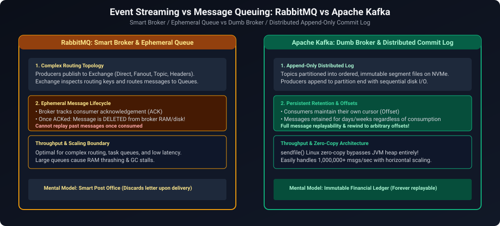
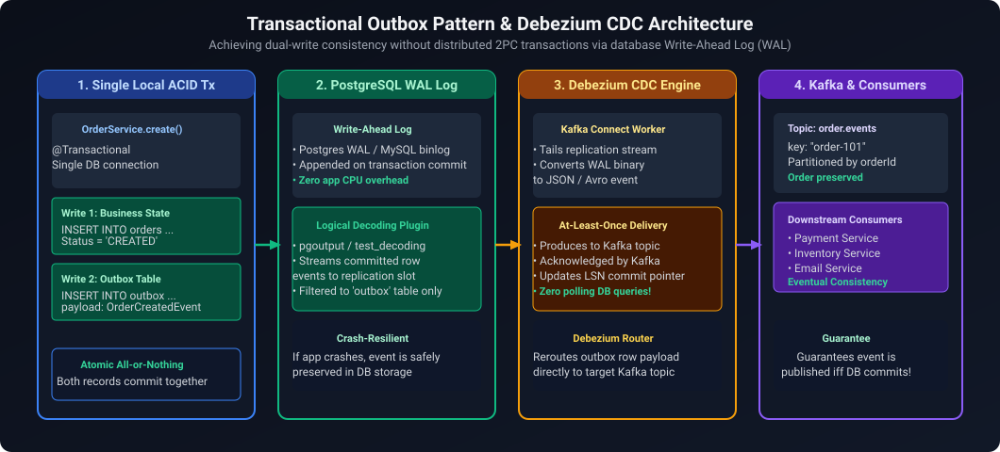
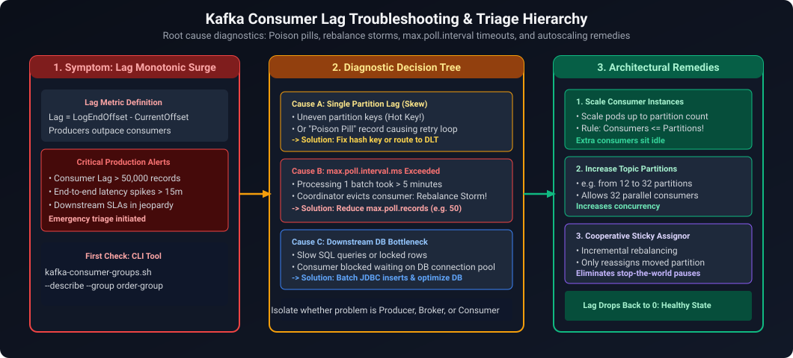
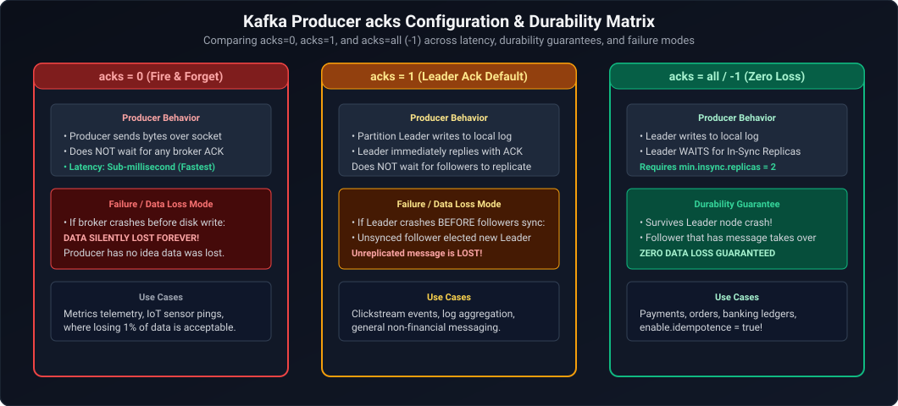
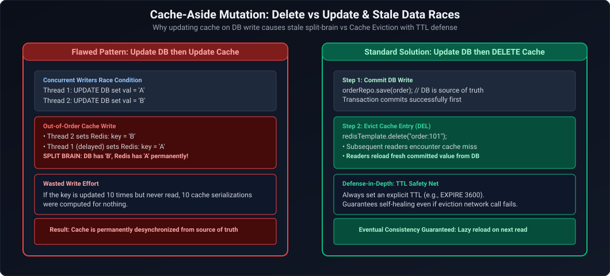

# 08. Messaging Systems: Kafka & RabbitMQ Architecture

A comprehensive guide answering all 8 questions on message broker concepts, RabbitMQ AMQP exchanges, Apache Kafka partitioned commit logs, consumer groups, Spring Boot integration, Dead Letter Queues (DLQ), and resilience against slow consumers.

---

## Architectural Overview: RabbitMQ vs Apache Kafka



*D2 Source:* [assets/08_caching_redis_and_kafka_faq/01_rabbitmq_vs_kafka_architecture.d2](assets/08_caching_redis_and_kafka_faq/01_rabbitmq_vs_kafka_architecture.d2)

---

## Table of Contents & Question Mapping

1. **Broker Fundamentals & RabbitMQ AMQP Architecture**
   - [Q1. Message Broker Services in Enterprise Java Architecture](#q1-easy-message-broker-services-in-enterprise-java-architecture)
   - [Q2. What is an Exchange in AMQP / RabbitMQ?](#q2-easy-what-is-an-exchange-in-amqp--rabbitmq)
2. **Kafka vs RabbitMQ Architectural Selection**
   - [Q3. Kafka vs RabbitMQ: Core Differences & Selection Criteria](#q3-medium-kafka-vs-rabbitmq-core-differences--selection-criteria)
3. **Apache Kafka Core Internals**
   - [Q4. Kafka Architecture: Brokers, Partitions, Consumer Groups & Scalability](#q4-expert-kafka-architecture-brokers-partitions-consumer-groups--scalability)
4. **Spring Boot Integration & Production Resilience**
   - [Q5. Integrating Apache Kafka with Spring Boot](#q5-medium-integrating-apache-kafka-with-spring-boot)
   - [Q6. Dead Letter Queues (DLQ), Retry Policies & Mitigating Slow Consumers](#q6-hard-dead-letter-queues-dlq-retry-policies--mitigating-slow-consumers)
   - [Q7. How Kafka Interacts with Databases: CDC (Debezium), Kafka Connect & Transactional Outbox](#q7-hard-how-kafka-interacts-with-databases-cdc-debezium-kafka-connect--transactional-outbox)
   - [Q8. Kafka Schema Registry Architecture, Avro Serialization & Schema Evolution](#q8-hard-kafka-schema-registry-architecture-avro-serialization--schema-evolution)
   - [Q9. Consumer Groups, Partition Rebalancing & Manual Offset Commit Strategies](#q9-medium-consumer-groups-partition-rebalancing--manual-offset-commit-strategies)
   - [Q10. Kafka Consumer Lag Diagnosis & Resolution Playbook](#q10-hard-kafka-consumer-lag-diagnosis--resolution-playbook)
   - [Q11. Kafka Producer Acknowledgements (`acks`), In-Sync Replicas (`min.insync.replicas`) & Durability Trade-Offs](#q11-hard-kafka-producer-acknowledgements-acks-in-sync-replicas-mininsyncreplicas--durability-trade-offs)
   - [Q12. Preventing Duplicate Business Effects When a Kafka Consumer Commits to Database Then Crashes Before Committing Offsets](#q12-hard-preventing-duplicate-business-effects-when-a-kafka-consumer-commits-to-database-then-crashes-before-committing-offsets)
---

# 1. Broker Fundamentals & RabbitMQ AMQP Architecture

---

### Q1. [Easy] Message Broker Services in Enterprise Java Architecture
**Difficulty:** [Easy]
**Topic Covered:** Event-Driven Architecture & Asynchronous Decoupling  
An intermediary system enabling asynchronous communication between independent systems. Provides temporal decoupling, traffic peak shaving/buffering, and failure isolation.

---

### Q2. [Easy] What is an Exchange in AMQP / RabbitMQ?
**Difficulty:** [Easy]
**Topic Covered:** RabbitMQ Routing Mechanics  
Producers publish messages to an Exchange, which routes messages to queues according to binding keys:
- **Direct Exchange:** Matches exact routing key.
- **Fanout Exchange:** Broadcasts to all bound queues.
- **Topic Exchange:** Matches routing keys using wildcards (`*` for one word, `#` for multiple words).
- **Headers Exchange:** Routes based on message header attributes.

---

# 2. Kafka vs RabbitMQ Architectural Selection

---

### Q3. [Medium] Kafka vs RabbitMQ: Core Differences & Selection Criteria
**Difficulty:** [Medium]
**Topic Covered:** Messaging Platform Comparison  

| Dimension | RabbitMQ | Apache Kafka |
| :--- | :--- | :--- |
| **Model** | Smart Broker, Dumb Consumer. | Dumb Broker, Smart Consumer (immutable append log). |
| **Delivery** | Push-based. | **Pull-based** batch polling. |
| **Retention** | Ephemeral (deleted upon ACK). | Durable on disk; supports offset rewinds and replay. |
| **Throughput** | Moderate (~50k msg/sec). | **Millions msg/sec** via zero-copy OS transfers (`sendfile`). |
| **Ordering** | Per single queue. | Guaranteed **strictly within a partition**. |
| **Best Used For** | Complex message routing, RPC task queues. | Event sourcing, high-throughput streaming, log aggregation. |

---

# 3. Apache Kafka Core Internals

---

### Q4. [Expert] Kafka Architecture: Brokers, Partitions, Consumer Groups & Scalability
**Difficulty:** [Expert]
*(Grouped together: Kafka Distributed Architecture)*  
**Topic Covered:** Log Partitioning & Scalable Parallelism  
- **Partition:** Fundamental unit of parallelism. An ordered, immutable commit log.
- **Partition Key:** Hashed by producer (`MurmurHash2(key) % numPartitions`) to guarantee that all events for a given entity land in the same partition in strict chronological order.
- **Consumer Group:** A logical pool of consumer instances. Each partition is consumed by **exactly one consumer instance** within the group at any given time. Scaling consumers beyond partition count results in idle worker instances.

---

# 4. Spring Boot Integration & Production Resilience

---

### Q5. [Medium] Integrating Apache Kafka with Spring Boot
**Difficulty:** [Medium]
**Topic Covered:** Spring for Apache Kafka  

```java
// Producer
@Service
public class OrderProducer {
    private final KafkaTemplate<String, OrderEvent> kafkaTemplate;
    public OrderProducer(KafkaTemplate<String, OrderEvent> kafkaTemplate) {
        this.kafkaTemplate = kafkaTemplate;
    }
    public void sendOrder(OrderEvent event) {
        kafkaTemplate.send("orders", event.orderId(), event);
    }
}

// Consumer
@Component
public class OrderConsumer {
    @KafkaListener(topics = "orders", groupId = "order-group")
    public void consume(OrderEvent event, Acknowledgment ack) {
        // Business logic...
        ack.acknowledge();
    }
}
```

---

### Q6. [Hard] Dead Letter Queues (DLQ), Retry Policies & Mitigating Slow Consumers
**Difficulty:** [Hard]
*(Grouped together: Error Handling and Backpressure)*  
**Topic Covered:** Message Failure Strategies & Backpressure Management  
- **Dead Letter Queue (DLQ):** Unprocessable messages are forwarded to a DLQ/DLT topic via `@RetryableTopic` with exponential backoff retries.
- **Slow Consumers & Heartbeat Timeouts:** If processing exceeds `max.poll.interval.ms` (default 5 min), Kafka assumes the consumer is dead and triggers an expensive partition rebalance. Prevent by decreasing `max.poll.records` or offloading work to background worker threads.

---

### Q7. [Hard] How Kafka Interacts with Databases: CDC (Debezium), Kafka Connect & Transactional Outbox
**Topic Covered:** Database & Event Streaming Integration  
**Difficulty:** `[Hard]`

#### Architectural Overview
Direct dual-writing from application code to both a database and Kafka creates data inconsistency if one write fails. Three enterprise patterns govern database-Kafka integration:
1. **Transactional Outbox Pattern**: The service writes business data and an event record into an `outbox` table in the *same* ACID database transaction. A separate relay publisher reads the outbox table and publishes to Kafka.
2. **Change Data Capture (CDC via Debezium)**: Debezium reads the database transaction log (PostgreSQL WAL or MySQL binlog) directly and streams every INSERT, UPDATE, and DELETE event into Kafka topics with zero application code changes.
3. **Kafka Connect**: Distributed framework for streaming data between Kafka and external datastores via pluggable Source (DB $\to$ Kafka) and Sink (Kafka $\to$ DB / Elasticsearch) connectors.



*D2 Source:* [assets/08_caching_redis_and_kafka_faq/02_transactional_outbox_pattern_debezium.d2](assets/08_caching_redis_and_kafka_faq/02_transactional_outbox_pattern_debezium.d2)

---

### Q8. [Hard] Kafka Schema Registry Architecture, Avro Serialization & Schema Evolution
**Topic Covered:** Message Contracts & Compatibility Enforcement  
**Difficulty:** `[Hard]`

#### Architectural Overview
In high-throughput event architectures, JSON payloads introduce schema drift and high bandwidth overhead. **Confluent Schema Registry** provides centralized schema governance using **Apache Avro**:
- Producers register their schema on first publish; the registry assigns a unique 4-byte Schema ID.
- The producer prepends Magic Byte `0` + Schema ID to the binary Avro payload.
- Consumers read the Schema ID, fetch the schema from the registry (cached locally), and deserialize dynamically.
- **Compatibility Rules**:
  - `BACKWARD`: New schema can read records written by old schema. (New fields must have defaults).
  - `FORWARD`: Old schema can read records written by new schema.
  - `FULL`: Combines both backward and forward compatibility.

---

### Q9. [Medium] Consumer Groups, Partition Rebalancing & Manual Offset Commit Strategies
**Topic Covered:** Consumer Scaling, Commit Semantics & Rebalance Protocols  
**Difficulty:** `[Medium]`

#### Architectural Overview
- **Partition Assignment**: If Topic has 4 partitions and Consumer Group has 2 pods, each pod consumes 2 partitions. If pods scale to 4, each consumes 1. If pods scale to 5, the 5th sits idle.
- **Rebalance Protocols**:
  - *Eager Rebalance*: Stops all consumption, revoking all partitions during group member change.
  - *Cooperative Sticky Rebalance (Modern Default)*: Reassigns only migrating partitions, allowing uninterrupted consumption on unaffected pods.
- **Offset Commits**:
  - `enable.auto.commit = true`: Risks data loss (commits before processing completes) or duplicate processing (commits after processing if crash occurs).
  - `AckMode.MANUAL_IMMEDIATE`: Application manually acknowledges after DB transaction commits (`ack.acknowledge()`), ensuring **at-least-once** processing. Pair with consumer idempotency (Redis/DB unique constraints) to achieve end-to-end **exactly-once processing semantics**.

---

### Q10. [Hard] Kafka Consumer Lag Diagnosis & Resolution Playbook
**Difficulty:** [Hard]
**Topic Covered:** Partition Skew, Processing Latency, Heartbeats & Consumer Rebalances  
**Question:** Kafka consumer lag keeps increasing even though consumers are healthy. What would you investigate?

#### Definition & Core Concepts
**Consumer Lag** measures the processing deficit between the production rate and consumption rate:
$$\text{Consumer Lag} = \text{Log End Offset (LEO)} - \text{Current Committed Offset}$$

When consumer instances report healthy HTTP liveness/readiness probes and continuously send heartbeat frames to the group coordinator, yet consumer lag monotonically rises, the issue is not instance death, but **throughput impedance mismatch**:
1. **Partition Key Skew (Hot Partition):**
   - If producers use a low-cardinality key (e.g. `tenant_id` where one enterprise tenant generates 80% of all events), 80% of messages route to Partition 2.
   - The consumer assigned to Partition 2 is overwhelmed and lags severely, while consumers on Partitions 0, 1, and 3 remain idle ($0\%$ CPU).
2. **Blocking Downstream I/O & `max.poll.interval.ms` Rebalance Death Spiral:**
   - If each record takes 25ms due to unindexed database queries or slow external REST calls, processing a default batch of `max.poll.records = 500` takes $500 \times 25\text{ms} = 12.5\text{ seconds}$.
   - If individual processing stalls (e.g. thread hangs on external network timeout exceeding `max.poll.interval.ms`, typically 300,000ms), the Kafka coordinator declares the consumer dead, revokes its partition, and triggers a **rebalance storm**, stalling consumption across the entire group!
3. **Partition Parallelism Ceiling:**
   - In Kafka, **a single partition can only ever be consumed by at most one consumer instance within the same consumer group**.
   - If your topic has 4 partitions and ingress surges to 20,000 msg/sec, scaling your Kubernetes deployment from 4 pods to 16 pods accomplishes **nothing**: 12 pods will sit completely idle with 0 assigned partitions!
4. **Stop-The-World (STW) JVM Garbage Collection Pauses:**
   - Prolonged Full GC pauses exceeding `session.timeout.ms` (e.g. 45s) prevent the consumer background heartbeat thread from pinging the broker, causing involuntary group rebalances.

#### Visual Flow


*D2 Source:* [assets/08_caching_redis_and_kafka_faq/03_kafka_consumer_lag_troubleshooting.d2](assets/08_caching_redis_and_kafka_faq/03_kafka_consumer_lag_troubleshooting.d2)

#### Production Implementation / Tuning Configuration
```yaml
# Spring Boot application.yml Optimized Consumer Configuration
spring:
  kafka:
    consumer:
      bootstrap-servers: kafka-broker:9092
      group-id: payment-processing-group
      enable-auto-commit: false
      auto-offset-reset: earliest
      # Safeguard against rebalance storms: Reduce batch size to guarantee fast iteration
      max-poll-records: 50
      properties:
        # Increase processing timeout window to 10 minutes for heavy downstream tasks
        max.poll.interval.ms: 600000
        # Heartbeat settings
        session.timeout.ms: 45000
        heartbeat.interval.ms: 10000
        # Cooperative Sticky Rebalance: Zero downtime during pod scaling
        partition.assignment.strategy: org.apache.kafka.clients.consumer.CooperativeStickyAssignor
    listener:
      ack-mode: MANUAL_IMMEDIATE
      concurrency: 4 # Thread concurrency per container replica
```

#### Engineering Implications & Production Pitfalls
1. **Blind Pod Scaling Fallback:** Never scale consumer pods blindly without checking partition count. If a topic has 6 partitions and you scale your Kubernetes HPA to 12 pods, half your pods sit idle while lag continues to climb!
2. **Key Salting for Skewed Producers:** If tenant skew causes single-partition lag, modify the producer to salt high-volume keys: `key = tenantId + "_" + (random.nextInt(4))`.

---

### Q11. [Hard] Kafka Producer Acknowledgements (`acks`), In-Sync Replicas (`min.insync.replicas`) & Durability Trade-Offs
**Difficulty:** [Hard]
**Topic Covered:** Producer Reliability, Replication ISR & CAP/PACELC Trade-Offs  
**Question:** Producer acknowledgements (acks) and replication: Explain the difference between `acks=0`, `acks=1`, and `acks=all` (`-1`). What is the relationship between `acks=all` and `min.insync.replicas`, and what happens during broker failure?

#### Definition & Core Concepts
When a producer publishes a message to a partitioned Kafka topic, the `acks` configuration controls how many broker replicas must acknowledge the write before the producer considers the request successful:
1. **`acks=0` (Zero Confirmation / Fire-and-Forget):**
   - Producer sends the packet over TCP and immediately returns success without waiting for any socket response.
   - **Throughput:** Maximum possible ($> 100,000 \text{ msgs/sec}$).
   - **Data Safety:** Zero durability guarantee. If the network drops or the broker crashes, data is silently lost.
2. **`acks=1` (Leader Confirmation):**
   - Producer waits until the partition leader broker writes the message to its local write-ahead log (pagecache).
   - **Durability Trap:** If the leader crashes *immediately* after acknowledging but before followers replicate the log segment, a newly elected follower lacks the message, causing permanent data loss (**Phantom Write**).
3. **`acks=all` or `acks=-1` (Full In-Sync Replica Quorum):**
   - Producer waits until the leader AND all active in-sync replicas (ISR) acknowledge the write.

**The Crucial `min.insync.replicas` Interlock:**
A common enterprise misunderstanding is assuming `acks=all` guarantees multi-broker replication.
- If a topic has `replication.factor = 3`, but two followers crash, the broker ISR pool shrinks to just 1 broker (the leader).
- If `min.insync.replicas = 1`, then `acks=all` succeeds with only the leader acknowledging—degrading to `acks=1` behavior without warning!
- **Enterprise Gold Standard:** Set `replication.factor = 3`, `min.insync.replicas = 2`, and `acks = all`. If 2 brokers crash, only 1 replica remains ($1 < 2$), and the leader rejects incoming writes with `NotEnoughReplicasException`, preserving strict consistency over availability (CP system under CAP).

#### Visual Flow


*D2 Source:* [assets/08_caching_redis_and_kafka_faq/04_kafka_producer_acks_durability_matrix.d2](assets/08_caching_redis_and_kafka_faq/04_kafka_producer_acks_durability_matrix.d2)

#### Production Implementation / Producer Configuration
```java
package com.enterprise.messaging.config;

import org.apache.kafka.clients.producer.ProducerConfig;
import org.apache.kafka.common.serialization.StringSerializer;
import org.springframework.context.annotation.Bean;
import org.springframework.context.annotation.Configuration;
import org.springframework.kafka.core.DefaultKafkaProducerFactory;
import org.springframework.kafka.core.KafkaTemplate;
import org.springframework.kafka.core.ProducerFactory;

import java.util.HashMap;
import java.util.Map;

@Configuration
public class ResilientKafkaProducerConfig {

    @Bean
    public ProducerFactory<String, String> producerFactory() {
        Map<String, Object> props = new HashMap<>();
        props.put(ProducerConfig.BOOTSTRAP_SERVERS_CONFIG, "kafka-broker:9092");
        props.put(ProducerConfig.KEY_SERIALIZER_CLASS_CONFIG, StringSerializer.class);
        props.put(ProducerConfig.VALUE_SERIALIZER_CLASS_CONFIG, StringSerializer.class);

        // Durability: Wait for Leader + all In-Sync Replicas
        props.put(ProducerConfig.ACKS_CONFIG, "all");

        // Idempotent Producer: Prevents duplicates from producer retries
        props.put(ProducerConfig.ENABLE_IDEMPOTENCE_CONFIG, true);
        props.put(ProducerConfig.RETRIES_CONFIG, Integer.MAX_VALUE);
        props.put(ProducerConfig.MAX_IN_FLIGHT_REQUESTS_PER_CONNECTION, 5);

        // Batching & Throughput Optimization
        props.put(ProducerConfig.BATCH_SIZE_CONFIG, 65536); // 64 KB
        props.put(ProducerConfig.LINGER_MS_CONFIG, 10); // Wait up to 10ms to coalesce batches
        props.put(ProducerConfig.COMPRESSION_TYPE_CONFIG, "zstd"); // High compression ratio

        return new DefaultKafkaProducerFactory<>(props);
    }

    @Bean
    public KafkaTemplate<String, String> kafkaTemplate() {
        return new KafkaTemplate<>(producerFactory());
    }
}
```
- **Time Complexity:** $O(1)$ asynchronous producer buffer dispatch; network wait bounded by broker roundtrip latency ($p99 < 15\text{ms}$).
- **Space Complexity:** $O(B)$ memory buffer pool (`buffer.memory = 32\text{MB}`).

#### Engineering Implications & Production Pitfalls
1. **The Dirty Leader Election Hazard (`unclean.leader.election.enable`):** If all ISR brokers crash and only an out-of-sync broker survives, setting `unclean.leader.election.enable=true` allows that out-of-sync broker to become leader. While restoring availability, it causes silent loss of all committed data not replicated to that broker! Always set `unclean.leader.election.enable=false` in financial systems.
2. **Idempotent Producer (`enable.idempotence=true`):** Prevents duplicate messages on network timeouts by assigning each producer a PID and sequence number per partition.

#### Core Curriculum Cross-Reference
*Deep-dive theoretical reference: See [12. Caching & Messaging: Kafka Producer Contracts](../08_caching_redis_and_kafka.md#5-apache-kafka-high-throughput-distributed-event-streaming)*

---

### Q12. [Hard] Preventing Duplicate Business Effects When a Kafka Consumer Commits to Database Then Crashes Before Committing Offsets
**Difficulty:** [Hard]
**Topic Covered:** Exactly-Once Processing (EOP), At-Least-Once Delivery Redelivery, and Consumer Idempotency Keys  
**Definition:** Kafka operates on **At-Least-Once delivery semantics**. If a consumer receives a message, writes changes to a database, commits the database transaction, and then crashes (or undergoes a partition rebalance) before committing its offset back to Kafka, the new consumer instance will **re-read the same message from the last committed offset**, triggering duplicate debits, duplicate order creations, or corrupted inventory counters unless protected by an **Idempotent Consumer Deduplication Store**.

#### Architectural Mechanics & Core Concepts



*D2 Source:* [assets/08_caching_redis_and_kafka_faq/05_distributed_cache_aside_mutation_split_brain.d2](assets/08_caching_redis_and_kafka_faq/05_distributed_cache_aside_mutation_split_brain.d2)

The Two Flawed Approaches:
1. **Flawed Approach A (Auto-commit `enable.auto.commit=true`):** Offsets commit in the background every 5 seconds. If the consumer crashes before DB write finishes, data is lost permanently (at-most-once).
2. **Flawed Approach B (Commit offset BEFORE writing to DB):** If the DB write fails or throws an exception, the message is lost forever without human intervention.
3. **Flawed Approach C (Distributed 2PC / XA between DB and Kafka):** Dual-write coordination via two-phase commit is notoriously fragile, unsupported natively by modern cloud DBs, and severely degrades throughput.

The Canonical Production Solution:
- **Idempotent Consumer via Relational De-duplication Table:** Combine the business entity write and a `processed_events` insert into the **same local ACID database transaction**. If the consumer crashes after DB commit and Kafka redelivers, the second attempt hits the unique index constraint on `event_id`, detects the redelivery, and safely acknowledges the offset without re-executing business logic.

#### Production-Grade Implementation

```java
package com.enterprise.messaging.consumer;

import org.apache.kafka.clients.consumer.ConsumerRecord;
import org.springframework.dao.DataIntegrityViolationException;
import org.springframework.jdbc.core.JdbcTemplate;
import org.springframework.kafka.annotation.KafkaListener;
import org.springframework.kafka.support.Acknowledgment;
import org.springframework.stereotype.Service;
import org.springframework.transaction.support.TransactionTemplate;

@Service
public class IdempotentPaymentConsumer {

    private final JdbcTemplate jdbcTemplate;
    private final TransactionTemplate transactionTemplate;

    public IdempotentPaymentConsumer(JdbcTemplate jdbcTemplate, TransactionTemplate transactionTemplate) {
        this.jdbcTemplate = jdbcTemplate;
        this.transactionTemplate = transactionTemplate;
    }

    @KafkaListener(
        topics = "payment-events",
        groupId = "billing-ledger-group",
        containerFactory = "manualAckKafkaListenerContainerFactory"
    )
    public void consumePayment(ConsumerRecord<String, String> record, Acknowledgment ack) {
        String eventId = record.key();
        String payload = record.value();

        try {
            // Execute business logic and deduplication insert within single atomic DB transaction
            boolean processedSuccessfully = Boolean.TRUE.equals(transactionTemplate.execute(status -> {
                try {
                    // Step 1: Insert into deduplication store
                    jdbcTemplate.update(
                        "INSERT INTO processed_events (event_id, topic, partition_num, offset_num, processed_at) " +
                        "VALUES (?, ?, ?, ?, NOW())",
                        eventId, record.topic(), record.partition(), record.offset()
                    );
                } catch (DataIntegrityViolationException ex) {
                    // DUPLICATE DETECTED: This message was already committed to DB prior to crash!
                    // Roll back and signal that we should skip duplicate business effects
                    status.setRollbackOnly();
                    return false;
                }

                // Step 2: Execute actual business effect (Debit balance)
                jdbcTemplate.update("UPDATE accounts SET balance = balance - 100 WHERE id = 'ACC-123'");
                return true;
            }));

            // Step 3: Always acknowledge Kafka offset!
            // Whether it was newly processed OR a duplicate, offset must now advance!
            ack.acknowledge();

        } catch (Exception ex) {
            // Transient database connectivity failure: do NOT acknowledge!
            // Kafka will retry with backoff according to error handler policy
            throw new RuntimeException("Transient consumer failure; message will redeliver", ex);
        }
    }
}
```

```sql
-- DDL for Idempotent Consumer Deduplication Store
CREATE TABLE processed_events (
    event_id VARCHAR(128) PRIMARY KEY,
    topic VARCHAR(64) NOT NULL,
    partition_num INT NOT NULL,
    offset_num BIGINT NOT NULL,
    processed_at TIMESTAMP NOT NULL DEFAULT CURRENT_TIMESTAMP
);
```

#### Complexity & Performance Analysis
- **Time Complexity:** $O(1)$ indexed B+ Tree primary key check on `processed_events`.
- **Throughput:** Maintains $> 5,000\text{ msg/sec}$ per consumer instance on PostgreSQL with connection pooling.
- **Space Complexity:** Bounded by periodic retention purging (e.g., delete events older than 7 days via partitioning).

#### Engineering Implications & Production Pitfalls
1. **Event ID Consistency:** The upstream producer must generate a deterministic, unique UUID or business idempotency key (`order_id + event_type`) in the message header or key, rather than letting the consumer rely on Kafka's ephemeral record offset (offsets change if topics are re-mirrored across clusters).
2. **Kafka Transactional API Alternative:** In pure Kafka-to-Kafka pipelines (Kafka Streams / Flink), use Kafka's built-in transactional API (`sendOffsetsToTransaction()`) with a `transactional.id` to commit consumer offsets and producer writes in a single two-phase atomic commit across Kafka brokers.

#### Core Curriculum Cross-Reference
*Deep-dive theoretical reference: See [08. Caching, Redis & Kafka: Exactly-Once Processing](../08_caching_redis_and_kafka.md#5-apache-kafka-high-throughput-distributed-event-streaming)*

---

## Summary Comparison & Production Reference Matrix

| Scenario Domain | Critical Runtime Pathology | Diagnostic & Triage Method | Canonical Production Resolution |
| :--- | :--- | :--- | :--- |
| **Broker Fundamentals & RabbitMQ AMQP Architecture** | High-throughput invariants & concurrency boundaries | Metric instrumentation & trace profiling | Defensive validation & graceful degradation |
| **Kafka vs RabbitMQ Architectural Selection** | High-throughput invariants & concurrency boundaries | Metric instrumentation & trace profiling | Defensive validation & graceful degradation |
| **Apache Kafka Core Internals** | High-throughput invariants & concurrency boundaries | Metric instrumentation & trace profiling | Defensive validation & graceful degradation |
| **Spring Boot Integration & Production Resilience** | High-throughput invariants & concurrency boundaries | Metric instrumentation & trace profiling | Defensive validation & graceful degradation |
| **Consumer Crash Offset Desynchronization** | Duplicate debits / business actions upon consumer restart | Message redelivery flag tracing, Consumer lag monitoring | Transactional processed_events table, manual ack |

---

## References & Further Reading

---
- [Redis Official Documentation & Data Structures Guide](https://redis.io/docs/)
- [Martin Kleppmann - Designing Data-Intensive Applications (O'Reilly)](https://dataintensive.net/)
- [RabbitMQ Documentation - AMQP 0-9-1 Model Explained](https://www.rabbitmq.com/tutorials/amqp-concepts.html)
- [Apache Kafka Documentation - Design Fundamentals & KRaft](https://kafka.apache.org/documentation/#design)
- [Baeldung - Spring Cache Abstraction Tutorial](https://www.baeldung.com/spring-cache-tutorial)
