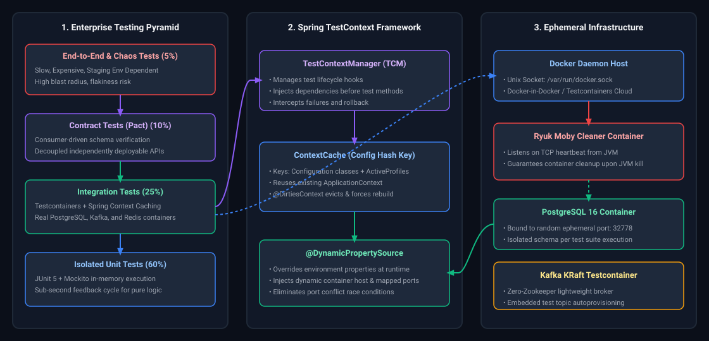
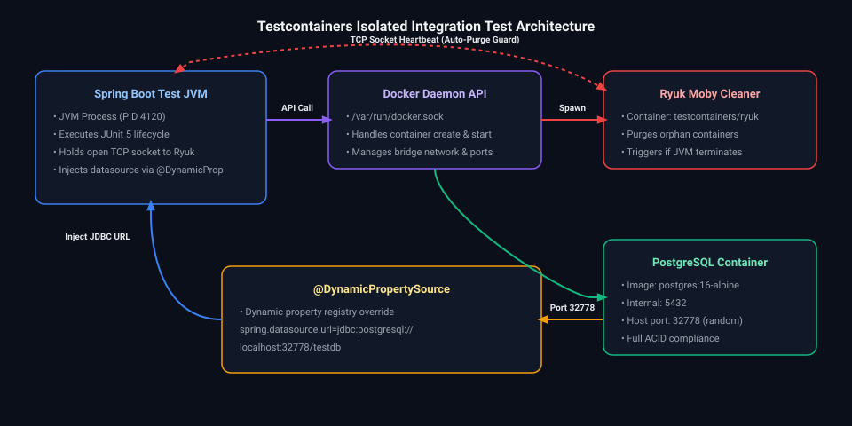
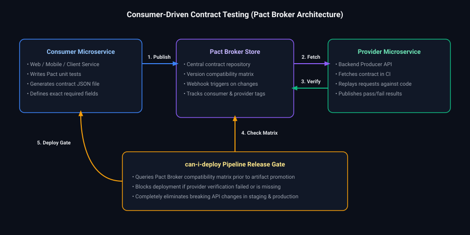

# 10. Testing & Quality Engineering: Interview FAQs & Playbooks

A comprehensive, production-grade guide to real-world interview scenarios and engineering solutions covering the enterprise testing pyramid, Spring Boot test slices (`@WebMvcTest`, `@DataJpaTest`), JUnit 5 extension internals, Mockito ByteBuddy agents, Testcontainers architecture, consumer-driven contract testing with Pact, and ArchUnit governance.

---

## Architectural Overview: Enterprise Quality Engineering & Test Execution Matrix



*D2 Source:* [assets/10_testing_and_quality_engineering_faq/01_testing_pyramid_and_spring_testcontext_caching.d2](assets/10_testing_and_quality_engineering_faq/01_testing_pyramid_and_spring_testcontext_caching.d2)

---

## Table of Contents & Question Directory

### 1. Test Architecture & Framework Internals
- [Q1. **`[Easy]`** Testing Pyramid & Test Slicing Strategy in Enterprise Spring Boot](#q1-easy-testing-pyramid--test-slicing-strategy-in-enterprise-spring-boot)
- [Q2. **`[Medium]`** JUnit 5 Lifecycle Extensions, Dynamic Tests & Custom ParameterResolvers](#q2-medium-junit-5-lifecycle-extensions-dynamic-tests--custom-parameterresolvers)
- [Q3. **`[Medium]`** Mockito Inline MockMaker, ByteBuddy Agents & Mocking Static/Final Methods](#q3-medium-mockito-inline-mockmaker-bytebuddy-agents--mocking-staticfinal-methods)
- [Q4. **`[Hard]`** Spring `TestContextManager` Caching Architecture, `@DirtiesContext` Performance Penalty & Optimization](#q4-hard-spring-testcontextmanager-caching-architecture-dirtiescontext-performance-penalty--optimization)
- [Q5. **`[Medium]`** WebMvcTest vs WebTestClient vs MockMvc: Slice Testing Trade-Offs & Mocking Web Layers](#q5-medium-webmvctest-vs-webtestclient-vs-mockmvc-slice-testing-trade-offs--mocking-web-layers)

### 2. Integration Testing & Ephemeral Containers
- [Q6. **`[Hard]`** Testcontainers Architecture: Ryuk Lifecycle, Container Reuse, DynamicPropertyRegistry & Local Port Mapping](#q6-hard-testcontainers-architecture-ryuk-lifecycle-container-reuse-dynamicpropertyregistry--local-port-mapping)
- [Q7. **`[Hard]`** Testing Concurrent Code & Race Conditions in Java with Awaitility & JCStress](#q7-hard-testing-concurrent-code--race-conditions-in-java-with-awaitility--jcstress)
- [Q8. **`[Medium]`** Consumer-Driven Contract Testing with Pact: Provider Verification & Breaking API Prevention](#q8-medium-consumer-driven-contract-testing-with-pact-provider-verification--breaking-api-prevention)
- [Q9. **`[Medium]`** Database Integration Testing with Testcontainers PostgreSQL, Flyway Migrations & Rollbacks](#q9-medium-database-integration-testing-with-testcontainers-postgresql-flyway-migrations--rollbacks)
- [Q10. **`[Hard]`** Kafka Integration Testing with EmbeddedKafka vs Testcontainers Kafka & Consumer Lag Assertion](#q10-hard-kafka-integration-testing-with-embeddedkafka-vs-testcontainers-kafka--consumer-lag-assertion)

### 3. Quality Governance & Advanced Reliability
- [Q11. **`[Easy]`** Enterprise Java Pull Request Code Review Checklist & Anti-Pattern Detection](#q11-easy-enterprise-java-pull-request-code-review-checklist--anti-pattern-detection)
- [Q12. **`[Medium]`** Architectural Fitness Functions with ArchUnit: Cyclic Dependencies, Layer Invariants & Naming Rules](#q12-medium-architectural-fitness-functions-with-archunit-cyclic-dependencies-layer-invariants--naming-rules)
- [Q13. **`[Hard]`** Mutation Testing with PIT (Pitest): Evaluating Test Suite Quality Beyond Line Coverage](#q13-hard-mutation-testing-with-pit-pitest-evaluating-test-suite-quality-beyond-line-coverage)
- [Q14. **`[Medium]`** Mocking Asynchronous Methods (`CompletableFuture`, `@Async`) & Virtual Threads in Unit Tests](#q14-medium-mocking-asynchronous-methods-completablefuture-async--virtual-threads-in-unit-tests)
- [Q15. **`[Medium]`** Managing Test Flakiness: Network Jitter, Clock Drift & Time-Freezing with `java.time.Clock`](#q15-medium-managing-test-flakiness-network-jitter-clock-drift--time-freezing-with-javatimeclock)

---

## 1. Test Architecture & Framework Internals

### Q1. [Easy] Testing Pyramid & Test Slicing Strategy in Enterprise Spring Boot
**Difficulty:** [Easy]  
**Topic Covered:** Testing Pyramid, Spring Boot Test Slices, Execution Speed  
**Question:** Explain the testing pyramid and how Spring Boot test slicing (`@WebMvcTest`, `@DataJpaTest`, `@JsonTest`) optimizes CI pipeline execution times compared to `@SpringBootTest`.

- **`@SpringBootTest` Overhead:** Scans the entire classpath, bootstraps the full Spring `ApplicationContext`, instantiates every bean, data source, and security filter chain. Running 500 `@SpringBootTest` classes can take 25+ minutes in CI.
- **Test Slices:** Load only a strictly isolated subset of the `ApplicationContext`:
  - `@WebMvcTest(OrderController.class)`: Loads only `DispatcherServlet`, Jackson message converters, validation, and the targeted controller. Services are mocked via `@MockBean`. Test runs in 150ms.
  - `@DataJpaTest`: Loads only Hibernate, JPA entity managers, and Spring Data repositories. Uses an embedded database or Testcontainer. Bypasses all web controllers.
  - `@JsonTest`: Tests JSON serialization/deserialization contracts in milliseconds.

*Deep-dive theoretical reference: See [Module 10: Testing & Quality Engineering](../10_testing_and_quality_engineering.md#1-the-testing-pyramid--unit-testing-foundations)*

---

### Q2. [Medium] JUnit 5 Lifecycle Extensions, Dynamic Tests & Custom ParameterResolvers
**Difficulty:** [Medium]  
**Topic Covered:** JUnit 5, Jupiter Extension Model, Dynamic Tests, ParameterResolver  
**Question:** How does the JUnit 5 Jupiter extension model differ from JUnit 4 `@Rule` and `Runner`? How do you write a custom `ParameterResolver` to inject security tokens or tenant contexts into test methods?

```java
import org.junit.jupiter.api.extension.ExtensionContext;
import org.junit.jupiter.api.extension.ParameterContext;
import org.junit.jupiter.api.extension.ParameterResolver;

public class SecurityContextResolver implements ParameterResolver {
    @Override
    public boolean supportsParameter(ParameterContext parameterContext, ExtensionContext extensionContext) {
        return parameterContext.getParameter().getType().equals(SecurityUser.class);
    }

    @Override
    public Object resolveParameter(ParameterContext parameterContext, ExtensionContext extensionContext) {
        return new SecurityUser("test-admin", "ROLE_ADMIN", "tenant-101");
    }
}
```
- Registered via `@ExtendWith(SecurityContextResolver.class)` on test classes. Eliminates repetitive test setup code across test suites.

*Deep-dive theoretical reference: See [Module 10: Testing & Quality Engineering](../10_testing_and_quality_engineering.md#1-the-testing-pyramid--unit-testing-foundations)*

---

### Q3. [Medium] Mockito Inline MockMaker, ByteBuddy Agents & Mocking Static/Final Methods
**Difficulty:** [Medium]  
**Topic Covered:** Mockito, ByteBuddy Agent, Subclass MockMaker vs Inline MockMaker, Final Classes  
**Question:** How does Mockito create mock objects under the hood? What changed between the default Subclass MockMaker and the modern Inline MockMaker that allows mocking `final` classes and static methods?

#### Subclass MockMaker vs Inline MockMaker
1. **Classic Subclass MockMaker (CGLIB / ByteBuddy Subclassing):**
   - Creates a dynamic subclass of the target class at runtime: `class OrderService$MockitoMock$123 extends OrderService`.
   - *Limitation:* In Java, `final` classes cannot be extended, and `final` methods cannot be overridden. Attempting to mock `final` methods fails.
2. **Inline MockMaker (`mock-maker-inline` using Java Instrumentation Agent):**
   - Utilizes ByteBuddy and the Java JVM `Instrumentation` API (`-javaagent`).
   - Rather than creating a subclass, it performs runtime bytecode transformation on the original `.class` file directly in memory, injecting Mockito dispatch hooks into existing method bodies.
   - Enables mocking of `final` classes, `record` instances, `final` methods, and static methods (`Mockito.mockStatic()`).

*Deep-dive theoretical reference: See [Module 10: Testing & Quality Engineering](../10_testing_and_quality_engineering.md#1-the-testing-pyramid--unit-testing-foundations)*

---

### Q4. [Hard] Spring `TestContextManager` Caching Architecture, `@DirtiesContext` Performance Penalty & Optimization
**Difficulty:** [Hard]  
**Topic Covered:** TestContextManager, ContextCache, @DirtiesContext, CI Optimization  
**Question:** Why does using `@DirtiesContext` across your Spring Boot integration test suite cause test execution time to jump from 2 minutes to 25 minutes? How does Spring cache test contexts, and how do you design tests to avoid dirtying the context?

#### ContextCache Mechanics
When Spring executes integration tests, the `TestContextManager` hashes the test configuration (active profiles, bean configuration classes, property sources) into a cache key. If 50 test classes share the identical configuration key, Spring initializes the `ApplicationContext` **only once** and reuses it for all 50 classes.
- **The `@DirtiesContext` Penalty:** When a test is marked with `@DirtiesContext`, Spring permanently evicts that `ApplicationContext` from memory after test completion. The next test class must recreate the entire Spring container, re-initialize Flyway migrations, and re-establish database connection pools from scratch (costing 3 to 10 seconds per class).
- **Optimization Strategy:** Never use `@DirtiesContext` simply to clear database state. Instead, use transactional rollbacks (`@Transactional` on test methods) or an explicit database cleanup listener (`DELETE FROM tables` in `@AfterEach`).

*Deep-dive theoretical reference: See [Module 10: Testing & Quality Engineering](../10_testing_and_quality_engineering.md#4-spring-testcontext-framework-caching--performance-optimization)*

---

### Q5. [Medium] WebMvcTest vs WebTestClient vs MockMvc: Slice Testing Trade-Offs & Mocking Web Layers
**Difficulty:** [Medium]  
**Topic Covered:** MockMvc, WebTestClient, WebMvcTest, HTTP Layer Testing  
**Question:** Compare `MockMvc`, `WebTestClient`, and `TestRestTemplate`. When would you choose `MockMvc` over a real HTTP client?

| Testing Client | Server Mode | Transport Layer | Optimal Use Case |
| :--- | :--- | :--- | :--- |
| **`MockMvc`** | Mock Servlet (`server.port=none`) | In-memory synthetic `DispatcherServlet` invocation; no real TCP socket | Unit/slice testing of controller mappings, validation, HTTP status codes, and security filters |
| **`WebTestClient`** | Mock Servlet OR Real HTTP Server | Non-blocking reactive client; fluent assertion API | Testing both Spring MVC and WebFlux reactive endpoints |
| **`TestRestTemplate`** | Real HTTP Server (`RANDOM_PORT`) | Real TCP socket connection through the network stack | Full end-to-end integration tests verifying actual network serialization and TLS |

*Deep-dive theoretical reference: See [Module 10: Testing & Quality Engineering](../10_testing_and_quality_engineering.md#4-spring-testcontext-framework-caching--performance-optimization)*

---

## 2. Integration Testing & Ephemeral Containers

### Q6. [Hard] Testcontainers Architecture: Ryuk Lifecycle, Container Reuse, DynamicPropertyRegistry & Local Port Mapping
**Difficulty:** [Hard]  
**Topic Covered:** Testcontainers, Ryuk Container, @DynamicPropertySource, Dynamic Port Sizing  
**Question:** How does Testcontainers communicate with the local Docker daemon? What is the role of the `testcontainers/ryuk` container, and how does `@DynamicPropertySource` inject dynamic ephemeral ports into the Spring environment?



*D2 Source:* [assets/10_testing_and_quality_engineering_faq/02_testcontainers_isolated_integration_architecture.d2](assets/10_testing_and_quality_engineering_faq/02_testcontainers_isolated_integration_architecture.d2)

1. **The Ryuk Cleaner:** When the Testcontainers Java library starts, it immediately launches a lightweight container named `testcontainers/ryuk`. Ryuk opens a bidirectional TCP connection to the test JVM. If the test process terminates cleanly—or crashes abruptly via `SIGKILL` or IDE stop—the TCP connection drops, and Ryuk immediately deletes all containers, networks, and volumes created during the session, preventing orphaned Docker zombie processes.
2. **Port Collisions & `@DynamicPropertySource`:** Testcontainers never binds containers to static fixed ports (e.g. 5432) to prevent collisions with local services or parallel CI jobs. It binds to random available host ports (e.g. 32778). `@DynamicPropertySource` dynamically resolves this port and overrides Spring properties before bean initialization:
   ```java
   @Container
   static PostgreSQLContainer<?> postgres = new PostgreSQLContainer<>("postgres:16-alpine");

   @DynamicPropertySource
   static void configureProperties(DynamicPropertyRegistry registry) {
       registry.add("spring.datasource.url", postgres::getJdbcUrl);
       registry.add("spring.datasource.username", postgres::getUsername);
       registry.add("spring.datasource.password", postgres::getPassword);
   }
   ```

*Deep-dive theoretical reference: See [Module 10: Testing & Quality Engineering](../10_testing_and_quality_engineering.md#2-spring-boot-test-slicing--real-integration-testing)*

---

### Q7. [Hard] Testing Concurrent Code & Race Conditions in Java with Awaitility & JCStress
**Difficulty:** [Hard]  
**Topic Covered:** Awaitility, JCStress, Race Conditions, Concurrency Testing  
**Question:** Why does using `Thread.sleep()` in unit tests cause flaky builds? How do you test asynchronous background processes with Awaitility, and how does JCStress detect low-level Java Memory Model concurrency violations?

- **Why `Thread.sleep()` Fails:** Sleeping for an arbitrary duration (e.g., `Thread.sleep(1000)`) is non-deterministic: on slow CI servers under CPU starvation, 1,000ms may be insufficient (causing false test failures), while on developer machines, it wastes unnecessary seconds.
- **Awaitility Polling Assertion:** Polls conditions at regular intervals with an explicit timeout:
  ```java
  await().atMost(5, SECONDS)
         .pollInterval(100, MILLISECONDS)
         .untilAsserted(() -> {
             Order order = orderRepository.findById(orderId).orElseThrow();
             assertThat(order.getStatus()).isEqualTo(OrderStatus.COMPLETED);
         });
  ```
- **JCStress (Java Concurrency Stress):** A specialized OpenJDK harness that executes concurrent operations millions of times across hardware cores with randomized thread schedulers, explicitly exposing race conditions, atomicity failures, and JMM hardware reordering violations.

*Deep-dive theoretical reference: See [Module 10: Testing & Quality Engineering](../10_testing_and_quality_engineering.md#5-testing-asynchronous-event-driven--concurrent-systems)*

---

### Q8. [Medium] Consumer-Driven Contract Testing with Pact: Provider Verification & Breaking API Prevention
**Difficulty:** [Medium]  
**Topic Covered:** Contract Testing, Pact, Breaking Changes, Microservice Verification  
**Question:** How does consumer-driven contract testing with Pact prevent breaking changes in microservice architectures without spinning up end-to-end environments?



*D2 Source:* [assets/10_testing_and_quality_engineering_faq/03_consumer_driven_contract_testing_pact_broker.d2](assets/10_testing_and_quality_engineering_faq/03_consumer_driven_contract_testing_pact_broker.d2)
- **The Breakthrough:** Unlike end-to-end testing which requires orchestrating 20 interdependent services, Pact tests are pure unit tests executed independently by the consumer and provider, completely eliminating breaking schema surprises in production.

*Deep-dive theoretical reference: See [Module 10: Testing & Quality Engineering](../10_testing_and_quality_engineering.md#3-contract-testing-mocking--code-quality-gates)*

---

### Q9. [Medium] Database Integration Testing with Testcontainers PostgreSQL, Flyway Migrations & Rollbacks
**Difficulty:** [Medium]  
**Topic Covered:** Flyway, H2 vs PostgreSQL, Schema Verification, Transaction Isolation  
**Question:** Why is testing with in-memory H2 databases an anti-pattern for PostgreSQL production applications? How do you run authentic Flyway migrations against Testcontainers?

- **H2 Divergence:** H2 does not support PostgreSQL JSONB operators (`@>`), full-text search indexes, array types (`TEXT[]`), or PostgreSQL CTE dialect nuances. A query that passes on H2 will frequently fail in production PostgreSQL.
- **Solution:** Always run tests against a Testcontainer running the identical PostgreSQL major version used in production. Spring Boot automatically detects Flyway on the classpath and applies migrations against the Testcontainer on startup.

*Deep-dive theoretical reference: See [Module 10: Testing & Quality Engineering](../10_testing_and_quality_engineering.md#2-spring-boot-test-slicing--real-integration-testing)*

---

### Q10. [Hard] Kafka Integration Testing with EmbeddedKafka vs Testcontainers Kafka & Consumer Lag Assertion
**Difficulty:** [Hard]  
**Topic Covered:** Apache Kafka, Testcontainers Kafka, KRaft, Idempotent Consumers  
**Question:** How do you test Kafka consumer offset commits and retry dead-letter queues in integration tests without relying on slow external shared brokers?

```java
@Testcontainers
@SpringBootTest
class KafkaConsumerIntegrationTest {

    @Container
    static KafkaContainer kafka = new KafkaContainer(DockerImageName.parse("confluentinc/cp-kafka:7.5.0"));

    @DynamicPropertySource
    static void configureProperties(DynamicPropertyRegistry registry) {
        registry.add("spring.kafka.bootstrap-servers", kafka::getBootstrapServers);
    }

    @Test
    void testMessageProcessingAndDeadLetterQueue() {
        kafkaTemplate.send("orders-topic", "invalid-payload");
        
        await().atMost(5, SECONDS).untilAsserted(() -> {
            ConsumerRecord<String, String> deadLetterRecord = deadLetterConsumer.pollRecord();
            assertThat(deadLetterRecord).isNotNull();
            assertThat(deadLetterRecord.value()).isEqualTo("invalid-payload");
        });
    }
}
```

*Deep-dive theoretical reference: See [Module 10: Testing & Quality Engineering](../10_testing_and_quality_engineering.md#2-spring-boot-test-slicing--real-integration-testing)*

---

## 3. Quality Governance & Advanced Reliability

### Q11. [Easy] Enterprise Java Pull Request Code Review Checklist & Anti-Pattern Detection
**Difficulty:** [Easy]  
**Topic Covered:** Code Reviews, Anti-Patterns, Security Audits, Concurrency Hazards  
**Question:** What core architectural invariants do you inspect when conducting pull request code reviews for high-throughput enterprise Java services?

1. **Transactional Hazards:** Verify `@Transactional` is not called internally within the same class (proxy bypass trap); verify database calls are not held across long external HTTP requests.
2. **Concurrency Safety:** Ensure shared collections use `ConcurrentHashMap` or immutable structures; verify `SimpleDateFormat` is not used across threads (use `java.time`).
3. **Database Efficiency:** Audit JPA associations for `FetchType.EAGER` (enforce `LAZY`); check queries for N+1 problems.
4. **Security & Input Validation:** Verify all DTOs enforce `@Valid`; ensure SQL queries utilize parameterized statements.
5. **Observability:** Ensure exceptions are logged with context and stack trace, avoiding empty `catch` blocks or `e.printStackTrace()`.

*Deep-dive theoretical reference: See [Module 10: Testing & Quality Engineering](../10_testing_and_quality_engineering.md#6-architecture-as-code--fitness-functions-with-archunit)*

---

### Q12. [Medium] Architectural Fitness Functions with ArchUnit: Cyclic Dependencies, Layer Invariants & Naming Rules
**Difficulty:** [Medium]  
**Topic Covered:** ArchUnit, Architecture as Code, Hexagonal Architecture, Layer Enforcement  
**Question:** How do you prevent developers from violating Clean/Hexagonal Architecture boundaries (e.g. Domain layer accidentally importing Spring web controller classes) using automated unit tests?

```java
import com.tngtech.archunit.junit.AnalyzeClasses;
import com.tngtech.archunit.junit.ArchTest;
import com.tngtech.archunit.lang.ArchRule;
import static com.tngtech.archunit.library.Architectures.layeredArchitecture;

@AnalyzeClasses(packages = "com.enterprise.app")
public class ArchitectureInvariantsTest {

    @ArchTest
    static final ArchRule layered_architecture_respected = layeredArchitecture()
        .consideringAllDependencies()
        .layer("Controller").definedBy("..controller..")
        .layer("Service").definedBy("..service..")
        .layer("Domain").definedBy("..domain..")
        .layer("Repository").definedBy("..repository..")
        
        .whereLayer("Controller").mayNotBeAccessedByAnyLayer()
        .whereLayer("Domain").mayOnlyBeAccessedByLayers("Service", "Repository");
}
```

*Deep-dive theoretical reference: See [Module 10: Testing & Quality Engineering](../10_testing_and_quality_engineering.md#6-architecture-as-code--fitness-functions-with-archunit)*

---

### Q13. [Hard] Mutation Testing with PIT (Pitest): Evaluating Test Suite Quality Beyond Line Coverage
**Difficulty:** [Hard]  
**Topic Covered:** Mutation Testing, Pitest, Mutants, Boundary Conditions  
**Question:** A project has 95% line coverage, yet critical bugs slip into production because developers wrote assertions that don't test actual logic. How does Mutation Testing evaluate test effectiveness?

- **The Mutation Concept:** Mutation testing deliberately introduces small syntax faults ("mutants") into your compiled bytecode:
  - Inverting conditionals: `if (a > b)` $\to$ `if (a <= b)`
  - Modifying arithmetic operators: `+` $\to$ `-`
  - Mutating return values: `return true;` $\to$ `return false;`
- **Mutant Scoring:** If your test suite fails when a mutant is introduced, the mutant is **killed** (good!). If the test suite still passes despite the altered logic, the mutant **survives** (exposing ineffective assertions).

*Deep-dive theoretical reference: See [Module 10: Testing & Quality Engineering](../10_testing_and_quality_engineering.md#6-architecture-as-code--fitness-functions-with-archunit)*

---

### Q14. [Medium] Mocking Asynchronous Methods (`CompletableFuture`, `@Async`) & Virtual Threads in Unit Tests
**Difficulty:** [Medium]  
**Topic Covered:** CompletableFuture, @Async, Virtual Threads, Test Execution  
**Question:** How do you test Spring `@Async` methods and `CompletableFuture` pipelines in unit tests without causing race conditions or deadlocks?

- In unit tests, inject a `SyncTaskExecutor` into the Spring test context or mock the executor service to run tasks synchronously on the calling thread.
- For `CompletableFuture`, return pre-completed futures: `CompletableFuture.completedFuture(mockData)` or `CompletableFuture.failedFuture(new CustomException())`.

*Deep-dive theoretical reference: See [Module 10: Testing & Quality Engineering](../10_testing_and_quality_engineering.md#5-testing-asynchronous-event-driven--concurrent-systems)*

---

### Q15. [Medium] Managing Test Flakiness: Network Jitter, Clock Drift & Time-Freezing with `java.time.Clock`
**Difficulty:** [Medium]  
**Topic Covered:** Test Flakiness, Clock Freezing, Instant, Deterministic Time  
**Question:** A unit test checking an expiration policy passes during the day but fails at 11:59 PM due to midnight date transitions. How do you eliminate time-dependent flakiness in Java applications?

- **Anti-Pattern:** Calling `Instant.now()` or `LocalDate.now()` directly in business logic.
- **Production Solution:** Inject a `java.time.Clock` bean into all services. In production, provide `Clock.systemUTC()`. In unit tests, inject a frozen clock:
  ```java
  Clock frozenClock = Clock.fixed(Instant.parse("2026-10-24T12:00:00Z"), ZoneId.of("UTC"));
  OrderService service = new OrderService(orderRepo, frozenClock);
  ```
- Guaranteed 100% deterministic time assertions regardless of timezone, leap years, or test run time.

*Deep-dive theoretical reference: See [Module 10: Testing & Quality Engineering](../10_testing_and_quality_engineering.md#1-the-testing-pyramid--unit-testing-foundations)*
