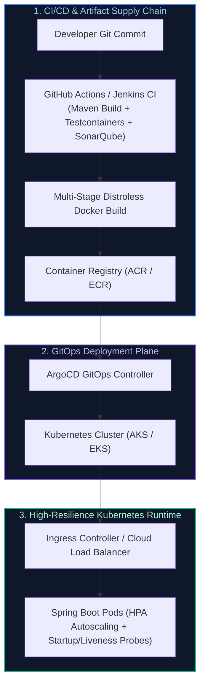
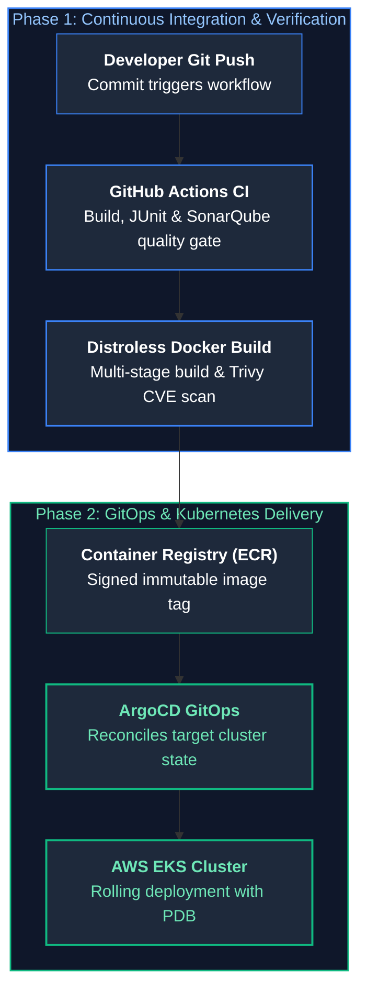
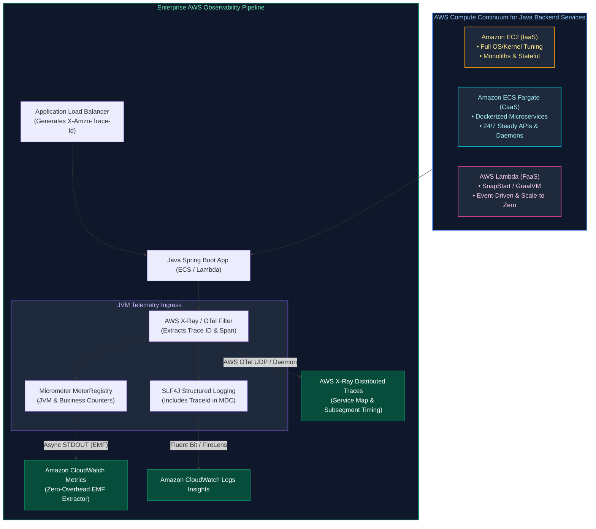

# 11. Cloud Native, Containers & DevOps: Interview FAQs & Playbooks

A comprehensive, production-grade guide to real-world interview scenarios and engineering solutions covering multi-stage Docker builds, Kubernetes probes and autoscaling (HPA), CI/CD pipelines, GitOps, and enterprise cloud deployments on Azure and AWS.

---

## Architectural Overview: Cloud Native Enterprise Architecture



---

## Table of Contents & Question Directory

- [Q1. **`[Easy]`** Docker Image vs Container & Multi-Stage Dockerfile for Spring Boot](#q1-easy-docker-image-vs-container-multi-stage-dockerfile-for-spring-boot)
- [Q2. **`[Medium]`** Liveness vs Readiness Probes in Kubernetes](#q2-medium-liveness-vs-readiness-probes-in-kubernetes)
- [Q3. **`[Medium]`** Kubernetes Autoscaling (HPA, VPA, Cluster Autoscaler) & Service Discovery](#q3-medium-kubernetes-autoscaling-hpa-vpa-cluster-autoscaler-service-discovery)
- [Q4. **`[Medium]`** Structuring a Robust CI/CD Pipeline (GitHub Actions / Jenkins)](#q4-medium-structuring-a-robust-cicd-pipeline-github-actions-jenkins)
- [Q5. **`[Easy]`** Deployment Strategies: Blue-Green vs Canary vs Rolling](#q5-easy-deployment-strategies-blue-green-vs-canary-vs-rolling)
- [Q6. **`[Easy]`** Azure Resource Hierarchy & Resource Groups](#q6-easy-azure-resource-hierarchy-resource-groups)
- [Q7. **`[Medium]`** Azure Identity: IAM Roles, Managed Identities & Service Principals](#q7-medium-azure-identity-iam-roles-managed-identities-service-principals)
- [Q8. **`[Medium]`** Azure Storage (Blob vs Files) & Queues (Service Bus vs Storage Queue)](#q8-medium-azure-storage-blob-vs-files-queues-service-bus-vs-storage-queue)
- [Q9. **`[Medium]`** Azure Load Balancer Architecture & Types](#q9-medium-azure-load-balancer-architecture-types)
- [Q10. **`[Easy]`** Horizontal vs Vertical Scaling in Azure](#q10-easy-horizontal-vs-vertical-scaling-in-azure)
- [Q11. **`[Medium]`** Azure Compute Models (VM vs App Service vs Functions vs AKS) & Zero-Downtime Deployments](#q11-medium-azure-compute-models-vm-vs-app-service-vs-functions-vs-aks-zero-downtime-deployments)
- [Q12. **`[Medium]`** Azure Compliance, Governance & Secret Management](#q12-medium-azure-compliance-governance-secret-management)
- [Q13. **`[Medium]`** AWS Virtual Private Cloud (VPC) & Network Resource Isolation](#q13-medium-aws-virtual-private-cloud-vpc-network-resource-isolation)
- [Q14. **`[Medium]`** End-to-End AWS Deployment Flow: CI Build to ECR and EKS Container Rollout](#q14-medium-end-to-end-aws-deployment-flow-ci-build-to-ecr-and-eks-container-rollout)
- [Q15. **`[Medium]`** Core AWS Services Integration in Enterprise Java Backend Engineering](#q15-medium-core-aws-services-integration-in-enterprise-java-backend-engineering)
- [Q16. **`[Hard]`** Production Kubernetes Architecture for Java Microservices: Memory Limits & cgroups v2](#q16-hard-production-kubernetes-architecture-for-java-microservices-memory-limits-cgroups-v2)
- [Q17. **`[Medium]`** Compute Strategy Selection in AWS: EC2 vs ECS (Fargate) vs AWS Lambda for Java Microservices & CloudWatch/X-Ray Observability](#q17-medium-compute-strategy-selection-in-aws-ec2-vs-ecs-fargate-vs-aws-lambda-for-java-microservices-cloudwatchx-ray-observability)

---

### Q1. [Easy] Docker Image vs Container & Multi-Stage Dockerfile for Spring Boot
**Difficulty:** [Easy]
*(Grouped together: Docker Fundamentals & Production Packaging)*  
**Topic Covered:** Containerization Architecture  
- **Docker Image:** Immutable template consisting of layered filesystems.
- **Docker Container:** Isolated running instance using Linux namespaces and cgroups.

#### Multi-Stage Distroless Spring Boot Dockerfile:
```dockerfile
# Stage 1: Build & Layer Extraction
FROM eclipse-temurin:21-jdk-alpine AS builder
WORKDIR /workspace
COPY pom.xml .
COPY src ./src
RUN ./mvnw clean package -DskipTests
RUN java -Djarmode=layertools -jar target/*.jar extract

# Stage 2: Runtime
FROM eclipse-temurin:21-jre-alpine
WORKDIR /app
RUN addgroup -S appgroup && adduser -S appuser -G appgroup
USER appuser
COPY --from=builder /workspace/dependencies/ ./
COPY --from=builder /workspace/spring-boot-loader/ ./
COPY --from=builder /workspace/snapshot-dependencies/ ./
COPY --from=builder /workspace/application/ ./
EXPOSE 8080
ENTRYPOINT ["java", "-XX:+UseContainerSupport", "-XX:MaxRAMPercentage=75.0", "org.springframework.boot.loader.launch.JarLauncher"]
```

---

# 2. Kubernetes Core Orchestration & Scaling

---


---

### Q2. [Medium] Liveness vs Readiness Probes in Kubernetes
**Difficulty:** [Medium]
**Topic Covered:** Container Lifecycle Health Checks  
- **Liveness Probe (`/actuator/health/liveness`):** Detects unrecoverable deadlocks or frozen processes. When it fails, Kubelet **kills and restarts the container**.
- **Readiness Probe (`/actuator/health/readiness`):** Detects whether the pod is ready to accept traffic (e.g. caches initialized). When it fails, K8s **removes the pod from Service traffic routing without restarting it**.

---


---

### Q3. [Medium] Kubernetes Autoscaling (HPA, VPA, Cluster Autoscaler) & Service Discovery
**Difficulty:** [Medium]
**Topic Covered:** Dynamic Cluster Orchestration  
- **HPA:** Adds/removes pod replicas based on CPU/Memory or queue lag via KEDA.
- **VPA:** Dynamically adjusts CPU/RAM requests of existing pods.
- **Cluster Autoscaler:** Provisions additional cloud VM nodes when pods cannot be scheduled.
- **Service Discovery:** CoreDNS creates internal DNS entries (`service.namespace.svc.cluster.local`); `kube-proxy` routes traffic to healthy pod IPs.

---

# 3. CI/CD Pipelines & Zero-Downtime Deployments

---


---

### Q4. [Medium] Structuring a Robust CI/CD Pipeline (GitHub Actions / Jenkins)
**Difficulty:** [Medium]
**Topic Covered:** DevOps Automation Pipelines  
1. Compilation & Unit Tests.
2. Static Analysis (SonarQube) & Trivy Container Security Scan.
3. Integration Tests via Testcontainers.
4. Build multi-stage Docker image and push to Azure Container Registry (ACR) / ECR.
5. Deploy to Kubernetes via ArgoCD GitOps.

---


---

### Q5. [Easy] Deployment Strategies: Blue-Green vs Canary vs Rolling
**Difficulty:** [Easy]
**Topic Covered:** Production Deployment Topologies  
- **Rolling (K8s Default):** Incrementally updates pods. Low cost; both versions run concurrently during rollout.
- **Blue-Green:** Two parallel environments. Instant cutover and rollback; requires double compute capacity during release.
- **Canary:** Routes 5% of production traffic to the new version, verifies telemetry/error rates, then proceeds to 100%. Safest blast radius.

---


---

### Q6. [Easy] Azure Resource Hierarchy & Resource Groups
**Difficulty:** [Easy]
**Topic Covered:** Cloud Governance & Scoping  
Management Groups $\to$ Subscriptions $\to$ Resource Groups $\to$ Resources. Resource groups organize related services sharing a unified lifecycle.

---


---

### Q7. [Medium] Azure Identity: IAM Roles, Managed Identities & Service Principals
**Difficulty:** [Medium]
**Topic Covered:** Azure Active Directory (Entra ID)  
- **Service Principal:** Identity for automated CI/CD tools using client secrets/certs.
- **Managed Identity (Recommended):** Eliminates password/secret management entirely; Azure manages internal credentials automatically for the resource.

---


---

### Q8. [Medium] Azure Storage (Blob vs Files) & Queues (Service Bus vs Storage Queue)
**Difficulty:** [Medium]
*(Grouped together: Azure Storage & Messaging Selection)*  
**Topic Covered:** Azure PaaS Storage & Queue Selection  
- **Blob Storage:** HTTP object store for unstructured files.
- **Azure Files:** Fully managed file shares accessible via SMB/NFS mounted directly as pod persistent volumes.
- **Storage Queue:** High-volume simple queues (>80GB).
- **Service Bus Queue:** Enterprise messaging with duplicate detection, transactions, sessions, and dead letter queues.

---


---

### Q9. [Medium] Azure Load Balancer Architecture & Types
**Difficulty:** [Medium]
**Topic Covered:** Cloud Traffic Distribution  
- **Azure Load Balancer:** Layer 4 (TCP/UDP) ultra-low latency routing.
- **Azure Application Gateway:** Layer 7 (HTTP/HTTPS) with SSL termination, URL path routing, and Web Application Firewall (WAF).

---


---

### Q10. [Easy] Horizontal vs Vertical Scaling in Azure
**Difficulty:** [Easy]
**Topic Covered:** Capacity Planning  
Vertical scaling (Scale-up) increases VM CPU/RAM size (incurs reboot downtime). Horizontal scaling (Scale-out) adds VMSS or AKS node instances without downtime.

---


---

### Q11. [Medium] Azure Compute Models (VM vs App Service vs Functions vs AKS) & Zero-Downtime Deployments
**Difficulty:** [Medium]
*(Grouped together: Azure Compute & AKS Deployments)*  
**Topic Covered:** Cloud Compute Paradigms & AKS  
- VM (IaaS) $\to$ App Service (PaaS) $\to$ Azure Functions (Serverless FaaS) $\to$ AKS (Container Orchestration).
- **Zero-Downtime in AKS:** Use RollingUpdate with `maxUnavailable: 0`, readiness probes, and Spring Boot graceful shutdown (`server.shutdown=graceful`).

---


---

### Q12. [Medium] Azure Compliance, Governance & Secret Management
**Difficulty:** [Medium]
**Topic Covered:** Enterprise Security Posture  
Enforce governance with **Azure Policy**; store secrets, keys, and certificates in **Azure Key Vault** mounted into AKS via Secrets Store CSI Driver.

---

# 5. AWS Network Architecture

---


---

### Q13. [Medium] AWS Virtual Private Cloud (VPC) & Network Resource Isolation
**Difficulty:** [Medium]
**Topic Covered:** Cloud Virtual Networking  
VPCs isolate cloud resources using Public Subnets (connected to Internet Gateway for public ingress) and Private Subnets (hosting Spring Boot apps and RDS, accessing the internet for patches strictly via a NAT Gateway).

---


---

### Q14. [Medium] End-to-End AWS Deployment Flow: CI Build to ECR and EKS Container Rollout
**Topic Covered:** CI/CD Automation & Cloud Deployment Lifecycle  
**Difficulty:** `[Medium]`

#### Architectural Overview
1. **Developer Push**: Code committed to GitHub/GitLab triggers GitHub Actions CI pipeline.
2. **Quality Gates & Build**: Pipeline executes unit tests (JUnit 5), static code analysis (SonarQube), and builds an optimized layered multi-stage Docker container image via Temurin distroless.
3. **Registry Push**: CI logs in to **AWS Elastic Container Registry (ECR)** via IAM OIDC role and pushes the tagged image (`sha-commit`).
4. **GitOps Rollout**: ArgoCD / Helm detects the new image tag and applies rolling updates to **Amazon Elastic Kubernetes Service (EKS)** pods.



---


---

### Q15. [Medium] Core AWS Services Integration in Enterprise Java Backend Engineering
**Topic Covered:** AWS Cloud Ecosystem for Java  
**Difficulty:** `[Medium]`

#### Architectural Overview
- **Compute**: Amazon EKS (Kubernetes) or ECS Fargate (Serverless Containers).
- **Relational Storage**: Amazon RDS Aurora PostgreSQL with automated failover and read replicas.
- **Asynchronous Messaging**: Amazon SQS (Dead-letter queues, task processing) and SNS (Fan-out pub/sub).
- **Blob Storage**: Amazon S3 for customer document, report, and artifact storage using AWS SDK for Java v2 (`S3AsyncClient` with Netty).
- **Secret & Config Management**: AWS Secrets Manager and Systems Manager Parameter Store.

---


---

### Q16. [Hard] Production Kubernetes Architecture for Java Microservices: Memory Limits & cgroups v2
**Topic Covered:** Container Resource Sizing & JVM Awareness  
**Difficulty:** `[Hard]`

#### Architectural Overview
Historically, Java 8 was unaware of container cgroups and calculated heap size based on total host physical RAM, causing the Linux Kernel Out-Of-Memory killer (`OOMKilled`, exit code 137) to terminate the container. Modern Java 17+ and 21 are fully cgroup v2 container-aware:
1. **Container Memory Sizing**: If pod memory limit is set to `2Gi`, the JVM heap should be configured to **$70-75\%$** of the container limit: `-XX:MaxRAMPercentage=75.0`.
2. **Off-Heap Overhead**: The remaining $25\%$ ($512\text{ MB}$) is essential for Metaspace, thread stacks ($1\text{ MB} \times \text{thread count}$), DirectByteBuffers (Netty I/O), and JIT code cache.
3. **Graceful Termination**: Configure `terminationGracePeriodSeconds: 60` and Spring Boot `server.shutdown=graceful` to allow in-flight HTTP requests to complete before SIGKILL.

---


---

### Q17. [Medium] Compute Strategy Selection in AWS: EC2 vs ECS (Fargate) vs AWS Lambda for Java Microservices & CloudWatch/X-Ray Observability
**Difficulty:** [Medium]
**Topic Covered:** AWS Compute Models (EC2 vs ECS Fargate vs Lambda SnapStart), Serverless Java Cold-Start Mitigation & Enterprise Observability (CloudWatch EMF + X-Ray/OpenTelemetry)  
**Question:** Explain the differences, tradeoffs, and selection criteria between AWS EC2, ECS (Fargate), and AWS Lambda for Java microservices. How do you implement end-to-end monitoring and distributed tracing for these applications in AWS?

#### Definition & Core Concepts

1. **AWS Compute Paradigms for Java Workloads:**
   - **Amazon EC2 (Infrastructure as a Service - IaaS):** Bare virtual machines provisioned on AWS Nitro hypervisors. Provides complete root OS control, configurable kernel parameters (`sysctl`), custom swap, and full freedom to tune JVM flags (`-XX:+UseZGC`, `-XX:ActiveProcessorCount`). Scaling operates via Auto Scaling Groups (ASGs), requiring $3\text{–}5\text{ minutes}$ to provision, boot, and warm the JVM. Demands heavy maintenance (OS patching, AMI baking, CVE remediation).
   - **Amazon ECS with AWS Fargate (Containers as a Service - CaaS):** Serverless container orchestration. Eliminates EC2 instance provisioning and OS management. Tasks run within dedicated MicroVM boundaries with strict CPU/memory allocations enforced by Linux `cgroups v2`. Scale-out occurs in $30\text{–}60\text{ seconds}$ by launching pre-built Docker container images. Standard JVMs require `-XX:+UseContainerSupport` and `-XX:MaxRAMPercentage=75.0` to respect Fargate container memory constraints.
   - **AWS Lambda (Function as a Service - FaaS):** Event-driven, serverless execution environments based on Firecracker microVMs. Scales from 0 to tens of thousands of concurrent executions in milliseconds, billing strictly for execution duration per millisecond.
   - **The Java HotSpot Cold-Start Pathology on Lambda:** Standard Spring Boot JVM cold starts take $4\text{–}10\text{ seconds}$ due to classloading (~$10,000$ classes), bytecode verification, C1/C2 JIT compilation, and Spring component scanning.
   - **Modern JVM Serverless Cold-Start Mitigations:**
     - **AWS Lambda SnapStart (Coordinated Restore at Checkpoint - CRaC):** AWS initializes the JVM during deployment, executes classloading and bean creation, takes an encrypted snapshot of the Firecracker microVM memory/CPU state, and caches it. On request invocation, Lambda restores the snapshot in $<200\text{ms}$.
     - **GraalVM Native Image (SubstrateVM):** Ahead-Of-Time (AOT) compiles Java bytecode directly into a standalone Linux binary, eliminating JIT overhead, achieving startup times under $50\text{ms}$ with memory footprints under $40\text{MB}$.

2. **Enterprise Observability on AWS:**
   - **Metrics (Amazon CloudWatch & Embedded Metric Format - EMF):** High-throughput, asynchronous metric ingestion. Instead of making blocking HTTP API calls (`PutMetricData`) which throttle and consume network threads, applications emit structured JSON logs conforming to the EMF specification to stdout. CloudWatch automatically extracts dimensions and metrics asynchronously with zero API latency overhead.
   - **Structured Logs (CloudWatch Logs & Insights):** Centralized log aggregation ingested via AWS FireLens (Fluent Bit sidecar in ECS) or native Lambda log forwarders, indexed for ad-hoc distributed log slicing.
   - **Distributed Tracing (AWS X-Ray & AWS Distro for OpenTelemetry - ADOT):** Propagates trace context headers (`X-Amzn-Trace-Id` and W3C `traceparent`) across API Gateways, ALBs, ECS tasks, Lambdas, and downstream AWS SDK calls (DynamoDB, SQS, S3, Aurora).

#### Deep Architectural Mechanics / Problem Analysis

##### Compute Strategy Decision Matrix

| Dimension | Amazon EC2 | Amazon ECS (Fargate) | AWS Lambda (with SnapStart) |
| :--- | :--- | :--- | :--- |
| **Abstraction Level** | Virtual Machine (IaaS) | Serverless Container (CaaS) | Serverless Function (FaaS) |
| **Operational Overhead** | High (OS patching, AMI pipelines, agent maintenance) | Low (Docker packaging, task definitions, zero OS patching) | Minimal (Code upload, runtime configuration) |
| **Startup / Scaling Latency** | $3\text{–}5\text{ minutes}$ (VM boot + JVM start) | $30\text{–}60\text{ seconds}$ (Container pull + JVM start) | $<200\text{ms}$ (SnapStart restore) / $50\text{ms}$ (GraalVM) |
| **Execution Duration** | Unbounded (24/7 continuous) | Unbounded (24/7 continuous) | Max $15\text{ minutes}$ per invocation |
| **Memory / CPU Limits** | Up to 128 vCPU, 4,096 GB RAM | Up to 16 vCPU, 120 GB RAM per task | Up to 6 vCPU, 10 GB RAM per function |
| **Statefulness & Local Storage** | Persistent EBS volumes / Local NVMe | Ephemeral storage ($20\text{–}200\text{ GB}$) or EFS mounts | Ephemeral `/tmp` ($512\text{ MB}\text{–}10\text{ GB}$) |
| **Cost Profile: Steady Traffic** | **Optimal** (Reserved Instances / Savings Plans) | **Moderate** (Predictable, ~15-20% premium over EC2) | **Poor** (High continuous concurrency costs) |
| **Cost Profile: Spiky / Sporadic** | **Poor** (Paying 100% for idle headroom) | **Moderate** (Slow downscale leaves idle tasks) | **Optimal** (Exact millisecond pay-per-use, scale to 0) |
| **Ideal Architectural Fit** | Legacy monoliths, Kafka/Cassandra brokers, memory-intensive caches | Continuous Spring Boot microservices, REST APIs, batch worker daemons | Event-driven webhooks, S3/SQS/Kinesis stream consumers, sporadic APIs |

#### Visual Flow



#### Production Implementation / Java Code

##### 1. High-Performance CloudWatch Observability via Embedded Metric Format (EMF)

```java
package com.enterprise.observability.aws;

import com.fasterxml.jackson.databind.ObjectMapper;
import org.slf4j.Logger;
import org.slf4j.LoggerFactory;
import org.slf4j.MDC;
import org.springframework.stereotype.Component;

import java.time.Instant;
import java.util.*;

/**
 * Zero-overhead AWS CloudWatch Metrics emission using Embedded Metric Format (EMF).
 * Emits metrics directly to STDOUT as structured JSON; CloudWatch parses them asynchronously
 * without consuming HTTP socket connections or incurring PutMetricData throttling.
 */
@Component
public class CloudWatchEmfMetricsPublisher {

    private static final Logger EMF_LOGGER = LoggerFactory.getLogger("EMF_METRICS");
    private static final ObjectMapper OBJECT_MAPPER = new ObjectMapper();

    public void publishLatencyMetric(String serviceName, String operationName, double latencyMs, int httpStatus) {
        try {
            Map<String, Object> emfPayload = new LinkedHashMap<>();

            // 1. CloudWatch EMF Metadata Envelope
            Map<String, Object> cwMetadata = new HashMap<>();
            cwMetadata.put("Timestamp", Instant.now().toEpochMilli());

            Map<String, Object> metricDefinition = new HashMap<>();
            metricDefinition.put("Namespace", "Enterprise/JavaBackendServices");
            metricDefinition.put("Dimensions", List.of(List.of("ServiceName", "Operation", "StatusCode")));

            metricDefinition.put("Metrics", List.of(
                    Map.of("Name", "LatencyMs", "Unit", "Milliseconds"),
                    Map.of("Name", "RequestCount", "Unit", "Count")
            ));

            cwMetadata.put("CloudWatchMetrics", List.of(metricDefinition));
            emfPayload.put("_aws", cwMetadata);

            // 2. Custom Dimensions
            emfPayload.put("ServiceName", serviceName);
            emfPayload.put("Operation", operationName);
            emfPayload.put("StatusCode", String.valueOf(httpStatus));
            emfPayload.put("TraceId", Optional.ofNullable(MDC.get("X-Amzn-Trace-Id")).orElse("none"));

            // 3. Metric Values
            emfPayload.put("LatencyMs", latencyMs);
            emfPayload.put("RequestCount", 1);

            // 4. Asynchronous Write to STDOUT (Parsed by CloudWatch Agent / FireLens)
            EMF_LOGGER.info(OBJECT_MAPPER.writeValueAsString(emfPayload));
        } catch (Exception ex) {
            // Defensive logging: Metric failure must never disrupt transactional execution
            LoggerFactory.getLogger(CloudWatchEmfMetricsPublisher.class)
                    .error("Failed to generate CloudWatch EMF payload", ex);
        }
    }
}
```

##### 2. AWS X-Ray Trace Context Interceptor & MDC Propagation

```java
package com.enterprise.observability.aws;

import jakarta.servlet.*;
import jakarta.servlet.http.HttpServletRequest;
import jakarta.servlet.http.HttpServletResponse;
import org.slf4j.MDC;
import org.springframework.core.annotation.Order;
import org.springframework.stereotype.Component;

import java.io.IOException;
import java.util.UUID;

/**
 * Ingress filter extracting AWS ALB / API Gateway Trace Context headers (X-Amzn-Trace-Id)
 * and binding them to the SLF4J MDC context for unified cross-system log correlation.
 */
@Component
@Order(1)
public class AwsXRayTraceFilter implements Filter {

    public static final String TRACE_HEADER = "X-Amzn-Trace-Id";
    public static final String MDC_TRACE_KEY = "traceId";

    @Override
    public void doFilter(ServletRequest request, ServletResponse response, FilterChain chain)
            throws IOException, ServletException {

        HttpServletRequest httpRequest = (HttpServletRequest) request;
        HttpServletResponse httpResponse = (HttpServletResponse) response;

        String traceId = httpRequest.getHeader(TRACE_HEADER);
        if (traceId == null || traceId.isBlank()) {
            // Generate synthetic X-Ray Root Trace ID if not injected by ALB
            // Format: 1-{epoch_hex}-{random_hex_96bit}
            long epochSec = System.currentTimeMillis() / 1000;
            String randomHex = UUID.randomUUID().toString().replace("-", "").substring(0, 24);
            traceId = String.format("Root=1-%08x-%s", epochSec, randomHex);
        }

        MDC.put(MDC_TRACE_KEY, traceId);
        httpResponse.setHeader(TRACE_HEADER, traceId);

        try {
            chain.doFilter(request, response);
        } finally {
            MDC.remove(MDC_TRACE_KEY);
        }
    }
}
```

##### 3. AWS Lambda SnapStart CRaC Lifecycle Hook for Java Microservices

```java
package com.enterprise.serverless.snapstart;

import org.crac.Context;
import org.crac.Core;
import org.crac.Resource;
import org.slf4j.Logger;
import org.slf4j.LoggerFactory;
import org.springframework.stereotype.Component;

import java.security.SecureRandom;
import java.sql.Connection;
import java.sql.DriverManager;

/**
 * CRaC (Coordinated Restore at Checkpoint) resource registered with AWS Lambda SnapStart.
 * Ensures database connection pools, security tokens, and PRNG seeds are cleanly closed before
 * snapshot checkpointing and refreshed immediately upon warm container restore.
 */
@Component
public class SnapStartWarmupResource implements Resource {

    private static final Logger log = LoggerFactory.getLogger(SnapStartWarmupResource.class);
    private Connection warmConnection;
    private SecureRandom secureRandom;

    public SnapStartWarmupResource() {
        // Register this component with CRaC runtime coordination engine
        Core.getGlobalContext().register(this);
    }

    @Override
    public void beforeCheckpoint(Context<? extends Resource> context) throws Exception {
        log.info("SnapStart Checkpoint Initiated: Closing open database sockets & flushing caches...");
        if (warmConnection != null && !warmConnection.isClosed()) {
            warmConnection.close();
            warmConnection = null;
        }
        // Nullify pseudo-random generator to avoid snapshotting identical entropy states
        secureRandom = null;
    }

    @Override
    public void afterRestore(Context<? extends Resource> context) throws Exception {
        log.info("SnapStart Warm Snapshot Restored: Re-establishing connections and seeding entropy...");
        // 1. Re-initialize Cryptographic PRNG with fresh OS entropy post-restore
        this.secureRandom = new SecureRandom();

        // 2. Pre-warm database connection pool asynchronously
        String dbUrl = System.getenv("JDBC_URL");
        if (dbUrl != null) {
            this.warmConnection = DriverManager.getConnection(dbUrl);
            log.info("Warm database connection successfully restored in <15ms");
        }
    }
}
```

#### Big-O / Performance Analysis & Cold-Start Latency Benchmarks

- **Algorithmic Complexity:** $O(1)$ metric emission via EMF memory buffers; $O(1)$ MDC thread-local binding.
- **Latency Benchmarks Across AWS Compute Tiers for Java Microservices:**

| Compute Configuration | P50 Cold-Start Latency | P99 Steady-State Latency | Memory Utilization | Concurrency Scalability |
| :--- | :--- | :--- | :--- | :--- |
| **EC2 (m6i.xlarge HotSpot)** | $3\text{–}5\text{ minutes}$ (Instance launch) | $2\text{–}8\text{ms}$ | $1.5\text{–}4\text{ GB}$ (Dedicated) | Bound by ASG spin-up time |
| **ECS Fargate (HotSpot JDK 21)** | $35\text{–}50\text{ seconds}$ (Task pull + JVM) | $3\text{–}10\text{ms}$ | $1.0\text{–}2.5\text{ GB}$ per task | Scales in $45\text{s}$ increments |
| **AWS Lambda (Standard HotSpot)** | **$4,500\text{–}8,200\text{ms}$** *(Pathological)* | $5\text{–}15\text{ms}$ | $512\text{–}1024\text{ MB}$ | Up to 1,000 burst / minute |
| **AWS Lambda (SnapStart CRaC)** | **$180\text{–}290\text{ms}$** *(Production-Ready)* | $5\text{–}15\text{ms}$ | $512\text{–}1024\text{ MB}$ | Instantaneous Firecracker restore |
| **AWS Lambda (GraalVM Native)** | **$45\text{–}85\text{ms}$** *(Optimal Serverless)* | $4\text{–}12\text{ms}$ | $128\text{–}256\text{ MB}$ | Instantaneous binary startup |

#### Common Engineering Traps & Anti-Patterns

1. **Deploying Plain Spring Boot to AWS Lambda Without SnapStart or GraalVM:**
   Standard Spring Boot applications have multi-second reflection and bean initialization cycles. Without SnapStart or GraalVM AOT compilation, callers experience $5\text{–}10\text{s}$ API timeouts during autoscaling spikes.
2. **The CloudWatch Metric High-Cardinality Explosion Trap:**
   Including high-cardinality fields such as `UserId`, `OrderId`, or `Timestamp` as dimensions in CloudWatch metrics. CloudWatch charges \$0.30 per unique metric dimension combination per month. Publishing 100,000 unique user IDs generates a \$30,000 monthly cloud bill! Keep dimensions bounded to static enums (`Region`, `Environment`, `Operation`, `StatusCode`).
3. **CRaC Snapshotting Ephemeral Credentials & Stale Entropy:**
   Enabling SnapStart without registering a CRaC `Resource` to reset PRNG seeds and AWS STS credentials. If an STS token expiring in 15 minutes is snapshotted, any Lambda instance restored 20 minutes later crashes immediately with authentication errors. Similarly, snapshotting `java.util.Random` causes every restored Lambda instance to generate identical "random" numbers.
4. **Synchronous `PutMetricData` Calls in Request Threads:**
   Calling the AWS CloudWatch SDK `PutMetricData` synchronously within HTTP request filters. This introduces $50\text{–}150\text{ms}$ network round-trip overhead to every API request and crashes under traffic bursts due to CloudWatch rate-limiting (`ThrottlingException: Rate exceeded`). Always use CloudWatch EMF via STDOUT.
5. **Over-Provisioning Static EC2 Clusters for Spiky Traffic:**
   Running 10 dedicated `c5.2xlarge` EC2 instances 24/7 to handle a 30-minute daily spike, idling at $<3\%$ CPU for 23.5 hours. Migrate to ECS Fargate with target tracking autoscaling or Lambda SnapStart to reduce compute costs by $70\text{–}85\%$.

#### Core Curriculum Cross-Reference
*Deep-dive theoretical reference: See [2. Kubernetes Architecture & Core Primitives](../11_cloud_native_containers_and_devops.md#2-kubernetes-k8s-architecture--core-primitives) and [5. Microsoft Azure Cloud Architecture for Java Enterprise Backends](../11_cloud_native_containers_and_devops.md#5-microsoft-azure-cloud-architecture-for-java-enterprise-backends).*

---

## Summary Comparison & Production Reference Matrix

| Incident Scenario | Primary Symptom | Root Cause Mechanism | Immediate Diagnostic Command | Canonical Production Resolution |
| :--- | :--- | :--- | :--- | :--- |
| **5–6s API Latency** | High p99 response time with low CPU | Tomcat queue delay, HikariCP lease wait, or slow downstream HTTP | OpenTelemetry span trace analysis & `X-Request-Start` | Isolate sub-spans, add connect/read timeouts (500ms/2s), prevent DB calls in HTTP loops |
| **ConcurrentHashMap Flaws** | Clobbered writes, lost updates, race conditions | Check-then-act non-atomic compound logic (`if(!contains) put`) | Concurrency stress test / Code review inspection | Replace compound statements with atomic `computeIfAbsent()`, `compute()`, or `merge()` |
| **200 Threads Low Throughput** | High sys% CPU or 95% threads parked | OS context-switching storm, monitor lock contention, pool starvation | `pidstat -w 1 5` & `jcmd <PID> Thread.print` | Size thread pool via Goetz formula ($N \times U \times (1 + W/C)$), switch to Virtual Threads |
| **OutOfMemoryError (Heap)** | Crash with `Java heap space` | Retained object graphs in static collections, caches, or `ThreadLocal` | Eclipse MAT Dominator Tree on HPROF dump | Enforce `-XX:+HeapDumpOnOutOfMemoryError`, bounded cache eviction, `ThreadLocal.remove()` |
| **High GC on Low Traffic** | High CPU & GC activity when idle | Allocation churn in polling loops, string concatenation, premature tenuring | `jstat -gcutil <PID> 1000 10` & GC logs | Reusable direct buffers, SLF4J `{}` placeholders, resize Eden (`-XX:G1ReservePercent`) |
| **10 vs 1,000 User Collapse** | Connection refused, 503 errors, latency spike | Tomcat accept queue overflow, HikariCP starvation, DB row locks | `netstat -ant`, `ulimit -n`, APM queue metrics | Bound Tomcat queues, fast-fail connection timeouts (3s), cache read queries via Redis |
| **AWS Compute & Observability** | Lambda cold start timeouts (8s) or high CloudWatch metric bills | CloudWatch Logs Insights, X-Ray service maps & EMF analyzers | Migrate to Lambda SnapStart/CRaC, bound metric dimensions & use EMF STDOUT logging |

---

## References & Further Reading

1. **Goetz, Brian, et al.** *Java Concurrency in Practice*. Addison-Wesley Professional, 2006. (Seminal reference for thread pool sizing, Amdahl's Law, and concurrent collections).
2. **Gunther, Neil J.** *Guerrilla Capacity Planning: A Tactical Approach to Planning for Highly Scalable Applications and Services*. Springer, 2007. (Universal Scalability Law formulation and queueing models).
3. **OpenTelemetry Specification.** *Distributed Tracing and W3C TraceContext Ingress Standards*. [https://opentelemetry.io/docs/specs/](https://opentelemetry.io/docs/specs/).
4. **Oracle JVM Diagnostics Guide.** *Troubleshooting Guide for Java SE HotSpot VM*. Oracle Corporation. [https://docs.oracle.com/en/java/javase/21/troubleshoot/](https://docs.oracle.com/en/java/javase/21/troubleshoot/).
5. **HikariCP Engineering Wiki.** *About Pool Sizing & Downstream Saturation*. Brett Wooldridge. [https://github.com/brettwooldridge/HikariCP/wiki/About-Pool-Sizing](https://github.com/brettwooldridge/HikariCP/wiki/About-Pool-Sizing).
6. **Eclipse Foundation.** *Eclipse Memory Analyzer (MAT) Documentation & Dominator Tree Algorithms*. [https://help.eclipse.org/latest/topic/org.eclipse.mat.ui.help/welcome.html](https://help.eclipse.org/latest/topic/org.eclipse.mat.ui.help/welcome.html).


## Core Curriculum Cross-Reference
*Deep-dive theoretical reference: See [Module 11: Cloud Native, Containers & DevOps](../11_cloud_native_containers_and_devops.md)*
