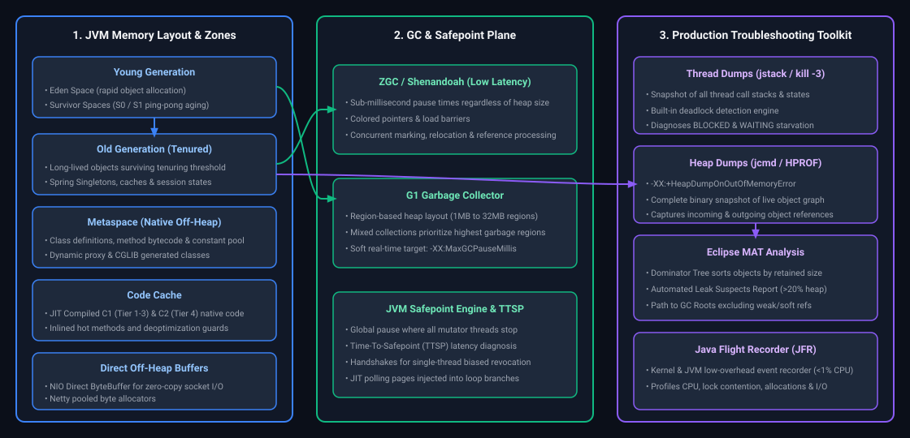
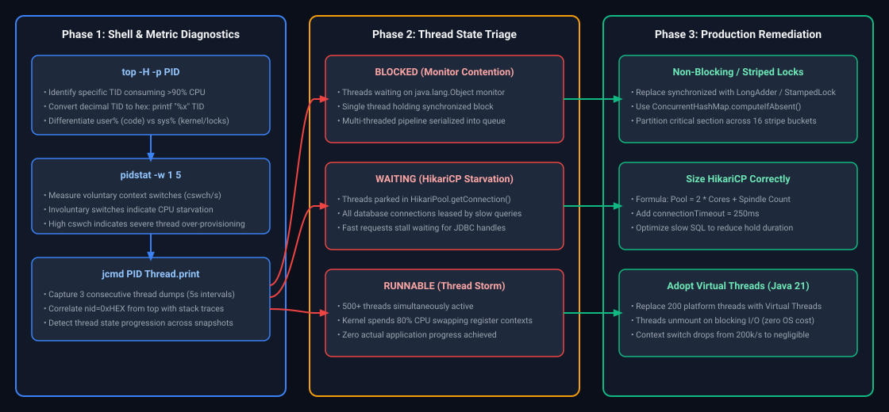
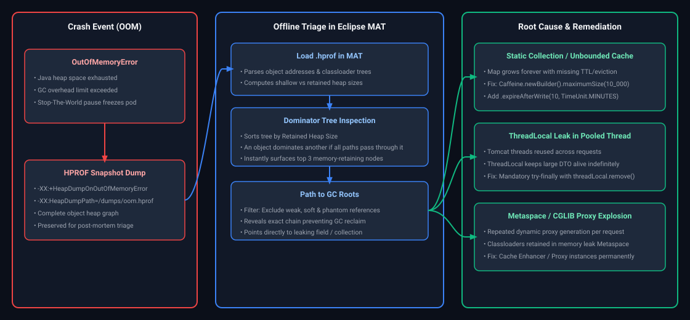
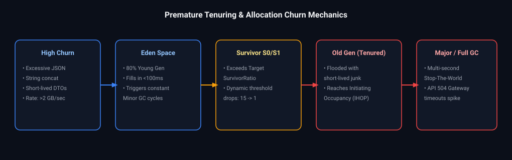
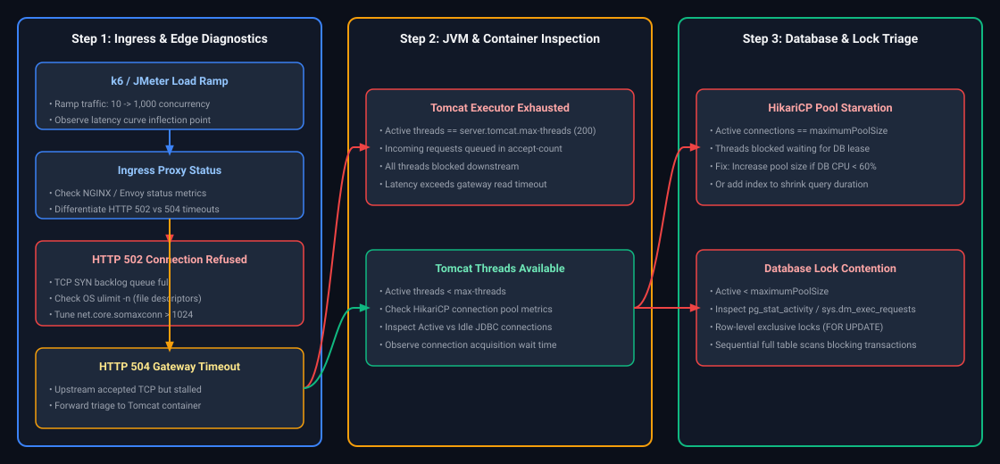

# 12. JVM Internals, Performance & Troubleshooting: Interview FAQs & Playbooks

A comprehensive, production-grade guide to real-world interview scenarios and diagnostic runbooks covering JVM memory architecture (Young/Old heap, Metaspace, DirectBuffer), garbage collection algorithms (G1, ZGC, Shenandoah), JIT compilation deoptimizations, thread dump triage (`jstack`), Eclipse MAT heap leak diagnosis, and low-overhead profiling.

---

## Architectural Overview: JVM Runtime Engine & Diagnostic Plane



*D2 Source:* [assets/12_jvm_internals_performance_and_troubleshooting_faq/01_jvm_subsystems_memory_execution_gc_architecture.d2](assets/12_jvm_internals_performance_and_troubleshooting_faq/01_jvm_subsystems_memory_execution_gc_architecture.d2)

---

## Table of Contents & Question Directory

### 1. JVM Memory Diagnostics & Heap Leak Triage
- [Q1. **`[Medium]`** Local and Remote Debugging via JDWP & Port Distinctions](#q1-medium-local-and-remote-debugging-via-jdwp-port-distinctions)
- [Q2. **`[Hard]`** Application Runs Fine for Hours, Then Suddenly Slows Down](#q2-hard-application-runs-fine-for-hours-then-suddenly-slows-down)
- [Q3. **`[Hard]`** High CPU Usage with Very Low Traffic: Investigation Steps](#q3-hard-high-cpu-usage-with-very-low-traffic-investigation-steps)
- [Q4. **`[Hard]`** Debugging Rare Production Deadlocks that Cannot be Reproduced Locally](#q4-hard-debugging-rare-production-deadlocks-that-cannot-be-reproduced-locally)
- [Q5. **`[Hard]`** Memory Usage Keeps Increasing with No Obvious Heap Leaks](#q5-hard-memory-usage-keeps-increasing-with-no-obvious-heap-leaks)
- [Q6. **`[Hard]`** GC Pauses Increase Significantly After a Small Release](#q6-hard-gc-pauses-increase-significantly-after-a-small-release)
- [Q7. **`[Medium]`** JVM Tuning: Throughput vs Latency Trade-Off](#q7-medium-jvm-tuning-throughput-vs-latency-trade-off)
- [Q8. **`[Hard]`** 200 Threads Running with Low Throughput: Thread Starvation, Pool Sizing & Lock Contention](#q8-hard-200-threads-running-with-low-throughput-thread-starvation-pool-sizing-lock-contention)

### 2. Garbage Collection, Safepoints & JVM Performance
- [Q9. **`[Hard]`** Spring Boot OutOfMemoryError Diagnostic Playbook: Heap Dumps, Metaspace & Leak Triage](#q9-hard-spring-boot-outofmemoryerror-diagnostic-playbook-heap-dumps-metaspace-leak-triage)
- [Q10. **`[Hard]`** High GC Activity with Low Production Traffic: Allocation Churn & Object Lifecycle Triage](#q10-hard-high-gc-activity-with-low-production-traffic-allocation-churn-object-lifecycle-triage)
- [Q11. **`[Hard]`** Concurrency Scalability Collapse: Investigating 10 vs 1,000 Concurrent Requests](#q11-hard-concurrency-scalability-collapse-investigating-10-vs-1000-concurrent-requests)
- [Q12. **`[Hard]`** Metaspace Leak Triage: Dynamic Class Generation & ClassLoader Leaks in Spring Boot](#q12-hard-metaspace-leak-triage-dynamic-class-generation-classloader-leaks-in-spring-boot)
- [Q13. **`[Hard]`** JIT Compilation Tiers (Interpreter to C1 to C2), Inlining & Deoptimization Traps](#q13-hard-jit-compilation-tiers-interpreter-to-c1-to-c2-inlining-deoptimization-traps)
- [Q14. **`[Hard]`** Stop-The-World (STW) GC Safepoint Latency: Time-To-Safepoint (TTSP) & Long Counted Loops](#q14-hard-stop-the-world-stw-gc-safepoint-latency-time-to-safepoint-ttsp-long-counted-loops)
- [Q15. **`[Hard]`** Java NIO DirectBuffer Memory Leaks (OutOfMemoryError: Direct buffer memory)](#q15-hard-java-nio-directbuffer-memory-leaks-outofmemoryerror-direct-buffer-memory)
- [Q16. **`[Expert]`** Project Panama (Foreign Function & Memory API) vs JNI: Off-Heap Arena Management](#q16-expert-project-panama-foreign-function-memory-api-vs-jni-off-heap-arena-management)

---

## 1. JVM Memory Diagnostics & Heap Leak Triage

### Q1. [Medium] Local and Remote Debugging via JDWP & Port Distinctions
**Difficulty:** [Medium]
*(Grouped together: Java Remote Debugging Mechanics)*  
**Topic Covered:** JVM Tool Interface (JVMTI) & JDWP Protocol  
Attach the JDWP agent on remote launch:
```bash
java -agentlib:jdwp=transport=dt_socket,server=y,suspend=n,address=*:5005 -jar app.jar
```
- **Application Server Port (e.g. 8080):** Serves customer HTTP traffic.
- **JVM Remote Debug Port (e.g. 5005):** Binary protocol exclusively for IDE breakpoint introspection. Must never be exposed publicly.

---

# 6. CPU & Latency Production Anomalies

---


---

### Q2. [Hard] Application Runs Fine for Hours, Then Suddenly Slows Down
**Difficulty:** [Hard]
**Topic Covered:** Progressive Degradation Diagnostics  
- Memory leak exhausting heap, forcing continuous Full GC thrashing.
- Unclosed database connections or file descriptors leaking over time.
- Database table grew past RAM buffer pool, forcing sequential disk scans.

---


---

### Q3. [Hard] High CPU Usage with Very Low Traffic: Investigation Steps
**Difficulty:** [Hard]
**Topic Covered:** Thread Profiling & Hotspot Tracking  
1. Find top thread ID: `top -H -p <PID>`.
2. Convert thread ID to hex: `printf "%x\n" <TID>`.
3. Capture thread dump and grep: `jstack <PID> | grep -A 30 "0x<hex_id>"`.
4. Inspect code for infinite loops, regex catastrophic backtracking (ReDoS), or JVM `VM Thread` spinning on Full GC.

---


---

### Q4. [Hard] Debugging Rare Production Deadlocks that Cannot be Reproduced Locally
**Difficulty:** [Hard]
**Topic Covered:** Post-Mortem Concurrency Debugging  
Capture thread dump via `jcmd <PID> Thread.print` or `kill -3 <PID>`. The JVM automatically outputs cyclic monitor dependency sections (`Found one Java-level deadlock`). Enforce global lock ordering to permanently resolve.

---

# 7. Memory, Garbage Collection & Collections Degradation

---


---

### Q5. [Hard] Memory Usage Keeps Increasing with No Obvious Heap Leaks
**Difficulty:** [Hard]
**Topic Covered:** Off-Heap & Native Memory Analysis  
If heap usage is stable but process memory (RSS) climbs:
- Metaspace class generation leak (CGLIB/ByteBuddy).
- Direct ByteBuffers allocated off-heap by Netty or Java NIO.
- Thread stack memory (each thread takes 1MB native stack via `-Xss`).
- Diagnose using Native Memory Tracking: `-XX:NativeMemoryTracking=summary`.

---


---

### Q6. [Hard] GC Pauses Increase Significantly After a Small Release
**Difficulty:** [Hard]
**Topic Covered:** GC Allocation Rate & Tenuring  
High allocation rate of short-lived large objects bypassing young generation survivor spaces and prematurely promoting to the Old Generation. Inspect using GC logs (`-Xlog:gc*`).

---


---

### Q7. [Medium] JVM Tuning: Throughput vs Latency Trade-Off
**Difficulty:** [Medium]
**Topic Covered:** GC Collector Mechanics  
- **Throughput-Oriented (Parallel GC / G1GC):** Maximizes application CPU time; accepts longer STW pauses.
- **Low-Latency (ZGC / Shenandoah in Java 21):** Concurrent marking and compaction with sub-millisecond pauses; trades ~10-15% peak throughput overhead.

---

# 8. Distributed Cascades, Scaling & Logging Pitfalls

---


---

### Q8. [Hard] 200 Threads Running with Low Throughput: Thread Starvation, Pool Sizing & Lock Contention
**Difficulty:** [Hard]
**Topic Covered:** Thread Pool Architecture, Monitor Contention & Amdahl's Law  
**Question:** Application has 200 threads running, but throughput is very low. What could be the issue?

#### Definition & Core Concepts
A common engineering fallacy is that increasing thread count proportionally increases throughput. When an application runs 200 threads but exhibits dismal throughput (e.g., tens of transactions per second instead of thousands), the bottleneck is almost always **concurrency coordination overhead** or **shared resource exhaustion**.

According to **Amdahl’s Law** and the **Universal Scalability Law (USL)**:

$$\text{Speedup}(N) = \frac{N}{1 + \alpha(N - 1) + \beta N(N - 1)}$$

Where $\alpha$ represents serialization (lock contention) and $\beta$ represents coherency delay (CPU cache invalidation and context switching). When $N$ expands to 200 on an 8-core host, throughput crashes due to three primary pathologies:

1. **OS Thread Context Switching Storms:** The Linux kernel scheduler must preemptively switch 200 platform threads across 4 to 8 physical CPU cores. Each context switch flushes L1/L2 CPU instruction caches, TLB (Translation Lookaside Buffers), and incurs thousands of CPU cycles in kernel space (`sys` CPU high, `usr` CPU low).
2. **Monitor Lock Contention (`BLOCKED` Threads):** 200 threads attempting to acquire the same synchronized block, database row, or shared queue serialization point spend 98% of their lifespan parked (`WAITING` / `BLOCKED`), waiting to be unparked by the OS scheduler.
3. **Downstream Resource Starvation (HikariCP Depletion):** If Tomcat spawns 200 worker threads, but HikariCP has a max pool size of 10 (`maximumPoolSize=10`), 190 threads are suspended waiting for a JDBC connection.

#### Brian Goetz Thread Pool Sizing Formula
To avoid starvation and CPU thrashing, calculate target thread count empirically:

$$N_{\text{threads}} = N_{\text{CPU}} \times U_{\text{CPU}} \times \left(1 + \frac{W}{C}\right)$$

Where:
- $N_{\text{CPU}}$ = Number of available CPU cores (`Runtime.getRuntime().availableProcessors()`).
- $U_{\text{CPU}}$ = Target CPU utilization ($0 \le U_{\text{CPU}} \le 1$).
- $\frac{W}{C}$ = Wait-to-Compute ratio ($\text{Wait Time} / \text{Service Time}$).

#### Visual Flow


*D2 Source:* [assets/12_jvm_internals_performance_and_troubleshooting_faq/02_cpu_spike_thread_dump_analysis_decision_tree.d2](assets/12_jvm_internals_performance_and_troubleshooting_faq/02_cpu_spike_thread_dump_analysis_decision_tree.d2)

#### Production Implementation / Code Solution
```java
package com.enterprise.diagnostics.concurrency;

import org.slf4j.Logger;
import org.slf4j.LoggerFactory;
import org.springframework.context.annotation.Bean;
import org.springframework.context.annotation.Configuration;
import org.springframework.scheduling.concurrent.ThreadPoolTaskExecutor;

import java.util.concurrent.*;

@Configuration
public class OptimizedThreadPoolConfig {

    private static final Logger log = LoggerFactory.getLogger(OptimizedThreadPoolConfig.class);

    /**
     * Production thread pool sizing calculated for an 8-core machine with 80% I/O wait ratio.
     * Formula: 8 cores * 1.0 utilization * (1 + 4.0 W/C) = 40 threads.
     * Prevents 200-thread context-switch thrashing.
     */
    @Bean(name = "orderProcessingExecutor")
    public Executor orderProcessingExecutor() {
        int cores = Runtime.getRuntime().availableProcessors();
        int corePool = cores * 2;        // 16 threads for baseline compute
        int maxPool = cores * 5;         // 40 threads maximum under peak load
        int queueCapacity = 1000;        // Bounded queue prevents OutOfMemoryError

        ThreadPoolTaskExecutor executor = new ThreadPoolTaskExecutor();
        executor.setCorePoolSize(corePool);
        executor.setMaxPoolSize(maxPool);
        executor.setQueueCapacity(queueCapacity);
        executor.setThreadNamePrefix("order-exec-");

        // Production CallerRunsPolicy provides natural backpressure:
        // When queue is full, calling HTTP thread executes task, slowing ingress rate!
        executor.setRejectedExecutionHandler(new ThreadPoolExecutor.CallerRunsPolicy());
        executor.setWaitForTasksToCompleteOnShutdown(true);
        executor.setAwaitTerminationSeconds(30);
        executor.initialize();

        log.info("Initialized bounded ThreadPool: cores={}, corePool={}, maxPool={}, queueCap={}",
                cores, corePool, maxPool, queueCapacity);
        return executor;
    }

    /**
     * Modern Alternative: Java 21+ Virtual Threads for massive I/O concurrency.
     * Virtual threads decouple thread count from OS kernel threads, eliminating context-switch storms.
     */
    @Bean(name = "virtualThreadExecutor")
    public ExecutorService virtualThreadExecutor() {
        log.info("Initializing Java 21 Virtual Thread Per Task Executor");
        return Executors.newVirtualThreadPerTaskExecutor();
    }
}
```
- **Time Complexity:** $O(1)$ task scheduling overhead in `ArrayBlockingQueue` or `LinkedBlockingQueue`.
- **Space Complexity:** Bounded memory footprint: $\text{Queue Capacity} \times \text{Task Object Size}$.

#### Engineering Implications & Production Pitfalls
1. **The Unbounded Queue Trap:** Default `Executors.newFixedThreadPool(200)` uses an unbounded `LinkedBlockingQueue` (`Integer.MAX_VALUE`). If downstream queries slow down, tasks accumulate silently until the JVM crashes with `OutOfMemoryError: Java heap space`. Always configure a bounded queue.
2. **Virtual Thread Pinning Hazard:** While virtual threads resolve OS context switching for 200+ threads, invoking `synchronized` blocks or native JNI methods inside a virtual thread **pins** it to its carrier platform thread, completely breaking virtual thread scalability. Replace `synchronized` with `ReentrantLock`.
3. **Database Connection Pool Mismatch:** Sizing worker threads to 200 while leaving HikariCP at `maximumPoolSize: 10` causes a 20:1 thread-to-connection ratio. As a result, 190 threads spend all their CPU quantum context switching while blocked on HikariCP pool lock.

#### Core Curriculum Cross-Reference
- See [04. Multithreading & Concurrency](../04_java_concurrency_and_multithreading.md#7-executor-framework--asynchronous-pipelines) for `ThreadPoolExecutor` internals, rejection policies, and thread state lifecycle transitions.

---


---

## 2. Garbage Collection, Safepoints & JVM Performance

### Q9. [Hard] Spring Boot OutOfMemoryError Diagnostic Playbook: Heap Dumps, Metaspace & Leak Triage
**Difficulty:** [Hard]
**Topic Covered:** JVM Memory Architecture, Heap Dumps & Eclipse Memory Analyzer (MAT)  
**Question:** How do you debug an OutOfMemoryError in a Spring Boot application?

#### Definition & Core Concepts
An `OutOfMemoryError` (OOM) indicates that the JVM cannot allocate memory for an object because available memory is exhausted and Garbage Collection cannot reclaim sufficient space. Treating all OOMs as "heap space" issues is a catastrophic production mistake.

The 5 distinct flavors of OOM in Spring Boot production environments:

| OOM Error Signature | Memory Subsystem Exhausted | Common Root Causes |
| :--- | :--- | :--- |
| `java.lang.OutOfMemoryError: Java heap space` | Tenured (Old) Generation Heap | Static collections, unevicted unbounded caches (Caffeine/HashMap), unclosed streams, `ThreadLocal` leaks. |
| `java.lang.OutOfMemoryError: Metaspace` | Off-Heap Native Metaspace (`-XX:MaxMetaspaceSize`) | Dynamic proxy generation (CGLIB, Spring AOP, ByteBuddy), un-unloaded classloaders in dynamic plugin engines. |
| `java.lang.OutOfMemoryError: GC overhead limit exceeded` | JVM Heap Protection | JVM spent > 98% of total execution time in GC recovering < 2% of heap space. |
| `java.lang.OutOfMemoryError: Direct buffer memory` | Off-Heap Direct ByteBuffers | Netty, gRPC, Cassandra, or NIO byte buffers (`ByteBuffer.allocateDirect()`) exceeding `-XX:MaxDirectMemorySize`. |
| `java.lang.OutOfMemoryError: unable to create new native thread` | OS Process Memory / PID Table | OS thread limit reached (`ulimit -u`), kernel PID limit reached (`/proc/sys/kernel/pid_max`), or host virtual memory exhausted. |

#### Visual Flow


*D2 Source:* [assets/12_jvm_internals_performance_and_troubleshooting_faq/03_oom_heap_dump_analysis_dominator_tree.d2](assets/12_jvm_internals_performance_and_troubleshooting_faq/03_oom_heap_dump_analysis_dominator_tree.d2)

#### Production Implementation / Code Solution
##### 1. Mandatory JVM Flags for Container Production Deployments (`Dockerfile` / Kubernetes Pod spec)
```bash
# Production JVM flags for Kubernetes pods running Spring Boot
java -XX:+UseG1GC \
     -Xms4g -Xmx4g \
     -XX:+HeapDumpOnOutOfMemoryError \
     -XX:HeapDumpPath=/var/log/dumps/app_oom.hprof \
     -XX:+ExitOnOutOfMemoryError \
     -XX:MaxMetaspaceSize=512m \
     -XX:MaxDirectMemorySize=1g \
     -Xlog:gc*,gc+age=trace:file=/var/log/dumps/gc.log:time,uptime,pid:filecount=5,filesize=50M \
     -jar app.jar
```
*Note: `-XX:+ExitOnOutOfMemoryError` is mandatory in Kubernetes so that container orchestration terminates the zombie container and restarts a fresh pod immediately after saving the `.hprof` heap dump to a mounted volume.*

##### 2. Defensive Production Code Preventing Common ThreadLocal & Collection Leaks
```java
package com.enterprise.diagnostics.memory;

import jakarta.servlet.*;
import jakarta.servlet.http.HttpServletRequest;
import org.slf4j.Logger;
import org.slf4j.LoggerFactory;
import org.springframework.stereotype.Component;

import java.io.IOException;

/**
 * Production Filter preventing ThreadLocal memory leaks in pooled Tomcat worker threads.
 */
@Component
public class SecurityContextCleanupFilter implements Filter {

    private static final Logger log = LoggerFactory.getLogger(SecurityContextCleanupFilter.class);

    // ThreadLocal storage for request tenant context
    private static final ThreadLocal<TenantContext> CONTEXT_HOLDER = new ThreadLocal<>();

    public static void setTenantContext(TenantContext context) {
        CONTEXT_HOLDER.set(context);
    }

    public static TenantContext getTenantContext() {
        return CONTEXT_HOLDER.get();
    }

    @Override
    public void doFilter(ServletRequest request, ServletResponse response, FilterChain chain)
            throws IOException, ServletException {
        try {
            HttpServletRequest httpServletRequest = (HttpServletRequest) request;
            String tenantId = httpServletRequest.getHeader("X-Tenant-ID");
            if (tenantId != null) {
                CONTEXT_HOLDER.set(new TenantContext(tenantId, System.currentTimeMillis()));
            }

            // Execute downstream controllers
            chain.doFilter(request, response);
        } finally {
            // CRITICAL DEFENSIVE CODING:
            // Tomcat worker threads are pooled and reused across thousands of requests.
            // Failing to remove ThreadLocal causes references to persist indefinitely in Thread.threadLocals,
            // creating massive OldGen heap leaks!
            CONTEXT_HOLDER.remove();
        }
    }

    public record TenantContext(String tenantId, long timestamp) {}
}
```
- **Time Complexity:** Heap Dump capture triggers a STW pause proportional to live heap size ($O(\text{Heap Size})$).
- **Space Complexity:** HPROF dump file size equals active allocated memory on disk (e.g., $4\text{ GB}$).

#### Engineering Implications & Production Pitfalls
1. **The Missing Dump Anti-Pattern:** Running a Java application in Kubernetes without `-XX:+HeapDumpOnOutOfMemoryError -XX:HeapDumpPath=/mount/...` means when OOM occurs, Kubernetes Kills the pod (`OOMKilled`, Exit Code 137), deletes the ephemeral container filesystem, and destroys all forensic evidence. Always mount a persistent volume for dumps.
2. **Shallow Size vs Retained Size:** In Eclipse MAT:
   - **Shallow Heap:** Memory consumed by the object itself (reference pointers and primitive fields, typically $16\text{–}64\text{ bytes}$).
   - **Retained Heap:** Total memory that would be freed if this object was garbage collected (the object plus its entire downstream object graph). A single `HashMap` instance has a shallow size of $48\text{ bytes}$, but its retained size can be $3.8\text{ GB}$!
3. **ThreadLocal Memory Leaks in Application Servers:** A `ThreadLocal` holds a reference inside `Thread.threadLocals`. When using servlet containers like Tomcat, threads never terminate; they return to the thread pool. Un-cleared `ThreadLocal` instances permanently anchor large user session graphs to thread roots, causing progressive heap exhaustion.

#### Core Curriculum Cross-Reference
- See [14. Testing, Observability & Performance Tuning](../12_jvm_internals_performance_and_troubleshooting.md) for MAT dominator tree interpretation, Eclipse Memory Analyzer OQL queries, and Metaspace classloader leak triage.

---


---

### Q10. [Hard] High GC Activity with Low Production Traffic: Allocation Churn & Object Lifecycle Triage
**Difficulty:** [Hard]
**Topic Covered:** GC Ergonomics, Allocation Churn & Escape Analysis  
**Question:** Application is showing high GC activity even when traffic is low. What could be wrong?

#### Definition & Core Concepts
When an idle or low-traffic Spring Boot microservice exhibits high CPU utilization driven by continuous Garbage Collection cycles (`jstat -gcutil` showing Young Gen or Old Gen filling rapidly), the root cause is **Allocation Churn** (excessive allocation and destruction of short-lived objects) or **Premature Tenuring**.

The primary architectural triggers of GC activity under low external load:
1. **Aggressive Background Polling / Scheduled Tasks:** An `@Scheduled(fixedRate = 100)` or infinite `while(true)` polling loop reading from Kafka, SQS, or a database, allocating thousands of DTOs, buffers, or JSON strings on each iteration even when no data is processed.
2. **JSON / String Concatenation in Logging:** High-frequency logging at `DEBUG` or `TRACE` level where string interpolation (`"Order: " + orderId + " with details: " + orderDetails.toString()`) allocates massive character arrays on the heap even if the log statement is discarded downstream.
3. **Premature Tenuring (Undersized Eden Generation):**
   - By default in G1GC / ParallelGC, objects allocate into Eden.
   - If Eden is sized too small relative to the internal allocation churn rate, short-lived objects survive through the Survivor spaces ($S_0 \to S_1$) before they have a chance to die.
   - When their age reaches `MaxTenuringThreshold` (or when survivor space overflows causing **Tenuring Overflow**), they are prematurely promoted into Old Gen, triggering frequent, expensive Concurrent Mark cycles or Full GCs.
4. **Failure of JVM Escape Analysis:** The JIT (Just-In-Time) compiler utilizes **Escape Analysis** to determine if an object allocated inside a method escapes the method scope. If it does not escape, JIT applies **Scalar Replacement**, allocating primitives directly on the CPU stack instead of the heap. Code patterns that prevent scalar replacement (e.g. passing objects to non-inlinable virtual methods or storing them in fields) force heap allocation.

#### Visual Flow


*D2 Source:* [assets/12_jvm_internals_performance_and_troubleshooting_faq/04_premature_tenuring_allocation_churn_mechanics.d2](assets/12_jvm_internals_performance_and_troubleshooting_faq/04_premature_tenuring_allocation_churn_mechanics.d2)

#### Production Implementation / Code Solution
##### Bad Code (Allocation Churn in Background Polling) vs Good Code (Zero-Allocation Buffer Re-use)
```java
package com.enterprise.diagnostics.churn;

import org.slf4j.Logger;
import org.slf4j.LoggerFactory;
import org.springframework.scheduling.annotation.Scheduled;
import org.springframework.stereotype.Component;

import java.nio.ByteBuffer;
import java.util.UUID;

@Component
public class AllocationChurnRemediationService {

    private static final Logger log = LoggerFactory.getLogger(AllocationChurnRemediationService.class);

    // ANTI-PATTERN: Background polling task generating 50MB/sec allocation churn while idle!
    // @Scheduled(fixedDelay = 50)
    public void antiPatternPolling() {
        // Bad practice 1: Allocating temporary strings and JSON structures on every tick
        for (int i = 0; i < 1000; i++) {
            String tempId = UUID.randomUUID().toString(); // Allocates 1000 UUID + String objects
            String logPayload = "Processing heartbeat for node: " + tempId + " at timestamp: " + System.currentTimeMillis();
            // Bad practice 2: String concatenation allocates StringBuilder + char[] even if log level is INFO!
            if (log.isDebugEnabled()) {
                log.debug(logPayload);
            }
        }
    }

    // PRODUCTION-GRADE PATTERN: Zero-allocation and parameterized logging
    // Reusable direct or pre-allocated byte buffer avoiding heap allocation churn
    private final ThreadLocal<ByteBuffer> reusableBuffer = 
            ThreadLocal.withInitial(() -> ByteBuffer.allocate(1024));

    @Scheduled(fixedDelay = 500) // Tuned frequency: 500ms instead of aggressive 50ms
    public void productionOptimizedPolling() {
        ByteBuffer buffer = reusableBuffer.get();
        buffer.clear(); // Reset pointers without re-allocating memory!

        // Perform polling check without creating intermediate String objects
        boolean workFound = checkHardwareChannel(buffer);

        if (workFound) {
            // Parameterized logging: Zero string concatenation unless DEBUG is active!
            log.debug("Work processed successfully from hardware channel at {}", System.currentTimeMillis());
        }
    }

    private boolean checkHardwareChannel(ByteBuffer buffer) {
        // Simulates zero-copy native I/O check
        return false;
    }
}
```
- **Time Complexity:** $O(1)$ constant overhead per polling loop cycle.
- **Space Complexity:** $O(1)$ static memory allocation via re-usable buffers, eliminating GC pressure.

#### Engineering Implications & Production Pitfalls
1. **Diagnostic Command Line:** To detect whether churn is in Young Gen or Old Gen, run:
   ```bash
   jstat -gcutil <PID> 1000 10
   ```
   If `YGC` (Young GC count) is incrementing by 5–10 counts per second on an idle app, Eden is churning. If `FGC` (Full GC count) increments, objects are prematurely dying in Old Gen.
2. **String Interpolation Trap in SLF4J:** Writing `log.info("Order: " + order.getId() + " - " + order.calculateTotal())` executes string concatenation and helper methods **before** SLF4J checks if the log level is enabled. Always use SLF4J placeholders: `log.info("Order: {} - {}", order.getId(), total)`.
3. **Survivor Space Sizing:** When using G1GC, if the application has high allocation bursts, increase `-XX:G1ReservePercent=15` (default 10) and tune `-XX:InitiatingHeapOccupancyPercent=45` (IHOP) to trigger the concurrent marking cycle before the Old generation becomes dangerously saturated.

#### Core Curriculum Cross-Reference
- See [14. Testing, Observability & Performance Tuning](../12_jvm_internals_performance_and_troubleshooting.md) for G1GC vs ZGC vs Shenandoah generational mechanics, compaction phases, and GC log flag configurations.

---


---

### Q11. [Hard] Concurrency Scalability Collapse: Investigating 10 vs 1,000 Concurrent Requests
**Difficulty:** [Hard]
**Topic Covered:** Scalability Bottlenecks, Queueing Theory & Universal Scalability Law (USL)  
**Question:** System handles 10 concurrent requests fine, but fails at 1000. How do you find the exact bottleneck?

#### Definition & Core Concepts
A system that performs flawlessly under 10 concurrent requests (e.g. $p99 = 25\text{ ms}$) but fails catastrophically under 1,000 concurrent requests (spiking to $15,000\text{ ms}$ or returning `HTTP 500 / 503 / 504`) has hit a **non-linear scalability wall**.

Under **Little’s Law** from queueing theory:

$$L = \lambda \times W$$

Where:
- $L$ = Average number of concurrent requests in the system.
- $\lambda$ = Arrival rate (throughput in requests per second).
- $W$ = Average response time (latency).

When concurrency jumps from 10 to 1,000, if throughput ($\lambda$) cannot scale linearly due to physical constraints, response time ($W$) **must inflate proportionally**, leading to buffer saturation, thread exhaustion, and connection timeouts.

#### Systematic 5-Layer Bottleneck Discovery Runbook
1. **Layer 1: OS / Kernel Limits (File Descriptors & TCP Syn Backlog):**
   - Inbound TCP connections require socket file descriptors. If `ulimit -n` (open files) is default (1024), 1,000 concurrent connections cause `java.io.IOException: Too many open files`.
   - Kernel TCP listen backlog (`net.core.somaxconn`) drops incoming SYN packets when the Tomcat OS socket backlog is full, manifesting as client connection resets (`ECONNRESET`).
2. **Layer 2: Web Server Container Saturation (Tomcat Executor):**
   - Default Tomcat configuration: `max-threads: 200`, `accept-count: 100`.
   - Under 1,000 concurrent requests: 200 are actively being processed, 100 sit in the Tomcat accept queue, and **700 requests are immediately rejected with Connection Refused**.
3. **Layer 3: Connection Pool Starvation (HikariCP):**
   - If 200 Tomcat worker threads all hit the database, but HikariCP `maximum-pool-size: 20`, 180 worker threads block on the pool lock.
   - If request takes $> 30,000\text{ ms}$ to acquire a connection, HikariCP throws: `SQLTransientConnectionException: Connection is not available, request timed out after 30000ms`.
4. **Layer 4: Relational Database Lock Contention & Disk I/O:**
   - 1,000 requests contending for identical database tables trigger row-level exclusive locks (`X-locks`), serializing transactions.
   - Database disk queue depth spikes; database CPU hits 100% or IOPS limit is throttled by cloud storage (e.g. AWS EBS gp2/gp3 burst exhaustion).
5. **Layer 5: JVM Garbage Collection STW Spikes:**
   - 1,000 concurrent threads creating large request/response object trees overwhelm Eden generation, causing continuous Stop-The-World GC pauses that freeze the application, causing load balancer health checks to fail.

#### Visual Flow


*D2 Source:* [assets/12_jvm_internals_performance_and_troubleshooting_faq/05_high_throughput_microservice_bottleneck_triage_flow.d2](assets/12_jvm_internals_performance_and_troubleshooting_faq/05_high_throughput_microservice_bottleneck_triage_flow.d2)

#### Production Implementation / Code Solution
##### 1. Production `application.yml` Tuned for 1,000 Concurrency
```yaml
server:
  port: 8080
  tomcat:
    threads:
      min-spare: 50             # Warm thread pool baseline
      max: 400                  # Sized for available CPU cores and memory
    accept-count: 500           # OS TCP backlog queue size when threads are busy
    max-connections: 10000      # Max keep-alive TCP connections accepted by NIO connector
    connection-timeout: 5000ms  # Drop idle client sockets after 5s

spring:
  datasource:
    hikari:
      # Sizing formula: poolSize = (coreCount * 2) + effective_spindle_count
      # On a 16-core database host: (16 * 2) + 1 = ~33. Do NOT oversize to 1000!
      maximum-pool-size: 40
      minimum-idle: 20
      connection-timeout: 3000  # Fail fast after 3 seconds instead of 30 seconds!
      idle-timeout: 600000
      max-lifetime: 1800000
      leak-detection-threshold: 5000 # Detect unclosed connections held > 5s
```

##### 2. Diagnostic Script to Profile Bottlenecks Under Load
```bash
#!/usr/bin/env bash
# Production Bottleneck Discovery Script for High Concurrency Incidents
APP_PID=$(pgrep -f "app.jar")
echo "=== Diagnosing Spring Boot PID: $APP_PID under load ==="

echo "--- 1. Checking Open File Descriptors vs Limits ---"
ls /proc/$APP_PID/fd | wc -l
cat /proc/$APP_PID/limits | grep "Max open files"

echo "--- 2. Checking TCP Connection States ---"
netstat -ant | awk '{print $6}' | sort | uniq -c | sort -n

echo "--- 3. Checking CPU User vs System vs Wait ---"
vmstat 1 5

echo "--- 4. Checking HikariCP Pool & Thread Dumps ---"
jcmd $APP_PID Thread.print | grep -E "waiting on <|BLOCKED|HikariPool" | head -n 30
```
- **Time Complexity:** Little's Law scaling: $W = \frac{L}{\lambda}$.
- **Space Complexity:** OS socket memory consumption: $1,000 \times 64\text{ KB} \approx 64\text{ MB}$ socket buffers in Linux kernel memory.

#### Engineering Implications & Production Pitfalls
1. **The Fallacy of Sizing Database Connections to Match Concurrency:** The worst mistake an engineer can make when seeing 1,000 concurrent requests is setting `hikari.maximum-pool-size: 1000`. A database server with 16 CPU cores will crash due to disk seek contention and OS thread scheduling if 1,000 queries run concurrently. Keep database connection pools small ($20\text{–}50$) and use application-level queues, caching (Redis), or read replicas to absorb load.
2. **Missing Fast-Fail Timeouts:** When system capacity is exceeded, waiting 30 seconds to fail guarantees that the entire thread pool remains saturated indefinitely. Setting `connection-timeout: 3000ms` ensures that excess requests fail fast with `503 Service Unavailable`, allowing the system to continue serving successful requests at full capacity without collapsing.
3. **OS Socket Exhaustion:** In high-churn HTTP environments, sockets close in `TIME_WAIT` state, persisting for 60 seconds (2 * MSL). Under 1,000 req/sec without HTTP keep-alive, all 65,535 ephemeral ports are exhausted. Enable TCP connection reuse: `sysctl -w net.ipv4.tcp_tw_reuse=1`.

#### Core Curriculum Cross-Reference
- See [13. Microservices & Distributed System Design](../09_microservices_and_system_design.md) for Little's law proofs, Universal Scalability Law math, and rate-limiting architectural patterns.

---

# 12. AWS Compute Strategy & Enterprise Observability Architecture

---


---

### Q12. [Hard] Metaspace Leak Triage: Dynamic Class Generation & ClassLoader Leaks in Spring Boot
**Difficulty:** [Hard]  
**Topic Covered:** Metaspace, ClassLoaders, CGLIB Proxies, Memory Leaks  
**Question:** Your Spring Boot application throws `java.lang.OutOfMemoryError: Metaspace`. What causes Metaspace memory leaks, and how do you diagnose them using `jcmd`?

#### Root Cause Analysis
Metaspace resides in native memory (off-heap) and stores class metadata, runtime constant pools, and method bytecode. Metaspace memory can only be freed when the `ClassLoader` that loaded those classes is itself garbage collected.
- **Common Culprits:**
  1. Frameworks generating dynamic proxy classes (CGLIB, ByteBuddy, Spring AOP) without caching class definitions.
  2. Hot-reloading application servers where previous `WebAppClassLoader` instances remain anchored in memory by `ThreadLocal` variables or static registries.
- **Diagnostic Runbook:**
  ```bash
  # Inspect Metaspace breakdown and classloader counts
  jcmd <pid> VM.metaspace show-loaders
  # Check class loading activity
  jcmd <pid> GC.class_stats
  ```
- **Remediation:** Configure `-XX:MaxMetaspaceSize=512m` to fail fast; eliminate un-cached dynamic proxy generation; ensure `ThreadLocal.remove()` is called in filter `finally` blocks.

*Deep-dive theoretical reference: See [Module 12: JVM Internals & Troubleshooting](../12_jvm_internals_performance_and_troubleshooting.md#23-metaspace-off-heap-class-metadata-replacing-permgen)*

---

### Q13. [Hard] JIT Compilation Tiers (Interpreter to C1 to C2), Inlining & Deoptimization Traps
**Difficulty:** [Hard]  
**Topic Covered:** JIT Compilation, TieredCompilation, C1 Client, C2 Server, Deoptimization  
**Question:** Explain the tiered compilation lifecycle in HotSpot JVM (Interpreter -> C1 -> C2). What causes expensive JIT deoptimizations in production?

#### HotSpot Tiered Compilation
1. **Tier 0 (Interpreter):** Code executes immediately via bytecode interpretation without compilation. Profiling counters track invocation count and loop backedge counts.
2. **Tier 1–3 (C1 Client Compiler):** High compilation speed; applies basic optimizations (inlining, constant folding) with profiling instrumentation.
3. **Tier 4 (C2 Server Compiler):** Produces heavily optimized native machine code (loop unrolling, escape analysis, vectorization SIMD).
- **Deoptimization Traps (Uncommon Traps):** C2 relies on speculative optimizations (e.g. assuming a class hierarchy is monomorphic: `shape.draw()` only ever encounters `Circle`). If the application suddenly passes a `Square`, the speculation is invalidated. HotSpot executes an **Uncommon Trap**, discards the compiled native code, deoptimizes back to the interpreter, and recompiles, causing brief CPU latency spikes.

*Deep-dive theoretical reference: See [Module 12: JVM Internals & Troubleshooting](../12_jvm_internals_performance_and_troubleshooting.md#24-code-cache-jit-compilation-tiers-interpreter-to-c1-to-c2)*

---

### Q14. [Hard] Stop-The-World (STW) GC Safepoint Latency: Time-To-Safepoint (TTSP) & Long Counted Loops
**Difficulty:** [Hard]  
**Topic Covered:** JVM Safepoints, Time-To-Safepoint (TTSP), Stop-The-World, Counted Loops  
**Question:** A GC log shows an allocation pause of 500ms, but the actual GC work took only 15ms. Why is there a 485ms pause before garbage collection starts, and what is Time-To-Safepoint (TTSP)?

#### The Time-To-Safepoint (TTSP) Pathology
To execute a Stop-The-World pause, the JVM cannot freeze threads at arbitrary bytecodes. It requires all application threads to reach a **Safepoint** (a known consistent execution state where registers and stack frames can be inspected).
- The JVM requests a safepoint by arming a memory page. Threads poll this page at method returns and loop backedges.
- **Counted Loop Flaw:** In HotSpot, integer counted loops (`for (int i = 0; i < 1_000_000_000; i++)`) historically omitted safepoint polls for performance reasons. If a thread is stuck executing a long counted loop, it delays the entire JVM from reaching the safepoint!
- **Diagnostic Flag:**
  ```bash
  -XX:+PrintSafepointStatistics -XX:PrintSafepointStatisticsCount=1 -XX:+UnlockDiagnosticVMOptions -XX:+LogVMOutput
  ```
- **Fix:** In Java 10+, use `-XX:+UseCountedLoopSafepoints`.

*Deep-dive theoretical reference: See [Module 12: JVM Internals & Troubleshooting](../12_jvm_internals_performance_and_troubleshooting.md#34-stop-the-world-stw-pauses-safepoints--time-to-safepoint-ttsp)*

---

### Q15. [Hard] Java NIO DirectBuffer Memory Leaks (OutOfMemoryError: Direct buffer memory)
**Difficulty:** [Hard]  
**Topic Covered:** Java NIO, DirectByteBuffer, Off-Heap Memory, Cleaner Mechanics  
**Question:** Your Netty/Spring WebFlux application crashes with `java.lang.OutOfMemoryError: Direct buffer memory` even though heap utilization is only 30%. How do Direct ByteBuffers work, and how do you resolve direct memory leaks?

#### DirectBuffer Allocation Mechanics
`ByteBuffer.allocateDirect(size)` allocates memory outside the JVM heap using native `malloc()` in C.
- Direct buffers provide zero-copy I/O by passing physical memory addresses directly to OS channel read/write system calls, avoiding intermediate heap-to-kernel copies.
- Direct memory is reclaimed via a phantom reference `Cleaner` object only when a Young or Full GC runs. If heap allocation rate is low, GC is never triggered, allowing off-heap memory to grow until `MaxDirectMemorySize` is breached!
- **Resolution:**
  1. Configure `-XX:MaxDirectMemorySize=1024m`.
  2. In Netty, ensure pooled byte buffers are explicitly released: `ReferenceCountUtil.release(msg)` inside channel handlers.

*Deep-dive theoretical reference: See [Module 12: JVM Internals & Troubleshooting](../12_jvm_internals_performance_and_troubleshooting.md#25-direct-memory--native-off-heap-storage)*

---

### Q16. [Expert] Project Panama (Foreign Function & Memory API) vs JNI: Off-Heap Arena Management
**Difficulty:** [Expert]  
**Topic Covered:** Project Panama, FFM API, Arena, MemorySegment, JNI Replacement  
**Question:** How does Java 22 Project Panama (Foreign Function & Memory API) replace fragile JNI (Java Native Interface), and how do structured `Arena` allocators provide deterministic off-heap memory management?

#### Panama Memory Architecture
JNI required writing C header files (`javah`), manual C glue code, and expensive JVM context switches that prevented JIT compiler optimizations.
- Project Panama introduces `MemorySegment` and `Arena`:
  ```java
  // Deterministic automatic deallocation upon exiting try-with-resources
  try (Arena arena = Arena.ofConfined()) {
      MemorySegment nativeArray = arena.allocate(ValueLayout.JAVA_INT, 1_000_000);
      nativeArray.setAtIndex(ValueLayout.JAVA_INT, 0, 42);
      // Native memory is instantly deallocated without waiting for GC!
  }
  ```
- Eliminates off-heap memory leaks by tying memory lifecycle to explicit lexical scopes.

*Deep-dive theoretical reference: See [Module 12: JVM Internals & Troubleshooting](../12_jvm_internals_performance_and_troubleshooting.md#8-project-panama-foreign-function--memory-api-java-21)*

---

## Core Curriculum Cross-Reference
*Deep-dive theoretical reference: See [Module 12: JVM Internals, Performance & Troubleshooting](../12_jvm_internals_performance_and_troubleshooting.md)*
