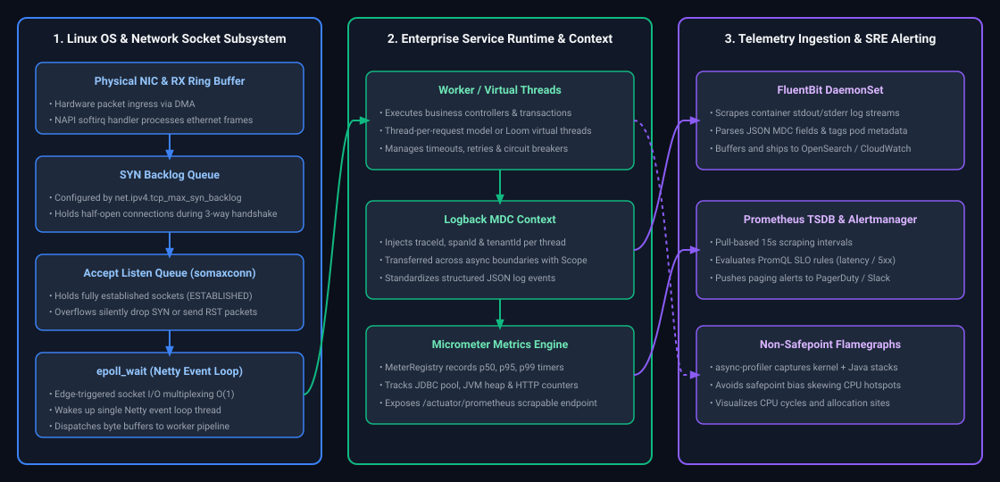
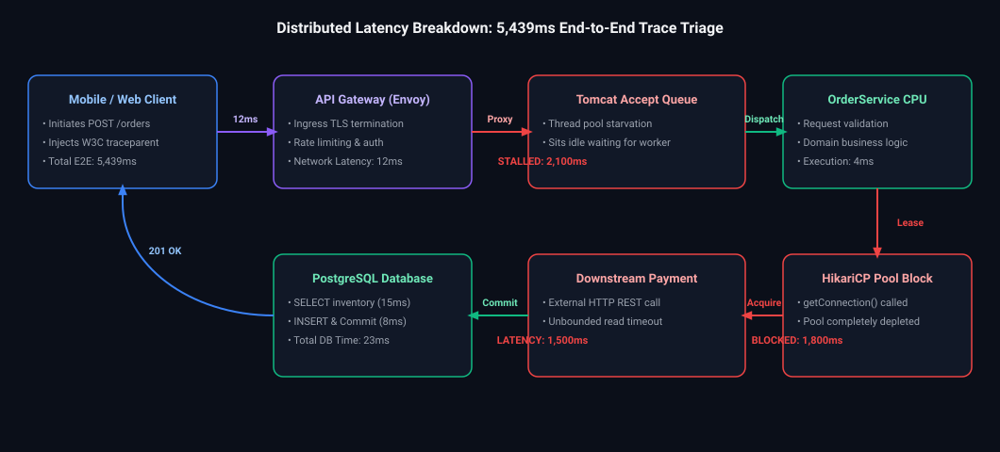

# 13. Linux Networking & Distributed Reliability: Interview FAQs & Playbooks

A comprehensive, production-grade guide to real-world interview scenarios and operational playbooks covering Linux kernel socket tuning, epoll event loop mechanics, structured MDC logging, OpenTelemetry distributed tracing, Prometheus alerting, retry storms, and async-profiler flamegraph interpretation.

---

## Architectural Overview: High-Scale Reliability & Observability Pipeline



*D2 Source:* [assets/13_linux_networking_and_distributed_reliability_faq/01_linux_kernel_network_socket_subsystem_to_runtime.d2](assets/13_linux_networking_and_distributed_reliability_faq/01_linux_kernel_network_socket_subsystem_to_runtime.d2)

---

## Table of Contents & Question Directory

### 1. Observability, Logging & Latency Breakdown
- [Q1. **`[Medium]`** Enterprise Production Monitoring & Observability Stack](#q1-medium-enterprise-production-monitoring-observability-stack)
- [Q2. **`[Hard]`** Service Slow but CPU Usage is Low: What to Check First](#q2-hard-service-slow-but-cpu-usage-is-low-what-to-check-first)
- [Q3. **`[Medium]`** Inconsistent API Response Time Without Code Changes](#q3-medium-inconsistent-api-response-time-without-code-changes)
- [Q4. **`[Medium]`** Isolating Background Jobs from Impacting API Latency](#q4-medium-isolating-background-jobs-from-impacting-api-latency)
- [Q5. **`[Medium]`** Why Increasing Log Verbosity Degrades Performance](#q5-medium-why-increasing-log-verbosity-degrades-performance)
- [Q6. **`[Hard]`** Why Scaling Instances Worsens Overall System Performance](#q6-hard-why-scaling-instances-worsens-overall-system-performance)
- [Q7. **`[Hard]`** Retry Storms: How Poorly Configured Retries Cause Cascading Outages](#q7-hard-retry-storms-how-poorly-configured-retries-cause-cascading-outages)

### 2. High-Concurrency Networking, SRE Resilience & Profiling
- [Q8. **`[Medium]`** Troubleshooting and Resolving 504 Gateway Timeout and 503 Service Unavailable](#q8-medium-troubleshooting-and-resolving-504-gateway-timeout-and-503-service-unavailable)
- [Q9. **`[Hard]`** Production Outage with No Exceptions in Logs: Silent Failure Investigation Runbook](#q9-hard-production-outage-with-no-exceptions-in-logs-silent-failure-investigation-runbook)
- [Q10. **`[Hard]`** Spring Boot API 5–6s Latency Breakdown: Java Code vs Database vs Network vs External Calls](#q10-hard-spring-boot-api-56s-latency-breakdown-java-code-vs-database-vs-network-vs-external-calls)
- [Q11. **`[Hard]`** High-Concurrency Linux Kernel Socket Tuning: somaxconn, tcp_max_syn_backlog & TIME_WAIT Ergonomics](#q11-hard-high-concurrency-linux-kernel-socket-tuning-somaxconn-tcp-max-syn-backlog-time-wait-ergonomics)
- [Q12. **`[Hard]`** Linux Epoll Starvation & Worker Thread Starvation in Non-Blocking Netty Event Loops](#q12-hard-linux-epoll-starvation-worker-thread-starvation-in-non-blocking-netty-event-loops)
- [Q13. **`[Medium]`** Distributed Trace Context Propagation Across Apache Kafka Message Headers in OpenTelemetry](#q13-medium-distributed-trace-context-propagation-across-apache-kafka-message-headers-in-opentelemetry)
- [Q14. **`[Hard]`** Low-Overhead Production Profiling with Async-Profiler: Non-Safepoint Profiling vs AGCT JVM Bugs](#q14-hard-low-overhead-production-profiling-with-async-profiler-non-safepoint-profiling-vs-agct-jvm-bugs)

---

## 1. Observability, Logging & Latency Breakdown

### Q1. [Medium] Enterprise Production Monitoring & Observability Stack
**Difficulty:** [Medium]
**Topic Covered:** Full-Stack Production Telemetry  
Metrics scraped from Spring Boot Actuator by **Prometheus** and visualized in **Grafana**; logs aggregated into **Elasticsearch / Azure Monitor Log Analytics**; distributed traces sent to **Grafana Tempo / OpenTelemetry**.

---

# 4. Microsoft Azure Cloud Infrastructure & Services

---


---

### Q2. [Hard] Service Slow but CPU Usage is Low: What to Check First
**Difficulty:** [Hard]
**Topic Covered:** Thread Blocking & Bottleneck Identification  
Threads are in `WAITING` or `BLOCKED` states waiting for external resources.
1. **HikariCP Pool Exhaustion:** Database connection pool starvation (`Connection is not available, request timed out after 30000ms`).
2. **Missing I/O Timeouts:** Outbound HTTP/gRPC calls blocking without socket read timeouts.
3. **Lock Contention:** Many threads waiting on a single synchronized lock or database row lock.

---


---

### Q3. [Medium] Inconsistent API Response Time Without Code Changes
**Difficulty:** [Medium]
**Topic Covered:** Latency Jitter & JVM Warmup  
- Periodic Stop-The-World (STW) Garbage Collection pauses.
- JVM Warmup (Tiered JIT compilation hasn't optimized hot paths yet).
- Noisy neighbor problem in shared cloud VM/container nodes.

---


---

### Q4. [Medium] Isolating Background Jobs from Impacting API Latency
**Difficulty:** [Medium]
**Topic Covered:** Workload Resource Isolation  
- Assign background jobs to a dedicated bounded `ThreadPoolExecutor` (never use `ForkJoinPool.commonPool()` or web server thread pools).
- Deploy heavy batch tasks to separate worker pods.
- Route reporting queries to dedicated database read replicas.

---


---

### Q5. [Medium] Why Increasing Log Verbosity Degrades Performance
**Difficulty:** [Medium]
**Topic Covered:** I/O Bottlenecks & Synchronous Logging  
Synchronous disk I/O blocks worker threads on every log write flush. String concatenations in debug logs create millions of short-lived heap objects. Use **Asynchronous Appenders** with LMAX Disruptor ring buffers.

---


---

### Q6. [Hard] Why Scaling Instances Worsens Overall System Performance
**Difficulty:** [Hard]
**Topic Covered:** Database Connection Pool Saturation  
Scaling from 5 to 20 instances increases total database connections from 150 to 600. The database server spends all CPU context-switching and managing lock contention, causing query latencies to spike and the system to collapse. Use a connection pooler like **PgBouncer**.

---


---

### Q7. [Hard] Retry Storms: How Poorly Configured Retries Cause Cascading Outages
**Difficulty:** [Hard]
**Topic Covered:** Thundering Herd & Cascading Failure  
When a service lags, uncoordinated client retries amplify load $3\times-5\times$, causing total failure. Prevent with **Exponential Backoff**, **Full Jitter**, and **Circuit Breakers**.

---

# 9. Spring & Gateway Failures

---


---

## 2. High-Concurrency Networking, SRE Resilience & Profiling

### Q8. [Medium] Troubleshooting and Resolving 504 Gateway Timeout and 503 Service Unavailable
**Difficulty:** [Medium]
**Topic Covered:** HTTP Edge Diagnostics  
- **504 Gateway Timeout:** The gateway timed out waiting for the Spring Boot backend service. Caused by slow database queries, deadlocks, or long-running computations.
- **503 Service Unavailable:** The gateway cannot connect to any healthy backend instance. Caused by pod crashes (`CrashLoopBackOff`), failed readiness probes, or saturated Tomcat connection queues.

---

# 10. Production Failure Triage, Architectural Modernization & Code Quality

---


---

### Q9. [Hard] Production Outage with No Exceptions in Logs: Silent Failure Investigation Runbook
**Topic Covered:** Silent Failures & JVM Diagnostics  
**Difficulty:** `[Hard]`

#### Architectural Overview
When customers report errors but application logs contain zero exceptions:
1. **Empty Catch Blocks & Silent Swallowing**: Look for legacy code with `try { ... } catch (Exception e) {}` or `catch (Throwable t) { log.debug(...) }` where log level is set to `INFO`.
2. **HTTP 200 Error Payloads**: Legacy endpoints returning HTTP 200 OK with internal `{ "status": "ERROR", "code": 500 }` payloads bypass standard monitoring alerts.
3. **Thread Pool / JVM Hangs**: The service hasn't crashed, but all worker threads are in `BLOCKED` or `WAITING` state (deadlock, connection pool collapse, or unbuffered DNS resolution). Take 3 thread dumps 10 seconds apart (`jcmd <pid> Thread.print` or `jstack <pid>`).
4. **Stop-The-World GC Pauses**: Long GC pauses freeze the JVM entirely. Inspect GC logs (`-Xlog:gc*`) for multi-second pauses where the application stops emitting logs entirely.

---


---

### Q10. [Hard] Spring Boot API 5–6s Latency Breakdown: Java Code vs Database vs Network vs External Calls
**Difficulty:** [Hard]
**Topic Covered:** Distributed Tracing, Latency Attribution & APM Diagnostics  
**Question:** An API in Spring Boot is taking 5–6 seconds to respond. How will you identify whether the issue is in Java code, database, network, or external calls?

#### Definition & Core Concepts
When an API endpoint experiences severe latency degradation (e.g., $5,000\text{ ms} - 6,000\text{ ms}$), naive ad-hoc logging or guessing wastes critical MTTR (Mean Time to Resolution). Production engineers dissect the total round-trip time into five distinct operational segments:

$$\text{Latency}_{\text{Total}} = T_{\text{Ingress/Network}} + T_{\text{Container Queue}} + T_{\text{JVM CPU/Lock}} + T_{\text{Database (Wait + Exec)}} + T_{\text{External HTTP/RPC}}$$

1. **Ingress & Reverse Proxy Network Latency ($T_{\text{Ingress}}$):** Time spent traversing DNS, edge load balancers (AWS ALB, NGINX), and TLS handshakes. Monitored via proxy request/upstream timing logs (`$request_time` vs `$upstream_response_time`).
2. **Container Queue & Thread Wait ($T_{\text{Queue}}$):** Time the request spends sitting in the embedded servlet container (Tomcat) connector accept queue before an executor thread (`http-nio-8080-exec-*`) picks it up. Saturated worker thread pools cause seconds of delay before application code even begins.
3. **In-Process Java Execution & JVM Stalls ($T_{\text{JVM}}$):** CPU compute time, synchronized monitor lock contention, serialization/deserialization overhead, and Stop-The-World (STW) Garbage Collection pauses.
4. **Database Tier ($T_{\text{DB}}$):** Composed of two critical phases:
   - **Connection Pool Acquisition Wait:** Time spent blocking on `HikariCP.getConnection()` waiting for a free JDBC connection.
   - **SQL Execution & Network Round-Trip:** Physical query execution on PostgreSQL/MySQL, index scans vs table scans, and lock acquisition.
5. **Downstream Dependencies & External RPCs ($T_{\text{External}}$):** Remote microservice calls over HTTP/REST or gRPC. Missing socket read timeouts or serialized remote calls in loops multiply response time linearly.

Production attribution is achieved deterministically through **Distributed Tracing (OpenTelemetry / Micrometer Tracing)** using W3C TraceContext standards (`traceparent` header).

#### Visual Flow


*D2 Source:* [assets/13_linux_networking_and_distributed_reliability_faq/02_distributed_latency_breakdown_distributed_tracing.d2](assets/13_linux_networking_and_distributed_reliability_faq/02_distributed_latency_breakdown_distributed_tracing.d2)

#### Production Implementation / Code Solution
```java
package com.enterprise.diagnostics.config;

import io.micrometer.observation.Observation;
import io.micrometer.observation.ObservationRegistry;
import io.micrometer.observation.annotation.Observed;
import org.slf4j.Logger;
import org.slf4j.LoggerFactory;
import org.springframework.boot.web.client.RestTemplateBuilder;
import org.springframework.context.annotation.Bean;
import org.springframework.context.annotation.Configuration;
import org.springframework.http.client.SimpleClientHttpRequestFactory;
import org.springframework.stereotype.Service;
import org.springframework.web.client.RestTemplate;

import javax.sql.DataSource;
import java.sql.Connection;
import java.sql.PreparedStatement;
import java.sql.ResultSet;
import java.time.Duration;

@Configuration
public class ObservabilityDiagnosticConfig {

    // 1. Enforce strict timeouts on all outbound HTTP communications to isolate downstream lag
    @Bean
    public RestTemplate restTemplate(RestTemplateBuilder builder) {
        return builder
                .setConnectTimeout(Duration.ofMillis(500))  // Max 500ms for TCP handshake
                .setReadTimeout(Duration.ofMillis(2000))    // Max 2000ms for socket read
                .build();
    }
}

@Service
class OrderProcessingDiagnosticsService {

    private static final Logger log = LoggerFactory.getLogger(OrderProcessingDiagnosticsService.class);

    private final DataSource dataSource;
    private final RestTemplate restTemplate;
    private final ObservationRegistry observationRegistry;

    public OrderProcessingDiagnosticsService(DataSource dataSource,
                                             RestTemplate restTemplate,
                                             ObservationRegistry observationRegistry) {
        this.dataSource = dataSource;
        this.restTemplate = restTemplate;
        this.observationRegistry = observationRegistry;
    }

    /**
     * Executes order checkout with granular Micrometer spans isolating each subsystem.
     */
    @Observed(name = "order.checkout", contextualName = "checkout-pipeline")
    public String executeCheckout(String orderId, String customerId, double amount) {
        // Step 1: Measure in-process Java computation & validation
        Observation.createNotStarted("java.validation", observationRegistry).observe(() -> {
            validateOrderPayload(orderId, customerId, amount);
        });

        // Step 2: Measure database tier (isolating HikariCP connection lease vs query execution)
        Observation.createNotStarted("database.inventory_check", observationRegistry).observe(() -> {
            long leaseStart = System.nanoTime();
            try (Connection conn = dataSource.getConnection()) {
                long leaseDurationMs = (System.nanoTime() - leaseStart) / 1_000_000;
                if (leaseDurationMs > 200) {
                    // Alert on HikariCP pool starvation: waiting > 200ms to lease a connection
                    log.warn("CRITICAL: HikariCP connection acquisition delayed! Leased in {} ms", leaseDurationMs);
                }

                long sqlStart = System.nanoTime();
                try (PreparedStatement ps = conn.prepareStatement(
                        "SELECT stock_quantity FROM inventory WHERE sku = ?")) {
                    ps.setString(1, "SKU-99021");
                    try (ResultSet rs = ps.executeQuery()) {
                        if (rs.next()) {
                            int stock = rs.getInt("stock_quantity");
                            log.info("Inventory verified: stock={}, queryDuration={} ms", 
                                    stock, (System.nanoTime() - sqlStart) / 1_000_000);
                        }
                    }
                }
            } catch (Exception ex) {
                log.error("Database operation failed during checkout triage", ex);
                throw new RuntimeException("Database error", ex);
            }
        });

        // Step 3: Measure external downstream HTTP call with APM span context
        String paymentRef = Observation.createNotStarted("external.payment_gateway", observationRegistry)
                .observe(() -> {
                    long rpcStart = System.currentTimeMillis();
                    try {
                        String response = restTemplate.postForObject(
                                "https://payment.internal.enterprise.com/v1/charge",
                                new PaymentRequest(orderId, amount),
                                String.class
                        );
                        log.info("External payment finished in {} ms", System.currentTimeMillis() - rpcStart);
                        return response;
                    } catch (Exception ex) {
                        log.error("Downstream payment service degraded or timed out: {} ms", 
                                System.currentTimeMillis() - rpcStart, ex);
                        throw ex;
                    }
                });

        return paymentRef;
    }

    private void validateOrderPayload(String orderId, String customerId, double amount) {
        if (orderId == null || customerId == null || amount <= 0.0) {
            throw new IllegalArgumentException("Invalid checkout order parameters");
        }
    }

    private record PaymentRequest(String orderId, double amount) {}
}
```
- **Time Complexity:** $O(1)$ tracing instrumentation overhead ($\approx 15\ \mu\text{s}$ per observation span).
- **Space Complexity:** $O(1)$ constant memory overhead per in-flight request context.

#### Engineering Implications & Production Pitfalls
1. **The HikariCP Connection Mirage:** A frequent interview blunder is blaming the database engine when APM shows JDBC latency. If `dataSource.getConnection()` takes $4,500\text{ ms}$ and `ps.executeQuery()` takes $12\text{ ms}$, the database query is blazingly fast; your application is starved of database connections because other transactions hold connections while making long-running HTTP calls. **Golden Rule:** Never perform external network calls inside `@Transactional`.
2. **Missing Outbound Socket Timeouts:** Default Java HTTP clients (and unconfigured RestTemplate/WebClient) have infinite connect and socket read timeouts. A single hung downstream dependency will consume all Tomcat worker threads within seconds, resulting in cascading $5\text{–}6$ second delays followed by total service collapse.
3. **Tomcat Queue Latency Invisible to Controller Spans:** If distributed tracing only begins inside Spring's `HandlerInterceptor` or Controller, you will miss the $3\text{ seconds}$ the request sat in the Tomcat OS accept backlog (`server.tomcat.accept-count`). Always compare `X-Request-Start` (injected by NGINX/Envoy) with Spring filter entry timestamps.

#### Core Curriculum Cross-Reference
- See [Module 13: Linux Networking & Distributed Reliability](../13_linux_networking_and_distributed_reliability.md) for OpenTelemetry Collector pipelines, W3C trace propagation, and Micrometer core configurations.

---


---

### Q11. [Hard] High-Concurrency Linux Kernel Socket Tuning: somaxconn, tcp_max_syn_backlog & TIME_WAIT Ergonomics
**Difficulty:** [Hard]  
**Topic Covered:** Linux Kernel Networking, somaxconn, SYN Flood, TIME_WAIT, Socket Sizing  
**Question:** Under high connection rates (20,000 req/sec), incoming client requests receive `Connection refused` or experience 3-second TCP SYN retransmit delays. What Linux kernel parameters govern connection handshakes, and how do you tune them?

#### Linux TCP Handshake Mechanics
1. **The SYN Queue (`tcp_max_syn_backlog`):** Holds half-open connections during the initial `SYN -> SYN-ACK` phase. Default is often 128 or 512. Under burst traffic, this queue overflows, and the kernel drops incoming SYNs.
2. **The Accept Queue (`net.core.somaxconn`):** Holds fully established connections (`ESTABLISHED`) awaiting the application`s `accept()` system call.
- **Production `sysctl.conf` Tuning Blueprint:**
  ```ini
  # Increase maximum accept queue length
  net.core.somaxconn = 65535
  # Increase SYN backlog queue
  net.ipv4.tcp_max_syn_backlog = 65535
  # Allow reuse of TIME_WAIT sockets for outgoing connections
  net.ipv4.tcp_tw_reuse = 1
  # Expand ephemeral port range
  net.ipv4.ip_local_port_range = 1024 65535
  # Increase maximum open file descriptors
  fs.file-max = 2097152
  ```

*Deep-dive theoretical reference: See [Module 13: Linux Networking & Distributed Reliability](../13_linux_networking_and_distributed_reliability.md#1-linux-kernel-networking--high-concurrency-socket-subsystems)*

---

### Q12. [Hard] Linux Epoll Starvation & Worker Thread Starvation in Non-Blocking Netty Event Loops
**Difficulty:** [Hard]  
**Topic Covered:** epoll, Netty EventLoop, Non-blocking I/O, EventLoop Blocking  
**Question:** In high-performance Netty or Spring WebFlux gateways, why does executing a blocking database call or heavy encryption loop inside a channel handler collapse system throughput across thousands of unrelated connections?

#### Epoll EventLoop Concurrency Architecture
Netty allocates a small pool of EventLoop threads (typically `2 * vCPU`). Each EventLoop thread manages hundreds or thousands of active TCP channels via the Linux `epoll_wait()` system call.
- **The Starvation Pathology:** If a developer executes a blocking database query (`Thread.sleep()` or synchronous JDBC) on Channel A, the EventLoop thread blocks.
- **The Blast Radius:** Channels B, C, D... through Z assigned to that same EventLoop thread are completely starved! Their TCP read buffers fill up, TCP window scaling throttles to 0, and thousands of unrelated client connections experience 30-second timeouts.
- **Resolution:** Offload blocking operations to a separate un-pinned worker thread pool (`EventExecutorGroup`).

*Deep-dive theoretical reference: See [Module 13: Linux Networking & Distributed Reliability](../13_linux_networking_and_distributed_reliability.md#1-linux-kernel-networking--high-concurrency-socket-subsystems)*

---

### Q13. [Medium] Distributed Trace Context Propagation Across Apache Kafka Message Headers in OpenTelemetry
**Difficulty:** [Medium]  
**Topic Covered:** OpenTelemetry, W3C TraceContext, Kafka Headers, Asynchronous Tracing  
**Question:** In an event-driven architecture where Microservice A publishes to Kafka and Microservice B consumes, how does OpenTelemetry propagate trace context across asynchronous message boundaries?

- **Binary/String Header Injection:** The producer extracts the active trace context (`trace_id`, `span_id`) and injects it as Kafka record headers (`traceparent`):
  ```java
  ProducerRecord<String, OrderEvent> record = new ProducerRecord<>("orders", orderEvent);
  GlobalOpenTelemetry.getPropagators().getTextMapPropagator().inject(
      Context.current(),
      record.headers(),
      (headers, key, value) -> headers.add(key, value.getBytes(StandardCharsets.UTF_8))
  );
  ```
- **Consumer Extraction:** The consumer extracts the header before processing, linking consumer child spans directly to the producer span in Grafana Tempo / Jaeger.

*Deep-dive theoretical reference: See [Module 13: Linux Networking & Distributed Reliability](../13_linux_networking_and_distributed_reliability.md#3-the-three-pillars-of-observability--apm)*

---

### Q14. [Hard] Low-Overhead Production Profiling with Async-Profiler: Non-Safepoint Profiling vs AGCT JVM Bugs
**Difficulty:** [Hard]  
**Topic Covered:** async-profiler, Safepoint Bias, AsyncGetCallTrace (AGCT), Flamegraphs  
**Question:** Why do traditional JVM sampling profilers (VisualVM, JConsole) report completely inaccurate CPU hotspots due to Safepoint Bias, and how does async-profiler achieve true non-safepoint profiling?

#### Safepoint Bias Pathology
Traditional JVM profilers collect stack traces by requesting a JVM Safepoint (`Thread.getStackTrace()`).
- Because safepoints are only reached at specific code locations (method returns, loop backedges), code executing intensive arithmetic without safepoint checks is never sampled. The profiler reports false bottlenecks while missing real CPU hogs!
- **Async-Profiler Breakthrough:** Uses OS hardware performance interrupts (`perf_events` on Linux) and the JVM internal `AsyncGetCallTrace` API. It interrupts threads at any arbitrary machine instruction—inside safepoints or outside—generating perfectly accurate flamegraphs with $<1.5\%$ overhead in production.

*Deep-dive theoretical reference: See [Module 13: Linux Networking & Distributed Reliability](../13_linux_networking_and_distributed_reliability.md#4-production-performance-profiling--diagnostic-troubleshooting)*

---

## Core Curriculum Cross-Reference
*Deep-dive theoretical reference: See [Module 13: Linux Networking & Distributed Reliability](../13_linux_networking_and_distributed_reliability.md)*
