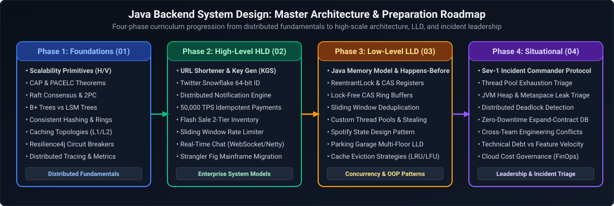

# Java Backend Engineering: System Design & Situational Scenarios Master Curriculum

A comprehensive, production-grade guide covering distributed system design foundations, 24 high-level distributed architectures, 11 low-level machine coding systems, and 16 engineering leadership and incident triage situational scenarios tailored specifically for Senior, Staff, and Principal Java Backend Engineers.

---

## Master Architecture & Preparation Roadmap

*D2 Source:* [assets/00_system_design_and_situational_index/01_master_architecture_and_preparation_roadmap.d2](assets/00_system_design_and_situational_index/01_master_architecture_and_preparation_roadmap.d2)

---

## Curriculum Coverage & Module Index

The index below details the 4 core pillars of the consolidated System Design & Situational Scenarios curriculum for Java Backend Engineers:

| Module File | Scope & Domain | Key Architectures & Scenarios Covered |
| :--- | :--- | :--- |
| [`01_system_design_foundations.md`](01_system_design_foundations.md) | Distributed Foundations | Scalability primitives, L4 vs L7 load balancing, Consistent Hashing with V-Nodes, CAP & PACELC theorems, Raft consensus, 2PC, B+ Tree vs LSM Tree, database sharding, caching topologies, cache stampede defenses, gRPC vs REST, circuit breakers, and rate limiting algorithms. |
| [`02_high_level_system_design.md`](02_high_level_system_design.md) | 24 High-Level Architectures | URL Shortener, Multi-Region Active-Active Redirects, API Rate Limiter, Global CDN, 64-bit Snowflake ID Generator, Real-Time Chat (WhatsApp/Slack), Notification Engine, Video Streaming (YouTube/Netflix), Payments (Stripe), Flash Sale Checkout, Ride-Hailing (Uber), Uber Eats Homepage, Distributed Cache (Redis), File Storage (Dropbox), Autocomplete, Collaborative Docs, Job Scheduler, Workflow Engine, Feed System, Billion-Scale Graph Search, **UK Faster Payments 24/7 Settlement**, **Real-Time Card Fraud Detection (<100ms)**, **Open Banking API Platform with Instant Revocation**, and **Mainframe to Microservices Zero-Downtime Migration**. |
| [`03_low_level_system_design.md`](03_low_level_system_design.md) | 11 Machine Coding Systems | Custom Bounded Queue & ThreadPool from scratch (no `ExecutorService`), Concurrent Sorted Linked List (ReadWriteLock), Segmented File Manager with byte-range locking, DAG Job Scheduler with dependency resolution, Playground Player Assignment with anti-starvation, Train & Platform Scheduler, In-Memory Twitter, In-Memory Pull-Based Message Queue, In-Memory Filesystem (`mkdir`, `pwd`, `cd` with wildcards), Rule Engine (AST/Composite), and Spotify LLD. |
| [`04_situational_scenarios.md`](04_situational_scenarios.md) | 16 Situational Engineering Scenarios | Incident Command during cascading outages, JVM memory leak & GC pause triage, HikariCP pool exhaustion, Pushing back on management (Monolith vs Microservices), Sync REST vs Event-driven trade-offs, Delivering under unrealistic deadlines, Deliberate technical debt governance, Managing breaking API changes across 15 teams, Turning around underperforming engineers, Resolving bitter code review stalemates, **Project failure postmortems & learnings**, **Radical cross-cutting system ownership**, **Balancing speed vs accuracy in financial launches**, and **Handling conflicting business vs technical requirements**. |

---

## References & Further Reading
- Kleppmann, Martin. *Designing Data-Intensive Applications*. O'Reilly Media.
- Xu, Alex. *System Design Interview – An Insider's Guide* (Vols. 1 & 2).
- Bloch, Joshua. *Effective Java* (3rd Edition). Addison-Wesley.
- Goetz, Brian, et al. *Java Concurrency in Practice*. Addison-Wesley.
- Nygard, Michael T. *Release It! Design and Deploy Production-Ready Software*. Pragmatic Bookshelf.
- Larson, Will. *Staff Engineer: Leadership Beyond the Management Track*.

