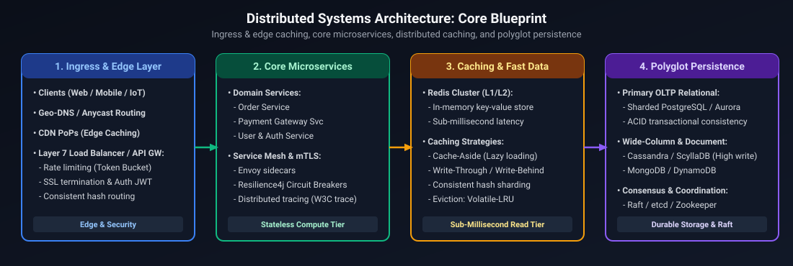
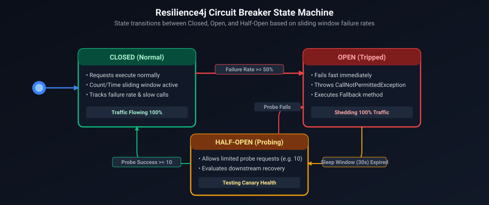

# 01. System Design Foundations: Core Principles & Architectural Primitives

A comprehensive, production-grade guide covering universal distributed systems foundations: scalability primitives, consensus mechanisms, consistency models, storage engines, caching topologies, communication protocols, resilience patterns, and failure mode mitigation tailored for Staff/Principal Software Engineers.

---

## Architectural Overview: Distributed Systems Core Blueprint

*D2 Source: [`01_distributed_systems_core_blueprint.d2`](assets/01_system_design_foundations/01_distributed_systems_core_blueprint.d2)*

---

## Table of Contents
1. [Scalability Primitives & Load Balancing](#1-scalability-primitives--load-balancing)
2. [Consistency Models: CAP & PACELC Theorems](#2-consistency-models-cap--pacelc-theorems)
3. [Distributed Consensus & Transactions (Raft, Paxos, 2PC)](#3-distributed-consensus--transactions-raft-paxos-2pc)
4. [Storage Engine Architecture: B+ Trees vs LSM Trees](#4-storage-engine-architecture-b-trees-vs-lsm-trees)
5. [Database Partitioning & Sharding Mechanics](#5-database-partitioning--sharding-mechanics)
6. [Caching Topologies & Eviction Patterns](#6-caching-topologies--eviction-patterns)
7. [API Protocols & Communication Mechanisms](#7-api-protocols--communication-mechanisms)
8. [Distributed Resiliency & Fault Tolerance](#8-distributed-resiliency--fault-tolerance)
9. [Architecture Decision Matrix](#9-architecture-decision-matrix)
10. [References & Further Reading](#10-references--further-reading)

---

## 1. Scalability Primitives & Load Balancing

### 1.1 Vertical vs Horizontal Scaling
- **Vertical Scaling (Scale-Up)**: Adding compute resources (CPU, RAM, NVMe disk) to an individual physical node.
  - *Hard Limitations*: Physical limits of motherboard sockets, memory controllers, bus bandwidth, and exponential cost curves. Single point of failure (SPOF) during hardware degradation.
- **Horizontal Scaling (Scale-Out)**: Distributing request processing and storage across an array of independent commodity nodes connected via software-defined networking.
  - *Design Imperative*: Services must be completely stateless. State must be externalized to distributed caches, durable event backplanes, or partitioned databases.

### 1.2 Load Balancing Algorithms & Topology
Load balancers operate across multiple OSI layers to multiplex network traffic across backend worker pools:

| Layer | Protocol Level | Routing Criteria | Performance vs Flexibility |
| :--- | :--- | :--- | :--- |
| **Layer 4 (L4)** | Transport (TCP/UDP) | Source/Destination IP, Port, TCP SYN flags | Extremely fast; zero payload inspection; kernel-level packet forwarding (IPVS/eBPF). |
| **Layer 7 (L7)** | Application (HTTP/gRPC) | URL Path, Host headers, Cookies, JWT claims, HTTP methods | Highly flexible; enables path-based routing, TLS termination, and sticky sessions; requires full TCP handshake and user-space buffer decoding. |

#### Routing Strategies:
1. **Round Robin & Weighted Round Robin**: Assigns requests cyclically. Weighted variant accounts for heterogeneous node capacities ($w_i$).
2. **Least Connections & Weighted Least Connections**: Dispatches traffic to the instance maintaining the fewest active TCP/HTTP connections, preventing long-lived requests from creating uneven load.
3. **Consistent Hashing**:
   - Maps both server nodes and incoming request keys (e.g., `user_id`, session tokens) onto an abstract 32-bit or 64-bit circular integer ring ($[0, 2^{32}-1]$).
   - Keys map to the nearest clockwise server on the ring.
   - *Virtual Nodes (V-Nodes)*: Each physical server is assigned $V$ distinct points on the ring (e.g., $V = 256$) using cryptographic hashing (`SHA-256(node_id + "#" + replica_index)`). This solves non-uniform key distribution, preventing severe load skew when nodes join or fail. When a node is removed, only $\frac{1}{N}$ keys require migration instead of complete re-hashing ($K \pmod N$).

---

## 2. Consistency Models: CAP & PACELC Theorems

### 2.1 The CAP Theorem
Formulated by Eric Brewer and proven by Gilbert & Lynch, the CAP theorem dictates that in an asynchronous network subject to partitions ($P$), a distributed data store can guarantee at most one of Consistency ($C$) or Availability ($A$):

$$\text{Partition Tolerance } (P) \implies \text{Tradeoff between } C \text{ (Linearizability)} \text{ and } A \text{ (Availability)}$$

1. **CP (Consistency + Partition Tolerance)**: Under a network split, minority partitions reject writes or block to prevent split-brain state divergences (e.g., Apache ZooKeeper, etcd, Spanner, CockroachDB).
2. **AP (Availability + Partition Tolerance)**: All nodes accept reads and writes regardless of partition status, deferring reconciliation to gossip protocols or eventual conflict resolution (e.g., AWS DynamoDB, Apache Cassandra, Couchbase).

### 2.2 The PACELC Theorem
Daniel Abadi extended CAP to reflect steady-state operational realities when no network partitions exist:

$$\textbf{If } \mathbf{P} \text{ (Partition)}: \quad \text{Choose between } \mathbf{A} \text{ and } \mathbf{C}; \quad \textbf{Else } (\mathbf{E}): \quad \text{Choose between } \mathbf{L} \text{ (Latency)} \text{ and } \mathbf{C} \text{ (Consistency)}.$$

| System | PACELC Classification | Architectural Behavior |
| :--- | :--- | :--- |
| **DynamoDB / Cassandra** | **PA / EL** | On partition, yields Availability. In normal operation, trades strong consistency for sub-10ms Latency via local reads. |
| **Spanner / CockroachDB** | **PC / EC** | On partition, yields Consistency. In normal operation, incurs cross-datacenter round-trip Latency to enforce serializable ACID transactions. |
| **MongoDB (Default)** | **PC / EC** | Primary handles reads/writes. In normal mode, waits for majority write ack if configured, favoring consistency. |

---

## 3. Distributed Consensus & Transactions (Raft, Paxos, 2PC)

### 3.1 Two-Phase Commit (2PC)
A centralized atomic commitment protocol coordinating transactions across distributed resource managers:
1. **Prepare Phase**: The Coordinator writes a commit-intent record to its WAL and broadcasts `PREPARE` to all participants. Participants execute the query, acquire local row locks, write redo/undo logs, and reply with `VOTE_COMMIT` or `VOTE_ABORT`.
2. **Commit Phase**: If all participants vote commit, the Coordinator writes `COMMITTED` to its log and sends `GLOBAL_COMMIT`. If any node votes abort or times out, `GLOBAL_ABORT` is broadcast.
- *Critical Vulnerability*: Blocking protocol. If the Coordinator crashes after participants vote yes, participants remain blocked holding locks indefinitely.

### 3.2 Raft Consensus Algorithm
Raft provides deterministic linearizable state machine replication across $2F+1$ nodes, tolerating up to $F$ failures:
- **Leader Election**: Uses randomized election timers (150ms–300ms) to elect a single leader via majority votes.
- **Log Replication**:
  1. Client sends command to Leader.
  2. Leader appends entry to its local log.
  3. Leader sends `AppendEntries` RPC to followers.
  4. Once entry is replicated to a quorum ($\lfloor \frac{N}{2} \rfloor + 1$ nodes), Leader commits the entry, applies it to its state machine, and replies to client.
  5. Subsequent heartbeats notify followers to commit the entry locally.

---

## 4. Storage Engine Architecture: B+ Trees vs LSM Trees

| Metric / Attribute | B+ Tree Storage Engine | Log-Structured Merge (LSM) Tree |
| :--- | :--- | :--- |
| **Canonical Engines** | PostgreSQL, MySQL (InnoDB), Oracle | RocksDB, Cassandra, LevelDB, ScyllaDB |
| **Primary Workload** | Read-Heavy OLTP, Range Scans | Write-Heavy Ingestion, High-Velocity Timeseries |
| **Write Mechanism** | In-place update: traverses tree, modifies page buffer in RAM, appends physical delta to WAL. | Out-of-place append: writes sequentially to in-memory `MemTable` and WAL. No random disk seeks. |
| **Write Amplification** | High: modifying a single 32-byte tuple requires flushing an entire 8KB or 16KB dirty page to disk. | Moderate to High: continuous background compaction passes re-write data into sorted runs. |
| **Read Complexity** | $O(\log_B N)$ disk seeks where fan-out $B \approx 100\text{--}1000$. Single seek with cache. | $O(L \cdot \log N)$ where $L$ is level count; mitigated via Bloom Filters and Sparse Indexes. |
| **Disk Space Efficiency** | Suffers from internal page fragmentation (typically 30%--50% dead space after deletions). | Highly packed, sequential SSTables with Snappy/ZSTD block compression. |

---

## 5. Database Partitioning & Sharding Mechanics

1. **Range Sharding**: Divides data based on contiguous value intervals (e.g., dates `2026-01` to `2026-03`).
   - *Risk*: Severe write hotspotting when data values increase monotonically (all inserts route to the latest active partition).
2. **Hash Sharding**: Applies a hash function to the partition key modulo shard count ($h(\text{key}) \pmod N$).
   - *Advantage*: Uniform write distribution across physical disks.
   - *Disadvantage*: Scatter-gather overhead for range queries across multiple shards.
3. **Directory-Based Sharding**: Employs a lookup service to map entities to target partitions, enabling custom data migration without changing application logic.

---

## 6. Caching Topologies & Eviction Patterns

### 6.1 Caching Patterns
- **Cache-Aside (Lazy Loading)**: Application queries cache. On cache miss, loads from DB, populates cache, and returns. Cache invalidation handled on data updates.
- **Write-Through**: Application writes to cache; cache synchronously writes to DB before acknowledging success. Prevents stale reads at the expense of higher write latency.
- **Write-Behind (Write-Back)**: Application writes to cache; cache acknowledges immediately and batches asynchronous updates to DB. Extreme write throughput; risk of data loss on cache node crash.

### 6.2 Cache Failure Modes & Production Defenses
1. **Cache Stampede (Thundering Herd)**: Hot key expires while under high concurrent load; thousands of requests simultaneously miss cache and swamp backend DB.
   - *Defense*: Distributed Mutex (Redis `SET NX PX`), probabilistic early expiration (XFetch algorithm), or background asynchronous refresh.
2. **Cache Penetration**: Requests for non-existent keys bypass cache entirely and query DB repeatedly.
   - *Defense*: Bloom Filter at cache layer, or cache null values with short TTL (e.g., 60 seconds).
3. **Cache Avalanche**: Hundreds of thousands of cached keys share the exact same TTL and expire simultaneously.
   - *Defense*: Add randomized jitter to expiration timestamps (`TTL = base_ttl + uniform_random(-delta, +delta)`).

---

## 7. API Protocols & Communication Mechanisms

- **REST (HTTP/1.1 & HTTP/2)**: Ubiquitous, stateless, resource-oriented. Ideal for public public APIs and standard CRUD interfaces.
- **gRPC (HTTP/2 + Protocol Buffers)**: Binary serialization, multiplexed bidirectional streaming, strictly typed schema contracts (`.proto`). Default for internal microservice RPCs.
- **WebSockets**: Full-duplex persistent TCP connections. Ideal for low-latency bi-directional messaging (chat, live notifications, real-time tickers).
- **Event Streaming (Kafka / Pulsar)**: Append-only persistent commit log. Decouples producers and consumers temporally and spatially.

---

## 8. Distributed Resiliency & Fault Tolerance

*D2 Source: [`02_resilience4j_circuit_breaker_state_machine.d2`](assets/01_system_design_foundations/02_resilience4j_circuit_breaker_state_machine.d2)*

1. **Circuit Breakers (Resilience4j / Envoy)**: Prevents cascading failure by failing fast when downstream services become degraded.
2. **Bulkhead Pattern**: Partitions thread pools, connection pools, and memory quotas so that the exhaustion of one integration does not bring down the entire host.
3. **Exponential Backoff with Full Jitter**:
   $$t_{\text{sleep}} = \text{random}(0, \min(t_{\text{max}}, t_{\text{base}} \cdot 2^{\text{attempt}}))$$
   Decorrelates retry spikes, preventing self-inflicted DDoS against recovering services.
4. **Rate Limiting Algorithms**:
   - *Token Bucket*: Tokens replenished at constant rate $r$; bursts allowed up to capacity $b$.
   - *Leaky Bucket*: Requests enter FIFO queue; processed at constant output rate. Eliminates bursts.
   - *Sliding Window Counter*: Subdivides sliding time frame into memory buckets to accurately measure traffic spikes across boundary edges.

---

## 9. Architecture Decision Matrix

| Requirement | Recommended Architectural Primitive | Key Trade-Off |
| :--- | :--- | :--- |
| **High Write Throughput (Metrics/Logs)** | LSM Tree (Cassandra / RocksDB) | Slower point queries; background compaction CPU overhead |
| **Transactional Banking Ledgers** | B+ Tree RDBMS (PostgreSQL / CockroachDB) | Lower raw write throughput; lock contention during hot updates |
| **Sub-Millisecond Read Latency** | Distributed In-Memory Cache (Redis) | Memory cost; cache-invalidation complexity |
| **Cross-Service Event Decoupling** | Distributed Append-Only Log (Kafka) | Out-of-order processing edge cases; consumer lag monitoring |
| **Cascading Failure Protection** | Circuit Breakers + Exponential Jitter | Degraded fallback behavior required; increased code complexity |

---

## 10. References & Further Reading
- Kleppmann, Martin. *Designing Data-Intensive Applications*. O'Reilly Media.
- Gilbert, Seth, and Nancy Lynch. *Brewer's Conjecture and the Feasibility of Consistent, Available, Partition-Tolerant Web Services*. ACM SIGACT News.
- Ongaro, Diego, and John Ousterhout. *In Search of an Understandable Consensus Algorithm (Raft)*. USENIX ATC.
- O'Neil, Patrick, et al. *The Log-Structured Merge-Tree (LSM-Tree)*. Acta Informatica.
