# 02. Java & Backend Engineering: High-Level System Design (HLD)

A comprehensive, production-grade guide answering real-world large-scale distributed systems architecture, high-concurrency protocols, storage mechanics, failure containment, and trade-off matrices tailored for Senior and Staff Backend Engineers.

---

## Architectural Overview: High-Scale Distributed Platform Reference Model

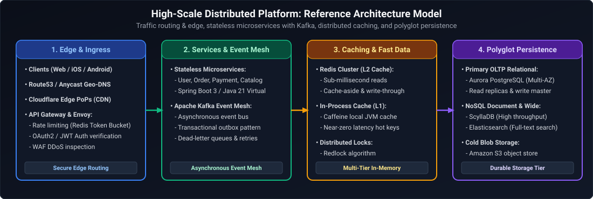

*D2 Source: [`01_high_scale_distributed_platform_reference_model.d2`](assets/02_high_level_system_design/01_high_scale_distributed_platform_reference_model.d2)*

---

## Table of Contents & Question Mapping

1. **High-Throughput Web Services & Edge Infrastructure**
   - [Q1. Design a Scalable URL Shortener (bit.ly)](#q1-design-a-scalable-url-shortener-bitly)
   - [Q2. Multi-Region URL Shortener Architecture with Global Active-Active Coordination](#q2-multi-region-url-shortener-architecture-with-global-active-active-coordination)
   - [Q3. Design an API Rate Limiter](#q3-design-an-api-rate-limiter)
   - [Q4. Design a Content Delivery Network (CDN)](#q4-design-a-content-delivery-network-cdn)
   - [Q5. Design a Distributed Unique ID Generator (Snowflake)](#q5-design-a-distributed-unique-id-generator-snowflake)
2. **Real-Time Communication & Media Streaming**
   - [Q6. Design a Scalable Chat Application (WhatsApp/Slack)](#q6-design-a-scalable-chat-application-whatsappslack)
   - [Q7. Design a Distributed Notification System](#q7-design-a-distributed-notification-system)
   - [Q8. Scaling a Video Streaming Platform (YouTube/Netflix)](#q8-scaling-a-video-streaming-platform-youtubenetflix)
3. **Financial Transactions, E-Commerce & Geospatial Coordination**
   - [Q9. Design a High-Throughput Payment System (50,000 TPS) with Zero Double-Charges](#q9-design-a-high-throughput-payment-system-50000-tps-with-zero-double-charges)
   - [Q10. Design an E-Commerce Checkout System](#q10-design-an-e-commerce-checkout-system)
   - [Q11. Design a Ride-Hailing Platform (Uber/Ola)](#q11-design-a-ride-hailing-platform-uberola)
   - [Q12. Design an Uber Eats Dynamic Homepage (Geohashing, Menus & SQL vs. NoSQL)](#q12-design-an-uber-eats-dynamic-homepage-geohashing-menus--sql-vs-nosql)
4. **Distributed Storage, Caching & File Systems**
   - [Q13. Design a Distributed In-Memory Cache (Redis-like)](#q13-design-a-distributed-in-memory-cache-redis-like)
   - [Q14. Design a Distributed File Storage System (Dropbox/Google Drive)](#q14-design-a-distributed-file-storage-system-dropboxgoogle-drive)
5. **Compute Scheduling, Graph Search & Collaborative Systems**
   - [Q15. Design a Search Autocomplete System (Typeahead)](#q15-design-a-search-autocomplete-system-typeahead)
   - [Q16. Collaborative Real-Time Document Editing (Google Docs)](#q16-collaborative-real-time-document-editing-google-docs)
   - [Q17. Design a Distributed Job Scheduler](#q17-design-a-distributed-job-scheduler)
   - [Q18. Design a Generic Workflow Engine (AWS Step Functions / Temporal)](#q18-design-a-generic-workflow-engine-aws-step-functions--temporal)
   - [Q19. Design a Social Media Feed (Twitter/Instagram)](#q19-design-a-social-media-feed-twitterinstagram)
   - [Q20. Degrees of Separation at Billion-User Scale (Social Graph Bidirectional BFS)](#q20-degrees-of-separation-at-billion-user-scale-social-graph-bidirectional-bfs)
6. **Mission-Critical Financial, Security & Legacy Migration Systems**
   - [Q21. Design the UK Faster Payments Settlement System (24/7 Sub-Second Instant Payments & Timeout Guarantees)](#q21-design-the-uk-faster-payments-settlement-system-247-sub-second-instant-payments--timeout-guarantees)
   - [Q22. Design Real-Time Card Fraud Detection Under 100ms](#q22-design-real-time-card-fraud-detection-under-100ms)
   - [Q23. Design an Open Banking API Platform with Instant Consent Revocation](#q23-design-an-open-banking-api-platform-with-instant-consent-revocation)
   - [Q24. Design Zero-Downtime Mainframe to Microservices Migration](#q24-design-zero-downtime-mainframe-to-microservices-migration)

---

# 1. High-Throughput Web Services & Edge Infrastructure

---

### Q1. Design a Scalable URL Shortener (bit.ly)
**Topic Covered:** Hash Encoding, Key Generation Services, Caching, and Redirection Mechanics  
**Question:** *Design a scalable URL Shortener.*

#### Functional & Non-Functional Requirements
- **Functional:** Given a long URL, return a unique 7-character short URL (`https://tiny.ly/7aB9xQ`). When accessed, redirect with sub-10ms latency.
- **Non-Functional:** Highly available ($99.99\%$), ultra-low latency reads, durable for 5 years, tamper-resistant.
- **Scale:** 100M URLs created/month, 100:1 read-to-write ratio $\implies$ 10B reads/month ($\approx 3,800$ read QPS, peak 10,000 QPS).

#### Core Architecture & Mechanics
1. **Base62 Encoding:** A 7-character string using $[a-z, A-Z, 0-9]$ yields $62^7 \approx 3.52 \text{ Trillion}$ unique combinations.
2. **ID Generation:** Using MD5/SHA256 hashes of the URL produces collisions. Instead, generate a monotonically increasing 64-bit unique integer via a **Distributed ID Generator** (Snowflake) or a pre-allocated **Key Generation Service (KGS)**, then convert that integer to Base62.
3. **HTTP 301 vs. 302:**
   - `301 Moved Permanently`: Browser caches the redirect locally. Subsequent requests bypass our servers entirely (lowest server load, but blinds our analytics).
   - `302 Found (Temporary Redirect)`: Browser always hits our server first (enables click tracking, geographic analytics, and link expiration). **Choose 302** for business analytics.

#### Visual Flow

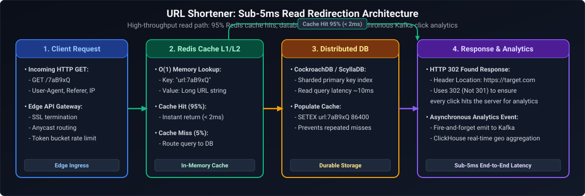

*D2 Source: [`02_url_shortener_redirection_flow.d2`](assets/02_high_level_system_design/02_url_shortener_redirection_flow.d2)*

#### Production Base62 Conversion Implementation (Java)
```java
public class Base62Encoder {
    private static final String BASE62 = "0123456789abcdefghijklmnopqrstuvwxyzABCDEFGHIJKLMNOPQRSTUVWXYZ";

    public static String encode(long id) {
        StringBuilder sb = new StringBuilder();
        while (id > 0) {
            int remainder = (int) (id % 62);
            sb.append(BASE62.charAt(remainder));
            id /= 62;
        }
        while (sb.length() < 7) {
            sb.append('0'); // Zero-pad to 7 characters
        }
        return sb.reverse().toString();
    }

    public static long decode(String str) {
        long id = 0;
        for (int i = 0; i < str.length(); i++) {
            id = id * 62 + BASE62.indexOf(str.charAt(i));
        }
        return id;
    }
}
```

---

### Q2. Multi-Region URL Shortener Architecture with Global Active-Active Coordination
**Topic Covered:** Multi-Region Active-Active Deployment, Geo-DNS, Conflict Resolution, and Distributed ID Spaces  
**Question:** *How do you design a URL Shortener operating active-active across US-East, EU-West, and AP-South with zero cross-region write lock contention?*

#### Multi-Region Architectural Blueprint
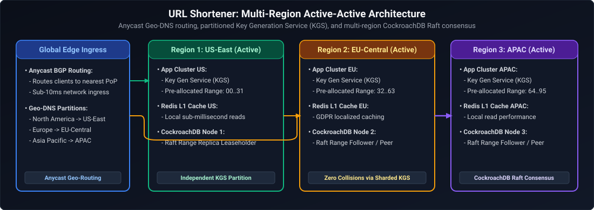

*D2 Source: [`03_url_shortener_multiregion_architecture.d2`](assets/02_high_level_system_design/03_url_shortener_multiregion_architecture.d2)*

1. **Partitioned ID Space Across Regions (Zero Cross-Region Coordination):**
   - Avoid cross-region distributed locks for ID generation. Pre-assign distinct **Datacenter IDs** in Snowflake generators:
     - `US-East`: Region bit `00`
     - `EU-West`: Region bit `01`
     - `AP-South`: Region bit `10`
   - Every region generates globally unique 64-bit IDs independently with zero cross-region latency.
2. **Multi-Master Replicated Storage:**
   - Use Google Cloud Spanner or CockroachDB with multi-region multi-master consensus.
   - Writes commit locally with read-your-own-writes consistency. Asynchronous change feeds replicate short-URL mapping records globally within 150ms.
3. **Geo-Local Caching with Anycast Routing:**
   - Anycast routes user clicks to the nearest regional Point of Presence.
   - Cache hit ratio reaches 98% locally; on a rare regional cache miss for a newly created link from another continent, the service queries the global distributed database.

---

### Q3. Design an API Rate Limiter
**Topic Covered:** Throttling Algorithms, Redis Lua Scripts, Distributed Concurrency, and Sliding Windows  
**Question:** *How do you design an API Rate Limiter?*

#### Architectural Context & Throttling Mechanisms
An API Rate Limiter regulates the rate at which incoming network traffic is processed by upstream services. At enterprise scale, rate limiting serves three primary functions: protecting downstream microservices against Cascading Failures and Denial of Service (DoS) attacks, preventing noisy-neighbor starvation in multi-tenant SaaS environments, and enforcing contractual monetization tiers.

Choosing the appropriate rate-limiting strategy requires evaluating memory consumption, computational overhead, and traffic burst tolerance:
1. **Token Bucket:** A central bucket stores up to capacity $C$ tokens, refilling at a constant rate of $r$ tokens/second. Each request consumes one token. If tokens are available, the request proceeds immediately; otherwise, it is dropped or queued. This permits short, controlled bursts of traffic up to capacity $C$ while enforcing an average rate limit of $r$.
2. **Leaky Bucket:** Modeled as a FIFO queue of capacity $C$. Inflowing requests enter the queue and drain at a strictly constant rate $r$ into the downstream service. While it guarantees a completely smooth egress traffic profile, sudden traffic bursts that exceed queue capacity are dropped immediately.
3. **Fixed Window Counter:** Divides the timeline into fixed discrete intervals (e.g., 60 seconds). A counter tracks requests within each window. While simple to implement in Redis using `INCR` and `EXPIRE`, it suffers from the critical **Boundary Burst Vulnerability**: an attacker can send the full limit in the last second of window $W_1$ and another full limit in the first second of window $W_2$, effectively doubling the allowable threshold within a 2-second interval ($2 \times \text{limit}$).
4. **Sliding Window Counter:** A hybrid approach combining the request count of the previous fixed window and the current window using a time-weighted interpolation formula:
   $$\text{EstimatedCount} = \text{Count}(\text{PrevWindow}) \times \left(1 - \frac{\text{CurrentOffset}}{\text{WindowSize}}\right) + \text{Count}(\text{CurrWindow})$$
   It smooths out boundary spikes while maintaining $O(1)$ memory overhead and constant-time evaluation.

#### Rate Limiting Algorithms Comparison

The comparison matrix below evaluates the core trade-offs, operational mechanics, advantages, and vulnerabilities of the primary distributed throttling algorithms:

| Algorithm | Mechanism | Pros | Cons |
| :--- | :--- | :--- | :--- |
| **Token Bucket** | Tokens refill at constant rate $r$; bursts allowed up to capacity $C$. | Memory efficient, handles traffic bursts gracefully. | Parameter tuning ($r$ and $C$) can be complex. |
| **Leaky Bucket** | Requests enter FIFO queue and drain at strict constant rate. | Smooth output rate; prevents downstream overload. | Drops burst traffic immediately when queue fills. |
| **Fixed Window Counter** | Counter resets every fixed minute/second. | Simple to implement in Redis. | Double-burst vulnerability at window boundaries ($2 \times \text{limit}$). |
| **Sliding Window Counter** | Hybrid weighted sum of previous window + current window. | Eliminates boundary bursts, highly memory efficient ($O(1)$). | Approximate count ($\pm 1\%$ error margin). |

#### Production Implementation: Redis Lua Atomic Sliding Window
```java
// Spring Boot Redis Lua Sliding Window Rate Limiter
@Component
public class SlidingWindowRateLimiter {
    private final StringRedisTemplate redisTemplate;
    private final RedisScript<Long> script;

    public SlidingWindowRateLimiter(StringRedisTemplate redisTemplate) {
        this.redisTemplate = redisTemplate;
        String lua = 
            "local key = KEYS[1] " +
            "local now = tonumber(ARGV[1]) " +
            "local window = tonumber(ARGV[2]) " +
            "local limit = tonumber(ARGV[3]) " +
            "local clear_before = now - window " +
            "redis.call('ZREMRANGEBYSCORE', key, '-inf', clear_before) " +
            "local current_requests = redis.call('ZCARD', key) " +
            "if current_requests < limit then " +
            "    redis.call('ZADD', key, now, now) " +
            "    redis.call('EXPIRE', key, math.ceil(window / 1000)) " +
            "    return 1 " +
            "else " +
            "    return 0 " +
            "end";
        this.script = RedisScript.of(lua, Long.class);
    }

    public boolean isAllowed(String clientId, int limit, long windowMillis) {
        long now = System.currentTimeMillis();
        String key = "rate_limit:" + clientId;
        Long result = redisTemplate.execute(script, Collections.singletonList(key), 
                                            String.valueOf(now), String.valueOf(windowMillis), String.valueOf(limit));
        return result != null && result == 1L;
    }
}
```

---

### Q4. Design a Content Delivery Network (CDN)
**Topic Covered:** Anycast Routing, Edge Caching, Cache Invalidation, and Origin Shielding  
**Question:** *Design a Content Delivery Network (CDN).*

#### Core Architecture
1. **Anycast BGP Routing:** Directs client traffic to the topologically closest Point of Presence (PoP) across global data centers using a single shared Anycast IP address.
2. **Two-Tier Cache Hierarchy (Edge + Origin Shield):**
   - **L1 Edge Cache:** Fast SSD/NVMe servers sitting directly at ISP peering points serving 90%+ of traffic.
   - **L2 Origin Shield:** Centralized intermediate proxy shielding the core origin servers from thundering herds during cache misses.
3. **Cache Invalidation:**
   - **Time-To-Live (TTL):** Standard expiration using `Cache-Control: public, max-age=86400, s-maxage=604800`.
   - **Event-Driven Purging:** Instantaneous cache invalidation via Webhooks or Kafka notifications to the CDN management API (purging by URL, wildcards, or `Surrogate-Key` / `Cache-Tags`).

---

### Q5. Design a Distributed Unique ID Generator (Snowflake)
**Topic Covered:** 64-bit ID Layout, Clock Synchronization, and Lock-Free Sequencing  
**Question:** *How would you design a Distributed ID Generator?*

#### 64-bit Bitwise Layout
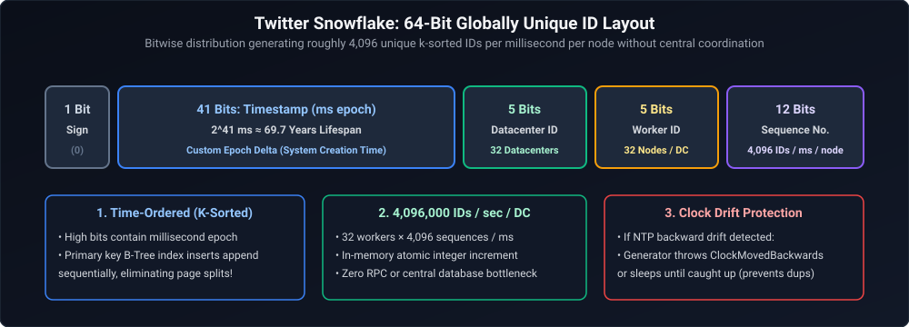

*D2 Source: [`04_twitter_snowflake_64bit_layout.d2`](assets/02_high_level_system_design/04_twitter_snowflake_64bit_layout.d2)*

#### Production Snowflake Implementation (Java)
```java
public class SnowflakeIdGenerator {
    private static final long EPOCH = 1704067200000L; // Custom Epoch: 2024-01-01 00:00:00 UTC
    private static final long WORKER_ID_BITS = 5L;
    private static final long DATACENTER_ID_BITS = 5L;
    private static final long SEQUENCE_BITS = 12L;

    private static final long MAX_WORKER_ID = ~(-1L << WORKER_ID_BITS);
    private static final long MAX_DATACENTER_ID = ~(-1L << DATACENTER_ID_BITS);
    private static final long SEQUENCE_MASK = ~(-1L << SEQUENCE_BITS);

    private static final long WORKER_ID_SHIFT = SEQUENCE_BITS;
    private static final long DATACENTER_ID_SHIFT = SEQUENCE_BITS + WORKER_ID_BITS;
    private static final long TIMESTAMP_LEFT_SHIFT = SEQUENCE_BITS + WORKER_ID_BITS + DATACENTER_ID_BITS;

    private final long workerId;
    private final long datacenterId;
    private long sequence = 0L;
    private long lastTimestamp = -1L;

    public SnowflakeIdGenerator(long datacenterId, long workerId) {
        if (workerId > MAX_WORKER_ID || workerId < 0) throw new IllegalArgumentException("Worker ID out of range");
        if (datacenterId > MAX_DATACENTER_ID || datacenterId < 0) throw new IllegalArgumentException("Datacenter ID out of range");
        this.datacenterId = datacenterId;
        this.workerId = workerId;
    }

    public synchronized long nextId() {
        long timestamp = System.currentTimeMillis();

        if (timestamp < lastTimestamp) {
            long offset = lastTimestamp - timestamp;
            if (offset <= 5) {
                try {
                    wait(offset << 1);
                    timestamp = System.currentTimeMillis();
                } catch (InterruptedException e) {
                    Thread.currentThread().interrupt();
                }
            } else {
                throw new RuntimeException("Clock moved backwards! Refusing to generate ID for " + offset + "ms");
            }
        }

        if (lastTimestamp == timestamp) {
            sequence = (sequence + 1) & SEQUENCE_MASK;
            if (sequence == 0) {
                while (timestamp <= lastTimestamp) {
                    timestamp = System.currentTimeMillis();
                }
            }
        } else {
            sequence = 0L;
        }

        lastTimestamp = timestamp;

        return ((timestamp - EPOCH) << TIMESTAMP_LEFT_SHIFT)
                | (datacenterId << DATACENTER_ID_SHIFT)
                | (workerId << WORKER_ID_SHIFT)
                | sequence;
    }
}
```

---

# 2. Real-Time Communication & Media Streaming

---

### Q6. Design a Scalable Chat Application (WhatsApp/Slack)
**Topic Covered:** WebSockets, Connection Gateways, Presence Management, and Distributed Message Stores  
**Question:** *Design a scalable Chat Application (WhatsApp/Slack).*

#### Core Architecture
1. **Ingress & Persistent Connections:** Clients maintain bidirectional persistent **WebSocket** connections to an edge **Connection Gateway Cluster**. Gateways are stateless proxies maintaining active TCP sockets in memory.
2. **Session & Presence Tracking:** When User A connects to Gateway #14, the mapping `user_a -> gateway_14` is recorded in a Redis Cluster with a 30-second TTL (refreshed via client heartbeats).
3. **Message Dispatch:**
   - User A sends a message to User B.
   - Gateway #14 queries Redis for User B's location (`user_b -> gateway_42`).
   - If User B is online, the message is dispatched to Gateway #42 via an internal Kafka/Redis Pub/Sub topic and pushed over User B's open WebSocket.
   - If User B is offline, an event is sent to the **Notification Service** (Push Notification) and stored in the **Offline Message Queue**.
4. **Storage Engine:** Use a wide-column distributed database (**ScyllaDB / Apache Cassandra**) partitioned by `chat_id` with `message_id` as the clustering key:
   ```sql
   CREATE TABLE messages (
       chat_id uuid,
       message_id bigint, -- Snowflake ID (naturally time-sorted)
       sender_id uuid,
       payload text,
       media_url text,
       status text, -- sent, delivered, read
       PRIMARY KEY (chat_id, message_id)
   ) WITH CLUSTERING ORDER BY (message_id DESC);
   ```

---

### Q7. Design a Distributed Notification System
**Topic Covered:** Multi-Channel Delivery, Idempotency, Dead Letter Queues, and Priority Scheduling  
**Question:** *Design a distributed Notification System.*

#### Architecture Blueprint
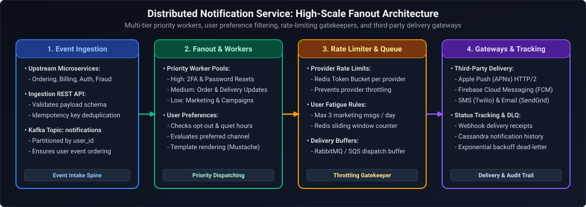

*D2 Source: [`05_distributed_notification_service_architecture.d2`](assets/02_high_level_system_design/05_distributed_notification_service_architecture.d2)*

---

### Q8. Scaling a Video Streaming Platform (YouTube/Netflix)
**Topic Covered:** Adaptive Bitrate Streaming (HLS/DASH), Video Chunking, and Transcoding Pipelines  
**Question:** *How would you scale a Video Streaming platform?*

#### Core Mechanics
1. **Video Ingestion & Chunking:** Uploaded raw video is split into standardized 2-to-6 second segments (`.ts` or fragmented `.mp4`).
2. **Distributed Transcoding Pipeline:** A worker farm encodes each video chunk into multiple resolutions (360p, 720p, 1080p, 4K) and codecs (AVC/H.264, HEVC/H.265, AV1), generating an `.m3u8` master playlist.
3. **Adaptive Bitrate Streaming (ABR):** The client video player monitors local bandwidth. When network throughput drops, the player seamlessly fetches the next 4-second chunk from the 720p stream instead of 1080p without buffering.
4. **CDN Edge Caching:** Popular video chunks are stored directly on ISP-edge CDN PoPs, offloading 98% of streaming network traffic from the cloud origin.

---

# 3. Financial Transactions, E-Commerce & Geospatial Coordination

---

### Q9. Design a High-Throughput Payment System (50,000 TPS) with Zero Double-Charges
**Topic Covered:** 50,000 TPS Financial Systems, Double-Entry Bookkeeping, Distributed Idempotency, Saga Orchestration & Reconciliation  
**Question:** *Design a payment system that handles 50,000 transactions per second. It should never charge a customer twice, even if the server crashes or the payment gateway times out:*
- *How will you prevent duplicate payments?*
- *What if the payment succeeds but your database update fails?*
- *How will you handle retries in Kafka?*
- *How will you manage transactions across multiple services?*
- *What happens if a payment stays in PENDING state for hours?*

#### End-to-End Architectural Blueprint (50,000 TPS)
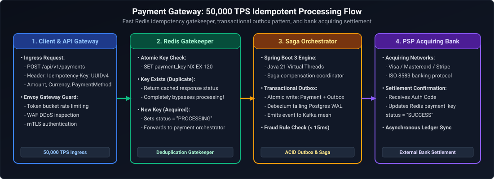

*D2 Source: [`06_payment_gateway_idempotent_processing_flow.d2`](assets/02_high_level_system_design/06_payment_gateway_idempotent_processing_flow.d2)*

---

#### Detailed Technical Solutions to the 5 Interview Challenges

##### 1. How Will You Prevent Duplicate Payments?
At 50,000 TPS, network retries and duplicate user clicks are inevitable. Duplicate defense requires a **3-Layer Defense-in-Depth Model**:
1. **Layer 1: Edge Distributed Lock (Redis Cluster):**
   - Client generates a cryptographic `Idempotency-Key` (`UUIDv4`).
   - The edge gateway executes atomic Redis command: `SET idemp:<key> "PROCESSING" NX EX 120`.
   - If key already exists with status `PROCESSING`, immediately reject concurrent duplicate with `HTTP 409 Conflict`.
   - If key status is `COMPLETED`, return the cached JSON response payload directly from Redis without hitting backend databases.
2. **Layer 2: Database Storage Hard Constraint:**
   - In the relational ledger database, enforce a unique index:
     ```sql
     CREATE UNIQUE INDEX uq_payment_idempotency ON payments (idempotency_key);
     ```
   - Even if Redis fails or evicts keys under memory pressure, a duplicate database insert throws a unique constraint violation (`DataIntegrityViolationException`), guaranteeing zero duplicate record creation.
3. **Layer 3: Downstream Gateway Idempotency Transmission:**
   - When calling external acquiring banks or card networks, pass the exact same `Idempotency-Key` in the downstream HTTP/gRPC request header. Payment gateways (Stripe, Visa Direct, Mastercard Send) deduplicate requests at their switch level.

##### 2. What If the Payment Succeeds at the Gateway but Your Database Update Fails?
This is the classic **Distributed Two-Generals Problem**: The external gateway debited \$500 from the customer's card, but our local database crashed or timed out before committing the `SETTLED` state.
* **The Fatal Anti-Pattern:** Blindly retrying the transaction will debit the customer a second time (\$1,000 total). Marking it failed immediately causes money leakage.
* **The Production Solution:**
  1. The database record remains in state `GATEWAY_PENDING`.
  2. When the client retries (or when our recovery orchestrator processes the event), the system **NEVER blindly calls `POST /charges`**.
  3. Instead, the orchestrator first issues a **Status Inquiry / Verification Query** to the payment gateway:
     ```http
     GET /v1/charges?idempotency_key=550e8400-e29b-41d4-a716-446655440000
     ```
  4. If the gateway returns `status = SUCCEEDED`, the orchestrator writes the missing confirmation to the local ledger, writes to the audit journal, updates status to `SETTLED`, and returns `HTTP 200 OK` to the customer.
  5. If the gateway returns `NOT_FOUND`, the orchestrator safely proceeds with the payment call.

##### 3. How Will You Handle Retries in Kafka?
At 50,000 TPS, synchronous retries inside Kafka consumers will block partition processing threads, causing lag explosion and consumer group rebalances.
* **Partitioning Strategy:**
  - Partition the `payment-events` topic using `account_id` or `merchant_id` as the message key:
    $$\text{Partition} = \text{MurmurHash2}(\text{account\_id}) \pmod{N_{\text{partitions}}}$$
  - This ensures all payments for a single account are processed in strict chronological order, while 50,000 TPS across millions of distinct accounts execute fully in parallel across hundreds of partitions.
* **Dead Letter Queue (DLQ) & Non-Blocking Retry Topics:**
  - **Consumer Idempotency:** Consumers insert into an `idempotent_consumer_events (event_id, processed_at)` table with primary key `event_id` within the consumer's local transaction.
  - **Non-Blocking Retry Exponential Backoff:** If an external dependent service returns a transient 503 error, republish the message to progressive retry delay topics:
    $$\text{payment-events} \longrightarrow \text{payment-retry-10s} \longrightarrow \text{payment-retry-60s} \longrightarrow \text{payment-retry-300s}$$
  - **Dead Letter Queue:** After 3 failed retry attempts, route the poisoned message to `payment-dlq` with full stack trace metadata and trigger an automated PagerDuty alert. The consumer offset moves forward without stalling partition throughput.

##### 4. How Will You Manage Transactions Across Multiple Services?
At 50,000 TPS, **Two-Phase Commit (2PC) / XA distributed transactions are strictly prohibited** due to synchronous lock holding, high latency, and coordinator single-points-of-failure.
* **Production Solution: Orchestrated Saga Pattern with Transactional Outbox:**
  1. **Transactional Outbox + Debezium CDC:** The initiating service saves the business state and an outbox event into the same database atomically in a single local ACID transaction. Debezium reads the database transaction log (WAL) and publishes events to Kafka with zero dual-write anomalies.
  2. **Saga State Machine:** A dedicated `PaymentSagaOrchestrator` manages the distributed workflow:
     - Step 1: Reserve Funds (Account Service) $\to$ Success
     - Step 2: Authorize Payment (Payment Gateway) $\to$ Failure
     - Step 3 (Compensating Transaction): Release Reserved Funds (Account Service)
  3. Every step in the saga must be **idempotent** and have an explicitly defined **compensating action**.

##### 5. What Happens If a Payment Stays in `PENDING` State for Hours?
Payments enter extended `PENDING` state due to network dropouts, asynchronous 3D Secure (3DS) customer verification, or banking switch downtime.
* **Production Solution: The Automated Asynchronous Reconciliation Engine:**
  1. **Active Sweeper Job (Short-Term Recovery):**
     - A distributed cron job (using ShedLock / Kubernetes CronJob) queries the database every 5 minutes for records where:
       $$\text{status} = \text{'GATEWAY\_PENDING'} \quad \text{AND} \quad \text{updated\_at} < (\text{NOW}() - 15 \text{ minutes})$$
     - It invokes the Payment Gateway Status API to reconcile each record.
  2. **Batch Clearing & Settlement Reconciliation (End-of-Day):**
     - At the end of each business day ($T+1$), acquiring banks and card networks deliver cryptographic settlement clearing files (BAI2, MT940, or ISO 20022 CAMT.053).
     - A distributed Spark/Spring Batch job parses settlement records and joins them against the internal `payments` ledger table:
       - **Match:** Internal and external states agree $\to$ Mark `RECONCILED`.
       - **Internal Missing (Bank charged, no local record):** Create retroactive ledger entry and notify finance.
       - **External Missing (Local settled, bank didn't charge):** Alert fraud and accounting operations immediately for manual audit.

---

### Q10. Design an E-Commerce Checkout System
**Topic Covered:** Flash Sale Concurrency, Distributed Locking, Two-Phase Reservation, and Inventory Over-Selling Prevention  
**Question:** *Design an E-commerce Checkout System.*

#### The 2-Tier Inventory Reservation Architecture
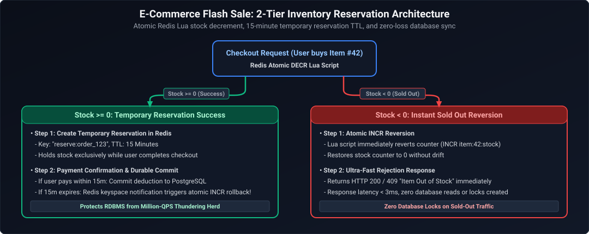

*D2 Source: [`07_ecommerce_flash_sale_two_tier_inventory_reservation.d2`](assets/02_high_level_system_design/07_ecommerce_flash_sale_two_tier_inventory_reservation.d2)*

---

### Q11. Design a Ride-Hailing Platform (Uber/Ola)
**Topic Covered:** Geospatial Indexing (H3 / S2 Hexagons), Real-Time Location Ingestion, and Driver-Rider Matching  
**Question:** *Design a Ride-Hailing app (Uber/Ola).*

#### Core Architecture
1. **Geospatial Indexing (Uber H3):** Traditional SQL `ST_Distance(lat1, lon1, lat2, lon2)` requires a full table scan ($O(N)$). Instead, map latitude and longitude coordinates into **Uber H3 discrete hexagonal cell IDs** (Resolution 8 $\approx 460\text{m}$ edge).
2. **Location Ingestion:** 1 million active drivers emit GPS pings every 4 seconds over persistent WebSockets. Location ingestion workers compute the driver's H3 cell ID and update an in-memory spatial index in **Redis Geo / Memory Grid**:
   ```text
   Key: h3_cell:882681a339fffff -> Set of [driver_id_1, driver_id_2]
   ```
3. **Dispatch & Matching:** When a rider requests a ride, the dispatch engine computes the rider's H3 cell and queries the current cell plus its 6 immediate neighboring hexagonal rings (`k-ring` distance). Candidate drivers are filtered by ETA, acceptance rating, and heading direction.

---

### Q12. Design an Uber Eats Dynamic Homepage (Geohashing, Menus & SQL vs. NoSQL)
**Topic Covered:** Spatial Aggregation, Personalized Feed Assembly, Dynamic Delivery Radii, and Polyglot Persistence  
**Question:** *Design the Uber Eats homepage displaying open restaurants, delivery ETAs, surge pricing, and promotional banners tailored to user location.*

#### Architecture Blueprint
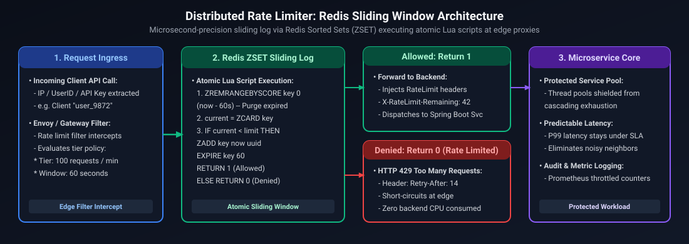

*D2 Source: [`08_distributed_rate_limiter_sliding_window_architecture.d2`](assets/02_high_level_system_design/08_distributed_rate_limiter_sliding_window_architecture.d2)*

#### SQL vs. NoSQL Trade-Off Analysis for Uber Eats
1. **Relational / SQL (PostgreSQL):** Used for **Order Placements, Payment Ledgers, and Merchant Billing** where strict ACID transactions, foreign keys, and zero phantom reads are mathematically required.
2. **Document / NoSQL (MongoDB / DynamoDB):** Used for **Restaurant Menus and Catalogs**. Menus are highly hierarchical, polymorphic documents (categories $\to$ items $\to$ size variants $\to$ modifier groups: *"extra cheese, gluten-free"*). Normalizing this in SQL requires 8 table joins per menu query; in NoSQL, the entire menu is retrieved in a single $O(1)$ key lookup (`restaurant_id`).
3. **Dynamic Delivery Radii:** Delivery radius is dynamic: if a restaurant has 40 orders queued, its delivery radius contracts from H3 resolution 7 to resolution 8 automatically to protect food quality and SLA.

---

# 4. Distributed Storage, Caching & File Systems

---

### Q13. Design a Distributed In-Memory Cache (Redis-like)
**Topic Covered:** Consistent Hashing, Virtual Nodes, Master-Replica Replication, and Gossip Protocol  
**Question:** *Design a Distributed Cache (like Redis).*

#### Architecture Mechanics
1. **Consistent Hashing with Virtual Nodes:** To distribute keys across $N$ cache nodes without rehashing the entire keyspace when nodes are added or removed, place both nodes and keys onto a circular hash ring $[0, 2^{32}-1]$. Assigning 100 to 200 **Virtual Nodes (v-nodes)** per physical server ensures uniform key distribution and eliminates hot spots.
2. **Memory Eviction Strategy:** Implement LRU or W-TinyLFU eviction when memory threshold exceeds 90%.
3. **Failure Detection & Cluster Membership:** Cache nodes run a decentralized **Gossip Protocol** (e.g., SWIM) to exchange heartbeat metadata every 100ms, detecting node crashes without a single point of failure coordinator.

---

### Q14. Design a Distributed File Storage System (Dropbox/Google Drive)
**Topic Covered:** Block-Level Chunking, Content-Addressed Storage, Deduplication, and Sync Engines  
**Question:** *Design a File Storage System (like Dropbox/Google Drive).*

#### Architecture Blueprint
1. **Chunking & Hashing:** Client desktop agent splits large files into fixed-size 4 MB chunks. Each chunk is hashed using SHA-256 (`chunk_hash`).
2. **Global Deduplication:** The client queries the metadata server with the list of chunk hashes before uploading bytes. If a chunk hash already exists anywhere in cloud storage (e.g., a shared popular PDF), the client skips uploading that 4 MB block, linking to the existing chunk reference.
3. **Delta Sync:** When a user edits a 200 MB file, only the modified 4 MB chunk is re-hashed and uploaded, reducing bandwidth by 98%.
4. **Separation of Metadata and Block Storage:**
   - **Block Store:** Raw immutable encrypted byte chunks stored in AWS S3 / Google Cloud Storage.
   - **Metadata Database:** File namespace trees, user permissions, version histories, and chunk manifests stored in a distributed transactional database (Spanner / CockroachDB).

---

# 5. Compute Scheduling, Graph Search & Collaborative Systems

---

### Q15. Design a Search Autocomplete System (Typeahead)
**Topic Covered:** Prefix Trie Data Structures, Top-K Caching, Offline Aggregations, and Client Debouncing  
**Question:** *Design a Search Autocomplete System (like Google).*

#### Architecture Blueprint
1. **Data Structure:** A **Prefix Trie** where each node represents a character. Precompute and store the **Top 5 search queries and frequencies directly inside each Trie node** to achieve sub-10ms query responses.
2. **Offline Aggregation Pipeline:** Real-time user searches are streamed to Kafka and aggregated daily in Apache Spark to compute query frequencies. The updated Trie is built offline and hot-swapped into memory on read servers.
3. **Client-Side Optimization:** Client applications debounce input by 150ms to avoid firing HTTP requests on every keystroke, and cache search results locally in the browser.

---

### Q16. Collaborative Real-Time Document Editing (Google Docs)
**Topic Covered:** Concurrency Control, Operational Transformation (OT), and CRDTs  
**Question:** *How would you design Google Docs (collaborative editing)?*

#### The Core Distributed Concurrency Challenge
Real-time collaborative editing enables multiple users to edit the same shared document simultaneously across heterogeneous geographical regions. The fundamental engineering challenge arises from asynchronous network latency:
- Suppose a document currently contains the text `"CAT"`.
- User $A$ inserts `'S'` at index 0 to produce `"SCAT"`.
- Concurrently, User $B$ deletes `'T'` at index 2 to produce `"CA"`.
- When User $B$'s delete operation (`delete(2)`) arrives at User $A$'s client without transformation, User $A$ deletes index 2 of `"SCAT"` (the letter `'A'`), resulting in `"SCT"`. Meanwhile, User $B$ applies User $A$'s insert (`insert(0, 'S')`), resulting in `"SCA"`.
- The document states have permanently diverged!

To guarantee eventual consistency across all distributed clients, systems deploy either **Operational Transformation (OT)** or **Conflict-Free Replicated Data Types (CRDTs)**.

#### Concurrency Control Architectures
1. **Operational Transformation (OT):**
   - **Centralized Sequencing:** Relies on a centralized server that establishes a strict, total chronological ordering of all operations.
   - **Transformation Functions ($T$):** When an operation arrives out of order relative to concurrent edits that have already been applied by the server, the server transforms the incoming operation against the intervening operations:
     $$op_1' = T(op_1, op_2), \quad op_2' = T(op_2, op_1)$$
     This adjusts character indices dynamically so that applying $op_1$ followed by $op_2'$ yields the identical character sequence as applying $op_2$ followed by $op_1'$.
   - **Client State Machine:** Clients buffer unacknowledged local operations, applying optimistic UI rendering, and transform incoming remote operations against their local pending buffer.
2. **Conflict-Free Replicated Data Types (CRDTs):**
   - **Decentralized Convergence:** Characters are modeled not by volatile array indices, but by globally unique, immutable identifiers embedded in a partially ordered set (e.g., Replicated Growable Array - RGA, or Logoot/LSEQ fractional indexing).
   - **Monotonic Semi-Lattice Merging:** Merge operations are mathematically guaranteed to be commutative, associative, and idempotent:
     $$A \vee B = B \vee A, \quad (A \vee B) \vee C = A \vee (B \vee C), \quad A \vee A = A$$
   - **Offline-First Resilience:** Because CRDTs require no central server to resolve conflicts, clients can edit documents completely offline for days and merge changes seamlessly upon reconnecting.

#### Operational Transformation (OT) vs. CRDTs

The comparison matrix below contrasts the architectural topology, computational mechanics, memory profiles, and industry adoption between Operational Transformation and CRDTs:

| Dimension | Operational Transformation (OT) | CRDTs (Conflict-Free Replicated Data Types) |
| :--- | :--- | :--- |
| **Architecture** | Centralized server required to order operations globally. | Fully decentralized; peer-to-peer or server-assisted. |
| **Mechanics** | Operations (Insert, Delete) are mathematically transformed based on concurrent peer operations. | Data structures with mathematically provable monotonic merge functions (LWW-Element-Set, RGA). |
| **Memory Overhead** | Extremely low memory overhead per character. | Higher memory footprint due to unique node IDs and tombstone metadata. |
| **Industry Adoption** | Google Docs, Apache Wave. | Figma, Apple Notes, Linear, Notion. |

#### Production Architecture Blueprint
1. **WebSocket Gateway:** Terminates bi-directional persistent WebSocket connections, mapping active document sessions to designated stateful Document Workers.
2. **Document Session Worker (JVM Actor / Stateful Node):** Holds the in-memory document state, manages client revision numbers, executes OT transformation matrices or CRDT causal merges, and broadcasts committed edits to all active session participants.
3. **Presence & Cursor Service:** In-memory Redis pub/sub tracking real-time cursor positions, user selections, and active collaborator avatars with low-latency broadcasts.
4. **Append-Only Edit Log (WAL) & Snapshot Store:** Every committed operation is appended to an immutable write-ahead log (Apache Kafka or Cassandra). Periodically (e.g., every 50 operations or 30 seconds), the document worker writes a compact document snapshot to Object Storage (S3 / GCS) to allow fast cold-start loading.

---

### Q17. Design a Distributed Job Scheduler
**Topic Covered:** Distributed Cron, Time-Wheel Algorithm, Consensus Coordination, and Idempotent Worker Pools  
**Question:** *Design a Distributed Job Scheduler.*

#### Core Components
1. **Leader Election & Coordination:** Use Apache ZooKeeper or etcd with Raft consensus to maintain a single active scheduler leader that holds a distributed lease.
2. **High-Resolution Time-Wheel:** The leader schedules upcoming jobs using a hierarchical **Hashed Time Wheel** ($O(1)$ timer insertion and tick execution), avoiding expensive linear database polling.
3. **At-Least-Once Delivery & Worker Heartbeats:** Jobs are dispatched to worker nodes via Kafka topics. Workers emit periodic heartbeats. If a worker dies mid-execution, the leader reassigns the unacknowledged job to an alternate worker.
4. **Job Idempotency:** Jobs must be engineered with unique `job_run_id` tokens to ensure that duplicate dispatches produce identical state.

---

### Q18. Design a Generic Workflow Engine (AWS Step Functions / Temporal)
**Topic Covered:** State Machine Execution, Saga Orchestration, Event Sourcing, and Durable Execution  
**Question:** *Design a generic, fault-tolerant workflow system capable of orchestrating long-running state machines across distributed microservices.*

#### Architecture Blueprint
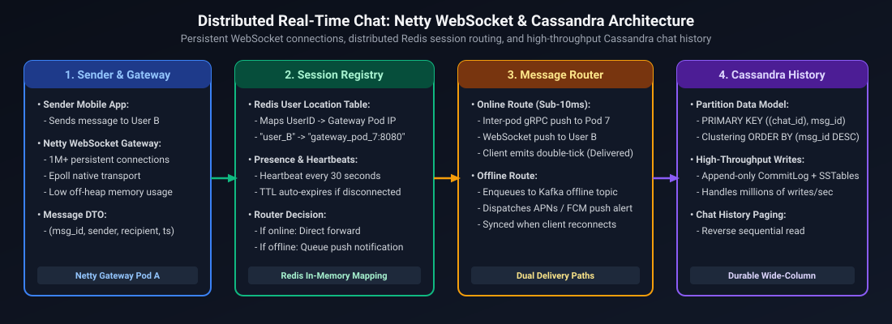

*D2 Source: [`09_whatsapp_distributed_chat_architecture.d2`](assets/02_high_level_system_design/09_whatsapp_distributed_chat_architecture.d2)*

1. **State Machine Definition (JSON/YAML DSL):** Workflows are defined as declarative JSON state machines specifying states, tasks, transitions, retry policies, and compensating error handlers (Sagas).
2. **Durable Execution & Event Sourcing:**
   - Workflows never store state as mutable rows; they store an **immutable sequence of historical events** (`WorkflowStarted`, `TaskScheduled`, `TaskCompleted`, `TimerFired`).
   - If an orchestrator node crashes mid-workflow, another node loads the event history and **replays** the deterministic state machine to reconstruct exact in-memory state.
3. **Activity Workers & Heartbeating:** Tasks are pushed into activity-specific queues. Workers poll tasks, execute business logic (calling external microservices), and record progress via heartbeats. If a heartbeat expires, the orchestrator triggers an automated retry.

---

### Q19. Design a Social Media Feed (Twitter/Instagram)
**Topic Covered:** Fanout-on-Write (Push) vs. Fanout-on-Read (Pull), Hybrid Feed Generation, and Redis Timelines  
**Question:** *Design a Social Media Feed (Twitter/Instagram).*

#### The Hybrid Fanout Architecture
- **Fanout-on-Write (Push Model):** When regular user posts a tweet, asynchronously insert the tweet ID into the Redis home timeline list of all their followers. Reading the feed is an instant $O(1)$ `LRANGE 0 20` operation.
- **The Celebrity Problem:** If a celebrity with 80 million followers posts, pushing to 80 million Redis lists takes minutes and saturates network I/O.
- **The Production Hybrid Solution:**
  1. Users with $< 25,000$ followers use **Fanout-on-Write**.
  2. Users with $\ge 25,000$ followers (celebrities) bypass fanout on write.
  3. When a follower loads their feed, the system fetches their precomputed timeline from Redis (regular users) and merges it on-the-fly with the latest tweets of any followed celebrities (**Fanout-on-Read** merge).

---

### Q20. Degrees of Separation at Billion-User Scale (Social Graph Bidirectional BFS)
**Topic Covered:** Distributed Graph Partitioning, Bidirectional Search, Cache Frontiers, and Six Degrees of Separation  
**Question:** *How would you calculate the degrees of separation and shortest friendship path between any two users in a social graph of 1 billion active users?*

#### Algorithmic & Architectural Challenges at Scale
In a graph with $V = 10^9$ users and average degree $d = 500$:
- Forward BFS to depth 6 explores $500^6 \approx 1.56 \times 10^{16}$ nodes (computationally impossible in real-time).
- **Bidirectional BFS:** Simultaneously expanding from User A (Source) and User B (Target) to depth 3 meets in the middle:
  $$2 \times 500^3 \approx 2 \times 1.25 \times 10^8 = 2.5 \times 10^8 \text{ checks}$$
  This reduces search space by **8 orders of magnitude**!

#### High-Scale Architecture
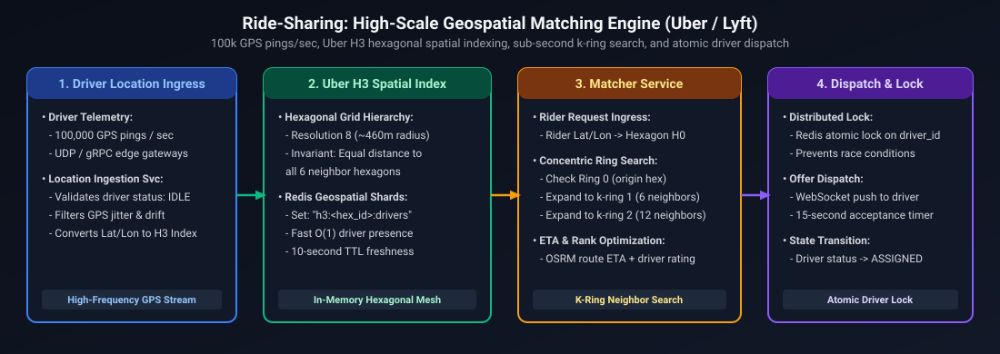

*D2 Source: [`10_ride_sharing_geospatial_matching_engine.d2`](assets/02_high_level_system_design/10_ride_sharing_geospatial_matching_engine.d2)*

1. **Storage: Roaring Bitmaps in In-Memory Cache (Facebook TAO Pattern):**
   - Each user's friend list is stored as a compressed **Roaring Bitmap** in an in-memory Redis/Memcached cluster.
   - Checking friend intersection between two users is an instantaneous bitwise `AND` operation executing in $< 50\mu\text{s}$.
2. **Distributed Pruning Strategy:**
   - Degrees of separation query cuts off at $k = 4$ for online requests ($< 200\text{ms}$ SLA).
   - Highly connected celebrity nodes (nodes with $> 50,000$ friends) are pruned or evaluated last to prevent explosive frontier expansion.

---

# 6. Mission-Critical Financial, Security & Legacy Migration Systems

---

### Q21. Design the UK Faster Payments Settlement System (24/7 Sub-Second Instant Payments & Timeout Guarantees)
**Topic Covered:** 24/7 Real-Time Settlement, ISO 20022 Messaging, Two-Phase Timeout Resolution, Non-Repudiation, Active-Active Ledger  
**Question:** *Design the payment system behind UK Faster Payments, which has to confirm or reject a transfer in seconds, 24/7. How do you guarantee a payment is never debited without being credited when the receiving bank's response times out?*

#### Functional & Non-Functional Requirements
- **Functional:** 
  - Authorize, validate, and execute direct account-to-account credit transfers (`pacs.008`) within $2\text{–}5\text{ seconds}$ end-to-end.
  - Settle 24/7/365 across sending bank, central payment switch (Pay.UK / Vocalink), and receiving bank.
  - Guarantee atomic ledger consistency: A sender is **never** debited without a corresponding credit to the receiver or a guaranteed automated reversal.
- **Non-Functional:**
  - $99.999\%$ system availability ($< 5.26\text{ minutes}$ downtime/year).
  - Strict zero data loss ($RPO = 0, RTO < 3\text{ seconds}$).
  - Full non-repudiation and cryptographic audit trails with HSM (Hardware Security Module) digital signatures.

#### The Timeout Dilemma & Two-Phase Settlement Protocol
In distributed payment settlement across heterogeneous banking networks, network timeouts are inevitable:
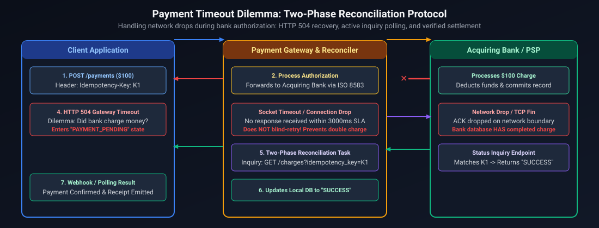

*D2 Source: [`11_payment_timeout_dilemma_two_phase_settlement.d2`](assets/02_high_level_system_design/11_payment_timeout_dilemma_two_phase_settlement.d2)*

#### Core Architecture & Mechanics
1. **Three-State Ledger Locking (Never Debit Immediately):**
   - Traditional naïve systems debit the sender's account immediately upon request. If the downstream times out, the bank must chase money with manual reconciliation.
   - **Modern Protocol:** The sender's balance is split into `Available Balance` and `Ledger Balance`. Upon initiation, place a cryptographic reservation (`PENDING_OUTBOUND_HOLD`).
   - If affirmative confirmation (`pacs.002 ACCP`) is received, deduct `Ledger Balance` and release the hold to `SETTLED`.
   - If rejected, cancel the reservation; `Available Balance` is restored instantly.
2. **Deterministic Timeout Reconciliation Engine (Investigation State Machine):**
   - If the receiving bank or switch times out after 5,000ms:
     - Mark payment as `PAYMENT_IN_INVESTIGATION`.
     - **DO NOT cancel or refund immediately** (the receiving bank may have processed the credit and timed out only on the return acknowledgment).
     - Initiate an automated ISO 20022 `pacs.028` (Payment Status Request) every 2 seconds up to 3 retries.
     - If the switch returns a terminal state, finalize according to that state.
     - If the central switch confirms transaction failure or abort window expires, trigger an automated compensating transaction signed by the bank's HSM.
3. **Idempotency & Replay Protection:**
   - Client sends `Idempotency-Key: <UUID>` generated on the mobile device.
   - Stored in a globally distributed Spanner / CockroachDB table with unique constraint `(sender_account_id, idempotency_key)`.
   - Any duplicate submission within 24 hours returns the cached exact state without touching ledger balances.
4. **Active-Active Cross-Region Ledger Persistence:**
   - CockroachDB or Google Cloud Spanner utilizing TrueTime / Raft consensus across 3 availability zones.
   - Every transaction is written to write-ahead logs (WAL) synchronously replicated across quorum nodes before ACKing the ingress API.

---

### Q22. Design Real-Time Card Fraud Detection Under 100ms
**Topic Covered:** Sub-100ms Scoring, Sliding Window Feature Serving, Geodesic Velocity, Fallback Degradation  
**Question:** *Design real-time card fraud detection for millions of credit card transactions a day. How do you score every swipe in under 100ms without blocking legitimate customers who are traveling abroad?*

#### Architectural Blueprint

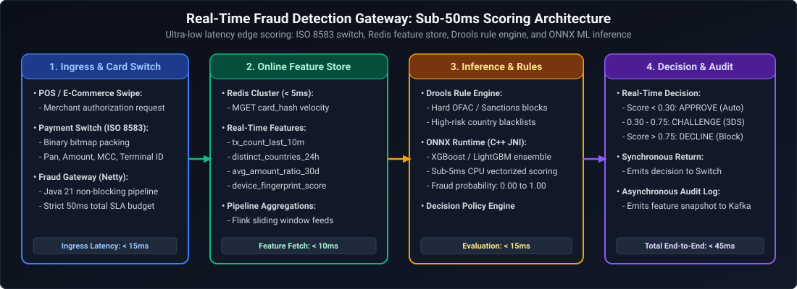

*D2 Source: [`12_realtime_fraud_detection_gateway_architecture.d2`](assets/02_high_level_system_design/12_realtime_fraud_detection_gateway_architecture.d2)*

#### Core Mechanics & Features
1. **Budget Allocation (100ms Hard Budget):**
   - Network Ingress/Egress: $20\text{ms}$
   - Feature Extraction (Redis): $20\text{ms}$
   - ML Inference Model: $25\text{ms}$
   - Decision & Business Policy Rules: $10\text{ms}$
   - Safety Buffer: $25\text{ms}$
2. **Preventing Legitimate Traveler False Positives:**
   - **Travel Notice Integration:** Ingest airline/hotel booking confirmation data and mobile app "Travel Plans" into the in-memory cache. If swipe location matches an active itinerary, penalize fraud score by $-0.45$.
   - **Cellular & App Telemetry Alignment:** Mobile banking app periodically syncs coarse location (via permissioned background geofence). If the cardholder's mobile device is in Paris and the physical card swipe occurs in Paris 5 minutes later, card-present fraud probability drops to near zero.
   - **Geodesic Velocity Check (Haversine Formula):**
     $$V = \frac{\text{Distance}(\text{Location}_{t}, \text{Location}_{t-1})}{\Delta t}$$
     If calculated speed $V > 1,000\text{ km/h}$ and no flight ticket exists on record $\to$ flag as impossible travel.
3. **Hard Deadline Circuit Breaker:**
   - If Redis feature retrieval or ML inference takes $> 70\text{ms}$, the Java `CompletableFuture.orTimeout(70, TimeUnit.MILLISECONDS)` triggers a fallback rule-based evaluator (checks hard blacklist and daily spending limit). If clean, approve transaction and flag for post-auth async review to avoid blocking legitimate merchant sales.

---

### Q23. Design an Open Banking API Platform with Instant Consent Revocation
**Topic Covered:** OAuth 2.0 / FAPI Security, Cryptographic Consent Tokens, Distributed Invalidation, Sub-Millisecond Blacklists  
**Question:** *Design an Open Banking API platform where third-party apps request account data with customer consent. How do you enforce per-customer consent and revoke access instantly across every service?*

#### Architectural Walkthrough
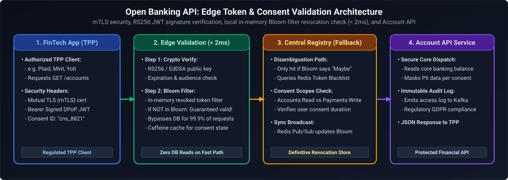

*D2 Source: [`13_open_banking_consent_and_token_validation.d2`](assets/02_high_level_system_design/13_open_banking_consent_and_token_validation.d2)*

#### Core Mechanics
1. **Granular Consent Metadata in FAPI Token:**
   - Standard access tokens are embedded with a distinct `consent_id` UUID claim alongside permissions (`accounts:read`, `transactions:read:90days`) and account masking IDs.
2. **Distributed Instant Revocation Architecture:**
   - Stateless JWT tokens cannot be revoked by themselves until their expiration timestamp (e.g. 15 minutes). For Open Banking, regulations mandate **instant** revocation.
   - **The Invalidation Bus:** When a user revokes consent on their banking app, `Consent Management Service` updates the database record to `REVOKED`, writes `consent:<consent_id>:revoked = 1` into Redis with TTL matching token expiry, and publishes `REVOKE_CONSENT: <consent_id>` to a Redis Pub/Sub channel.
   - **Gateway Memory Sync:** Every Envoy / Java Gateway worker subscribes to this channel and immediately inserts the revoked `consent_id` into its local **ConcurrentHashMap / Caffeine Cache** and bitmask.
   - **Request Evaluation:** Ingress requests validate the JWT signature in memory, then perform an $O(1)$ lookup in the local memory blacklist ($< 0.1\text{ms}$). If found, the gateway rejects the call immediately with `403 Forbidden` (`{"error": "consent_revoked"}`). Zero database load is incurred.

---

### Q24. Design Zero-Downtime Mainframe to Microservices Migration
**Topic Covered:** Strangler Fig Pattern, Dual-Write Reconciliation, CDC Shadow Replication, Reversible Cutover  
**Question:** *Design the migration of customer accounts from a legacy mainframe to microservices with zero downtime. How do you keep both systems consistent during the cutover?*

#### 4-Phase Migration Roadmap (Strangler Fig Architecture)

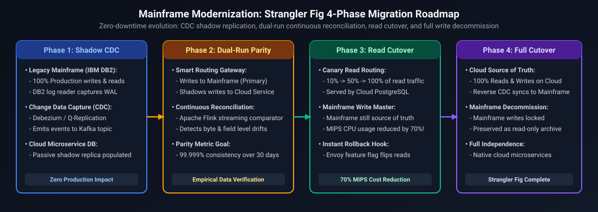

*D2 Source: [`14_mainframe_strangler_fig_migration_roadmap.d2`](assets/02_high_level_system_design/14_mainframe_strangler_fig_migration_roadmap.d2)*

#### Core Mechanics & Consistency Guarantees
1. **Phase 1: Initial Bulk Load + CDC Stream:**
   - Take an offline DB2 snapshot and load it into PostgreSQL / CockroachDB.
   - Concurrently start Debezium CDC mining the DB2 transaction log. Apply all CDC events timestamped after the snapshot start time.
2. **Phase 2: Continuous Real-Time Reconciliation:**
   - Run an automated background reconciler comparing aggregate hash checksums for every account block:
     $$\text{Hash} = \text{SHA256}(\text{account\_id} \parallel \text{balance} \parallel \text{last\_txn\_id})$$
   - Any divergence triggers an automated diff alert and re-sync of that specific partition.
3. **Phase 3: Canary Read Routing:**
   - Migrate read traffic gradually using feature flags (1% $\to$ 5% $\to$ 25% $\to$ 100%).
   - If response latencies or error rates spike, instantly dial traffic back to 0%.
4. **Phase 4: Reverse CDC for Instant Rollback:**
   - When cutting writes over to the microservice, maintain **Reverse CDC** from the new microservice DB back to the mainframe DB2.
   - If an unrecoverable failure occurs in the new microservice 4 hours after cutover, traffic can be switched back to the mainframe with zero lost transactions because DB2 was kept updated in real time.

---

## Summary & High-Level System Design Reference Matrix

Designing enterprise distributed backend systems requires balancing strict consistency against high availability, memory efficiency against computational latency, and real-time streaming against durable batch persistence. The reference matrix below synthesizes the primary architectural trade-offs, service latency SLAs, bottleneck mitigations, and canonical storage choices across the distributed systems analyzed throughout this guide:

| System Domain | Latency SLA | Primary Bottleneck | Canonical Architectural Solution | Persistence Choice |
| :--- | :--- | :--- | :--- | :--- |
| **URL Shortener** | $< 10\text{ms}$ | Hash collisions, write lock contention | Monotonic 64-bit ID generator + Base62 + Redis 302 redirect | ScyllaDB / PostgreSQL |
| **Rate Limiter** | $< 2\text{ms}$ | Race conditions, double-burst boundary | Atomic Redis Lua script with sliding window timestamps | Redis Cluster |
| **Chat System** | $< 50\text{ms}$ | Connection scaling, presence tracking | Stateful WebSocket gateways + Redis presence + ScyllaDB | ScyllaDB (Wide-Column) |
| **Video Streaming** | Sub-second | Transcoding CPU, bandwidth saturation | Chunking (2-6s) + ABR (HLS/DASH) + Edge CDN caching | AWS S3 + Cloudflare CDN |
| **Payment Platform** | $< 300\text{ms}$ | Double-spending, distributed inconsistencies | Idempotency keys + Double-entry ledger + Orchestrated Saga | PostgreSQL (ACID) |
| **Flash Sale Checkout** | $< 100\text{ms}$ | DB row-lock contention, overselling | 2-Tier in-memory atomic Redis reservation + async payment queue | Redis + PostgreSQL |
| **Ride-Hailing Matching**| $< 200\text{ms}$ | High-frequency GPS updates, spatial scans | Uber H3 hexagonal spatial indexing + Redis Geo + WebSocket pings | Redis + PostgreSQL |
| **Workflow Engine** | $< 50\text{ms}$ | Node crashes during long-running workflows | Event-sourced append log replay + task queue dispatchers | CockroachDB / Spanner |
| **Social Media Feed** | $< 20\text{ms}$ | Fanout saturation for high-follower accounts| Hybrid Push/Pull: Push for regular users; Pull on read for celebrities | Redis + Cassandra |
| **Billion-Scale Graph** | $< 250\text{ms}$ | Combinatorial explosion in graph traversal | Bidirectional BFS + Roaring Bitmap intersections in memory | Facebook TAO / Neo4j |
| **Faster Payments Settlement** | $< 2\text{s}$ | Downstream receiver timeouts, non-repudiation | Two-Phase Saga + Hold/Settle ledger + ISO 20022 reconciliation | CockroachDB / Spanner |
| **Real-Time Fraud Detection** | $< 100\text{ms}$ | Scoring latency, traveler false positives | Sub-10ms Redis feature retrieval + ONNX inference + fallback breaker | Redis Cluster + Kafka |
| **Open Banking Consent** | $< 2\text{ms}$ | Cross-service revocation lag, token staleness | Invalidation Pub/Sub + Gateway Bloom filter & local LRU cache | Redis + PostgreSQL |
| **Mainframe Migration** | Zero Downtime | Data divergence, cutover rollback risk | Strangler Fig + DB2 CDC + Dual-Run Reconciliation + Reverse CDC | PostgreSQL + Kafka + DB2 |

---

## References & Further Reading
- Martin Kleppmann, *Designing Data-Intensive Applications* (O'Reilly).
- Alex Xu, *System Design Interview – An Insider's Guide* (Vol 1 & 2).
- Gregor Hohpe & Bobby Woolf, *Enterprise Integration Patterns* (Addison-Wesley).
- Leslie Lamport, *Time, Clocks, and the Ordering of Events in a Distributed System* (Communications of the ACM).
- Uber Engineering: *H3: Uber's Hexagonal Hierarchical Spatial Index*.

