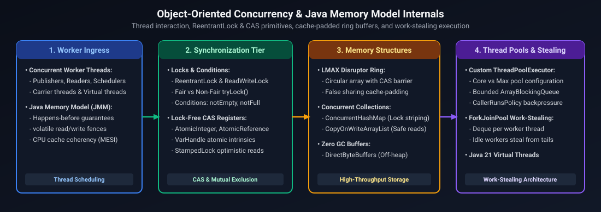
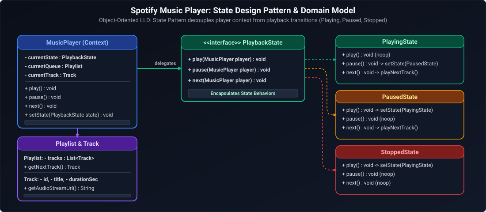

# 03. Java & Backend Engineering: Low-Level Design (LLD) & Machine Coding

A comprehensive, production-grade guide answering real-world Low-Level Design (LLD), object-oriented architecture, concurrency control, and 60–75 minute machine coding challenges tailored for Senior, Staff, and Principal Java / Backend Engineers.

---

## Architectural Overview: Object-Oriented Concurrency & Memory Model



*D2 Source:* [assets/03_low_level_system_design/01_concurrency_and_memory_model_internals.d2](assets/03_low_level_system_design/01_concurrency_and_memory_model_internals.d2)

---

## Table of Contents & Question Mapping

1. **Core Concurrency Primitives & Custom Runtimes**
   - [LLD 1. Implement a Thread-Safe Bounded Blocking Queue & Custom Thread Pool (No `ExecutorService`)](#lld-1-implement-a-thread-safe-bounded-blocking-queue--custom-thread-pool-no-executorservice)
   - [LLD 2. Concurrent Linked List Operations (Concurrent Reads, Single Write, Exclusive Delete)](#lld-2-concurrent-linked-list-operations-concurrent-reads-single-write-exclusive-delete)
   - [LLD 3. Multithreaded File Read/Write Engine Using Byte Offsets](#lld-3-multithreaded-file-readwrite-engine-using-byte-offsets)
2. **Scheduling Engines & Resource Assignment**
   - [LLD 4. Design a DAG Job Scheduler with Dependency Resolution and Concurrency](#lld-4-design-a-dag-job-scheduler-with-dependency-resolution-and-concurrency)
   - [LLD 5. Playground Player Assignment Engine (Anti-Starvation & Team Synchronization)](#lld-5-playground-player-assignment-engine-anti-starvation--team-synchronization)
   - [LLD 6. Train and Platform Management Scheduler (Machine Coding)](#lld-6-train-and-platform-management-scheduler-machine-coding)
3. **Machine Coding & In-Memory Distributed Systems**
   - [LLD 7. Machine Coding: In-Memory Twitter Engine](#lld-7-machine-coding-in-memory-twitter-engine)
   - [LLD 8. Machine Coding: In-Memory Pull-Based Message Queue (Kafka-like)](#lld-8-machine-coding-in-memory-pull-based-message-queue-kafka-like)
   - [LLD 9. Machine Coding: In-Memory Filesystem (`mkdir`, `pwd`, `cd` with Wildcards)](#lld-9-machine-coding-in-memory-filesystem-mkdir-pwd-cd-with-wildcards)
4. **Enterprise Domain Models & Pattern Architectures**
   - [LLD 10. Design a Dynamic Rule Engine (AST / Composite Pattern)](#lld-10-design-a-dynamic-rule-engine-ast--composite-pattern)
   - [LLD 11. Low-Level Design for a Music Streaming Platform (Spotify LLD)](#lld-11-low-level-design-for-a-music-streaming-platform-spotify-lld)

---

# 1. Core Concurrency Primitives & Custom Runtimes

---

### LLD 1. Implement a Thread-Safe Bounded Blocking Queue & Custom Thread Pool (No `ExecutorService`)
**Design Focus:** Monitors, ReentrantLock, Condition Variables, Worker Thread Lifecycle, and Worker Rejection Policies.

#### Problem Specification
1. Implement a circular array-backed bounded blocking queue `CustomBlockingQueue<T>` with `enqueue(T item)` and `dequeue()`.
2. Build a `CustomThreadPool` on top of it that initializes a fixed number of worker threads, accepts `Runnable` tasks, and gracefully shuts down.

#### Complete Production Implementation (Java)
```java
import java.util.ArrayList;
import java.util.List;
import java.util.concurrent.locks.Condition;
import java.util.concurrent.locks.ReentrantLock;

public class CustomThreadPool {

    // 1. Thread-safe Bounded Queue
    public static class CustomBlockingQueue<T> {
        private final Object[] items;
        private int head = 0, tail = 0, count = 0;
        private final ReentrantLock lock = new ReentrantLock(true); // Fair lock
        private final Condition notFull = lock.newCondition();
        private final Condition notEmpty = lock.newCondition();

        public CustomBlockingQueue(int capacity) {
            if (capacity <= 0) throw new IllegalArgumentException("Capacity must be positive");
            this.items = new Object[capacity];
        }

        public void enqueue(T item) throws InterruptedException {
            lock.lockInterruptibly();
            try {
                while (count == items.length) {
                    notFull.await();
                }
                items[tail] = item;
                tail = (tail + 1) % items.length;
                count++;
                notEmpty.signal();
            } finally {
                lock.unlock();
            }
        }

        @SuppressWarnings("unchecked")
        public T dequeue() throws InterruptedException {
            lock.lockInterruptibly();
            try {
                while (count == 0) {
                    notEmpty.await();
                }
                T item = (T) items[head];
                items[head] = null; // Prevent memory leak
                head = (head + 1) % items.length;
                count--;
                notFull.signal();
                return item;
            } finally {
                lock.unlock();
            }
        }

        public int size() {
            lock.lock();
            try { return count; } finally { lock.unlock(); }
        }
    }

    // 2. Custom Thread Pool Engine
    private final CustomBlockingQueue<Runnable> taskQueue;
    private final List<Worker> workers;
    private volatile boolean isShutdown = false;

    public CustomThreadPool(int poolSize, int queueCapacity) {
        this.taskQueue = new CustomBlockingQueue<>(queueCapacity);
        this.workers = new ArrayList<>(poolSize);

        for (int i = 0; i < poolSize; i++) {
            Worker worker = new Worker("CustomWorker-" + i);
            workers.add(worker);
            worker.start();
        }
    }

    public void execute(Runnable task) throws InterruptedException {
        if (isShutdown) throw new IllegalStateException("ThreadPool has been shut down!");
        taskQueue.enqueue(task);
    }

    public void shutdown() {
        this.isShutdown = true;
        for (Worker worker : workers) {
            worker.interrupt();
        }
    }

    private class Worker extends Thread {
        public Worker(String name) { super(name); }

        @Override
        public void run() {
            while (!isShutdown || taskQueue.size() > 0) {
                try {
                    Runnable task = taskQueue.dequeue();
                    task.run();
                } catch (InterruptedException e) {
                    if (isShutdown) break; // Exit cleanly on shutdown
                } catch (Throwable t) {
                    System.err.println("Task execution failed: " + t.getMessage());
                }
            }
        }
    }
}
```

---

### LLD 2. Concurrent Linked List Operations (Concurrent Reads, Single Write, Exclusive Delete)
**Design Focus:** Multi-Granular Concurrency, `ReentrantReadWriteLock`, Custom Synchronization Semantics.

#### Problem Specification
Design a concurrent sorted singly-linked list supporting:
- Concurrent `search(T val)` without blocking other searches.
- Single `insert(T val)` allowing concurrent searches but mutually exclusive with other inserts and deletes.
- Exclusive `delete(T val)` which blocks all concurrent searches, inserts, and deletes.

#### Production Implementation (Java)
```java
import java.util.concurrent.locks.ReentrantReadWriteLock;

public class ConcurrentLinkedList<T extends Comparable<T>> {
    private static class Node<T> {
        final T value;
        Node<T> next;
        Node(T value) { this.value = value; }
    }

    private final Node<T> head = new Node<>(null); // Sentinel dummy head
    private final ReentrantReadWriteLock rwLock = new ReentrantReadWriteLock(true);
    private final Object writeMutex = new Object(); // Ensures only single insert executes

    // Concurrent searches allowed
    public boolean search(T val) {
        rwLock.readLock().lock();
        try {
            Node<T> curr = head.next;
            while (curr != null) {
                if (curr.value.equals(val)) return true;
                if (curr.value.compareTo(val) > 0) break; // Sorted property
                curr = curr.next;
            }
            return false;
        } finally {
            rwLock.readLock().unlock();
        }
    }

    // Single insert allowed concurrently with reads, but blocked by delete
    public void insert(T val) {
        synchronized (writeMutex) { // Only one insert at a time
            rwLock.readLock().lock(); // Holds read lock so deletes cannot execute concurrently
            try {
                Node<T> prev = head;
                Node<T> curr = head.next;
                while (curr != null && curr.value.compareTo(val) < 0) {
                    prev = curr;
                    curr = curr.next;
                }
                Node<T> newNode = new Node<>(val);
                newNode.next = curr;
                prev.next = newNode;
            } finally {
                rwLock.readLock().unlock();
            }
        }
    }

    // Delete blocks ALL searches, inserts, and other deletes
    public boolean delete(T val) {
        rwLock.writeLock().lock(); // Exclusive lock
        try {
            Node<T> prev = head;
            Node<T> curr = head.next;
            while (curr != null && !curr.value.equals(val)) {
                prev = curr;
                curr = curr.next;
            }
            if (curr != null) {
                prev.next = curr.next;
                return true;
            }
            return false;
        } finally {
            rwLock.writeLock().unlock();
        }
    }
}
```

---

### LLD 3. Multithreaded File Read/Write Engine Using Byte Offsets
**Design Focus:** Range-Based Locking, Memory-Mapped Buffers, Segmented Concurrency.

#### Problem Specification
Design a file buffer manager supporting concurrent thread operations:
- Multiple threads can read overlapping byte offset ranges concurrently.
- Threads can write to non-overlapping byte ranges concurrently.
- Conflicting range writes block until preceding operations release their offset lock.

#### Production Implementation (Java)
```java
import java.util.ArrayList;
import java.util.List;
import java.util.concurrent.locks.Condition;
import java.util.concurrent.locks.ReentrantLock;

public class SegmentedFileManager {
    public static class RangeLock {
        final long startOffset;
        final long endOffset;
        final boolean isWrite;

        public RangeLock(long startOffset, long endOffset, boolean isWrite) {
            this.startOffset = startOffset;
            this.endOffset = endOffset;
            this.isWrite = isWrite;
        }

        public boolean overlaps(long start, long end) {
            return this.startOffset <= end && this.endOffset >= start;
        }
    }

    private final byte[] fileBuffer;
    private final List<RangeLock> activeLocks = new ArrayList<>();
    private final ReentrantLock lock = new ReentrantLock();
    private final Condition lockReleased = lock.newCondition();

    public SegmentedFileManager(int fileSizeBytes) {
        this.fileBuffer = new byte[fileSizeBytes];
    }

    public void readRange(long start, long end, byte[] dest) throws InterruptedException {
        lock.lock();
        try {
            while (hasWriteConflict(start, end)) {
                lockReleased.await();
            }
            activeLocks.add(new RangeLock(start, end, false));
        } finally {
            lock.unlock();
        }

        // Safe concurrent read
        System.arraycopy(fileBuffer, (int) start, dest, 0, (int) (end - start + 1));

        lock.lock();
        try {
            removeLock(start, end, false);
            lockReleased.signalAll();
        } finally {
            lock.unlock();
        }
    }

    public void writeRange(long start, long end, byte[] src) throws InterruptedException {
        lock.lock();
        try {
            while (hasAnyConflict(start, end)) {
                lockReleased.await();
            }
            activeLocks.add(new RangeLock(start, end, true));
        } finally {
            lock.unlock();
        }

        // Safe exclusive write on range
        System.arraycopy(src, 0, fileBuffer, (int) start, (int) (end - start + 1));

        lock.lock();
        try {
            removeLock(start, end, true);
            lockReleased.signalAll();
        } finally {
            lock.unlock();
        }
    }

    private boolean hasWriteConflict(long start, long end) {
        for (RangeLock l : activeLocks) {
            if (l.isWrite && l.overlaps(start, end)) return true;
        }
        return false;
    }

    private boolean hasAnyConflict(long start, long end) {
        for (RangeLock l : activeLocks) {
            if (l.overlaps(start, end)) return true;
        }
        return false;
    }

    private void removeLock(long start, long end, boolean isWrite) {
        activeLocks.removeIf(l -> l.startOffset == start && l.endOffset == end && l.isWrite == isWrite);
    }
}
```

---

# 2. Scheduling Engines & Resource Assignment

---

### LLD 4. Design a DAG Job Scheduler with Dependency Resolution and Concurrency
**Design Focus:** Directed Acyclic Graphs, Topological Sort, Concurrent Execution, Task State Machines.

#### Production Implementation (Java)
```java
import java.util.*;
import java.util.concurrent.*;
import java.util.concurrent.atomic.AtomicInteger;

public class DagJobScheduler {
    public static class Job {
        final String id;
        final Runnable task;
        final List<Job> dependents = new ArrayList<>();
        final AtomicInteger inDegree = new AtomicInteger(0);

        public Job(String id, Runnable task) {
            this.id = id;
            this.task = task;
        }
    }

    private final ExecutorService executor;

    public DagJobScheduler(int threadCount) {
        this.executor = Executors.newFixedThreadPool(threadCount);
    }

    public void addDependency(Job parent, Job child) {
        parent.dependents.add(child);
        child.inDegree.incrementAndGet();
    }

    public CompletableFuture<Void> executeGraph(List<Job> allJobs) {
        CompletableFuture<Void> graphCompletion = new CompletableFuture<>();
        AtomicInteger remainingJobs = new AtomicInteger(allJobs.size());

        // Find initial root jobs with zero in-degree
        List<Job> readyJobs = new ArrayList<>();
        for (Job job : allJobs) {
            if (job.inDegree.get() == 0) readyJobs.add(job);
        }

        for (Job rootJob : readyJobs) {
            submitJob(rootJob, remainingJobs, graphCompletion);
        }

        return graphCompletion;
    }

    private void submitJob(Job job, AtomicInteger remainingJobs, CompletableFuture<Void> graphCompletion) {
        executor.submit(() -> {
            try {
                job.task.run();
                if (remainingJobs.decrementAndGet() == 0) {
                    graphCompletion.complete(null);
                    return;
                }
                for (Job dependent : job.dependents) {
                    if (dependent.inDegree.decrementAndGet() == 0) {
                        submitJob(dependent, remainingJobs, graphCompletion);
                    }
                }
            } catch (Throwable t) {
                graphCompletion.completeExceptionally(t);
            }
        });
    }
}
```

---

### LLD 5. Playground Player Assignment Engine (Anti-Starvation & Team Synchronization)
**Design Focus:** Multi-Party Synchronization, Anti-Starvation Aging, ReentrantLock Conditions.

#### Problem Specification
A playground field accommodates **one team at a time**, with a maximum of **10 players** per session. Multiple teams queue for entry. Implement thread-safe player assignment guaranteeing:
1. Only one team plays on the field simultaneously.
2. Once a team enters, up to 10 players of that team can join the field.
3. Anti-starvation policy: high-frequency small teams cannot starve waiting large teams.

#### Production Implementation (Java)
```java
import java.util.HashMap;
import java.util.Map;
import java.util.concurrent.locks.Condition;
import java.util.concurrent.locks.ReentrantLock;

public class PlaygroundAssignmentManager {
    private static final int MAX_PLAYERS = 10;

    private String activeTeam = null;
    private int currentPlayersOnField = 0;
    private final ReentrantLock lock = new ReentrantLock(true); // Fair lock prevents team starvation
    private final Condition teamFinished = lock.newCondition();
    private final Condition spotAvailable = lock.newCondition();

    public void enterPlayground(String teamId, String playerId) throws InterruptedException {
        lock.lock();
        try {
            // Wait while another team is active or field is full
            while ((activeTeam != null && !activeTeam.equals(teamId)) || currentPlayersOnField >= MAX_PLAYERS) {
                if (activeTeam == null) break;
                if (!activeTeam.equals(teamId)) {
                    teamFinished.await();
                } else {
                    spotAvailable.await();
                }
            }

            activeTeam = teamId;
            currentPlayersOnField++;
            System.out.println("Player " + playerId + " of Team " + teamId + " entered. Total: " + currentPlayersOnField);
        } finally {
            lock.unlock();
        }
    }

    public void leavePlayground(String teamId, String playerId) {
        lock.lock();
        try {
            if (!teamId.equals(activeTeam)) return;
            currentPlayersOnField--;
            System.out.println("Player " + playerId + " left field. Remaining: " + currentPlayersOnField);

            if (currentPlayersOnField == 0) {
                activeTeam = null;
                teamFinished.signalAll(); // Allow waiting teams to enter
            } else {
                spotAvailable.signal(); // Allow pending players of same team to enter
            }
        } finally {
            lock.unlock();
        }
    }
}
```

---

### LLD 6. Train and Platform Management Scheduler (Machine Coding)
**Design Focus:** Platform Allocation, Interval Overlap Detection, Station Resource Registry.

```java
import java.time.LocalTime;
import java.util.*;

public class StationPlatformManager {
    public static class TrainSchedule {
        final String trainNumber;
        final LocalTime arrival;
        final LocalTime departure;

        public TrainSchedule(String trainNumber, LocalTime arrival, LocalTime departure) {
            this.trainNumber = trainNumber;
            this.arrival = arrival;
            this.departure = departure;
        }
    }

    public static class Platform {
        final int id;
        LocalTime nextAvailableTime = LocalTime.MIN;

        public Platform(int id) { this.id = id; }
    }

    private final List<Platform> platforms = new ArrayList<>();

    public StationPlatformManager(int platformCount) {
        for (int i = 1; i <= platformCount; i++) {
            platforms.add(new Platform(i));
        }
    }

    public synchronized Optional<Integer> assignPlatform(TrainSchedule train) {
        // Find platform that is free before train arrival with smallest gap
        Platform bestPlatform = null;
        for (Platform platform : platforms) {
            if (!platform.nextAvailableTime.isAfter(train.arrival)) {
                if (bestPlatform == null || platform.nextAvailableTime.isAfter(bestPlatform.nextAvailableTime)) {
                    bestPlatform = platform;
                }
            }
        }

        if (bestPlatform != null) {
            bestPlatform.nextAvailableTime = train.departure;
            return Optional.of(bestPlatform.id);
        }
        return Optional.empty(); // Station saturated (all platforms occupied)
    }
}
```

---

# 3. Machine Coding & In-Memory Distributed Systems

---

### LLD 7. Machine Coding: In-Memory Twitter Engine
**Design Focus:** Fanout-on-Write, Min-Heap Top-K Feed Assembly, User Relationships.

```java
import java.util.*;

public class InMemoryTwitter {
    private static int globalTimestamp = 0;

    private static class Tweet {
        final int tweetId;
        final int time;
        Tweet next; // Linked list of tweets per user (newest first)

        Tweet(int tweetId, int time) {
            this.tweetId = tweetId;
            this.time = time;
        }
    }

    private static class User {
        final int id;
        final Set<Integer> following = new HashSet<>();
        Tweet tweetHead = null;

        User(int id) {
            this.id = id;
            following.add(id); // Follow self to see own tweets
        }

        void post(int tweetId) {
            Tweet t = new Tweet(tweetId, ++globalTimestamp);
            t.next = tweetHead;
            tweetHead = t;
        }
    }

    private final Map<Integer, User> userMap = new HashMap<>();

    private User getOrCreateUser(int userId) {
        return userMap.computeIfAbsent(userId, User::new);
    }

    public void postTweet(int userId, int tweetId) {
        getOrCreateUser(userId).post(tweetId);
    }

    public void follow(int followerId, int followeeId) {
        getOrCreateUser(followerId).following.add(followeeId);
        getOrCreateUser(followeeId);
    }

    public void unfollow(int followerId, int followeeId) {
        if (followerId != followeeId && userMap.containsKey(followerId)) {
            userMap.get(followerId).following.remove(followeeId);
        }
    }

    public List<Integer> getNewsFeed(int userId) {
        List<Integer> feed = new ArrayList<>();
        if (!userMap.containsKey(userId)) return feed;

        // Min-heap of size 10 to merge K sorted lists of tweets
        PriorityQueue<Tweet> minHeap = new PriorityQueue<>(Comparator.comparingInt(t -> t.time));

        for (int followeeId : userMap.get(userId).following) {
            User u = userMap.get(followeeId);
            if (u != null && u.tweetHead != null) {
                minHeap.add(u.tweetHead);
            }
        }

        while (!minHeap.isEmpty() && feed.size() < 10) {
            Tweet newest = minHeap.poll();
            feed.add(newest.tweetId);
            if (newest.next != null) {
                minHeap.add(newest.next);
            }
        }

        return feed;
    }
}
```

---

### LLD 8. Machine Coding: In-Memory Pull-Based Message Queue (Kafka-like)
**Design Focus:** Topics, Partitions, Consumer Groups, Offset Tracking, Concurrency.

```java
import java.util.*;
import java.util.concurrent.*;
import java.util.concurrent.atomic.AtomicLong;

public class InMemoryMessageQueue {
    public static class Message {
        final long offset;
        final String payload;
        public Message(long offset, String payload) {
            this.offset = offset;
            this.payload = payload;
        }
    }

    public static class Topic {
        final String name;
        final List<Message> log = new ArrayList<>();
        final AtomicLong offsetCounter = new AtomicLong(0);

        public Topic(String name) { this.name = name; }

        public synchronized void publish(String payload) {
            long offset = offsetCounter.getAndIncrement();
            log.add(new Message(offset, payload));
        }

        public synchronized List<Message> poll(long fromOffset, int maxRecords) {
            List<Message> batch = new ArrayList<>();
            for (int i = (int) fromOffset; i < log.size() && batch.size() < maxRecords; i++) {
                batch.add(log.get(i));
            }
            return batch;
        }
    }

    private final Map<String, Topic> topics = new ConcurrentHashMap<>();
    private final Map<String, Map<String, Long>> consumerGroupOffsets = new ConcurrentHashMap<>();

    public void createTopic(String topicName) {
        topics.putIfAbsent(topicName, new Topic(topicName));
    }

    public void publish(String topicName, String payload) {
        Topic topic = topics.get(topicName);
        if (topic == null) throw new IllegalArgumentException("Topic does not exist");
        topic.publish(payload);
    }

    public List<Message> poll(String topicName, String consumerGroup, int maxRecords) {
        Topic topic = topics.get(topicName);
        if (topic == null) return Collections.emptyList();

        consumerGroupOffsets.putIfAbsent(consumerGroup, new ConcurrentHashMap<>());
        Map<String, Long> offsets = consumerGroupOffsets.get(consumerGroup);
        long currentOffset = offsets.getOrDefault(topicName, 0L);

        List<Message> messages = topic.poll(currentOffset, maxRecords);
        if (!messages.isEmpty()) {
            long newOffset = messages.get(messages.size() - 1).offset + 1;
            offsets.put(topicName, newOffset);
        }
        return messages;
    }
}
```

---

### LLD 9. Machine Coding: In-Memory Filesystem (`mkdir`, `pwd`, `cd` with Wildcards)
**Design Focus:** Composite Pattern, Tree Data Structures, Path Resolution, Wildcard Globbing.

```java
import java.util.*;
import java.util.regex.Pattern;

public class InMemoryFileSystem {
    private static class Node {
        final String name;
        final boolean isDir;
        final Map<String, Node> children = new TreeMap<>();
        Node parent;

        Node(String name, boolean isDir, Node parent) {
            this.name = name;
            this.isDir = isDir;
            this.parent = parent;
        }
    }

    private final Node root = new Node("/", true, null);
    private Node currentDir = root;

    public InMemoryFileSystem() {
        root.parent = root;
    }

    public void mkdir(String path) {
        resolvePath(path, true);
    }

    public String pwd() {
        if (currentDir == root) return "/";
        StringBuilder sb = new StringBuilder();
        Node curr = currentDir;
        while (curr != root) {
            sb.insert(0, "/" + curr.name);
            curr = curr.parent;
        }
        return sb.toString();
    }

    public void cd(String path) {
        if (path.contains("*") || path.contains("?")) {
            cdWildcard(path);
        } else {
            Node target = resolvePath(path, false);
            if (target == null || !target.isDir) {
                throw new IllegalArgumentException("No such directory: " + path);
            }
            this.currentDir = target;
        }
    }

    private void cdWildcard(String path) {
        String regex = "^" + path.replace(".", "\\.").replace("*", ".*").replace("?", ".") + "$";
        Pattern pattern = Pattern.compile(regex);

        for (Map.Entry<String, Node> entry : currentDir.children.entrySet()) {
            if (entry.getValue().isDir && pattern.matcher(entry.getKey()).matches()) {
                this.currentDir = entry.getValue();
                return;
            }
        }
        throw new IllegalArgumentException("No directory matching wildcard: " + path);
    }

    private Node resolvePath(String path, boolean createMissing) {
        if (path.isEmpty()) return currentDir;
        Node curr = path.startsWith("/") ? root : currentDir;
        String[] tokens = path.split("/");

        for (String token : tokens) {
            if (token.isEmpty() || token.equals(".")) continue;
            if (token.equals("..")) {
                curr = curr.parent;
                continue;
            }
            if (!curr.children.containsKey(token)) {
                if (createMissing) {
                    Node newNode = new Node(token, true, curr);
                    curr.children.put(token, newNode);
                } else {
                    return null;
                }
            }
            curr = curr.children.get(token);
        }
        return curr;
    }
}
```

---

# 4. Enterprise Domain Models & Pattern Architectures

---

### LLD 10. Design a Dynamic Rule Engine (AST / Composite Pattern)
**Design Focus:** Composite Pattern, Abstract Syntax Trees, Boolean Evaluation, Strategy Pattern.

```java
import java.util.Map;

public class DynamicRuleEngine {
    // 1. Component Expression Interface
    public interface RuleExpression {
        boolean evaluate(Map<String, Object> context);
    }

    // 2. Leaf Comparison Expression
    public static class ComparisonRule implements RuleExpression {
        private final String field;
        private final String operator;
        private final Comparable<Object> expectedValue;

        @SuppressWarnings("unchecked")
        public ComparisonRule(String field, String operator, Object expectedValue) {
            this.field = field;
            this.operator = operator;
            this.expectedValue = (Comparable<Object>) expectedValue;
        }

        @Override
        public boolean evaluate(Map<String, Object> context) {
            Object actual = context.get(field);
            if (actual == null) return false;
            int cmp = expectedValue.compareTo(actual);
            return switch (operator) {
                case ">" -> cmp < 0;
                case "<" -> cmp > 0;
                case "==" -> cmp == 0;
                default -> false;
            };
        }
    }

    // 3. Composite Logical Expressions
    public static class AndRule implements RuleExpression {
        private final RuleExpression left;
        private final RuleExpression right;
        public AndRule(RuleExpression left, RuleExpression right) {
            this.left = left;
            this.right = right;
        }
        @Override
        public boolean evaluate(Map<String, Object> context) {
            return left.evaluate(context) && right.evaluate(context);
        }
    }
}
```

---

### LLD 11. Low-Level Design for a Music Streaming Platform (Spotify LLD)
**Design Focus:** State Pattern (Playback: Playing, Paused, Buffering), Strategy Pattern (Shuffle/Loop/Radio), Observer Pattern.



*D2 Source:* [assets/03_low_level_system_design/02_spotify_music_streaming_class_diagram.d2](assets/03_low_level_system_design/02_spotify_music_streaming_class_diagram.d2)

#### Production Implementation (Java)
```java
import java.util.*;

public class SpotifyPlayerLLD {
    public interface PlaybackState {
        void play(MusicPlayer player);
        void pause(MusicPlayer player);
        void next(MusicPlayer player);
    }

    public static class PlayingState implements PlaybackState {
        @Override
        public void play(MusicPlayer player) { /* Already playing */ }
        @Override
        public void pause(MusicPlayer player) {
            player.setState(new PausedState());
            System.out.println("Audio paused.");
        }
        @Override
        public void next(MusicPlayer player) {
            player.skipToNextSong();
        }
    }

    public static class PausedState implements PlaybackState {
        @Override
        public void play(MusicPlayer player) {
            player.setState(new PlayingState());
            System.out.println("Audio resumed.");
        }
        @Override
        public void pause(MusicPlayer player) { /* Already paused */ }
        @Override
        public void next(MusicPlayer player) {
            player.skipToNextSong();
            player.setState(new PlayingState());
        }
    }

    public static class MusicPlayer {
        private PlaybackState state = new PausedState();
        private final List<String> playlist = new ArrayList<>();
        private int currentIndex = 0;

        public void setState(PlaybackState state) { this.state = state; }
        public void addSong(String song) { playlist.add(song); }

        public void play() { state.play(this); }
        public void pause() { state.pause(this); }
        public void next() { state.next(this); }

        void skipToNextSong() {
            if (!playlist.isEmpty()) {
                currentIndex = (currentIndex + 1) % playlist.size();
                System.out.println("Now playing: " + playlist.get(currentIndex));
            }
        }
    }
}
```

---

## Summary & Low-Level Design Reference Matrix

Low-level systems design bridges architectural abstractions with concrete runtime implementations. Building robust, production-grade concurrent systems requires orchestrating clean object-oriented structural patterns (e.g., State, Strategy, Composite, and Observer) with strict hardware-aware concurrency guarantees. Whether managing thread-safe bounded buffers, implementing fine-grained segment locking, or evaluating AST rules without stack overflow hazards, defensive engineering dictates explicit boundary validations, deadlock prevention protocols, and lock-free atomic transitions.

The reference matrix below synthesizes the core concurrency primitives, architectural design patterns, and production hazards across the canonical low-level engineering implementations covered in this guide:

| Problem Pattern | Concurrency Mechanism | Design Pattern | Critical Production Hazard |
| :--- | :--- | :--- | :--- |
| **Bounded Queue & ThreadPool** | Fair `ReentrantLock` + 2 `Condition` vars | Producer-Consumer | Deadlock on pool shutdown; memory leak from null array slots |
| **Concurrent Linked List** | `ReentrantReadWriteLock` + `synchronized` | Decorator / Monitor | Readers starving writers; ABA pointer corruption |
| **Segmented File Manager** | Dynamic `RangeLock` list + wait conditions | Facade / Flyweight | Range fragmentation; live-lock between overlapping writes |
| **DAG Job Scheduler** | `AtomicInteger` in-degrees + `CompletableFuture` | Topological / Visitor | Graph cycles causing deadlock; task exception leakage |
| **Twitter In-Memory Feed** | `PriorityQueue` min-heap multi-way merge | Strategy / Iterator | Memory explosion from unbounded timeline lists |
| **In-Memory Message Queue** | Topic partitioning + synchronized circular buffer | Observer / Mediator | Race condition on consumer offset increments |
| **Rule Engine** | Recursive tree visitor | Composite / AST | Stack overflow on deeply nested recursive expressions |
| **Spotify Player** | Encapsulated state transitions | State Pattern | Inconsistent audio playback state upon rapid UI toggles |

---

## References & Further Reading
- Brian Goetz, *Java Concurrency in Practice* (Addison-Wesley).
- Erich Gamma, Richard Helm, Ralph Johnson, John Vlissides, *Design Patterns: Elements of Reusable Object-Oriented Software* (GoF).
- Joshua Bloch, *Effective Java* (Addison-Wesley).
- Doug Lea, *Concurrent Programming in Java: Design Principles and Patterns*.

