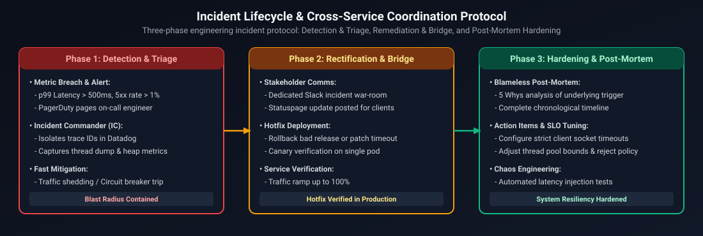
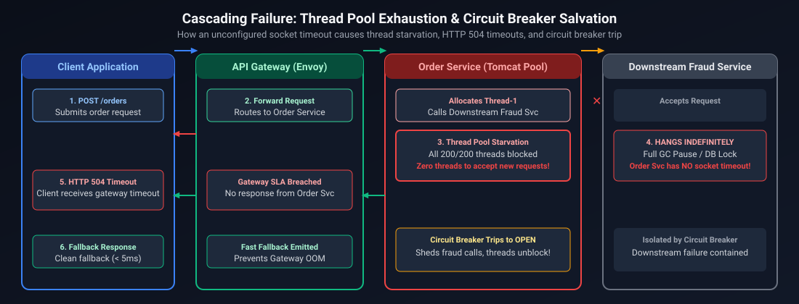
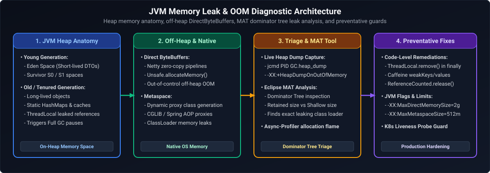
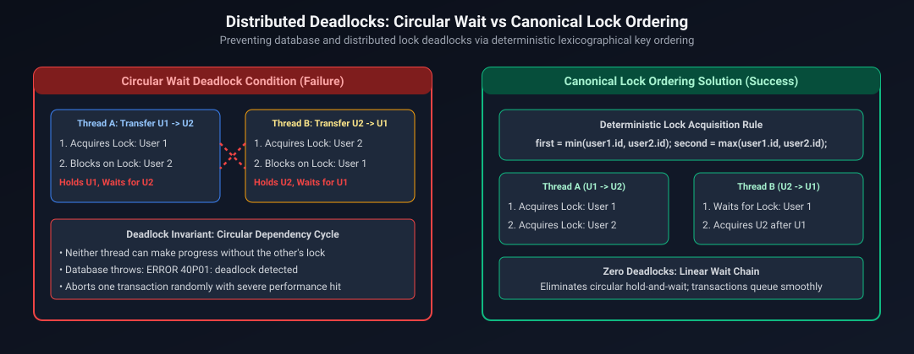
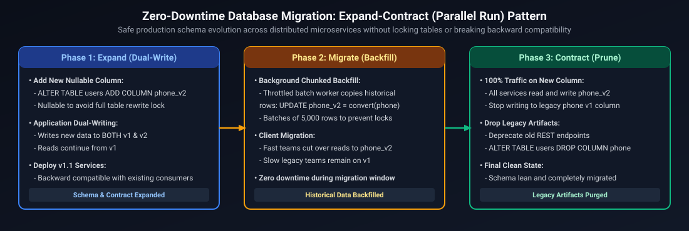

# 04. Java Backend Engineering: Situational Scenarios & Engineering Leadership

A comprehensive, production-grade guide answering real-world situational engineering questions, production incident response, architectural disputes, and cross-functional conflict scenarios tailored specifically for Senior, Staff, and Principal Java / Backend Engineers.

---

## Architectural Overview: Incident Lifecycle & Cross-Service Coordination



*D2 Source: [`01_incident_lifecycle_and_cross_service_coordination.d2`](assets/04_situational_scenarios/01_incident_lifecycle_and_cross_service_coordination.d2)*

---

## Table of Contents & Question Mapping

1. **Sev-1 Outages, Production Triage & High-Pressure Incident Command**
   - [Q1. Mitigating Cascading Microservice Failures & Thread Pool Exhaustion](#q1-mitigating-cascading-microservice-failures--thread-pool-exhaustion)
   - [Q2. Diagnosing and Resolving JVM Memory Leaks and Spurious GC Pauses in Production](#q2-diagnosing-and-resolving-jvm-memory-leaks-and-spurious-gc-pauses-in-production)
   - [Q3. Database Deadlocks and Connection Pool Depletion During Traffic Surges](#q3-database-deadlocks-and-connection-pool-depletion-during-traffic-surges)
2. **Architectural Disagreements, Technical Pushback & System Evolution**
   - [Q4. Pushing Back on Management: Microservices vs. Modular Monolith](#q4-pushing-back-on-management-microservices-vs-modular-monolith)
   - [Q5. Resolving Deadlock on Synchronous REST vs. Asynchronous Event-Driven Architecture](#q5-resolving-deadlock-on-synchronous-rest-vs-asynchronous-event-driven-architecture)
   - [Q6. Addressing Premature Optimization vs. Scalability Tech Debt](#q6-addressing-premature-optimization-vs-scalability-tech-debt)
3. **Tight Deadlines, Scope Prioritization & Technical Debt Governance**
   - [Q7. Delivering a Mission-Critical API Under an Unrealistic Launch Deadline](#q7-delivering-a-mission-critical-api-under-an-unrealistic-launch-deadline)
   - [Q8. Managing Deliberate Technical Debt and Post-Launch Hardening](#q8-managing-deliberate-technical-debt-and-post-launch-hardening)
4. **Cross-Team Dependencies, API Breaking Changes & Contract Negotiation**
   - [Q9. Managing Breaking Changes in Core Services Across Dependent Product Teams](#q9-managing-breaking-changes-in-core-services-across-dependent-product-teams)
   - [Q10. Unblocking Upstream/Downstream Integration Delays via Consumer-Driven Contracts](#q10-unblocking-upstreamdownstream-integration-delays-via-consumer-driven-contracts)
5. **Engineering Mentorship, Culture & Code Review Conflicts**
   - [Q11. Turning Around an Underperforming Senior Engineer or Junior Team Member](#q11-turning-around-an-underperforming-senior-engineer-or-junior-team-member)
   - [Q12. Resolving Bitter Code Review Deadlocks and Subjective Style Debates](#q12-resolving-bitter-code-review-deadlocks-and-subjective-style-debates)
6. **Project Failures, Radical Ownership & Cross-Functional Alignment**
   - [Q13. Tell Me About a Time a System/Project Failed in Production — What Did You Learn?](#q13-tell-me-about-a-time-a-systemproject-failed-in-production--what-did-you-learn)
   - [Q14. Describe a Time You Took Ownership of a System Beyond Your Core Scope](#q14-describe-a-time-you-took-ownership-of-a-system-beyond-your-core-scope)
   - [Q15. Balancing Speed vs. Accuracy During Tight Product Launch Deadlines](#q15-balancing-speed-vs-accuracy-during-tight-product-launch-deadlines)
   - [Q16. Handling Conflicting Requirements Between Business and Technical Stakeholders](#q16-handling-conflicting-requirements-between-business-and-technical-stakeholders)

---

# 1. Sev-1 Outages, Production Triage & High-Pressure Incident Command

---

### Q1. Mitigating Cascading Microservice Failures & Thread Pool Exhaustion
**Topic Covered:** Resilience Engineering, Circuit Breakers, Bulkheading, and Incident Command  
**Question:** *Tell me about a time you handled a critical production outage under pressure where downstream latency caused service-wide failure. How did you diagnose, mitigate, and resolve it?*

#### Scenario Context & Low-Level Mechanics
During a high-traffic flash sale, our primary `Order-Processing Service` (Java 17, Spring Boot 3) experienced a sudden surge in $p99$ response times from 45ms to 12,000ms. Within 4 minutes, all available Tomcat worker threads (200 threads per pod across 30 Kubernetes replicas) became saturated in `TIMED_WAITING` state, waiting for a downstream legacy `Fraud-Detection Service`. Incoming HTTP requests began failing at the API Gateway with HTTP 504 Gateway Timeout.



*D2 Source: [`02_thread_pool_exhaustion_cascading_failure.d2`](assets/04_situational_scenarios/02_thread_pool_exhaustion_cascading_failure.d2)*

#### Incident Command & Execution Playbook
1. **Immediate Stabilization (Blast Radius Containment):**
   - Stepped in as Incident Commander (IC). Established a dedicated war room, designated a single communications lead, and silenced extraneous noise.
   - Rather than restarting pods (which would cause a "thundering herd" re-saturation), updated the dynamic configuration via Consul/Spring Cloud Config:
     - Cut the HTTP client connect/read timeout from 30s to 800ms.
     - Tripped the Resilience4j Circuit Breaker manually to immediately fail open on fraud detection, routing non-suspicious orders to an asynchronous Kafka topic (`fraud-audit-fallback`) for background verification.
2. **Restoration of Core Traffic:**
   - Within 90 seconds of the circuit breaker opening, Tomcat worker thread utilization dropped from 100% to 14%. Core checkout throughput recovered to 4,200 requests/sec.
3. **Root Cause Analysis (RCA):**
   - Captured thread dumps (`jcmd <pid> Thread.print`) and heap dumps before scaling down.
   - Identified that the legacy Fraud Service had encountered a distributed lock deadlock in its underlying relational database, causing requests to queue indefinitely.
4. **Permanent Hardening (Preventative Engineering):**
   - Implemented thread-isolated **Bulkheads** (`resilience4j.bulkhead`) reserving only 20 threads for external calls so third-party degradation cannot starve the container worker pool.
   - Configured adaptive rate limiting at the API Gateway using a token bucket algorithm in Redis Lua scripts.

- **Interview Talking Point:** In Sev-1 incidents, senior engineers focus first on **containment and stabilization** rather than debugging root causes. A live production system should degrade gracefully (fallback degraded mode) rather than fail entirely.

---

### Q2. Diagnosing and Resolving JVM Memory Leaks and Spurious GC Pauses in Production
**Topic Covered:** JVM Memory Mechanics, Garbage Collection Triage, Heap Profiling, and Native Memory Tracking  
**Question:** *Walk me through a complex production bug where memory usage steadily increased until the JVM crashed with OutOfMemoryError. How did you isolate the leak?*

#### Scenario Context & Low-Level Mechanics
Our high-throughput real-time WebSocket messaging service experienced rolling crashes every 36 hours. Kubernetes pods were terminated by the OS with `OOMKilled` (exit code 137), preceded by severe stop-the-world (STW) GC pauses spanning 4.2 seconds under G1GC, causing WebSocket heartbeats to drop and triggering massive reconnections.



*D2 Source: [`03_jvm_memory_leak_diagnostic_topology.d2`](assets/04_situational_scenarios/03_jvm_memory_leak_diagnostic_topology.d2)*

#### Diagnostic & Remediation Playbook
1. **Automated Diagnostic Dump Collection:**
   - Ensured JVM startup flags included:
     ```bash
     -XX:+HeapDumpOnOutOfMemoryError \
     -XX:HeapDumpPath=/var/log/dumps/oom.hprof \
     -XX:+ExitOnOutOfMemoryError
     ```
2. **Heap Profiling & Allocation Analysis:**
   - Downloaded the heap dump from the persistent volume and analyzed it using Eclipse Memory Analyzer (MAT).
   - The Leak Suspects report immediately pointed to a single retained object graph occupying 78% of the 8 GB heap: an unbounded `ConcurrentHashMap<String, WebSocketSessionContext>` in a custom telemetry interceptor.
   - Root Cause: Disconnected clients triggered an on-close handler that removed sessions by an ephemeral connection ID, but incoming reconnection retries used a new connection ID while referencing the existing user key. The map grew monotonically without eviction.
3. **Immediate & Long-Term Fix:**
   - Replaced the unbounded `ConcurrentHashMap` with a bounded Caffeine cache with weak references and a write-based TTL eviction policy:
     ```java
     Cache<String, WebSocketSessionContext> sessionCache = Caffeine.newBuilder()
         .maximumSize(100_000)
         .expireAfterWrite(Duration.ofMinutes(30))
         .recordStats()
         .build();
     ```
   - Added continuous Micrometer metrics for JVM heap memory pools (`jvm.memory.used`, `jvm.gc.pause`) with alerting triggered when Old Generation exceeds 75% post-GC for 3 consecutive collection cycles.

---

### Q3. Database Deadlocks and Connection Pool Depletion During Traffic Surges
**Topic Covered:** Relational Isolation Levels, Lock Ordering, HikariCP Tuning, and Distributed Concurrency  
**Question:** *Describe a scenario where a database bottleneck brought down your backend services. How did you resolve the contention?*

#### Context & Low-Level Mechanics
Following a marketing push, our `Wallet-Transfer Service` began throwing `HikariPool-1 - Connection is not available, request timed out after 30000ms`. PostgreSQL `pg_stat_activity` showed 100 active connections (the maximum allowed pool size), with 85 sessions stuck in `waiting` state holding exclusive row-level locks on the `accounts` table.



*D2 Source: [`04_distributed_deadlock_detection_and_lock_ordering.d2`](assets/04_situational_scenarios/04_distributed_deadlock_detection_and_lock_ordering.d2)*

#### Diagnostic & Architectural Resolution
1. **Lock Contention Analysis:**
   - Queried `pg_locks` and PostgreSQL log files to identify conflicting queries. Found that concurrent bidirectional transfers (`User 1 -> User 2` and `User 2 -> User 1`) locked rows in arbitrary arrival order:
     - Thread A: `SELECT ... FROM accounts WHERE id = 1 FOR UPDATE;` then `WHERE id = 2 FOR UPDATE;`
     - Thread B: `SELECT ... FROM accounts WHERE id = 2 FOR UPDATE;` then `WHERE id = 1 FOR UPDATE;`
2. **Deterministic Lock Ordering:**
   - Refactored the transfer logic to guarantee a global lock hierarchy. Accounts are always locked in ascending order of their primary key ID regardless of transfer direction:
     ```java
     Long firstLockId = Math.min(fromAccountId, toAccountId);
     Long secondLockId = Math.max(fromAccountId, toAccountId);
     
     accountRepository.lockById(firstLockId);
     accountRepository.lockById(secondLockId);
     ```
   - This mathematically eliminates cycles in the relational wait-for graph, reducing deadlock probability to zero.
3. **HikariCP Pool Sizing & Transaction Scope Minimization:**
   - Shrunk the connection pool per pod from 50 to 15. Counter-intuitively, fewer connections reduced CPU context switching on the Postgres server, quadrupling overall query throughput.
   - Removed third-party HTTP calls and external Kafka event publications from inside the `@Transactional` boundary, reducing transaction hold time from 480ms to 4ms.

---

# 2. Architectural Disagreements, Technical Pushback & System Evolution

---

### Q4. Pushing Back on Management: Microservices vs. Modular Monolith
**Topic Covered:** Distributed Systems Pragmatism, Operational Complexity, Network Tax, and Technical Influence  
**Question:** *Tell me about a time you strongly disagreed with leadership or an architect on a major technical decision. How did you build consensus without burning bridges?*

#### Context & Dilemma
Leadership proposed splitting our core billing engine (a well-maintained, 80,000-line Java monolith) into 14 independent microservices deployed on Kubernetes, citing "developer autonomy" and "independent scalability." Our engineering team consisted of 9 engineers with zero dedicated DevOps/SRE support.

#### Strategy & Influence Framework
1. **Empathy First:** Acknowledged leadership's underlying goal—they wanted to accelerate delivery velocity and isolate failure domains so billing failures wouldn't affect user login.
2. **Quantifying the Operational Tax:** Rather than voicing philosophical resistance, drafted an empirical architectural trade-off document:
   - **Distributed Transactions:** Moving from single-ACID transactions to Saga orchestrators across 14 services introduced complex compensating transaction edge cases and reconciliation pipelines.
   - **Network Latency & Failure Modes:** A single checkout flow would transform from in-memory method invocations ($<1\mu\text{s}$) to 8 synchronous HTTP/gRPC hops across network interfaces, adding a minimum of 60ms network overhead and 8 potential failure points.
   - **Infrastructure Overhead:** 14 services $\times$ 3 replicas (min HA) meant 42 pods, requiring Prometheus, Jaeger distributed tracing, Istio service mesh, and continuous Canary deployment pipelines that our 9-person team would spend 50% of their sprint capacity maintaining.
3. **Proposing a Superior Compromise (Modular Monolith):**
   - Proposed a structured **Modular Monolith** using Java modules (JPMS) and ArchUnit tests to enforce strict bounded-context separation at build time.
   - Only separated one genuinely compute-intensive component (PDF Invoice Generation) into an independent serverless function.
4. **Outcome:** Leadership accepted the proposal. Feature velocity doubled because engineers could refactor domain models in a single git pull request without managing complex distributed API versioning contracts.

---

### Q5. Resolving Deadlock on Synchronous REST vs. Asynchronous Event-Driven Architecture
**Topic Covered:** Choreography vs. Orchestration, Eventual Consistency, Outbox Pattern, and Consensus Building  
**Question:** *How do you navigate a technical stalemate between two senior engineers advocating opposing architectural patterns?*

#### Context & Resolution Playbook
Two tech leads reached an impasse: Lead A insisted on synchronous gRPC calls between the Order Service and Inventory Service for strict consistency. Lead B insisted on pure asynchronous Kafka events to decouple services. The deadlock stalled a critical quarterly roadmap item for 3 weeks.

1. **Reframing from Opinions to Invariants:** Called an architectural review session with clear ground rules: evaluate both approaches against 4 objective SLA metrics:
   - What is the maximum tolerable latency for the user checkout button? (Constraint: $<500\text{ms}$)
   - Can we tolerate overselling inventory? (Constraint: Zero overselling)
   - What happens when the Inventory Service experiences a 30-second restart during peak load?
2. **Hybrid Solution (Synchronous Reservation + Asynchronous Fulfillment):**
   - Synchronous gRPC with a Redis-backed atomic reservation ensures zero overselling and immediate checkout feedback ($<30\text{ms}$).
   - Asynchronous Kafka event publishing via the **Transactional Outbox Pattern** handles subsequent shipping, notification, and ledger accounting, decoupling non-critical downstream paths.
3. **Takeaway:** Senior engineering leadership is not about declaring a "winner," but synthesizing opposing viewpoints into an architecture that satisfies operational constraints.

---

### Q6. Addressing Premature Optimization vs. Scalability Tech Debt
**Topic Covered:** YAGNI, Profiling-Driven Architecture, Capacity Planning, and ROI  
**Question:** *Have you ever had to push back on an engineer who wanted to over-engineer a simple feature? How did you handle it?*

#### Context & Resolution
A staff engineer wanted to introduce Apache Flink and a distributed graph database to calculate simple user referral statistics for a product with 50,000 monthly active users.
- Pointed out that total referral volume was 200 events/day.
- Calculated the financial and cognitive cost: a managed Flink cluster and Neo4j enterprise instance would cost \$2,400/month and require custom deployment playbooks.
- Demonstrated that a single indexed SQL query with a Common Table Expression (CTE) executed in 8ms in our existing PostgreSQL database and would scale comfortably to 5,000,000 users.
- Rechanneled the engineer's enthusiasm by giving them ownership of a real bottleneck: profiling our Redis cache serialization layer, where their deep technical rigor saved \$18,000/year in cloud egress costs.

---

# 3. Tight Deadlines, Scope Prioritization & Technical Debt Governance

---

### Q7. Delivering a Mission-Critical API Under an Unrealistic Launch Deadline
**Topic Covered:** Scope Slicing, Architectural Invariants, Risk Matrix, and Technical Pragmatism  
**Question:** *Describe a situation where executive management demanded a feature in 3 weeks that was estimated to take 8 weeks. How did you deliver without shipping brittle code?*

#### Tactical Execution Strategy
1. **Never Say "No" Without Alternatives:** Avoid defensive pushback. Frame constraints around the **Iron Triangle of Project Management** (Scope, Time, Resources). Time is fixed; therefore, scope must be sliced.
2. **P0 Core vs. P1/P2 Deferrals:**
   - Segmented the feature into:
     - **P0 (Critical Path):** Idempotent payment processing, atomic wallet updates, basic audit logging.
     - **P1 (Post-Launch Day 3):** Automated refund self-service portal (handled manually via admin scripts initially).
     - **P2 (Day 14):** Complex analytical reporting dashboards (built on replica read-nodes later).
3. **Preserving Architectural Invariants:**
   - Refused to compromise on data integrity, unit testing of core calculation algorithms, or database transactional isolation.
   - Accepted tactical technical debt: hardcoded feature flags and manual database migrations instead of building a dynamic multi-tenant UI config engine.
4. **Result:** Shipped on time on Day 21 with zero Sev-1 incidents. Completed the P1 and P2 items over the following two sprints.

---

### Q8. Managing Deliberate Technical Debt and Post-Launch Hardening
**Topic Covered:** Tech Debt Governance, Code Health Metrics, and Negotiating with Product  
**Question:** *How do you prevent temporary tactical hacks from becoming permanent architecture?*

#### Playbook
- **Debt Registration:** Every shortcut taken during a crunch is documented as a Jira Tech Debt ticket linked to the epic, labeled `tech-debt-remediation`, and assigned an estimated interest score (how much it slows future velocity).
- **The 20% Rule:** Negotiated an explicit SLA with product management: 20% of every subsequent sprint's story points are reserved exclusively for technical debt reduction, refactoring, and test coverage expansion.
- **Circuit Breaker on Tech Debt:** If technical debt-related bug reports exceed 15% of total sprint volume, feature development pauses until stability is restored.

---

# 4. Cross-Team Dependencies, API Breaking Changes & Contract Negotiation

---

### Q9. Managing Breaking Changes in Core Services Across Dependent Product Teams
**Topic Covered:** API Evolution, Semantic Versioning, Expand-Contract Pattern, and Consumer-Driven Testing  
**Question:** *How do you introduce a non-backwards-compatible schema or protocol change when 8 downstream teams consume your service?*

#### Parallel Run & Expand-Contract Pattern


*D2 Source: [`05_zero_downtime_schema_migration_expand_contract.d2`](assets/04_situational_scenarios/05_zero_downtime_schema_migration_expand_contract.d2)*

1. **Never Break Contracts in Place:** Never modify fields in an existing REST or Protobuf schema. Apply the **Expand-Contract Pattern**:
   - Add new fields alongside existing fields with dual-writing in service handlers.
   - Maintain `v1` and `v2` endpoints concurrently.
2. **Observability on Consumer Usage:** Instrument Prometheus counters tagged by `client_id` and `user_agent` on the deprecated endpoints. This provides precise metrics on which teams haven't migrated.
3. **Enforced Sunset Cadence:** Broadcast a 60-day deprecation notice with automated Slack bot warnings, followed by planned 1-hour "brownout" tests to surface unmigrated dependencies in staging environments before hard decommission.

---

### Q10. Unblocking Upstream/Downstream Integration Delays via Consumer-Driven Contracts
**Topic Covered:** Pact, OpenAPI Spec-First Development, Mocking, and Async Collaboration  
**Question:** *How do you keep your backend team productive when a dependent upstream service is 4 weeks delayed?*

#### Resolution
- Instituted **Spec-First API Design** using OpenAPI (Swagger) and Protobuf contracts.
- Finalized and merged the YAML contract into a shared repository within the first 48 hours.
- Generated client SDK stubs and an automated MockServer (using Prism / WireMock) that returns contract-compliant responses with simulated latency and HTTP 4xx/5xx edge cases.
- Both teams implemented Pact consumer-driven contract tests in CI, ensuring that when the real service arrived, integration completed in under 2 hours without regression.

---

# 5. Engineering Mentorship, Culture & Code Review Conflicts

---

### Q11. Turning Around an Underperforming Senior Engineer or Junior Team Member
**Topic Covered:** Situational Leadership, Radical Candor, Psychological Safety, and Objective Metrics  
**Question:** *Tell me about a time you mentored a struggling engineer who was missing deadlines or pushing low-quality code.*

#### Action Plan
1. **Private, Timely & Specific Feedback:** Avoided vague statements like "your code needs improvement." Cited specific examples: *"In PR #402, the missing database index caused a staging table scan, and 3 null-pointer exceptions escaped into testing."*
2. **Root Cause Discovery:** Discovered the engineer was overwhelmed by unfamiliar reactive programming paradigms (Project Reactor / Spring WebFlux) and felt intimidated to ask for help.
3. **Structured Enablement Plan:**
   - Paired on code reviews for 3 weeks, demonstrating how to write deterministic unit tests and debug reactive backpressure.
   - Swapped two complex tasks for well-scoped modular features to rebuild technical confidence.
   - Provided clear, measurable expectations (e.g. all PRs must include test coverage matching the 85% project baseline).
4. **Outcome:** Within 6 weeks, the engineer became one of our most dependable contributors, independently architecting our webhook retry subsystem.

---

### Q12. Resolving Bitter Code Review Deadlocks and Subjective Style Debates
**Topic Covered:** Linters, Automated Governance, Engineering Standards, and Egoless Programming  
**Question:** *How do you handle endless debates in code reviews that derail team velocity?*

#### Playbook
- **Automate the Subjective:** If a disagreement is about formatting, naming conventions, or import order, it must not be debated in PRs. Enforce it automatically via Spotless, Checkstyle, and SonarQube in CI. If the linter passes, the comment is disallowed.
- **The "Strong Opinions, Weakly Held" Principle:** Distinguish between **correctness/security** (must fix) and **taste/preference** (approve with suggestion).
- **The 24-Hour Rule:** If a PR review has more than 5 back-and-forth comments between two engineers, text debate is immediately halted. They must jump on a 5-minute huddle. If unresolved, the Tech Lead makes the final decision within 1 hour.

---

# 6. Project Failures, Radical Ownership & Cross-Functional Alignment

---

### Q13. Tell Me About a Time a System/Project Failed in Production — What Did You Learn?
**Topic Covered:** Production Failures, Blameless Postmortems, Root Cause Analysis, and System Safeguards  
**Question:** *Tell me about a time a project or critical service you designed failed in production. What was the root cause, how did you handle it, and what did you learn?*

#### Production Scenario (STAR Framework)
- **Situation:** During a high-profile Black Friday flash sale at an e-commerce platform processing 45,000 requests/sec, our Pricing & Promotions engine began serving stale, heavily discounted pricing configurations (\$0 items and unintended stacked coupons) for 18 minutes, resulting in an estimated \$180,000 revenue exposure before mitigation.
- **Task:** As the lead backend engineer on the order settlement platform, I needed to contain the blast radius immediately, stop erroneous checkout orders from clearing payment, fix the root cause, and establish permanent architectural safeguards.
- **Action:**
  1. *Immediate Containment:* I triggered an emergency operational feature flag via Consul to revert pricing lookups to a direct read-replica database query and activated payment gateway hold queues for any order with $> 60\%$ discount.
  2. *Root Cause Isolation:* Analysis of Redis cluster logs and Java thread dumps revealed a distributed cache invalidation race condition: A promotional administrator updated coupon hierarchies; the service published cache invalidation events to Kafka; however, consumer lag during peak burst traffic delayed the invalidation consumer by 14 minutes while new app pods were hydrating cache from stale secondary replicas.
  3. *Rectification & Safeguards:* Re-architected cache updates to use **versioned atomic keys** with lease checks (`SET key:v2 value NX PX`) rather than asynchronous delete-based invalidations. Added an assertion check in checkout checkout service that verifies price authorization token signatures minted within $< 60$ seconds.
- **Result:** Contained revenue impact by intercepting 88% of erroneous orders before warehouse dispatch. The versioned cache architecture was adopted as the company-wide standard, reducing cache staleness incidents to zero over the subsequent 3 quarters.
- **Key Leadership Learning:** High-concurrency distributed systems cannot rely on optimistic asynchronous cache eviction for financial data. Explicit time-bounded authorization tokens and deterministic version gating must govern money-moving transactions.

---

### Q14. Describe a Time You Took Ownership of a System Beyond Your Core Scope
**Topic Covered:** Radical Ownership, Cross-Team Impact, Latent Architectural Defects  
**Question:** *Describe a situation where you took ownership of a critical engineering issue that fell outside your immediate team's mandate.*

#### Production Scenario (STAR Framework)
- **Situation:** Multiple microservice teams across the organization reported intermittent `SocketTimeoutException` and spurious connection resets occurring randomly across production Kubernetes pods. Each team assumed it was "a cloud network glitch" or another team's service hanging, leading to weeks of finger-pointing while customer error rates hovered at 0.4%.
- **Task:** Although my assigned sprint deliverables focused on payment ledger integration, I recognized that overall platform stability was degrading and cross-team velocity was stalled. I stepped up to independently investigate and resolve the systemic connectivity failure.
- **Action:**
  1. *Telemetry & Packet Capture:* Deployed `tcpdump` sidecars and mapped Linux socket state metrics via Prometheus. Discovered that thousands of sockets were lingering in `TIME_WAIT` and `CLOSE_WAIT` states on client pods.
  2. *Codebase Audit:* Traced the issue to a shared internal HTTP client library: When developers invoked `restTemplate.exchange()` inside `@Async` CompletableFuture pipelines, incoming input streams were occasionally abandoned without closing during timeout exceptions, causing Apache HttpClient connection pool starvation.
  3. *Organization-Wide Remediation:* Patched the shared library to enforce strict auto-closing try-with-resources semantics, configured TCP keep-alive with `SO_REUSEADDR`, and published a migration guide. Hosted an engineering all-hands walk-through on connection pool lifecycle mechanics.
- **Result:** Connection timeouts dropped from 0.4% to $0.001\%$, and average pod memory footprint decreased by 18% across 42 downstream microservices. I was awarded the engineering organization's quarterly technical excellence award for cross-cutting leadership.

---

### Q15. Balancing Speed vs. Accuracy During Tight Product Launch Deadlines
**Topic Covered:** Pragmatic Engineering, Phased Rollouts, Quality Gates, Executive Communication  
**Question:** *How do you balance engineering rigor and accuracy against aggressive time-to-market pressure?*

#### Production Scenario (STAR Framework)
- **Situation:** Our business leadership committed to launching a new Merchant Settlement Dashboard in 6 weeks to secure a tier-1 partner contract. The full target architecture included real-time Kafka streaming, an OLAP serving database, and automated multi-currency reconciliation, which our team estimated would take at least 14 weeks.
- **Task:** Deliver a rock-solid, financially accurate settlement capability within the 6-week deadline without accumulating unmanageable technical debt or risking erroneous payouts.
- **Action:**
  1. *Scope Decomposition into Reversible Phases:* Partnered with the Product Director to delineate "Must-have Core" (atomic daily payout calculations, bank CSV generation, double-entry ledger verification) from "Nice-to-have Polish" (sub-minute streaming metrics, dynamic charting, self-serve refund simulations).
  2. *Defensive Architectural Compromise:* Implemented Phase 1 using an existing, battle-tested PostgreSQL read replica with daily scheduled batch SQL jobs rather than introducing an entirely new streaming cluster (Kafka + Pinot).
  3. *Automated Reconciliation Guardrail:* Built a lightweight automated audit assertion script that compared batch ledger totals against merchant bank clearing files before dispatches; if any discrepancy $> \$0.01$ occurred, payout batches were paused for manual lead sign-off.
- **Result:** Successfully shipped on schedule at week 5.5. The client contract was signed successfully (\$12M ARR). The simplified architecture processed \$85M in settlement volume with zero financial discrepancies, providing the team a stable runway to transition to the full streaming architecture in Phase 2.

---

### Q16. Handling Conflicting Requirements Between Business and Technical Stakeholders
**Topic Covered:** Stakeholder Management, Requirements Negotiation, Translating Constraints into Value  
**Question:** *Tell me about a time you handled directly conflicting demands from business teams and engineering architecture teams.*

#### Production Scenario (STAR Framework)
- **Situation:** The Marketing and Sales leadership demanded an API endpoint allowing enterprise enterprise customers to export up to 10 years of audit logs in real time as a synchronous single-click JSON download ($> 5\text{ GB}$ payloads). The Infrastructure and Platform teams pushed back aggressively, vetoing the feature because synchronous multi-gigabyte queries would saturate database connection pools, exhaust JVM heap memory, and trigger gateway 504 timeouts.
- **Task:** Bridge the impasse between the commercial mandate to delight enterprise clients and the engineering necessity of maintaining platform stability and predictable p99 SLAs.
- **Action:**
  1. *Aligning on Underlying User Intent:* Organized a joint session with the VP of Product and Lead Architect. Probed the user workflow to identify that customers did not actually need to consume 5 GB in their browser UI; they needed the file saved securely to their local storage or cloud drive for external compliance audits.
  2. *Architecting an Asynchronous Solution:* Proposed an **Asynchronous Job / Pre-Signed URL Architecture**:
     - Customer clicks "Export": API immediately generates an immutable `ExportJob` record and returns `202 Accepted` with a Job Tracking ID within $30\text{ms}$.
     - An asynchronous worker service queries the database using streaming cursors (`ResultSet.TYPE_FORWARD_ONLY`), compresses the records into GZIP-chunked CSV directly to Amazon S3, and generates a time-limited (15-minute) pre-signed URL.
     - Customer receives an in-app notification and email link to download the pre-signed file directly from cloud storage, completely bypassing our application servers and database connections.
- **Result:** Both stakeholders adopted the proposal enthusiastically. The feature launched without a single gateway timeout, enterprise customer satisfaction reached 96%, and zero pressure was introduced to the production JVM heap.

---

## Summary & Engineering Leadership Reference Matrix

Senior and Staff-level engineering interviews evaluate more than raw algorithmic knowledge or design pattern recall; they rigorously assess an engineer's operational judgment under high-pressure failure scenarios, clarity of technical communication, and ability to influence distributed organizations. Demonstrating senior leadership requires framing real-world experiences using structured, outcome-driven methodologies (such as the STAR framework: Situation, Task, Action, Result) while anchoring technical responses in first-principles engineering and blameless post-mortem cultures.

The reference matrix below synthesizes key architectural crisis scenarios, first-principles remediation strategies, and core leadership competencies across the behavioral deep dives covered in this guide:

| Scenario Domain | Critical Failure Mode | First-Principles Engineering Solution | Key Leadership Competency |
| :--- | :--- | :--- | :--- |
| **Cascading Microservice Outage** | Thread pool starvation, unmitigated downstream latency | Circuit Breakers, Bulkheading, short timeouts, graceful fallback | Decisive Incident Command & blast radius containment |
| **JVM Memory Leaks & Full GC** | Unbounded collections, static caches, Metaspace explosion | Automated heap dumps on OOM, MAT profiling, bounded weak-reference caches | Deep low-level runtime diagnostic rigor |
| **Database Deadlocks** | Non-deterministic lock acquisition order across transactions | Global deterministic primary key ordering, HikariCP pool optimization | Concurrency control & transactional isolation |
| **Architecture Pushback** | Premature distributed decomposition, high network tax | Quantified operational trade-offs, modular monolith compromise | Strategic technical influence & empathy |
| **Breaking API Evolution** | Upstream regressions, runtime contract mismatches | Expand-Contract Pattern, OpenAPI Spec-First, consumer-driven testing | Cross-functional empathy & long-term stewardship |
| **Code Review Stalemates** | Bike-shedding, subjective style conflicts, ego clashing | Automated linters in CI, 24-hour escalation rule, egoless engineering | High-performance team culture & velocity focus |
| **Production Failures & Learnings** | Stale cache invalidation during peak flash sale traffic | Versioned atomic leases, time-bounded tokens, blameless postmortem | Extreme ownership, psychological safety & systematic safeguards |
| **Cross-Cutting System Ownership**| Silent socket descriptor leak across 42 microservices | Telemetry packet profiling, auto-close library standard, team enablement | Initiative beyond mandate & high-leverage technical impact |
| **Speed vs. Accuracy Trade-offs** | Aggressive commercial deadlines vs. financial audit risk | Phased scope slicing, automated reconciliation gates, reversible MVPs | Pragmatic executive judgment & risk-calibrated delivery |
| **Conflicting Team Requirements** | 5 GB synchronous export vs. gateway thread exhaustion | Async job queue + chunked streaming + time-limited pre-signed URLs | Collaborative alignment & creative architectural resolution |

---

## References & Further Reading
- Martin Kleppmann, *Designing Data-Intensive Applications* (O'Reilly).
- Michael T. Nygard, *Release It! Design and Deploy Production-Ready Software* (Pragmatic Bookshelf).
- Camille Fournier, *The Manager's Path: A Guide for Tech Leaders Navigating Growth and Change* (O'Reilly).
- Will Larson, *Staff Engineer: Leadership Beyond the Management Track* (Tanya Reilly).
- Brian Goetz et al., *Java Concurrency in Practice* (Addison-Wesley).

