# Interview Preparation & Engineering Knowledge Base

A comprehensive, production-grade collection of curriculum study guides, architectural deep dives, distributed systems foundations, and real-world interview preparation organized into **two specialized, production-ready engineering tracks**:

1. **[Data and AI Engineering](Data%20and%20AI%20Engineering/00_data_and_ai_study_guide_and_index.md)**
2. **[Java Backend Engineering](Java%20Backend%20Engineering/00_java_study_guide_and_index.md)**

---

## Architectural Map & Structural Overview

```mermaid
flowchart TD
    subgraph Track1 ["🚀 Track 1: Data and AI Engineering"]
        direction TB
        DE_Idx["📄 00_data_and_ai_study_guide_and_index.md"]
        DE_Core["Tier 1-4: Relational SQL, Python Systems, Storage Engines,<br/>Distributed Spark, Delta Lake, Kafka & Data Quality (Modules 01-09)"]
        DE_AI["Tier 5: AI Data Engineering, Document Chunking,<br/>Embeddings, Vector DBs, Hybrid RAG & vLLM Serving (Modules 10-12)"]
        DE_Py["Tier 6-7: Python Backend (FastAPI, AsyncIO, SQLAlchemy 2.0)<br/>& Cloud Platform DevOps (Modules 13-15)"]
        DE_Spec["Tier 8: Advanced ML & Transformer Foundations,<br/>Autonomous Agents & Model Adaptation (Modules 16-17)"]
        
        subgraph DE_Pillars ["Role-Tailored Pillars"]
            direction LR
            DE_SDB["📁 system_design_and_situational/<br/>(Foundations + 14 HLDs + 8 LLDs + 41 Leadership Scenarios)"]
            DE_FAQ["📁 frequently_asked_questions/<br/>(17 Scenario Companion Guides)"]
        end
        
        DE_Idx --- DE_Core --> DE_AI --> DE_Py --> DE_Spec
        DE_Idx --- DE_Pillars
    end

    subgraph Centralized_DSA ["🧠 Universal Algorithmic Foundations"]
        Java_DSA["📁 Java Backend: data_structures_and_algorithms/<br/>(Centralized DSA Master Track: 8 Progressive In-Depth Modules in Java)"]
    end

    subgraph Track2 ["☕ Track 2: Java Backend Engineering"]
        direction TB
        Java_Idx["📄 00_java_study_guide_and_index.md"]
        Java_Core["Tier 1-2: Core Java & OOP, Collections, Generics,<br/>Modern Java (8-21), Streams & Concurrency (Modules 01-04)"]
        Java_Enterprise["Tier 3-4: Spring Boot, REST APIs, Security, OAuth2,<br/>JPA/Hibernate, Redis & Kafka Messaging (Modules 05-08)"]
        Java_Arch["Tier 5: Microservices, GoF Patterns, Distributed Design<br/>& Transactional Outbox (Module 09)"]
        Java_Ops["Tier 6: Testing (JUnit 5, Testcontainers), Cloud Native K8s,<br/>JVM Internals, GC Tuning & SRE Observability (Modules 10-13)"]
        
        subgraph Java_Pillars ["Role-Tailored Pillars"]
            direction LR
            Java_SDB["📁 system_design_and_situational/<br/>(Foundations + 24 HLDs + 11 LLDs + 16 Leadership Scenarios)"]
            Java_FAQ["📁 frequently_asked_questions/<br/>(13 Scenario Companion Guides)"]
        end
        
        Java_Idx --- Java_Core --> Java_Enterprise --> Java_Arch --> Java_Ops
        Java_Idx --- Java_Pillars
    end

    Track1 -.->|"Centralized DSA Reference"| Centralized_DSA
    Centralized_DSA --- Track2

    style Track1 fill:#0f172a,stroke:#3b82f6,stroke-width:2px,color:#93c5fd
    style Track2 fill:#0f172a,stroke:#10b981,stroke-width:2px,color:#a7f3d0
    style Centralized_DSA fill:#0f172a,stroke:#f59e0b,stroke-width:2px,color:#fde68a
    style DE_Idx fill:#1e293b,stroke:#3b82f6,stroke-width:2px,color:#fff
    style Java_Idx fill:#1e293b,stroke:#10b981,stroke-width:2px,color:#fff
    style Java_DSA fill:#1e293b,stroke:#f59e0b,stroke-width:2px,color:#fff
    style DE_Pillars fill:#1e293b,stroke:#3b82f6,stroke-width:1.5px,color:#c084fc
    style Java_Pillars fill:#1e293b,stroke:#10b981,stroke-width:1.5px,color:#6ee7b7
```

---

## 1. [Track 1: Data and AI Engineering](Data%20and%20AI%20Engineering/00_data_and_ai_study_guide_and_index.md)

Designed to prepare engineers to build, scale, and govern enterprise data platforms that power AI applications, without losing the primary focus on core Data Engineering fundamentals.

- **Master Study Guide & Syllabus**: [`00_data_and_ai_study_guide_and_index.md`](Data%20and%20AI%20Engineering/00_data_and_ai_study_guide_and_index.md)
- **Core Curriculum Modules (17 Progressive Chapters)**:
  - **Relational & Storage Foundations**:
    - [`01. SQL Fundamentals & Advanced Querying`](Data%20and%20AI%20Engineering/01_sql_and_advanced_querying.md) — Query processing order, window functions, recursive CTEs, distributed joins, and skew salting.
    - [`02. Python for Data & Systems`](Data%20and%20AI%20Engineering/02_python_for_data_and_systems.md) — Memory layout, GIL mechanics, generator streaming for 10GB+ files, Pydantic, Polars, and DuckDB.
    - [`03. Data Modeling & Lakehouse Storage`](Data%20and%20AI%20Engineering/03_data_modeling_and_lakehouse_storage.md) — Kimball dimensional modeling (Star/Snowflake), SCD Types 0–6, Parquet/Avro internals, and compaction.
    - [`04. Database Internals & Distributed Systems`](Data%20and%20AI%20Engineering/04_database_internals_and_distributed_systems.md) — B+ Trees vs LSM Trees, WAL, buffer pools, CAP/PACELC, and Raft consensus.
  - **Distributed Lakehouses & Streaming Backplanes**:
    - [`05. Apache Spark & PySpark`](Data%20and%20AI%20Engineering/05_apache_spark_and_pyspark.md) — Catalyst optimizer, Project Tungsten, join strategies, skew handling, AQE, and OOM triage.
    - [`06. Databricks & Delta Lake`](Data%20and%20AI%20Engineering/06_databricks_and_delta_lake.md) — Delta transaction log, ACID, OPTIMIZE/Z-ORDER, Liquid Clustering, and VACUUM.
    - [`07. Streaming, Kafka & Auto Loader`](Data%20and%20AI%20Engineering/07_streaming_kafka_and_event_driven_data.md) — Commit logs, consumer groups, Auto Loader, watermarking, and exactly-once delivery.
    - [`08. ETL Pipelines & Data Quality`](Data%20and%20AI%20Engineering/08_etl_pipelines_orchestration_and_data_quality.md) — Airflow DAGs, dbt models, idempotent pipelines, DLQs, and Great Expectations assertions.
    - [`09. Unity Catalog & Governance`](Data%20and%20AI%20Engineering/09_unity_catalog_and_data_governance.md) — 3-level namespace, RBAC/ABAC, Row/Column security, data masking, and lineage.
  - **AI Data Engineering & Retrieval Infrastructure**:
    - [`10. Document Processing & AI Data Prep`](Data%20and%20AI%20Engineering/10_document_processing_and_data_preparation_for_ai.md) — Unstructured document parsing (PDF, tables, OCR), chunking strategies, token budgeting, and MinHash LSH deduplication.
    - [`11. Embeddings, Vector DBs & RAG`](Data%20and%20AI%20Engineering/11_embeddings_vector_databases_and_rag_pipelines.md) — Dense/sparse embeddings, HNSW graph indexing, IVF-PQ quantization, hybrid search (BM25 + Dense + RRF), and cross-encoder rerankers.
    - [`12. AI Infrastructure, Serving & LLMOps`](Data%20and%20AI%20Engineering/12_ai_infrastructure_serving_and_llmops.md) — GPU memory allocation, vLLM continuous batching, PagedAttention, model gateways (LiteLLM), semantic caching (GPTCache), and rate limiting.
  - **Python Backend for AI & Data Services**:
    - [`13. Python Backend & FastAPI`](Data%20and%20AI%20Engineering/13_python_backend_and_api_development.md) — AsyncIO event loop, FastAPI ASGI architecture, Pydantic v2, SSE token streaming, and WebSockets.
    - [`14. Persistence, Caching & Integration`](Data%20and%20AI%20Engineering/14_persistence_caching_and_service_architecture.md) — SQLAlchemy 2.0 AsyncSession, connection pool sizing, Redis distributed caching, Redlock distributed locking, and Celery task workers.
  - **Cloud DevOps & Specialized AI**:
    - [`15. Cloud Infrastructure & Observability`](Data%20and%20AI%20Engineering/15_cloud_infrastructure_containers_and_observability.md) — Docker containerization, Kubernetes for Data/AI workloads (Spark on K8s, Ray, vLLM), OpenTelemetry, and Prometheus.
    - [`16. ML & Transformer Foundations`](Data%20and%20AI%20Engineering/16_machine_learning_and_transformer_foundations.md) — Loss surfaces, backprop, autograd, multi-head attention, KV cache footprint, and MoE architectures.
    - [`17. Autonomous Agents & Adaptation`](Data%20and%20AI%20Engineering/17_autonomous_agents_and_model_adaptation.md) — ReAct loops, LangGraph state machine harnesses, multi-agent consensus, LoRA/QLoRA fine-tuning, and DPO.
- **Consolidated System Design & Situational Pillar**:
  - **[`system_design_and_situational/`](Data%20and%20AI%20Engineering/system_design_and_situational/00_system_design_and_situational_index.md)**:
    - `01_system_design_foundations.md`: Storage/compute disaggregation, Parquet/ORC columnar layouts, Delta/Iceberg ACID logs, Spark shuffle mechanics, RocksDB streaming state stores, and HNSW/IVF-PQ vector search math.
    - `02_high_level_system_design.md`: 14 high-level architectures (Multi-Hop Medallion Lakehouse, Debezium CDC at scale, ClickHouse/Pinot sub-second OLAP, 100M GPS pings telemetry, Trade Surveillance CEP, Regulatory Snapshot Time-Travel, Payment Event Streaming, Enterprise Payments Data Warehouse, Enterprise RAG, Feature Store, Model Drift Retraining, and Multi-Tenant LLM isolation).
    - `03_low_level_system_design.md`: 8 machine coding components (Ring Buffer with backpressure, Sliding Window Deduplication, Custom Shuffle Partitioner, Columnar Row-Group Reader, Schema Evolution Validator, Batch Sink with DLQ, Vector Index, and AI Agent Safe Tool Execution Gatekeeper).
    - `04_situational_scenarios.md`: 41 situational scenarios (Sev-1 pipeline outages, data skew OOM triage, 11 PM board reporting discrepancies, Spark ETL optimization from 6.7h to 48m, hallucination triage from stale chunks, and multi-million dollar GPU cost governance).
- **Interview FAQs**:
  - **[`frequently_asked_questions/`](Data%20and%20AI%20Engineering/frequently_asked_questions/00_data_and_ai_faq_index.md)**: 17 dedicated scenario companion guides.

---

## 2. [Track 2: Java Backend Engineering](Java%20Backend%20Engineering/00_java_study_guide_and_index.md)

Focused on building, maintaining, scaling, operating, and troubleshooting production-grade Java enterprise backend systems on modern cloud platforms.

- **Master Study Guide & Syllabus**: [`00_java_study_guide_and_index.md`](Java%20Backend%20Engineering/00_java_study_guide_and_index.md)
- **Core Curriculum Modules (13 Progressive Chapters)**:
  - **Core Java, OOP & Language Mechanics**:
    - [`01. Core Java & OOP`](Java%20Backend%20Engineering/01_core_java_and_oop.md) — 64-bit JVM object headers, dynamic dispatch via `vtable`, inheritance vs composition, keyword semantics, and the `Object` contract.
    - [`02. Collections Framework & Generics`](Java%20Backend%20Engineering/02_java_collections_and_generics.md) — `ArrayList` vs `LinkedList`, `HashMap` capacity, bitwise hashing and Red-Black treeification, `ConcurrentHashMap` CAS, and PECS wildcards.
    - [`03. Modern Java, Records & Streams`](Java%20Backend%20Engineering/03_modern_java_streams_and_records.md) — Functional interfaces, `Optional`, Stream pipeline lazy evaluation and `Sink` loop fusion, Java 16 Records, Java 17 Sealed hierarchies, and Java 21 Pattern Matching.
    - [`04. Concurrency & Multithreading`](Java%20Backend%20Engineering/04_java_concurrency_and_multithreading.md) — JMM happens-before rules, `volatile` memory barriers, `AtomicInteger` CAS, `ThreadPoolExecutor`, `CompletableFuture`, and Java 21 Virtual Threads (Project Loom).
  - **Enterprise Frameworks, Persistence & Messaging**:
    - [`05. Spring Boot & REST APIs`](Java%20Backend%20Engineering/05_spring_boot_and_rest_apis.md) — IoC container, Bean lifecycle, auto-configuration engine, Actuator, `DispatcherServlet` pipeline, and RFC 7807 `ProblemDetail`.
    - [`06. Security & Cryptography`](Java%20Backend%20Engineering/06_security_and_cryptography.md) — `SecurityFilterChain`, `AuthenticationManager`, BCrypt, `@PreAuthorize` SpEL, CSRF tokens, stateless JWT RS256, and OAuth2 with PKCE.
    - [`07. Databases, JPA & Hibernate`](Java%20Backend%20Engineering/07_databases_jpa_and_hibernate.md) — Relational storage, ACID, isolation levels, Spring Data JPA, entity lifecycle states, N+1 query problem, and transaction propagation.
    - [`08. Caching, Redis & Messaging`](Java%20Backend%20Engineering/08_caching_redis_and_kafka.md) — Cache-aside pattern, Redis data structures/clustering, Kafka commit logs, partitions, consumer groups, and Dead Letter Queues.
  - **Architecture, Quality & Operations**:
    - [`09. Microservices & System Design`](Java%20Backend%20Engineering/09_microservices_and_system_design.md) — GoF design patterns, SOLID, Clean/Hexagonal Architecture, Service discovery, Circuit Breakers, Saga Orchestration, Transactional Outbox, and CQRS.
    - [`10. Testing & Quality Engineering`](Java%20Backend%20Engineering/10_testing_and_quality_engineering.md) — Testing Pyramid, JUnit 5 lifecycle, Mockito verification, Spring Boot test slices (`@WebMvcTest`, `@DataJpaTest`), Testcontainers with PostgreSQL/Kafka, and Pact contract testing.
    - [`11. Cloud Native, Containers & DevOps`](Java%20Backend%20Engineering/11_cloud_native_containers_and_devops.md) — Distroless multi-stage Docker builds, Kubernetes Pod architecture, probes, HPA autoscaling, GitHub Actions CI/CD workflows, ArgoCD GitOps, and Terraform Azure platform.
    - [`12. JVM Internals & Troubleshooting`](Java%20Backend%20Engineering/12_jvm_internals_performance_and_troubleshooting.md) — JVM Heap generation zones, Metaspace, GC algorithms (G1, ZGC, Shenandoah), Java NIO channels/selectors, Project Panama, `jstack` thread dump triage, and MAT heap leak analysis.
    - [`13. Linux Networking & Reliability`](Java%20Backend%20Engineering/13_linux_networking_and_distributed_reliability.md) — Structured logging with Logback & MDC, Prometheus metrics, Grafana alerting rules, OpenTelemetry distributed tracing, async-profiler flamegraphs, and production failure playbooks.
- **Centralized Data Structures & Algorithms (DSA) Track**:
  - **[`data_structures_and_algorithms/`](Java%20Backend%20Engineering/data_structures_and_algorithms/00_dsa_study_guide_and_index.md)**: 8 progressive in-depth modules covering Two Pointers, Sliding Window, Monotonic Deques, Binary Trees/BSTs/Tries, Binary Search on Answer, Heaps & Sweep-Line Intervals, Graphs & Shortest Paths, Dynamic Programming, and Backtracking & Bit Manipulation with production Java implementations, formal complexity proofs, and edge cases.
- **Consolidated System Design & Situational Pillar**:
  - **[`system_design_and_situational/`](Java%20Backend%20Engineering/system_design_and_situational/00_system_design_and_situational_index.md)**:
    - `01_system_design_foundations.md`: Scalability primitives, L4 vs L7 load balancing, Consistent Hashing with V-Nodes, CAP & PACELC theorems, Raft consensus, 2PC, B+ vs LSM Trees, database sharding, caching topologies, cache stampede defenses, gRPC vs REST, circuit breakers, and rate limiters.
    - `02_high_level_system_design.md`: 24 high-level architectures (URL Shortener, Active-Active Redirects, API Rate Limiter, CDN, Snowflake ID, WhatsApp/Slack Chat, Notifications, Video Streaming, Stripe Payments, Flash Sale, Uber Ride-Hailing, Uber Eats, Redis Cache, Dropbox, Autocomplete, Google Docs, Job Scheduler, Temporal Workflow, Social Feed, Graph Search, UK Faster Payments 24/7 Settlement, Real-Time Card Fraud Detection <100ms, Open Banking API Platform, and Mainframe to Microservices Zero-Downtime Migration).
    - `03_low_level_system_design.md`: 11 concurrency & machine coding systems (Bounded Queue, ThreadPool, Concurrent Sorted List, Segmented File Manager, DAG Job Scheduler, Platform Scheduler, In-Memory Twitter, In-Memory Message Queue, In-Memory Filesystem, Rule Engine AST, and Spotify LLD).
    - `04_situational_scenarios.md`: 16 production situational scenarios (Cascading outages, JVM memory leaks, HikariCP deadlocks, Pushing back on management, REST vs Event-driven trade-offs, Delivering under tight deadlines, Managing breaking API changes, Turning around underperforming engineers, Project failure postmortems, Cross-cutting system ownership, Speed vs accuracy, and Conflicting business vs technical requirements).
- **Interview FAQs**:
  - **[`frequently_asked_questions/`](Java%20Backend%20Engineering/frequently_asked_questions/00_java_faq_study_guide_and_index.md)**: 13 dedicated scenario companion guides.
